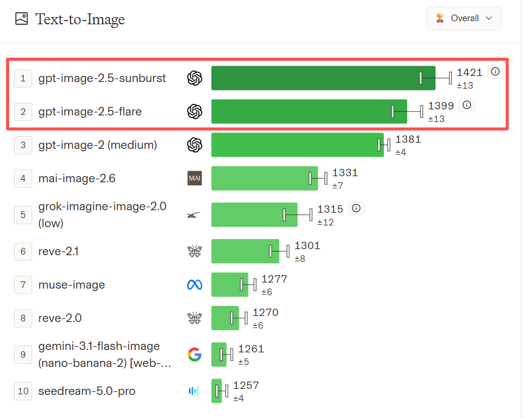
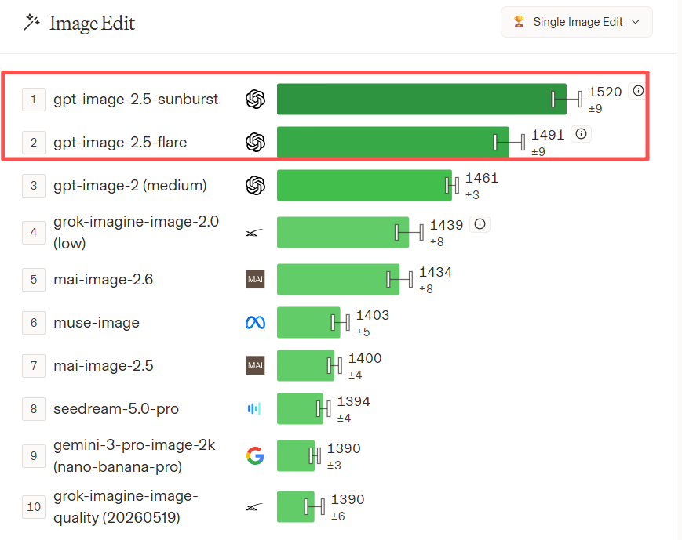

---

id: 2884278

title: ":fire:【图像视频百科7】关于GPT Image 2.5，你想知道的一切"

created_at: 2026-09-10T06:35:17.150Z

username: dwqxq1

display_username: "dwqxq1"

---

# :fire:【图像视频百科7】关于GPT Image 2.5，你想知道的一切

### 官方资料

GPT Image 2.5 Sunburst质量版

GPT Image 2.5 Flare速度版

价格都是输入$8，输出$30/1mt

上下文400k

### Arena评分

来源:[Arena Leaderboard | Compare & Benchmark the Best Frontier AI Models](https://arena.ai/leaderboard/)

---

## API渠道

### 官网/AzureAPI

### OpenRouter API

Sunburst：[GPT Image 2.5 Sunburst - API Pricing & Providers | OpenRouter](https://openrouter.ai/openai/gpt-image-2.5-sunburst)

Flare：[GPT Image 2.5 Flare - API Pricing & Providers | OpenRouter](https://openrouter.ai/openai/gpt-image-2.5-flare)

---

*来源: https://linux.do/t/topic/2884278.json*

