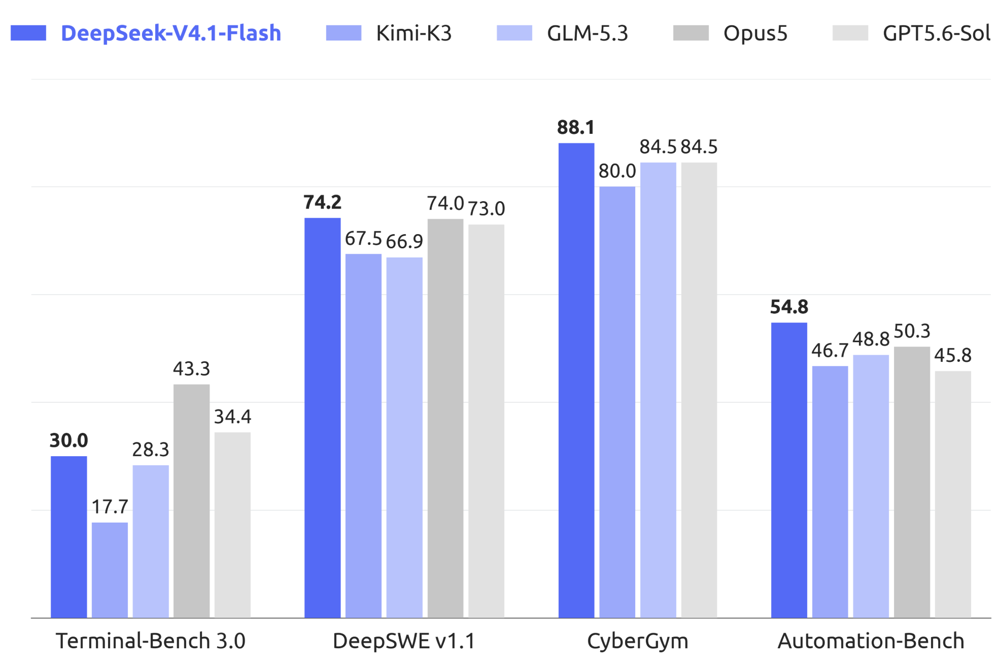
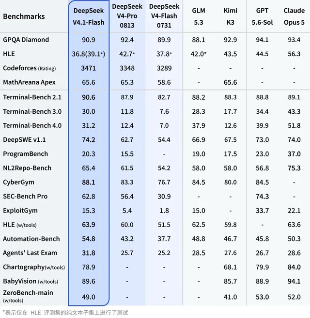
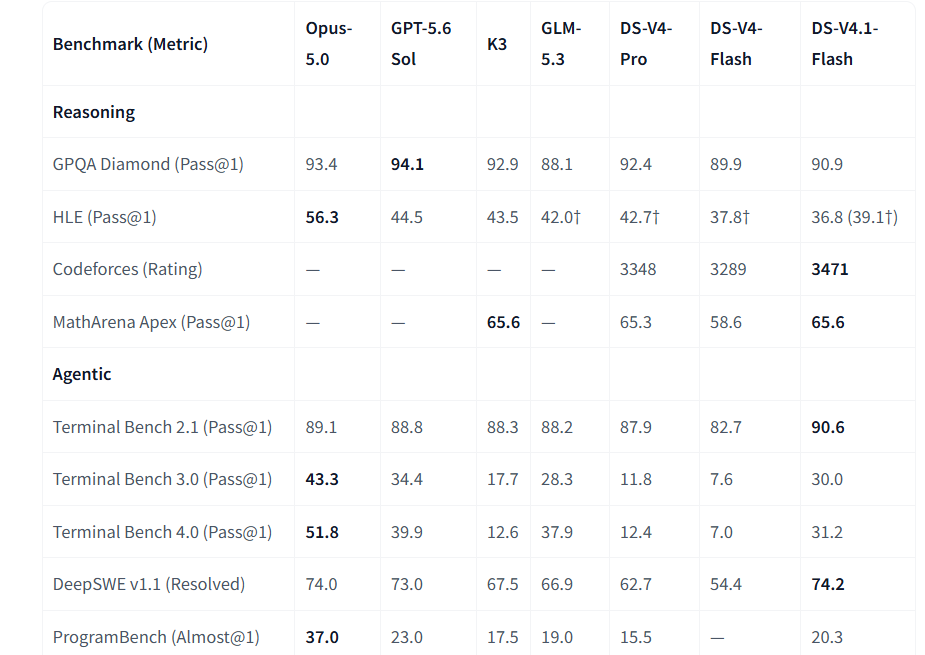
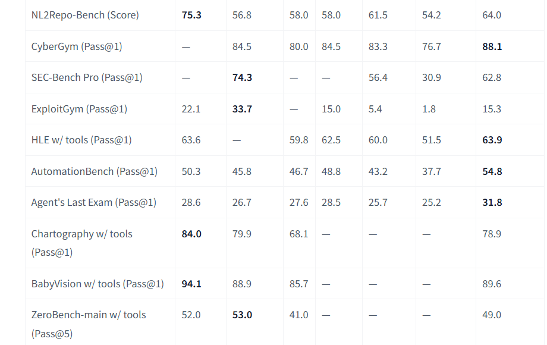

---

id: 2884440

title: ":fire:【大模型百科52】关于Deepseek v4.1 flash，你想知道的一切"

created_at: 2026-09-10T07:05:11.307Z

username: dwqxq1

display_username: "dwqxq1"

---

# :fire:【大模型百科52】关于Deepseek v4.1 flash，你想知道的一切

### 官方资料

模型卡：[deepseek-ai/DeepSeek-V4.1-Flash · Hugging Face](https://huggingface.co/deepseek-ai/DeepSeek-V4.1-Flash)

价格：输入$0.15，输出$0.60

上下文:1m

参数:500B,v4flash是280B

速度:300tps

### 官方自评

---

---

---

### ArtifacialAnalysis评分

### Arena评分

## API渠道

### 官网API

### OpenRouter API

来源:[DeepSeek V4.1 Flash - API Pricing & Benchmarks | OpenRouter](https://openrouter.ai/deepseek/deepseek-v4.1-flash)

### 权重下载

来源：[deepseek-ai/DeepSeek-V4.1-Flash at main](https://huggingface.co/deepseek-ai/DeepSeek-V4.1-Flash/tree/main)

---

*来源: https://linux.do/t/topic/2884440.json*

