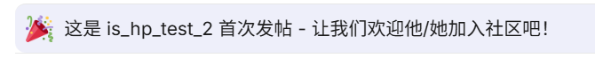

---

id: 2922369

title: "关于discourse（L站基于此）的举报系统，你所想知道的……大部分内容？"

created_at: 2026-09-19T06:50:49.339Z

username: is_hp

display_username: "散装江苏"

---

# 关于discourse（L站基于此）的举报系统，你所想知道的……大部分内容？

## 前言

我们知道，LINUX DO（以下简称“L站”）是一个基于discourse框架的社区。众所周知，discourse的特色之一就是其举报系统

但是有很多新佬友没读[《社区准则》](https://linux.do/guidelines)或者单纯是不了解，由此就有了很多 [运营反馈](/c/feedback/2) 帖子，抱怨自己被举报了，以及对于这个制度的不理解。甚至很多佬友都不知道这个举报系统是如何运作的，那么我今天就在自己的discourse free plan上做了点测试，给各位佬友们看一看，管理员、被举报者、举报者的视角是怎么样的

## 1. 视角说明

`is_hp`是管理员（具有审核权限）

`is_hp_test_user_test`是举报者

`is_hp_test_2`是被举报者

## 2. 那就开始测试吧

### 2.1. 从注册就开始的审核

首先，被举报者创建了一个账户。由于站点的设置，他必须通过邀请链接注册，注册完毕后还必须接受审核

### 2.2. 风控系统

这也是很多新佬友最迷惑的地方，不是哥们我入个站怎么这么快就把我号给ban了

实则不然，是风控系统发力了：

### 2.3. 默认原因举报（选择已有选项且无需填写原因，如`偏离话题`等）

首先，你在九九八十难（指注册、风控和解封）之后选择再发一个topic。

很不幸啊，你的topic属于垃圾信息/偏离话题（已有选项且无需填写原因）等，被举报了

那么很好，现在是管理员视角（为什么写的是非法，纯属是因为我写文章的时候思路有点乱，但是选项一致）：

这个时候，如果你以任何方式处理这个举报，那么**被举报人不会收到私信**（因为没有填写原因，4里面会解释）

但是这个时候被举报人会收到：

### 2.4. 填写原因举报（非法/其他原因）

是的，你还是不死心啊，非得看看怎么才能发点违规的东西

这个时候的举报菜单：

不同之处在这里：

同意类（以同意并删除为例）：

不同意类（以不同意并删除为例）：

## 3. 其余信息说明

---

对于审核界面的`洞察`这一栏：

---

要说明的是，对于管理员的举报菜单：

---

---

这个通知是固定在可见的帖子内的，也就是说假如前面全被举报光了只有这一个帖子，那么这个不是真正意义上的第一个帖子也有这个标识

---

> 

> 这是某点赞脚本的举报分数明细，可以看到计算方式是**1+信任等级±用户准确度+采取行动**

> 其中用户准确度是根据在过去的一段时间里，你所举报的话题/帖子被管理**同意，拒绝，忽略**的次数进行计算的。显然同意的多准确度高，反之亦然。具体计算方式未知。

> 具体某人的准确度难以查看。可以知道的是举报次数太少是没有这个的。所以别问自己是多少，我也不知道。

> 采取行动是固定加5分，为管理人员在举报时直接采取行动时所加的分数，不经过审核途径，非管理人员举报不可用。

找了很长时间，到最后发现……

---

**内容/话题被社区过多人举报的隐藏是由system用户自动控制的，非管理人员干涉，请勿误解！最终请以实际举报结果为准！**

## 尾声

先写这么多，这是一个 [文档共建](/c/wiki/42) 话题，请自由更正我的错误！

以及，**别看错了，这个帖子的原回复按钮位置为编辑！不要瞎改啊！**

希望各位佬友能合规发帖，享受在L站的每一天！谢谢~

---

*来源: https://linux.do/t/topic/2922369.json*

