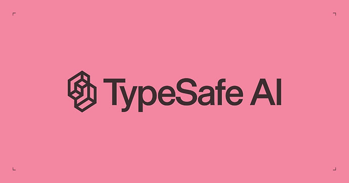
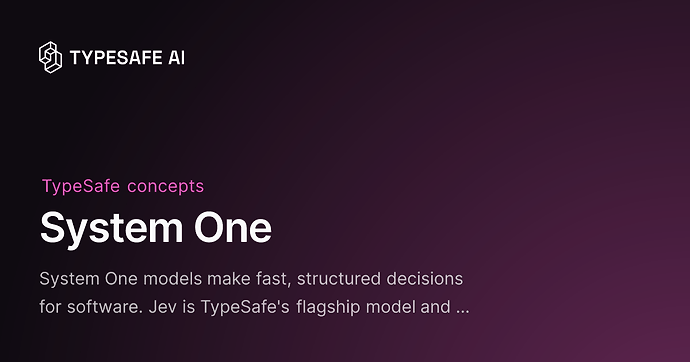

---

id: 2930543

title: "【AI与AI安全】JEV大烧烤：也许我们不必期待一个全知全能的神"

created_at: 2026-09-21T06:20:10.288Z

username: astrum

display_username: "astrum"

---


# 【AI与AI安全】JEV大烧烤：也许我们不必期待一个全知全能的神


## **前言**

简单聊一聊，最近事情仍然很多。

我们从工作模式和应用前景来说。

本文全部参考以下内容：



### [Introducing System One Models & Jev - TypeSafe AI Blog](https://typesafe.ai/blog/introducing-system-one-models-and-jev)

TypeSafe AI is an AI lab building machine-native intelligence infrastructure for automation, designed to make decisions within software. Try our first System One Model, Jev, in early access.



### [System One - TypeSafe AI](https://docs.typesafe.ai/concepts/system-one)

System One models make fast, structured decisions for software. Jev is TypeSafe's flagship model and the first System One model.

## **工作模式和原理**

JEV是一个System One Model（没有官方译名，下称单系统模型）。System One模型是一类旨在做出快速、结构化决策的 AI 模型。其输入为自然语言，输出为带类型的决策和概率。

这个模型目前只接受文本输入（不支持多模态），这个模型是以英语作为主要语言进行训练的，在使用其它语言时其准确率会下降。

[System One - TypeSafe AI](https://docs.typesafe.ai/concepts/system-one) 里展示了一系列输入输出的范例，我翻译之后放在下面：

[image935×429 47.4 KB](https://cdn3.ldstatic.com/original/4X/0/7/8/078b20590fea4cfccae56ef59a69d164bc73b256.jpeg)

这个范例在我看来写的并不清楚。因为在JEV中，输入实际上被分为State和Question两部分，其中State相当于前情提要或决策补充，Question作为提问的问题。

在API模式中（这个模型现在仅支持API调用）JEV为其二者提供了很多可选项，详见[API reference - TypeSafe AI](https://docs.typesafe.ai/api)。

State的输入格式没有明确的限制，它可以真的只是一段自然语言，也可以是一个json。

Question则有三个必选项type、instrutions和criteria，分别负责描述类型、问题描述和判断标准。比如，Question中可以设置提问的类别如noul（是否）、choice（选项）、score（评分）。下面是一个简单的Question示例：

```
{
    "is_urgent": {
      "type": "noul",
      "instructions": "Does this convey urgency?",
      "criteria": {
        "true": "Explicitly time-sensitive",
        "false": "No urgency expressed"
      }
}
```

于此对应的，模型会根据提问的type返回一个对应type的Answer。

```
{
  "model": "jev-1.13.0",
  "answers": {
    "is_urgent": {
      "type": "noul",
      "noul": 0.95
    }
  },
  "usage": { "input_tokens": 296, "output_tokens": 20 }
}
```

按照上文的内容我们可以mock出（openrouter账号没借到）一个请求响应的示例：

```
{
  "state": "公司中了勒索病毒",
  "model": "jev-latest",
  "questions": {
    "is_urgent": {
      "type": "choice",
      "criteria": { "a":{"name":"张伟","job":"会计"},"b":{"name":"张三","job":"安全工程师"} }
      "instructions":"要被派去现场的人是谁？"
    }
  }
}
```

```
{
  "model": "jev-1.13.0",
  "answers": {
    "department": {
      "type": "choice",
      "choice": "b",
      "probabilities": { "a": 0.1, "b": 0.9 },
      "confidence": 0.81
    }
  },
  "usage": { "input_tokens": 318, "output_tokens": 34 }
}
```

## **优势**

其实发布者自己已经拉了个表做对比，不过那个表太长了很占视野，有兴趣的读者可以直接阅读原文：


### [Introducing System One Models & Jev - TypeSafe AI Blog](https://typesafe.ai/blog/introducing-system-one-models-and-jev)

TypeSafe AI is an AI lab building machine-native intelligence infrastructure for automation, designed to make decisions within software. Try our first System One Model, Jev, in early access.

然后是我自己的看法。要描述它的优势，就不能仅从大模型角度来说，我们还得向上寻找传统小模型作为对比。

首先是快。按照发布者的说法，JEV能比前沿大模型快40-200倍，对于工业化部署和高并发环境来说，足够小的延时是前提。

其次是格式的可控性。大模型的输出如果在用于流水线式工作（简单来说，它的输出如果要被代码模块化分发处理）时会有很小的概率发生结构错乱问题，当然随着模型能力的提升这个问题出现的概率已经很低了，但仍然存在，JEV声称它的输出自始至终都是确定格式化的（ The model never makes type errors）。

最后也是最新颖的一点，不知道各位读者有没有发现，我认为是“判断标准的可控性”。这一点可能对于大模型来说无足轻重，但对于传统的分类小模型来说可算是飞跃式的创新。对于任意场景下的任意问题，它的判断标准可以由用户自定义，而无需额外微调，同一个模型可以同时承担各个场景下的分类。

## **应用前景**

大烧烤时间到^ ^。

本来我应该在详细论文发布之后再来好好聊聊这个模型。但是它很符合我对未来大模型应用模式的设想，而且我一直很想聊一聊这一块，所以就先说了。

当前网安行业应用AI分三大块，一大块是识别（流量、样本分析），一大块是规划任务（渗透测试和红队Agent），一大块是逆向。

规划任务属于很Agent的部分，起码从当前环境下我们认为还是得用强能力的基座模型，让它自由发挥，所以这个部分的主干道跟JEV暂时还没有什么联系。但Agent运行中的判断部分如“判断一个场景下是否存在漏洞”仍然可以用到JEV。

逆向任务实际上也依托大模型能力。这个部分和涌现关系比较大，也没法以现在的角度进行更深度的讨论。如果模型参数部分的研究出现更大进展，也许这个能力能被从大模型基座里“拆”出来，但目前我不抱什么希望。

识别任务在大模型时代之前就已经有AI分支了，亦或者说，在模型变成大模型之前，它们的主要任务之一就是这个。不过这两年有一些方案拿大模型做识别，一时之间不知道是说开倒车了还是经济下行了，怎么现在模型就业也内卷起来了^ ^。不过言归正传，JEV的工作模式很适合识别任务，特别是现在本地部署模型速度慢而任务需求高并发高流量的情况下，这个模型的网安就业基点可能在这里。不过需要注意的是，虽然发布者声称JEV的能力看齐GPT5.6 Luna，但目前公开的跑分数据都太小了（在中文任务里甚至测出了小模型水平）且不够垂直，如果模型能力不够还是白给。

## **写在最后，也许我们不必期待一个全知全能的神**

一直以来我们都试图使用大语言模型代替人工作，并且看上去它确实取得了长足的进步——一开始使用长长的系统提示词，然后是MCP协议，然后是Skill、ReAct，现在又返璞归真回到仅仅使用大模型本身。

即使包括模型提供商在内的所有人都希望大模型能够成为一个更加强大、全知全能的神，但事实是无论是在哪个领域，只要Agent负责的范围足够具体，则我们使用的仍然是庞大通用能力中狭小的一角。

从一方面来说，这未免太过累赘与浪费，大材小用到了极点；从另一方面来说，基于海量自由格式文本训练的大模型永远存在“挣脱”上下文描述的规范的可能，也许一个拥有“灵魂”的“生物”无法永远作为流水线的一环存在。

而这次发布的JEV则向我们展现了大模型能力的另一个发展方向，虽然以前不乏这样的专业小模型存在（比如专用于PII识别的小模型），但这可能是第一次有一个这样的模型以如此轰动的效果登场，出现在一个刚好各行各业都有广泛对AI的信任和需求的时代。也许时势之下，英雄正当其时，也许我们可以展望一个像调包一样调用各式各样专业、可控、格式规范的小模型的未来。

本系列其它文章可见：

[【AI与AI安全】聊聊黑GEO，也就是怎么给大模型搜索下毒](https://linux.do/t/topic/2416059/) [


文档共建](/c/wiki/42)

> 前言

> 我一直很好奇——技术如此简单，危害如此严重，难道要出一次类似魏则西事件才有人来管吗？

> 当然在你行业这种事司空见惯了。

> 1.1 SEO

> 要讲GEO，我们恐怕得先从SEO说起。经营过个人博客的读者应该对SEO这个词并不陌生。简单来说，SEO是一种“搜索引擎优化技术”，它旨在通过一系列手法1.提升特定网站与特定搜索词的关联性；2.提高特定网站的搜索排名。SEO本身并不是灰产，但使用不当手法…


---


*来源: https://linux.do/t/topic/2930543.json*

