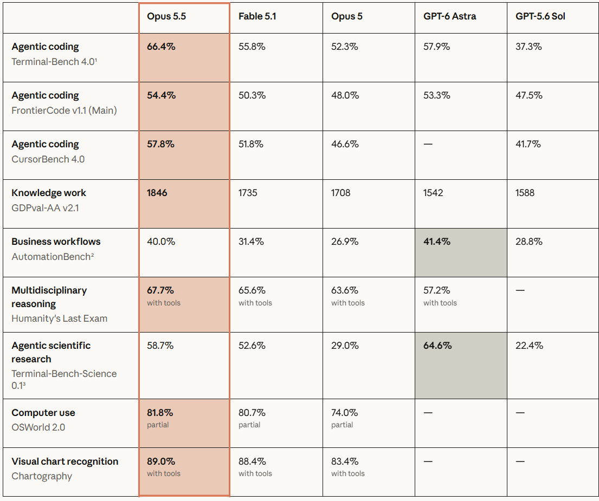
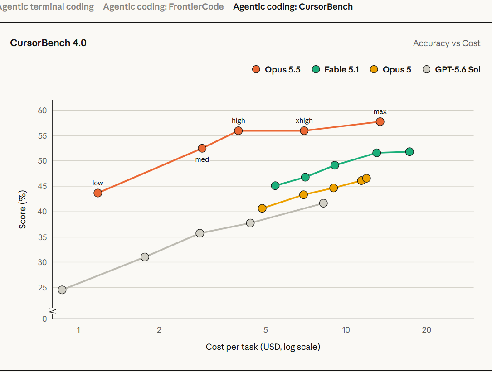
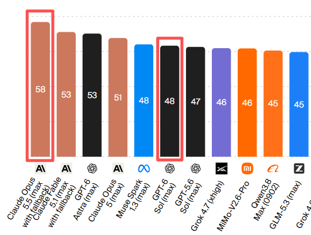
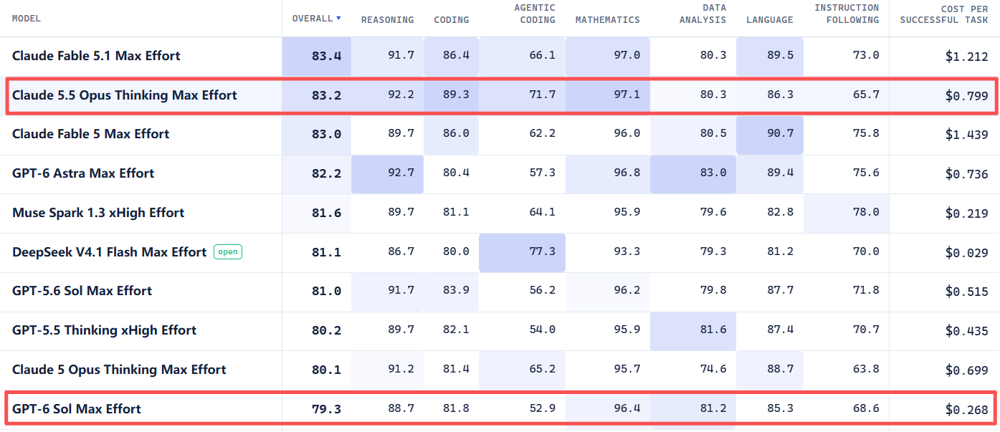
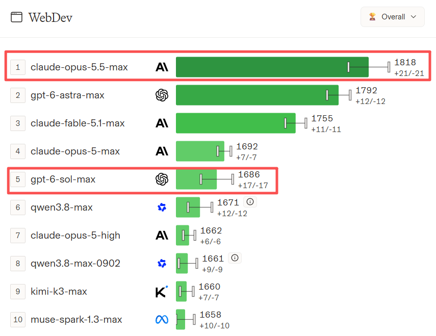
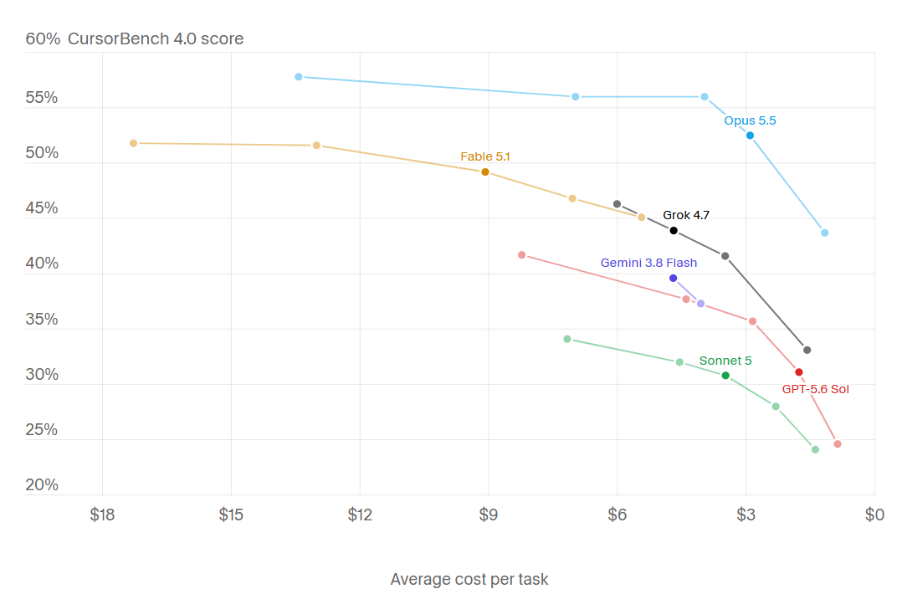

---

id: 2938133

title: ":fire:【大模型百科52】关于Opus 5.5, 你想知道的一切【AA超GPT6十分,挤爆牙膏】"

created_at: 2026-09-22T16:53:30.571Z

username: dwqxq1

display_username: "dwqxq1"

---

# :fire:【大模型百科52】关于Opus 5.5, 你想知道的一切【AA超GPT6十分,挤爆牙膏】

### 基本资料

**官方文**:[Introducing Claude Opus 5.5 \ Anthropic](https://www.anthropic.com/claude-opus-5-5)

**官方文档**:[Claude Opus 5.5 - Claude Platform Docs](https://platform.claude.com/docs/en/models/opus-5-5/overview)

**价格**:输入$4,输出$20,读缓存$0.2(降价60%),写缓存$5

opus5是$5/20/0.5/6.25

**上下文**:1m不变

**最大输出**:128k不变

**知识截止**:2606

---

### 官方自评

---

---

### ArtificialAnalysis评分

来源:[https://artificialanalysis.ai/](https://artificialanalysis.ai/)

---

### LiveBench评分

来源:[https://livebench.ai](https://livebench.ai)

---

### Arena评分

来源:[Arena Leaderboard | Compare & Benchmark the Best Frontier AI Models](https://arena.ai/leaderboard)

---

### CursorBench评分

来源:[Cursor · CursorBench](https://cursor.com/cursorbench)

---

### API

#### 官网/Azure/AWS/GCP API已上线

#### OpenRouter API已上线

来源:[Claude Opus 5.5 - API Pricing & Benchmarks | OpenRouter](https://openrouter.ai/anthropic/claude-opus-5.5)

---

*来源: https://linux.do/t/topic/2938133.json*

