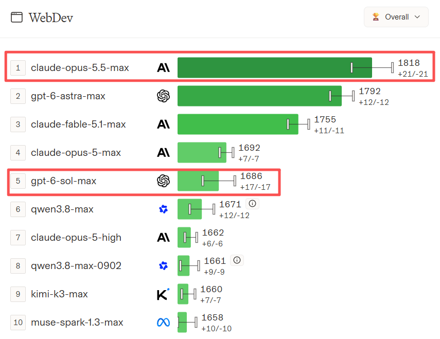
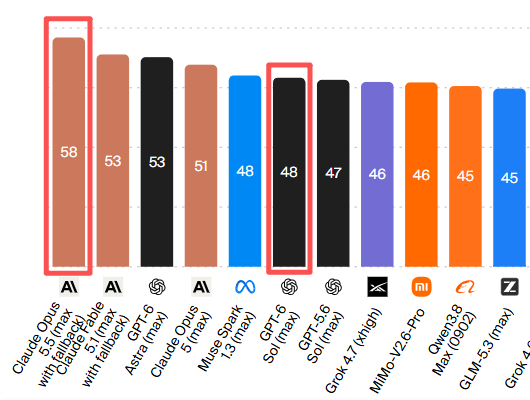
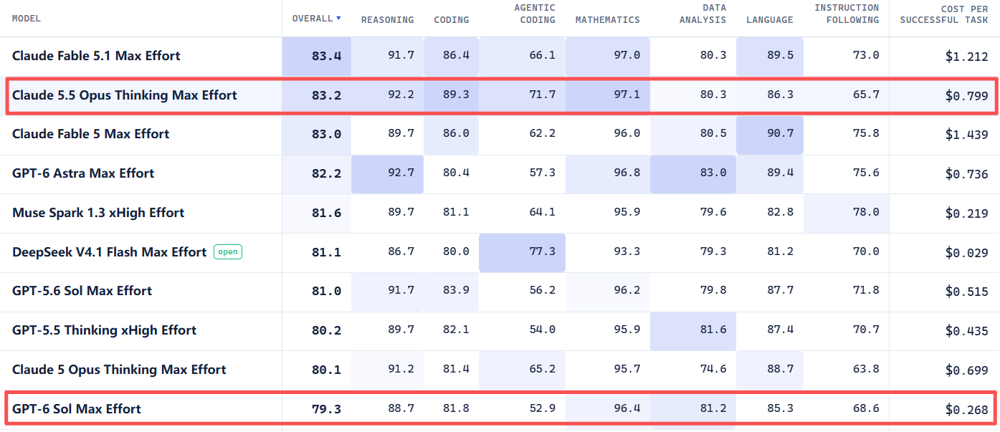

---

id: 2941647

title: ":fire:【大模型百科53】关于GPT-6-sol和luna,你想知道的一切【被opus5.5完爆】"

created_at: 2026-09-23T08:44:48.549Z

username: dwqxq1

display_username: "dwqxq1"

---

# :fire:【大模型百科53】关于GPT-6-sol和luna,你想知道的一切【被opus5.5完爆】

### 基本资料

**官方文**：[https://openai.com/index/introducing-gpt-6-sol-and-luna/](https://openai.com/index/introducing-gpt-6-sol-and-luna/)

**价格**

gpt-6-sol：输入$2, 输出$10, 5.6sol是$4/$20

gpt-6-luna：输入$0.1, 输$出0.5, 5.6-luna是$0.2/1.2

gpt-6-sol-pro：价格同sol

fast是2倍价格，flex是0.5倍价格

上下文：1.1m

---

### 官方自评

---

### Arena评分

来源:[Arena Leaderboard | Compare & Benchmark the Best Frontier AI Models](https://arena.ai/leaderboard)

---

### ArtifacialAnalysis评分

---

### LiveBench评分

来源:[https://livebench.ai](https://livebench.ai)

---

### Chat渠道

官网App/桌面/CLI/Web已上线

### 官网/Azure API已上线

### OpenRouter API已上线

6-sol:[GPT-6 Sol - API Pricing & Benchmarks | OpenRouter](https://openrouter.ai/openai/gpt-6-sol)

6-sol-pro:[GPT-6 Sol Pro - API Pricing & Providers | OpenRouter](https://openrouter.ai/openai/gpt-6-sol-pro#providers)

6-luna:[GPT-6 Luna - API Pricing & Benchmarks | OpenRouter](https://openrouter.ai/openai/gpt-6-luna)

---

*来源: https://linux.do/t/topic/2941647.json*

