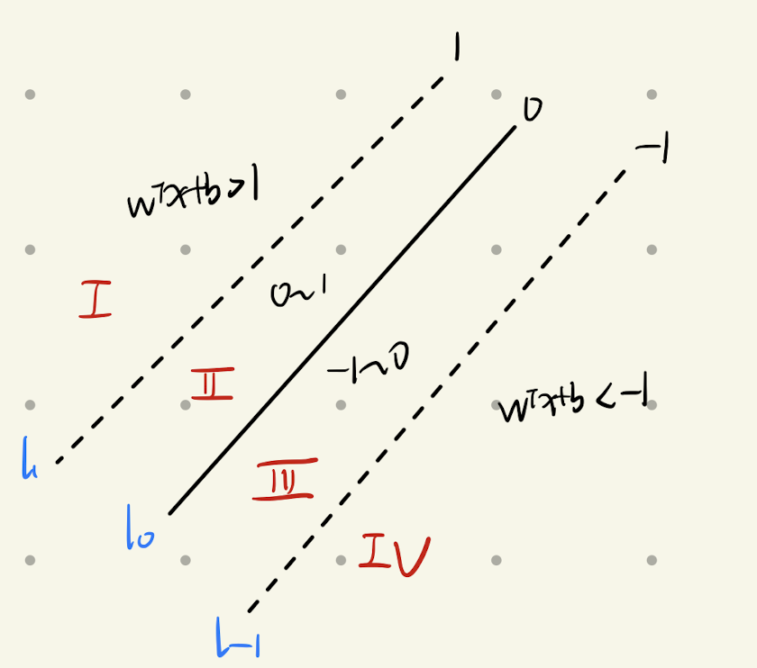
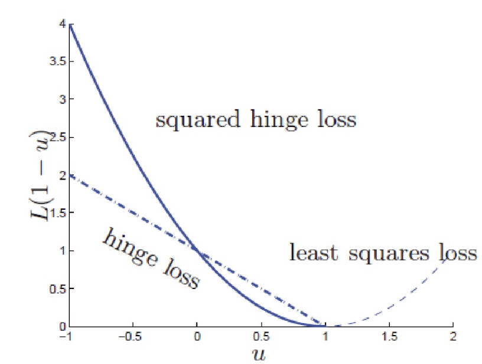

---

id: 297810

title: "建一个机器学习算法Wiki楼"

created_at: 2024-12-16T15:41:00.773Z

username: Thinler

display_username: "FeignedCat"

---

# 建一个机器学习算法Wiki楼

lz这学期在上模式识别导论课程，其中涉及到很多经典机器学习算法，lz上课很努力的去跟进度，奈何老师讲的太快，进度越落越多。再过两周就要考试了，痛心疾首，决定恶补一下，顺便把笔记整理一下建一个机器学习wiki贴。

目前我是把手写笔记用gemini识别，手动+ai帮忙勘误了一下，先把支持向量机的部分发出来！

## **S**upport **V**ector **M**achine 支持向量机

### SVM 的基本原理

**目标：** 给定数据集 \{x_i, y_i\}_{i=1}^m，其中 x_i \in R^n， y_i \in \{-1, +1\}，找到一个超平面将不同类别的样本分开，达到分类的目的。

**超平面定义：** 超平面可以表示为 f(x) = w^T x + b，其中 w 是法向量，b 是截距。

**分类正确条件：** 对于正确的分类，满足 y(w^T x + b) \geq 1。

#### 超平面间距离的计算

**直线距离：** 对于直线 ax + by + c = 0，其法向量为 (a, b)。

**超平面距离：** 对于超平面 w^T x + b = 1，其法向量为 w^T。

**点到超平面的距离：** 给定点 x_p，到超平面 w^T x + b = 1 的距离为：

d = \frac{|w^T x_p + b - 1|}{||w||}

**超平面间距：** 当 x_p 在 w^T x_p + b = -1 时，两个超平面之间的距离为：

d = \frac{2}{||w||}

#### 问题重新表述

**最大间隔 SVM：** 目标是最大化超平面之间的距离，即最大化 \frac{2}{||w||}，等价于最小化 \frac{1}{2} ||w||_2^2。

**优化问题：**

\min_{w,b} \quad \frac{1}{2} ||w||_2^2

s.t. \quad y_i(w^T x_i + b) \geq 1

**Soft-margin SVM：** 引入松弛变量 \rho_i \geq 0，允许一些样本分类错误，同时希望松弛变量尽可能小。

**软间隔优化问题：**

\min_{w,b, \rho} \quad \frac{1}{2} ||w||_2^2 + C\sum_i \rho_i (希望松弛变量尽可能小，所以把它加上并min)

s.t. \quad y_i(w^T x_i + b) \geq 1 - \rho_i

\rho_i \geq 0

**等价形式 (使用损失函数)：**

\min_{w,b} \quad \frac{1}{2} ||w||_2^2 + C\sum_i L(y_i(w^T x_i + b))

其中 L(\cdot) 是损失函数。

常见的损失函数有 hinge loss 和 squared hinge loss。

**Hinge Loss:**

L(u) = max(0, 1-u)

- 分类正确则为 0.

- 和错误程度成线性关系。

- 非凸，非光滑。

一种近似：squared hinge loss，凸并且光滑了，但是不够鲁棒

### 原问题和对偶问题

#### Primal-Dual 关系

**原问题（Primal）：**

 \min \quad f_0(x)

 s.t. \quad f_i(x) \leq 0, \quad i = 1, \cdots, m

 \qquad h_i(x) = 0, \quad i = 1, \cdots, p

最优值为 f^* = f_0(x^*)。

**对偶问题（Dual）：**

 \max \quad g(\lambda, \nu) = \inf_{x \in D} (f_0(x) + \lambda^T f(x) + \nu^T h(x))

 s.t. \quad \lambda \geq 0

其中 g(\lambda, \nu) 是拉格朗日函数的下确界。

最优值为 g^* = g(\lambda^*, \nu^*)。

**弱对偶性：** f(x) \geq g(\lambda, \nu) \implies f^* \geq g^*

**强对偶性：**  f^* = g^* (在满足一定条件的情况下成立)

#### KKT 条件

**KKT 条件 (强对偶成立时)：**

给定最优解 x^*，以及对偶变量 \lambda^*, \nu^*，满足：

1. **原问题可行性：** h(x^*) = 0,  f(x^*) \leq 0

2. **对偶可行性：** \lambda^* \geq 0

3. **互补松弛：** \lambda^* f(x^*) = 0

4. **拉格朗日函数梯度为零：** \frac{\partial L(x, \lambda^*, \nu^*)}{\partial x}|_{x = x^*} = 0

**互补松弛的证明：**

由于强对偶性，f(x^*) = g(\lambda^*, \nu^*)，

 g(\lambda^*, \nu^*) = \min_{x \in D} [f_0(x) + \sum_i \lambda_i^* f_i(x) + \sum_i \nu_i^* h_i(x)]

 \leq f_0(x^*) + \sum_i \lambda_i^* f_i(x^*) + \sum_i \nu_i^* h_i(x^*) \leq f_0(x^*)

由于 f(x^*) = g(\lambda^*, \nu^*), 所以

\sum_i \lambda_i^* f_i(x^*) = 0

则 \lambda_i^* f_i(x^*) = 0 。

#### SVM 的对偶问题

**拉格朗日函数：**（原问题+某系数 \times 约束条件转化为负数的形式）

L(w, b, \rho, \alpha, \beta) = \frac{1}{2} ||w||_2^2 + C\sum_i \rho_i - \sum_i \alpha_i[y_i(w^T x_i + b) - 1 + \rho_i] - \sum_i \beta_i \rho_i

**根据 KKT 条件：**

1. \frac{\partial L}{\partial w} = 0 \implies w = \sum_i \alpha_i y_i x_i

2. \frac{\partial L}{\partial b} = 0 \implies \sum_i \alpha_i y_i = 0

3. \frac{\partial L}{\partial \rho_i} = 0 \implies C- \alpha_i-\beta_i=0

4. \alpha_i \geq 0, \beta_i \geq 0

**将 KKT 条件代入拉格朗日函数:**

\frac{1}{2} w^T w = \frac{1}{2} (\sum_i \alpha_i y_i x_i)^T (\sum_j \alpha_j y_j x_j) = \frac{1}{2} \sum_i \sum_j \alpha_i y_i \alpha_j y_j x_i^T x_j

C\sum \rho_i - \sum \alpha_i \rho_i - \sum \beta_i \rho_i = \sum (C - \alpha_i - \beta_i)\rho_i = 0

- \sum \alpha_i y_i (w^T x_i + b) = - \sum \alpha_i y_i (x_i^T w + b) = - \sum_i \sum_j \alpha_i y_i \alpha_j y_j x_i^T x_j

**对偶问题：**

最终的拉格朗日函数变为：

max \sum_i \alpha_i - \frac{1}{2} \sum_i \sum_j \alpha_i y_i x_i^T x_j y_j \alpha_j

写成最小化形式：

min \quad \frac{1}{2} \sum_i \sum_j \alpha_i y_i x_i^T x_j y_j \alpha_j - \sum_i \alpha_i

s.t. \quad \sum_i \alpha_i y_i = 0

 \qquad 0 \leq \alpha_i \leq C

- \alpha_i 的数量和样本点的数量相同。

#### 在对偶空间中求解原问题的 w 和 b

**互补松弛条件：**

\begin{cases}

\alpha_i(1 - \rho_i - y_i(w^T x_i + b)) = 0 \\

\beta_i \rho_i = 0

\end{cases}

并且 C - \alpha_i - \beta_i = 0.

**\alpha_i 的取值和样本点的关系:**

- \alpha_i = 0 时，\beta_i = C, \rho_i = 0:  y_i(w^T x_i + b) \geq 1, 分类正确.

- 0 < \alpha_i < C 时, 0 < \beta_i < C,  \rho_i = 0:  y_i(w^T x_i + b) = 1, 样本点在间隔面上.

- \alpha_i = C 时,  \beta_i = 0, \rho_i \ge 0:

\rho_i = 0, y_i(w^T x_i + b) = 1

0 < \rho_i < 1, 0 < y_i(w^T x_i + b) < 1

\rho_i = 1, y_i(w^T x_i + b) = 0

\rho_i > 1, y_i(w^T x_i + b) < 0, 分类错误.

**支持向量：**  0 < \alpha_i \leq C 对应的样本点 x_i 是支持向量。

> 也就是说，分类不那么准的向量才是我们想要的。分类边界的位置只取决于距离边界最近的那些点（SV）

##### b 的求解

利用 0 < \alpha_i < C 的样本点 (支持向量)求解 b：

y_i(w^T x_i + b_i) = 1

w^T x_i + b_i = y_i

b_i = y_i - w^T x_i

b_i = y_i - \sum_{x_j \in SV} y_i \alpha_j x_j^T x_i ，这里的 x_i 当然也是支持向量

b = \frac{1}{n} \sum_i b_i

##### 最终的分类函数

f(x) = w^T x + b

= \sum_{x_i \in SV} y_i \alpha_i x_i^T x + \frac{1}{n} \sum_{k \in \{k | 0 < \alpha_k < C\}} (y_k - \sum_{x_j \in SV} y_k \alpha_j x_j^T x_k)

这里的 x_i^Tx 可以理解为训练样本点与待分类点的相似度，再乘以它的影响方向 y_i 和重要性权重 \alpha_i ,然后将所有影响累加起来。

### SMO 算法

Sequential Minimization Optimization

用于求解  \alpha

在对偶空间中

\min_\alpha \sum_{i}\sum_{j} \alpha_i y_i K_{ij} y_j \alpha_j - \sum_{i} \alpha_i

s.t. \quad \sum_{i=1}^{m}\alpha_iy_i=0

0\leq\alpha_i\leq C

将约束拆分为 i=1\sim2 , 3 \sim m

\sum_{i=1}^{2}\alpha_iy_i+\sum_{i=3}^{m} \alpha_iy_i = 0

\sum_{i=1}^{2}\alpha_iy_i=-\sum_{i=3}^{m} \alpha_iy_i=\gamma

我们只分析包含 \alpha_1 ,  \alpha_2 的情况

\sum_{i=1}^{2}\sum_{j=1}^{m} \alpha_iy_iK_{ij}y_j\alpha_j + \sum_{i=3}^{m}\sum_{j=1}^{2}\alpha_iy_iK_{ij}y_j\alpha_j

令 v_i = \sum_{j=3}^{m}\alpha_j y_j K_{ij}, \quad i=1,2

则上式可展开为（展开过程很复杂，详细步骤略去）

K_{11}\alpha_1^2+K_{22}\alpha_2^2 + 2y_1y_2K_{12}\alpha_1\alpha_2 - (\alpha_1 + \alpha_2) + y_1v_1\alpha_1 + y_2v_2\alpha_2 + const

s.t. \quad y_1\alpha_1+y_2\alpha_2=\gamma , \quad 0 \leq \alpha_1,\alpha_2 \leq C

\qquad \alpha_2 = y_2(r-y_1\alpha_1) \qquad [同乘y_2,\quad y_2^2 = 1]

将 \alpha_2 代入上式，即转化为 \alpha_1 的单变量优化问题，求导并令导数为0，并考虑约束，得到 \alpha_1 \ \alpha_2 ,如此迭代更新直到所有变量都满足KKT条件。

### Kernal SVM

**背景：** 对于非线性可分的情况，可以通过核函数将数据映射到高维空间，使得数据在高维空间中线性可分。

**RBF Kernal (Radial Basis Function，也叫Gaussian Kernel)：**

k(x, y) = e^{-\frac{||x - y||^2}{2 \sigma^2}} = exp(-\frac{x^2}{2 \sigma^2}) exp(\frac{xy}{\sigma^2}) exp(-\frac{y^2}{2 \sigma^2})

想要分离其中的 x,y ,对中间的一项泰勒展开：

exp(\frac{xy}{\sigma^2}) = \sum_{n=0}^{\infty} \frac{1}{n!} (\frac{xy}{\sigma^2})^n = \sum_{n=0}^{\infty} \frac{1}{\sqrt{n!}} (\frac{x}{\sigma})^n \frac{1}{\sqrt{n!}} (\frac{y}{\sigma})^n

= [1, \frac{x}{\sigma}, \frac{1}{\sqrt{2!}} (\frac{x}{\sigma})^2, \frac{1}{\sqrt{3!}} (\frac{x}{\sigma})^3, \cdots, \frac{1}{\sqrt{n!}} (\frac{x}{\sigma})^n]^T

\cdot [1, \frac{y}{\sigma}, \frac{1}{\sqrt{2!}} (\frac{y}{\sigma})^2, \frac{1}{\sqrt{3!}} (\frac{y}{\sigma})^3, \cdots, \frac{1}{\sqrt{n!}} (\frac{y}{\sigma})^n] = \hat{\phi}^T(x) \cdot \hat{\phi}(y)

**核函数映射：**

k(x, y) =  [exp(-\frac{x^2}{2 \sigma^2}) \hat{\phi}(x)]^T [exp(-\frac{y^2}{2 \sigma^2}) \hat{\phi}(y)] =  \phi^T(x) \phi(y)

\phi(x) = e^{-\frac{x^2}{2 \sigma^2}} \cdot [1, \frac{x}{\sigma}, \frac{1}{\sqrt{2!}} (\frac{x}{\sigma})^2, \cdots, \frac{1}{\sqrt{n!}} (\frac{x}{\sigma})^n]^T

- 将有限维数据映射到无限维空间。

- 不需要显式计算维度映射，只需要计算核函数即可。（非常巧妙的地方！）

不仅节省了计算量，并且存储的支持向量甚至会减少。（设想二维平面要分出一个圆，需要很多支持向量，但是映射到高维空间后，可能只需要一个支持向量）

## **P**rincipal **C**omponents **A**nalysis主成分分析

### 内容及推导

是指通过某种线性变换，将原始数据变换为一组各维度线性无关的表示，这组表示称为主成分

假如对于房价来说，有非常多影响因素，但是只有少数几个因素对房价的影响最大，主成分分析就是找到这几个最重要的因素

要提取特征，也就是要降维

Dimensionality reduction 降维

我们希望把数据从高维度降低到低维度，同时尽可能多的保留原有的**信息**。

信息可以表示为 -\log P(x_i)

x_i 越小信息量越大，概率越小越分散，熵也就越大

对一维： \frac{1}{m-1} \sum(y_i - \bar{y})^2 = \frac{1}{m-1}(Y-\bar{Y})^T(Y-\bar{Y})

=E(Y^TY) - (EY)^2

=E(w^TXX^Tw) - [E(X^T)w]^2

> 这里有 m-1 对应的是样本的无偏估计，如果是有偏估计，那么就是 m

预先对 X 做去均值化处理即$E(X^T)=0$

原式：w^TCw, C=XX^T

问题变为：\mathop{max}\limits_{w^Tw=1}w^TCw , (C=XX^T)

Lagrangian:  L(w,\lambda)=w^TCw - \lambda(w^Tw-1)

\frac{\partial L}{\partial w}=Cw-\lambda w = 0

Cw=\lambda w , 变成了一个求取特征值的问题

det(\mid C-\lambda I\mid)=0 , 求出 \lambda 再代入求得 w

则 w^TCw = w^T\lambda w=\lambda w^Tw = \lambda

(w^Tw=1)

想要方差最大，就是想要 \lambda 大，所以这里的 \lambda 应该代入之前求解的最大的特征值

这个 \lambda 对应的 w 即为投影的方向

对于高维度来说，我们求的就不是方差，而是协方差矩阵

恭喜你已经找到了第一个投影方向，第二个方向怎么找呢？

假设第二个方向是 w_2 ，我们希望第一个方向和第二个方向的关系尽可能小，可以让互协方差为0

互协方差： cov(w_1^TX, w_2^TX)=0

cov(Y_1, Y_2) = E(Y_1-\bar{Y_1})^T(Y_2 - \bar{Y_2})

(零均值化处理)

= E(Y_1^TY_2)

= E(w_1^TXX^Tw_2)

=w_1^TCw_2

=(Cw_1)^Tw_2

=\lambda_1w_1^Tw_2, 且 \lambda_1 \neq 0

=0

则 w_1^Tw_2=0 , 即 w_1 与 w_2 正交

加入这个约束条件，问题变为

\max w^TCw

s.t. w^Tw=1, w_1^Tw=0

Lagrangian:

L(w,\lambda) = w^TCw-\lambda(w^Tw-1)-\beta w^Tw

经过求导，最终得到的还是  Cw=\lambda w

接下来继续求特征值，得到 w_2 ，以此类推

### 步骤总结

对于 x_i \in R^n ，想要降维到 k 维（ k<n ），则

1. 对 x_i 进行零均值化处理 x_i-\bar{x_i}

2. 计算协方差矩阵 C=\frac{1}{m-1}XX^T , X 为零均值化后的矩阵，X \in R^{n\times m} ，对应m个样本，n个维度

3. 求解 Cw=\lambda w，得到特征值和特征向量

4. 把特征值按照从大到小的顺序排列，取前k个特征值对应的特征向量组成投影矩阵 W，W \in R^{n\times k}，对每一个特征向量进行归一化处理 w = \frac{w}{||w||}

5. y_i=[w_1^Tx_i, w_2^Tx_i, ..., w_k^Tx_i], y_i \in R^k

投影后每一维度的方差是 \lambda_i ，对于投影后的Y来说，它的协方差矩阵是对角矩阵，对角线上的元素就是 \lambda_i

cov(Y)=\begin{bmatrix}

\lambda_1 & 0 & 0 & ... & 0 \\

0 & \lambda_2 & 0 & ... & 0 \\

0 & 0 & \lambda_3 & ... & 0 \\

... & ... & ... & ... & ... \\

0 & 0 & 0 & ... & \lambda_k

\end{bmatrix}

这是其中一种求解方法，对于PCA来说，还有一种least square的方法

简单来说就是

Y=W^TX , \hat{X}=WX^TX，\hat{X} 为重构后的矩阵，W 为投影矩阵

让恢复后的矩阵和原矩阵的差异最小，即 \min||X-\hat{X}||^2

### Kernel PCA

todo

### **C**anonical **C**orrelation **A**nalysis 典型相关性分析

todo

---

*来源: https://linux.do/t/topic/297810.json*

