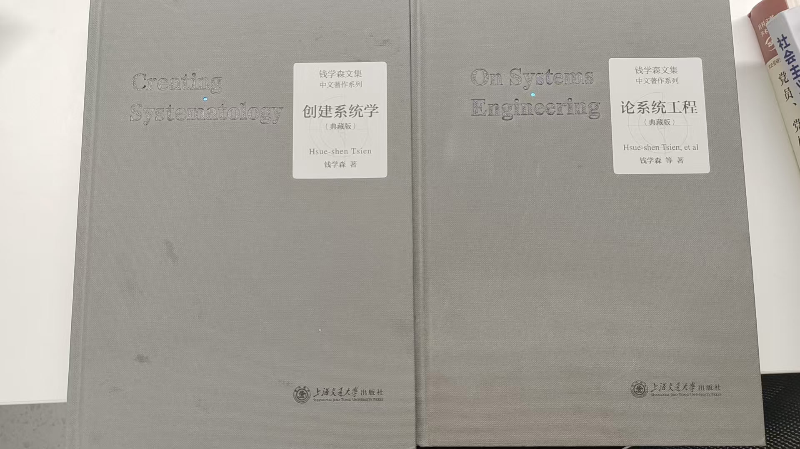
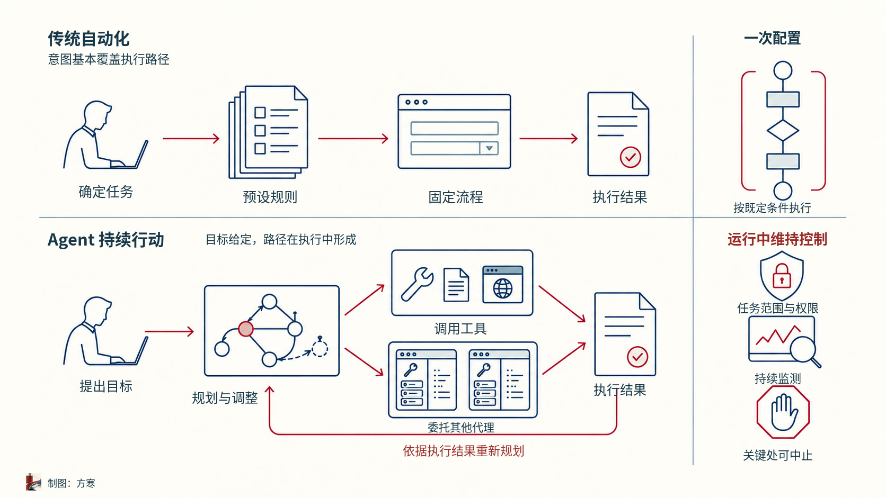
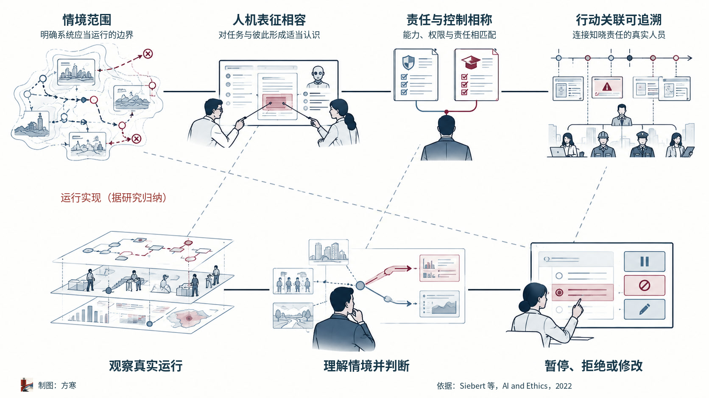
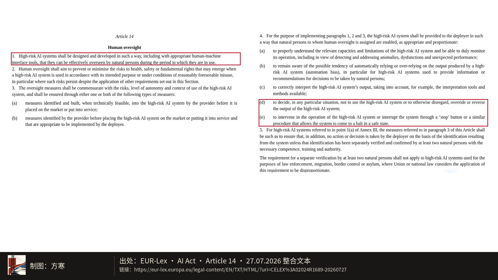
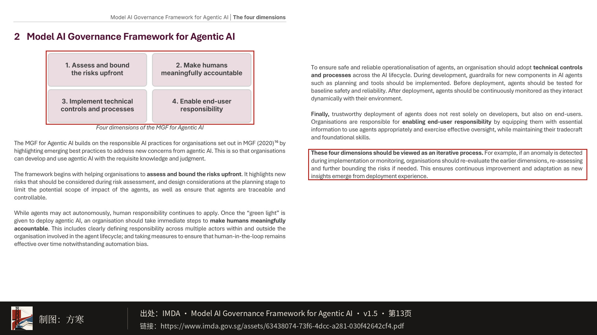
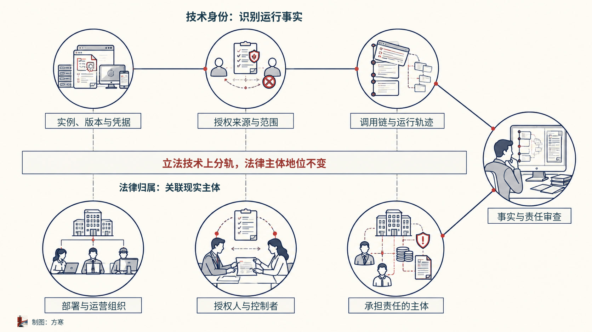
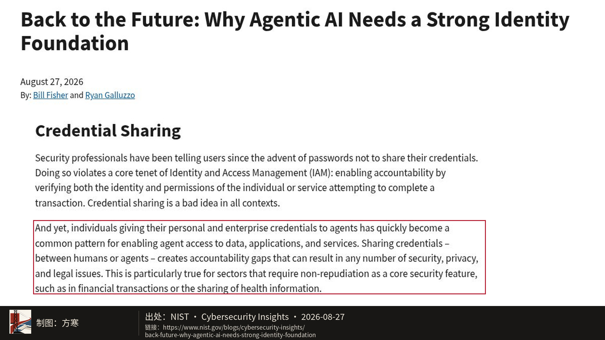
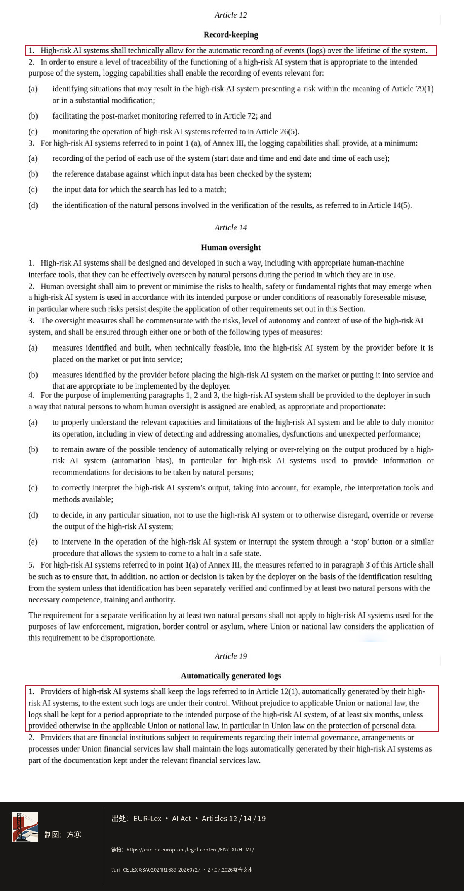
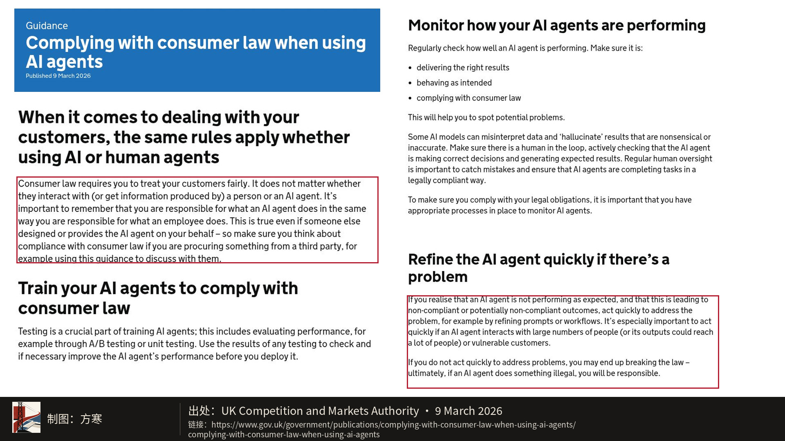
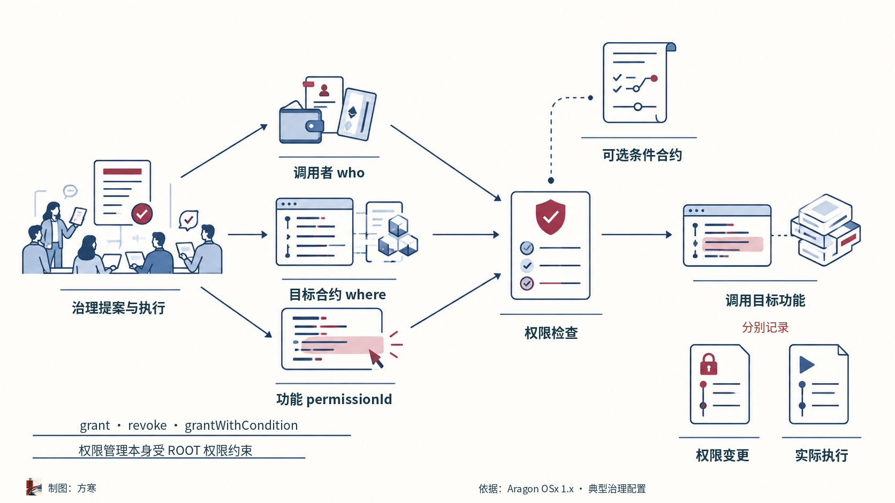

---

id: 2978720

title: "【深度】学习《AI智能体的法律定位与责任配置研究》"

created_at: 2026-10-02T23:25:21.007Z

username: ZRainbow

display_username: "ZRainbow"

---

# 【深度】学习《AI智能体的法律定位与责任配置研究》

最近读到《信息安全研究》2026 年第 8 期刊发的《AI智能体的法律定位与责任配置研究》，作者是公安部第三研究所的黄道丽与密码法治实践创新基地的马民虎。［1］

非常感动，能在中文互联网读到这么一篇很有先见、也很懂技术的法学论文*（虽然仍然称呼 Agent 为智能体而非智能代理）*。迫不及待地赶制一篇文章，和各位一起分享我的学习所得。

论文讨论 AI 智能体的法律定位和责任配置。开始没有继续延续中国法学界自知或不自知的意识，即将 Agent 理解成一个回答能力更强、犯错方式更多的大模型。作者清晰地认知到，我们讨论的 Agent 更类似于钱学森同志当年所指出巨系统：它可以接下一个目标，继续规划步骤、调用工具、访问外部资源，根据执行结果调整路径，必要时还会把任务交给另一个智能体。因此，基于这么一个正确的认识，作者明确法律所要处理的已经不只是某段内容由谁生成，而是一个持续行动的过程。

这个区别相当重要，因为 Agent 时代，模型只是底层能力的一部分。基于上述的认识我们能够发现，Agent 最后发生的行为，还会受到权限配置、运行环境、外部插件、数据反馈和其他系统的影响。

最初下达任务的人仍然存在，却未必逐项决定后面发生了什么。原本相对稳定的“主体—行为”关系，就这样被一段不断变化的运行过程拉长，法律关系在其中也受到影响。

于是，这篇论文从这里起步，依次提出“功能化工具主义”“技术身份—法律归属”双轨识别、“关系主义归责”和“最小必要原则”来进行分析。

四个概念分属法理、身份、责任和治理，结合国内外法律实际，连成一条线首先回答法律为什么仍然可以把智能体视作工具，再处理这种工具如何获得身份、接受授权、受到控制，随后才讨论多个参与者之间怎样分配责任，接着判断哪些问题可以继续适用现行法，哪些地方已经需要专门规则和技术标准。最后作者希望推动的，是AI治理从一次行为、一次结果、一次归责，转向围绕持续运行过程展开的动态治理。

我想专门写一篇文章谈它，原因就在“动态”二字。

不少研究思路只站在法律这一侧，先讨论主体、人格、侵权和监管，再用几句技术介绍把对象缝补，得到的是静态、片面，概念得到削减的结论。而这篇论文肯往系统里面走，愿意先带着这些技术事实，再回来调整法律对工具、控制和责任的理解。

所以，让我们来看看这篇文章是怎么展开讨论的。

---

# 超越工具

人工智能是工具还是主体，是我们首先要回答的概念问题，这已经争论了很多年。

支持者认为，法律人格本来就是制度创设的结果。公司并不是自然人，也可以依法享有权利、承担义务；只要制度上确有需要，理论上未必不能为人工智能设计一种有限的法律人格。石冠彬教授便从哲学、伦理和法学三个层面论证，人工智能成为法律主体不存在不可逾越的理论障碍。[［2］](https://www.nopss.gov.cn/n1/2024/0816/c219544-40299960.html)

另一种意见坚持人本主义和工具定位。支振锋教授在2026年发表的《人工智能法律主体问题的法理辨析》中，仍将人工智能视为人的辅助工具，认为现阶段没有必要为了回应技术能力的增长，打破既有的主体制度。[［3］](https://www.cssn.cn/fx/202601/t20260105_5967932.shtml)

《AI智能体的法律定位与责任配置研究》选择了后一条路。

作者没有因为智能体能够自行规划和执行，就把这种技术自主性直接换算成法律主体资格。智能体的目标由谁设定，权限由谁配置，算力、数据和工具由谁提供，运行收益最后归到哪里，这些关键关系仍然由现实中的人和组织决定。出了问题，也仍然需要由具备财产承担能力、风险控制能力和诉讼能力的主体处理。此时再造一个智能体人格，很可能让原本应当接受约束的开发者、部署者或者运营者躲到系统后面，责任反而变得更轻。

这项选择的路线是有历史渊源的，早在 2005 年《联合国国际合同使用电子通信公约》已经承认，由自动信息系统形成的合同，不会仅仅因为没有自然人在每一步中亲自审查，就失去法律效力。联合国贸法会2024年通过的《自动化订约示范法》，又进一步为自动化系统和人工智能参与合同订立、履行提供了法律承认框架。它们采用的基本思路，仍然是把系统行为放回使用和部署系统的人，而不是让自动化程序自己成为合同当事人。[［4］](https://uncitral.un.org/en/mlac)

法律早已在处理机器自动完成的行为。今天的 Agent 工作过程与当年的自动化工具工作过程很相似，于是有一派学者，包括本文，主张延续前者的法理传统。可是有一个问题不得不要回答，即早期自动化系统与今天的 Agent 之间，已经出现了很大的距离。

自动售货机、预设交易程序或者传统自动订约系统，通常按照相对确定的条件运行，可以简单理解为一对一的情形，实现的场景单一，同时完成的目标特定。但智能体面对的任务常常只有一个抽象目标。它如何分解任务、选择工具、访问什么数据、是否委托其他智能体，中间都可能继续变化。最初的人类指令仍然是起点，却不再完整包含最后那项行为。

传统工具规则以及其形成的传统工具主义所依赖的一个前提——人的意志能够相对稳定地贯穿工具运行过程——开始松动了，法律在这种情况下慌了神，因为它发现它需要解决机器发出的这项信息或者完成的这次交易，应当算在谁的名下这个更加技术的问题，而非单纯的固定的一段关系。

论文依然坚持 Agent 是一种工具，所以，真正有意思的问题并不是“AI到底是不是工具”，而是：

**法律怎样继续把一种具有持续行动能力的系统理解为工具？**

作者提出的答案叫作“功能化工具主义”。

这个名字容易让人误以为，论文在主体与客体之间找了一个折中位置，给智能体分配一部分人格，再保留一部分工具属性。原文没有在这里打哈哈，而是清晰坚定地确定：**智能体在法律上仍然属于客体，主体制度没有发生移动；需要改变的是“工具—控制关系”。**

传统工具主义习惯根据人是否使用工具来确认控制，功能化工具主义则往前迈了一步，考察人在系统运行时究竟是否具有控制的能力。

界面上出现一个“人工审核”按钮，并不能证明人类监督已经实现。审核者需要知道系统准备做什么，为什么这样做，可能带来什么风险；他还要有时间判断，并且真的能够拒绝、暂停或者改变后续操作。否则，所谓“人在回路”最多只能证明流程图里画过一个人。

在这一点上，论文与

**“有意义的人类控制”**

的研究形成了很自然的联系。

这一概念最初在自主武器等领域受到重视，后来逐渐进入一般人工智能研究。相关学者提出，人的责任应当与其实际控制系统的能力和权限相匹配，系统行为还要能够明确联系到知晓自身责任的人。只在名义上把最终决定交给人，并不能自动补上责任。[［5］](https://arxiv.org/abs/2112.01298)

功能化工具主义把类似的关切放进了法律控制结构。作者提出，智能体治理需要从“主体控制”转向“运行控制”。这里的“转向”不是把人赶出系统，而是要求**人在真正可能产生风险的地方拥有干预能力**。

这种控制也不能一体对待。

生成一份可以重新修改的文字，与划转资金、改变账户权限、操作关键基础设施，后果并不相同。论文用可恢复性、可逆性和影响范围作为尺度：**风险较低、后果容易修正的行为，可以采用较轻的控制；涉及重大或者难以挽回后果的行为，则需要更严格的人工确认、权限隔离和故障回滚。**

这里已经能看出论文对技术的理解。

高风险控制不是多放几个弹窗，也不是把所有操作都交给人工逐项审批。它要先识别哪些行为一旦执行便**难以恢复**，再把人的判断放到这些位置上。人类的注意力本来就是有限资源，**要求他确认每一步，最后常常等于没有认真确认任何一步**。

欧盟《人工智能法》对高风险 AI 系统的人类监督采取了相近思路。其第14条要求系统在使用期间能够受到自然人的有效监督，并通过人机界面等技术条件，使监督者能够理解系统能力和局限、识别自动化偏误、正确解释输出，在必要时干预或者停止系统。监督是否有效，要结合具体风险、自治程度和使用环境判断。[［6］](https://eur-lex.europa.eu/legal-content/EN/TXT/HTML/?uri=CELEX%3A02024R1689-20260727)

新加坡2026年发布并随后更新的《智能体人工智能治理示范框架》，同样把事前限定风险、人类责任、全生命周期技术控制和终端用户责任放在一套连续治理中。它虽然属于治理框架，但与论文共同注意到，Agent 的风险不只来自某一次输出，还来自系统取得权限以后持续行动的过程。当然，很难说谁先谁后，也难说彼此究竟是谁启发了谁。[［7］](https://www.imda.gov.sg/resources/press-releases-factsheets-and-speeches/updated-model-ai-governance-framework-for-agentic-ai)

功能化工具主义还提出了另一项很实际的变化：**合规不能只在上线时完成一次。**

一个智能体最初只能查询资料，后来接入了支付工具；最初只能生成操作建议，更新后可以直接执行；模型、组件、调用范围和风险等级都可能发生变化。系统名称没有变，能力边界已经换了一遍。论文因此主张建立**“实质性变更识别机制”**，当行为模式、权限范围或者风险等级出现显著变化时，重新评估并重新授权。

走到这里，下一步已经很清楚了。

既然智能体仍然是工具，而这种工具地位要靠持续、有效的控制来维持，那么系统必须先分清，究竟是哪一个智能体在行动，它以什么身份出现，权限从哪里取得，现在还剩多少。

如何分清呢？本文将解题的思路依然从技术出发。

---

# 身份、授权与日志

论文第三章提出了一套“技术身份—法律归属”双轨结构旨在揭开系统内的黑箱。

技术身份处理系统里的事实：哪个智能体实例发起了行为，使用什么模型和版本，经过哪些组件和工具，在什么权限范围内运行，权限后来有没有变化。

法律归属处理事实背后的关系：该智能体由谁部署、运营和维护，为谁提供服务，关键资源由谁控制，行为后果最后应当联系到哪个自然人、法人或者其他现实组织。

把这两个层次分开，非常重要。

在这里我们必须要分清技术和法律上的区别，为智能体配置独立技术身份，不等于承认它具有法律人格。恰恰是因为作者坚持让现实主体承担责任，才需要在技术上把人、智能体实例和具体操作区分开，才能理清真正的责任所在。

假如企业直接把员工账号和密码交给智能体，后台看到的所有操作都会显示为“张三”。张三本人修改了文件，还是智能体代表张三修改了文件；张三授权的是读取，智能体为何又获得了删除权限呢？这些问题在账户层面全被混成了同一个名字。形式上的身份绑定很牢，真正需要查明的关系反而消失了。

因此，论文进一步将技术身份理解为一种运行中的动态行为识别。它关心的不只是登录时“谁在使用系统”，还包括**系统后来怎样运行、权限怎样变化、行为怎样产生**。在高风险场景中，作者提出可以通过**唯一、可验证的数字身份DID**，结合实例编号、权限记录、运行日志、调用链和软件物料清单等信息，记录模型版本、部署主体、组件构成和初始授权边界。

读到这里，会发现这篇论文与NIST刚刚发布的一篇官方博客，几乎从法律和技术两侧碰到了同一个问题。

2026年8月27日，也就是三天前，NIST 的 Bill Fisher 和 Ryan Galluzzo 发表了《Back to the Future: Why Agentic AI Needs a Strong Identity Foundation》。文章讨论的不是民事责任，而是智能体的身份与访问管理。可它所揭示的技术困难，与论文建立双轨身份的理由高度相似。[［8］](https://www.nist.gov/blogs/cybersecurity-insights/back-future-why-agentic-ai-needs-strong-identity-foundation)

NIST 首先批评了一种正在变得普遍的做法，**把个人或者企业凭据直接交给智能体**。

这样做很方便。智能体拿到用户已有的账号，就能访问邮件、文档、日历和其他服务，产品很快便可以跑起来。代价是系统无法稳定区分用户本人和代表用户行动的 Agent，问责也跟着出现缺口。NIST认为，智能体应当在身份管理系统中作为一种独立的技术实体，拥有自己的唯一标识、凭据和权限，同时与运行它的用户或者系统身份绑定。[［8］](https://www.nist.gov/blogs/cybersecurity-insights/back-future-why-agentic-ai-needs-strong-identity-foundation)

这与论文的双轨结构形成了一种默契。多说一嘴，在这里我们似乎能瞥见 Agent 发展的历史进程浪潮推动。

简而言之，技术上，智能体需要自己的身份，不能永远借用人的名义行动。法律上，这个身份仍然要连接到部署、运营和授权它的人。独立技术身份让系统分得清谁在操作，法律归属则防止这项区分把智能体变成一座责任孤岛。

NIST接着谈到了长期静态凭据。

为了快速搭建原型，开发者经常给智能体配置长期有效的 API Key 或者Bearer Token。问题在于，静态密钥通常只能说明调用者持有这串字符，不能充分证明调用者是谁。密钥一旦泄露，任何得到它的人或服务都可能继续调用。而且这类凭据往往权限过宽，很难限定智能体在某次特定任务中能够做什么。NIST 因此强调短期、细粒度、限定使用对象的凭据，并要求授权随着委托逐层收缩。[［8］](https://www.nist.gov/blogs/cybersecurity-insights/back-future-why-agentic-ai-needs-strong-identity-foundation)

这恰好呼应了论文所说的动态授权。

特别是在多 Agent 系统层出不穷，Harness 的发展进而确立了跨 Agent 协作的今天，传统的在任务开始时完成的授权习惯已经不再受用， Agent 常常在执行中更换工具、访问新的数据源、将子任务交给另一个 Agent 。初始授权合法越来越难框定后续每一步是否都还在原来的意图和权限之内。

动态授权要持续回答的，就是“它现在凭什么做这件事”。

权限是不是为当前任务所必需，能不能随任务结束而失效，转交给下一个智能体时是否被继续扩大，系统能力出现实质变化后要不要重新确认。它与一次又一次点击“同意”并不是一回事。

进而，NIST 在这篇博客里专门提醒了人工确认的副作用。

如果智能体每切换一个工具、每接触一类数据，都要求用户再次批准，人很快会出现“同意疲劳”。当授权框弹到第二十七次时，用户的主要任务往往只剩下继续点“允许”，不再认真判断这次请求与前一次有什么区别。NIST 把这种现象与多因素认证轰炸相比较，发现实践中问责和不可撤回性只弱不强，成为本文的一大强而有力的论证。[［8］](https://www.nist.gov/blogs/cybersecurity-insights/back-future-why-agentic-ai-needs-strong-identity-foundation)

这也使功能化工具主义中的“实质控制”更容易理解。

NIST 还谈到本地Agent直接继承用户账户的问题。本地部署便于开发，也很受个人用户欢迎。但智能体以用户本人的系统权限运行，会同时获得宽泛访问能力，并让外部系统难以证明某项操作究竟出自用户本人，还是 Agent 在用户并未充分理解的情况下完成。虽然目前 Agent 支付都悬而未决，Agent 网络仍在襁褓，但 NIST 依旧坚持，本地智能体也需要放进经过加固的运行框架或受限沙箱，不能把“在自己的电脑上运行”理解成天然安全。[［8］](https://www.nist.gov/blogs/cybersecurity-insights/back-future-why-agentic-ai-needs-strong-identity-foundation)

综上，两篇文章汇合出一个共识，互相印证，共同从技术这一侧向制度与法律呼唤。

纵观我国法律法规制度体系，也可以发现共识的痕迹。我国2026年5月发布的《智能体规范应用与创新发展实施意见》已经沿着这个方向展开。文件提出探索智能体注册平台，提供数字身份管理、能力声明以及开发者、部署方式、接口协议等信息查询。同时要求区分用户本人决策、用户授权决策和智能体自主决策，确保执行不超出授权，并探索重要场景下行为可验证、可追溯的机制。[［9］](https://www.cac.gov.cn/2026-05/08/c_1779979789523320.htm)

当身份和授权都开始随运行过程变化，日志这一种设计事中以及事后的记录，作为证据的重要性日渐凸显。

这篇论文紧接着身份和授权的设计，从下而上对日志的重视，是我认为最值得注意的部分之一。

作者首先要求系统记录权限授予、权限调整和关键操作过程，并将日志管理权限与操作者、管理员权限作必要隔离。原因并不复杂，如果实施操作的人同时可以修改或者删除记录，日志能够证明的事情便非常有限。系统持续运行、版本更新或者自动覆盖，也可能让事故发生时的状态永久消失。

之所以如此重视，是因为这些日志内容至少要帮助回答几个问题：当时运行的是哪个智能体实例，模型与组件是什么版本，权限来源于哪里，后来发生过哪些调整，调用过哪些工具和外部系统，是否出现异常提示，人工监督者看到了什么，又是否具有中止操作的能力。

当然，论文作为一篇法学论文，作者即便有这个笔力，但也可能处于多方面的考量，没有制定一份字段表或列出一份表格。上面这些是我根据作者提出的身份、权限、调用链和关键操作要求作出的归纳。不同场景需要记录的内容当然不会完全一样，数据的分类分级标准不一。

为了能最大程度从事后角度还原到运行时期的状态，论文进一步提出，需要对关键日志使用数字签名、可信时间戳和防篡改机制，并要求记录具备可复核性。受害人、服务提供者和司法机关应当有条件围绕同一组运行数据，重新检查行为过程和责任链条，而不是只能接受运营者单方面提供的一句“系统运行正常”。

欧盟《人工智能法》在制度规制上走的较远，即便 Agent 发展仍落后于世界，但把自动日志写进高风险AI系统的具体义务的规定是值得借鉴的。具体来说，其第12条要求高风险系统在其生命周期内具备自动记录事件的技术能力，第14条又要求系统能够受到有效的人类监督，对于由提供者控制的自动日志，第19条原则上要求保存至少六个月。日志、监督和后续纠正因此被放进了同一套运行制度。[［6］](https://eur-lex.europa.eu/legal-content/EN/TXT/HTML/?uri=CELEX%3A02024R1689-20260727)

日志的重要性还体现在举证上。

智能体造成损害以后，普通用户通常拿不到模型版本、权限记录、工具调用和异常处置数据。论文因此主张按照**信息控制优势分配举证责任**。部署者应当说明测试、风险评估、动态监测、日志留存和异常处理情况。开发者则在其可控范围内说明模型训练、系统设计和安全机制是否存在相关问题。掌握核心信息的优势方不能提供必要记录时，建议法院可以结合其控制能力和信息优势作出不利判断。

在这一点上，论文进而潜在地在主要解决事实的还原上划定了较高的门槛，同时在判断谁负有什么法律义务，有没有违反义务，行为与损失之间存在多大关联，各方最终承担多少责任上，还需要进一步落地。

而且日志本身也会有问题。

系统只会记录它被设计去记录的内容。不同平台的时间、身份和事件能否对齐，决定了调用链能否拼接完整。链下输入如果本来就是错误的，防篡改只能证明错误信息后来没有被改过。而模型事后生成的一段“我为什么这么做”，也不能直接当作真实运行记录。日志中还可能包含个人信息、商业秘密和安全凭据，保存得越全面，调取与披露的边界就越需要认真设计，交由法律人所进行的工作更像侦探一般拼凑蛛丝马迹。

所以，论文不是简单地说“出了问题查日志”，它主张构造这么一种条件，身份和权限要能够在系统中留下可审查的痕迹，后续责任判断才不至于全靠各方回忆。

等这些事实能够被识别以后，责任配置才真正有地方落脚。

---

# 责任划分

前面的分析中我们已经从两方面确立，智能体造成的损害，是多个环节共同作用的产物。

传统侵权责任习惯从“谁实施了行为”开始查。到了智能体，这个问题更加复杂。行为可能由某个智能体实例发起，风险却来自另外一处权限配置，操作通过第三方插件完成，真正允许插件接触资金账户的又是部署者。

论文提出“关系主义归责”，就是想从这种多方结构里找到相对稳定的判断方法。

作者把控制关系、利益结构和风险来源作为分析维度，考察每个参与者在风险生成、风险预防和收益取得中的位置。谁能够发现和阻止某类**风险**，谁直接从系统运行中获益，谁控制造成损害的环节，都会影响它应当承担的义务。

我认为，这种分析没有废除过错、因果关系或者合同义务，也没有创造一种遇到AI便自动适用的新责任。**主要改变的是视角，重视不同场景以及不同个体所拥有的能力，以及能力带来的风险。本质上是一种风险导向以及保护弱势方的思路。**

论文先聚焦场景上的不同。

日常办公、信息咨询等低风险用途，仍然可以从**一般过错责任**出发，检查相关主体有没有完成必要测试、权限管理、异常监测和安全保障。金融交易、医疗辅助决策、自动驾驶、关键基础设施等场景，可能造成重大且难以恢复的损害，作者主张提高风险控制要求，并根据后果的不可逆程度和受害人保护需要，考虑更强的责任配置。

对于作为经济细胞的商业化服务，论文进一步提出

**“对外责任确定—对内责任追偿”**

的结构。

直接面对用户的部署者，通常决定系统在哪个场景运行、开放哪些工具和权限，也把底层模型、插件和接口组织成一项完整服务。作者主张以**部署者作为对外责任的关键节点**，先降低受害人识别复杂技术链条的成本。完成赔偿后，再根据模型训练、系统设计、权限管理、插件漏洞和运行维护等实际原因，**向其他责任主体追偿。**

这里应当为不太熟悉我国数据法的读者区分作者的制度主张与现行法的具体适用。我国目前在智能体纠纷是仍在探索，作者是在提出一种更适合复杂服务链的责任安排，具体案件仍然要进入合同、侵权、消费者保护和行业规则。

不过，这种思路在国际实践中并不孤单。

英国竞争与市场管理局在2026年3月发布的智能体消费者法指南中明确提出，企业通过Agent与消费者交易时，适用的消费者保护规则不会因为前台从人换成AI而改变；企业应当像对员工行为负责一样，对所使用的Agent负责，即使系统由第三方设计或者提供，也需要进行测试、监测并及时纠正问题。[［10］](https://www.gov.uk/government/publications/complying-with-consumer-law-when-using-ai-agents/complying-with-consumer-law-when-using-ai-agents)

英国指南处理的是企业与消费者之间的关系，不能直接推出所有领域都由部署者承担最终责任。但它和论文的对外责任安排有一个共同考虑：普通用户购买的是一项完整服务，不应为了维权先去研究模型、插件和接口分别由哪家公司提供。

对普通用户的责任，论文也采取了相对克制的态度。

用户**故意滥用系统、绕过安全机制、发出明显违法指令**，当然需要承担相应后果。但仅仅因为用户按下了启动按钮，不能让他承接模型缺陷、权限漏洞和供应链风险。否则，开发者和部署者反而会失去持续投入安全治理的动力。

读到这里，我自然想到了 DAO。

原文隐隐约约有点这样的意思，在讨论开源和去中心化部署时，用一段很短的文字提出：

> 对于由去中心化自治组织运行的智能体，可以结合治理结构、资源控制关系和收益分配情况，综合认定相应责任主体。［1］

论文没有再往智能合约、多签或者具体治理协议上展开。

我觉得 DAO 与这篇论文之间确实存在值得比较的地方。

在智能体系统里，提出目标、开发模型、配置权限、维护工具、执行操作和取得收益的，可能是不同主体。DAO 也经常把提案、表决、协议维护、资金控制、技术执行和收益分配交给不同参与者。两边面对的都是一种被拆开的组织关系：谁作出决定，谁拥有执行权限，谁能够改变规则，谁控制关键资源。

我们引入一个具体协议可以让这种关系变得更清楚。

Aragon OSx 是一个非常常见的 DAO 协议。其权限系统围绕“谁可以在何处调用哪项功能”配置权力，并提供授权、撤销和附条件授权。修改这些权限本身，也需要具有相应权限的地址或者治理结构执行。[［11］](https://docs.aragon.org/osx-contracts/1.x/core/permissions/)

若把 DAO 中这套可编程的权限结构，同本文讨论的 Agent 制度架构放在一起读，不难发现一条明显联系，其中 Agent 的制度架构也有了参照方向。

Aragon OSx 将一次授权拆成了几个可以分别辨认的要素：由谁（`who`）、在什么合约上（`where`）、调用哪项功能（`permissionId`），必要时还可以附加具体的生效条件。权限的授予、撤销与变更，本身又受到更高一级权限的约束。在通常的治理结构中，需要由取得执行权限的治理插件通过提案完成。这样一来，“授权”不再只是一句笼统的同意，而有了明确的对象、范围、条件和变更程序。

再回头看论文提出的“关系主义归责”，许多原本抽象的关系也就具体了。DAO 中的提案权、表决权、权限管理权和执行权，可以分别掌握在不同成员、地址、合约和治理插件手中。Agent 系统同样可能由用户设定目标，由部署者配置工具和初始权限，由治理程序批准能力扩展，最后再由插件或者外部系统完成执行。法律需要辨认的，正是这些环节怎样连接，以及各方分别控制了哪一步，而不能把整条过程简单压缩成“DAO 作出了决定”或者“Agent 实施了行为”。这也正是论文为什么要同时考察控制关系、利益结构与风险来源。

Aragon OSx 还会分别记录权限的授予、撤销和 DAO 的实际执行。由此，论文前面讨论的技术身份、动态授权、复杂责任链条和运行日志，便可以丝滑地得到现实结构的印证，显示的更加直观。

从这里出发，DAO 的困境其实也是本论文的困境，也就是现实制度的分工结果。

如何将法律代码化，或是如何将代码法律化？哪些要求需要由法律确定，哪些问题应当通过专门规则补足，又有哪些控制条件必须写进协议、日志和技术标准，才能在系统运行中真正发生作用呢？

---

# 弥合代码与法律

论文最后克制地提出“最小必要原则”。

作者没有因为智能体表现出新的能力，就主张立即制定一部包揽所有问题的“AI智能体法”。合同、侵权、消费者保护、个人信息保护、数据安全和网络安全等现行制度，仍然可以处理大量一般风险。真正需要补充的，是静态工具规则已经难以稳定覆盖的结构性问题。

作者据此提出三层结构：

- 现行法律继续提供基本的权利义务和责任规则；

- 数字身份识别、动态授权验证、复杂责任链条识别、高风险持续运行控制等问题，通过专门规则补强；

- 运行日志、安全审计、身份互操作和动态授权的具体实现，再由技术标准与行业规范承接。

最小必要原则并不稀奇，它是早在个保法就确定的一大原则。但在这里的坚持颇有新意，让我看到了作者一种更加务实，来自法律的沉稳。

并非怀揣壮志雄心，要将法律通通拆解为代码；或是墨守成规，主张老死不相往来，以及学科槽的傲慢。作者即便明显有这个能力、视角和笔力，但仍高高拿起轻轻落下，用一种柔和阴阳的意味，试着弥合法律与系统设计之间的差距。

法律要求行为可归属，系统就需要把人类身份和智能体身份区分开。法律要求授权有效，权限就不能只靠长期静态密钥维持。法律要求人类监督，界面与运行环境就要让监督者理解并阻止关键行为。法律要追究责任，权限变化、调用链和异常处置就必须留下可以复核的记录。

我以为，过去的 AI 法研究，大量精力放在算法黑箱如何影响因果关系、开发者与用户怎样分责或是望洋兴叹的幻想中。这些问题并没有过时，只是到了 Agent 阶段，我们这个时代更急迫的是不是在符号与逻辑之间继续推演，而是需要一套切实的规则进行规制。

**Agent 已经开始不可避免地影响起我们的生活了，不管你愿意还是不愿意，接受还是不接受。**

它是一股极其磅礴的力量向我们推来，迫使任何膜拜或是轻视的人都要往前走。

于是，这篇论文向前走了一步。将它的身段首先放置在了两界，并认真感受和倾听两边的切实需求，尝试给出自己的回答。不只是这篇论文，世界各国不同机构受到了这样的感召，也在向相近方向靠近。

具体而言，《AI智能体的法律定位与责任配置研究》的特殊之处，在于它把这些原本分散在网络安全、身份管理、AI治理和消费者保护中的问题，放回法律定位与责任配置中统一理解。

当然，它留下的问题也不少。

实质控制要求人类理解并干预系统，当多智能体协作的复杂程度已经超过监督者能够理解的范围，这项要求怎样实现，论文自己也承认仍然困难。开源和去中心化运行会继续分散控制与利益关系，关系主义归责能够提供调查方向，却未必每次都能得出稳定、清楚的责任比例。

以部署者作为对外责任节点，有利于用户救济，也需要防止上游提供者通过合同把系统性风险全部推向缺少技术能力的下游企业。日志能够改善事实查明，前提是系统从一开始就完整记录，而且掌握记录的人不能随意选择保留什么。数字身份能够说明谁在行动，仍然不能代替对具体权限和真实授权意图的判断。

这些问题不会削弱论文的价值。恰恰相反，它们说明作者已经进入了真正困难的地方。

我读完以后最深的感受，是作者**愿意作出改变。**

我还是想要重复地表达我的困惑，很多 AI 法文章也会谈技术，但技术部分往往停在“自主决策”“算法黑箱”“深度学习”几个概念上。到了责任章节，讨论又回到开发者、用户和平台。中间那段最要紧的运行过程——Agent以什么身份取得凭据，权限怎样传下去，调用过哪些工具，人在什么位置能够制止，出了问题能留下什么记录——常常没有人继续追问。

**这篇论文追问了。**

我很推崇这种研究，不只是怎样用AI检索文献、归纳案例、润色论文或者审理合同、经营机构。

**我希望，研究Agent法律问题的人，至少应当亲自运行一次Agent，看一看它怎样取得凭据，怎样调用工具，权限如何授予和撤回，沙箱在限制什么，运行日志又能记录到哪里。**

一门AI法课，如果学生从头到尾没有看过一次Agent的权限配置和运行日志，课堂上讨论的“动态授权”，很可能最后只剩下“授权”两个熟悉的汉字。至于为什么要动态，仍然全部交给技术人员。

我想专门写这篇文章，原因就在这里。

《AI智能体的法律定位与责任配置研究》已经在做这件事。也正因为如此，我愿意把它认真介绍给更多人。

---

> 除另有说明外，本文文字及作者自制图表采用 CC BY-SA 4.0 国际许可协议发布。

> 转载、改编及商业使用应当适当署名、注明来源和修改情况，改编成果应采用相同或兼容许可。

> 文中第三方图片、商标、引文及另行标注的材料不在本许可范围内。

> 文章使用AI辅助生成图片并进行格式调整，**保证全文内容为我本人方寒真人写作。**

---

［1］黄道丽，马民虎：《AI智能体的法律定位与责任配置研究》[J]，《信息安全研究》，2026年第8期。

［2］石冠彬：《人工智能成为法律主体不存在理论障碍》[EB/OL]，全国哲学社会科学工作办公室（转载自《光明日报》），2024年8月16日，[https://www.nopss.gov.cn/n1/2024/0816/c219544-40299960.html](https://www.nopss.gov.cn/n1/2024/0816/c219544-40299960.html)（访问日期：2026年10月3日）。

［3］支振锋：《人工智能法律主体问题的法理辨析》[J/OL]，《法律科学》，2026年第1期；中国社会科学网，2026年1月5日，[https://www.cssn.cn/fx/202601/t20260105_5967932.shtml](https://www.cssn.cn/fx/202601/t20260105_5967932.shtml)（访问日期：2026年10月3日）。

［4］联合国国际贸易法委员会：《自动化订约示范法》[EB/OL]，2024年，[https://uncitral.un.org/en/mlac](https://uncitral.un.org/en/mlac)。

［5］Luciano Cavalcante Siebert，Maria Luce Lupetti，Evgeni Aizenberg，等：《Meaningful human control: actionable properties for AI system development》[EB/OL]，arXiv:2112.01298，2021年11月25日（修订日期：2022年5月19日），[https://arxiv.org/abs/2112.01298](https://arxiv.org/abs/2112.01298)（访问日期：2026年10月3日）。

［6］《人工智能法》[EB/OL]，EUR-Lex，[https://eur-lex.europa.eu/legal-content/EN/TXT/HTML/?uri=CELEX%3A02024R1689-20260727](https://eur-lex.europa.eu/legal-content/EN/TXT/HTML/?uri=CELEX%3A02024R1689-20260727)。

［7］信息与通信媒体发展局：《智能体人工智能治理示范框架》[EB/OL]，2026年，[https://www.imda.gov.sg/resources/press-releases-factsheets-and-speeches/updated-model-ai-governance-framework-for-agentic-ai](https://www.imda.gov.sg/resources/press-releases-factsheets-and-speeches/updated-model-ai-governance-framework-for-agentic-ai)。

［8］Bill Fisher，Ryan Galluzzo：《Back to the Future: Why Agentic AI Needs a Strong Identity Foundation》[EB/OL]，NIST，2026年8月27日，[https://www.nist.gov/blogs/cybersecurity-insights/back-future-why-agentic-ai-needs-strong-identity-foundation](https://www.nist.gov/blogs/cybersecurity-insights/back-future-why-agentic-ai-needs-strong-identity-foundation)（访问日期：2026年10月3日）。

［9］《智能体规范应用与创新发展实施意见》[EB/OL]，中国网信网，2026年5月8日，[https://www.cac.gov.cn/2026-05/08/c_1779979789523320.htm](https://www.cac.gov.cn/2026-05/08/c_1779979789523320.htm)（访问日期：2026年10月3日）。

［10］英国竞争与市场管理局：《Complying with consumer law when using AI agents》[EB/OL]，[GOV.UK](http://GOV.UK)，2026年3月9日，[https://www.gov.uk/government/publications/complying-with-consumer-law-when-using-ai-agents/complying-with-consumer-law-when-using-ai-agents](https://www.gov.uk/government/publications/complying-with-consumer-law-when-using-ai-agents/complying-with-consumer-law-when-using-ai-agents)（访问日期：2026年10月3日）。

［11］Aragon Docs：《Permissions》[EB/OL]，[https://docs.aragon.org/osx-contracts/1.x/core/permissions/](https://docs.aragon.org/osx-contracts/1.x/core/permissions/)（访问日期：2026年10月3日）。

# **往期精彩：**

[剑之法——《中华人民共和国反网络暴力法（征求意见稿）》逐条解读与评析 - 文档共建 - LINUX DO](https://linux.do/t/topic/2906687)

[【开源】「v2.2.0发布」 BentoDesk：优雅、极致、安全，由rust驱动的下一代windows桌面管理工具 - 开发调优 - LINUX DO](https://linux.do/t/topic/2743066)

[一张显卡、一间小屋和一部羞羞短剧：H3给监管出的新题 - 文档共建 - LINUX DO](https://linux.do/t/topic/2808060)

[政府生态的消失，是AI Token高价的最大制度因素 - 文档共建 - LINUX DO](https://linux.do/t/topic/2737311)

---

*来源: https://linux.do/t/topic/2978720.json*

