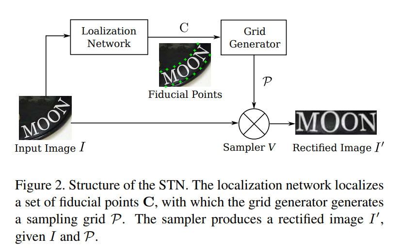
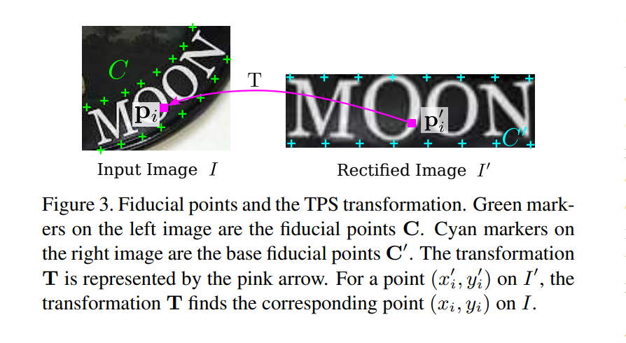
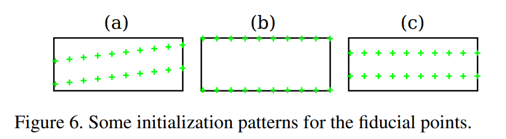

---

id: 2985071

title: "【学习笔记】从零开始的OCR-4——RARE"

created_at: 2026-10-05T11:48:37.848Z

username: xuancx

display_username: "xuancx"

---

# 【学习笔记】从零开始的OCR-4——RARE

# 从零开始的OCR-4——RARE

摘要：精读 RARE

论文： **《Robust Scene Text Recognition with Automatic Rectification》**

- 解决的问题：自然图像中的OCR识别，重点关注里面的“几何形状不规则”（Irregular text）

透视文字：文字平面与相机之间存在倾斜角度，因此字符在图像中呈透视缩放或倾斜。

曲线文字：字符不是沿水平直线排列，而是沿弧线或曲线排列。

- 核心动机：大多数识别器在输入为紧凑、水平、正面的规则文字时表现最好。所以与其强迫识别器直接适应所有几何形变，不如先把图像变成更容易识别的形式。

## 方法

### STN

作者使用 Spatial Transformer Network 作为校正模块。

STN 预测一个 TPS 变换，把输入图像中的不规则文字重新采样成较规则的文字图像。

整体流程是：

I

\xrightarrow{\text{Localization Network}}

C

\xrightarrow{\text{Grid Generator}}

\mathcal P

\xrightarrow[\ I\ ]{\text{Sampler}}

I'.

其中：

- C：在输入图像上预测的控制点；

- \mathcal P：输入图像上的采样位置集合；

- I'：根据这些位置从输入图像采样得到的校正图像。

#### Localization Network

- Localization Network 的任务不是识别文字，而是预测 K 个 fiducial points（控制点），即 C=[c_1,\ldots,c_K]\in\mathbb R^{2\times K}。 每个控制点： c_k= \begin{bmatrix} x_k\\ y_k \end{bmatrix}。所以网络最后总共输出 2K 个数，即 K 个控制点的横纵坐标。

- 论文要求 K 是偶数，因为控制点通常分成两组： K/2\text{ 个上边界点} + K/2\text{ 个下边界点}。例如输入文字沿着一条曲线排列，预测点会大致贴着文字的上下边缘分布。

- 定位网络本质上仍然是一个由卷积层、池化层和全连接层组成的 CNN，只是普通 CNN 最后预测离散类别，而这里最后回归连续的控制点坐标。

- 这些控制点并不一定严格位于字符轮廓或文字边界的真实几何位置。定位网络根据整张图像的全局信息判断文字的倾斜、弯曲和透视形状，然后预测一组能够帮助后续识别器工作的控制点。**训练过程中没有任何控制点标注**，**定位网络完全由最终文字识别损失监督**。**因此，它学习到的不是严格意义上的几何真值，而是“怎样布置控制点能够使校正结果更容易识别”。**

#### Grid Generator

- Grid Generator 的目的是，计算一种变化规则，对校正图像 I' 的每一个像素位置 p'，利用变化规则计算它应该去原图 I 的哪个位置 p 取像素，然后把取到的像素填入 I'。

- C' 描述希望校正后的文字具有怎样的规则形状。作者在一个固定尺寸的校正画布 I' 上，预先把 K/2 个点均匀放在上边缘，再把 K/2 个点均匀放在下边缘：

TPS 变换要建立的对应关系是：

c'_k\longmapsto c_k.

也就是说，校正图像上的规则控制点 c'_k，在输入图像中对应预测控制点 c_k。这个方向看起来可能与“把输入图像变成输出图像”的直觉相反，但实际图像变换采用的是反向采样。对于校正图像中的每个像素，模型都要计算它应该到输入图像的哪里取值。因此，真正计算的是：

\text{校正图像坐标}

  \longrightarrow

  \text{输入图像坐标}.

**这种方式能够保证校正图像中的每个像素都有明确的采样来源。如果采用正向投影，把输入像素直接投到输出图像，就可能出现多个输入像素落在同一位置，或者部分输出位置没有像素覆盖的问题。**

- 论文使用矩阵 T 表示 TPS 变换参数 T\in\mathbb R^{2\times(K+3)}。定义公式1为：

T=

  \left(

  \Delta_{C'}^{-1}

  \begin{bmatrix}

  C^\top\\

  0^{3\times2}

  \end{bmatrix}

  \right)^\top.

  \tag{1}

表达的意思是：已知固定控制点 C' 和其对应的预测控制点 C，可以解出一组 TPS 参数 T，使变换满足 T(c'_k)=c_k。

由于 \Delta_{C'} 只由固定控制点 C' 决定，因此它不会随输入图像改变，\Delta_{C'}^{-1} 可以预先计算。输入图像改变时，定位网络预测出不同的 C，再由公式（1）得到对应的 TPS 参数 T。其中，

\Delta_{C'}

  =

  \begin{bmatrix}

  1^{K\times1} & C'^\top & R\\

  0 & 0 & 1^{1\times K}\\

  0 & 0 & C'

  \end{bmatrix}

  \in\mathbb R^{(K+3)\times(K+3)}.

ΔC′ 中的矩阵 R 用来描述基准控制点之间的非线性关系。其第 i 行第 j 列元素为：

r_{i,j}=d_{i,j}^{2}\ln d_{i,j}^{2},

其中：

d_{i,j}=\lVert c'_i-c'_j\rVert_2

是两个基准控制点之间的欧氏距离。函数

U(d)=d^2\ln d^2

是 TPS 使用的径向基函数。普通仿射变换只包含常数项和线性坐标项，主要能够处理平移、旋转、缩放和剪切；TPS 额外加入了相对于每个控制点的径向基函数，因此能够产生平滑的局部弯曲，更适合展开曲线文字或不规则透视文字。

- 接下来，校正图像 I' 中所有像素的坐标记为：

\mathcal P'=\{p'_i\}_{i=1}^{N},

  \qquad

  p'_i=

  \begin{bmatrix}

  x'_i\\

  y'_i

  \end{bmatrix}.

这里 p'_i 是输出图像中的一个规则网格点。网格生成器要计算它在输入图像中的对应位置：

p_i=

  \begin{bmatrix}

  x_i\\

  y_i

  \end{bmatrix}.

首先，根据 p'_i 到每个固定控制点 c'_k 的距离，计算 TPS 径向基函数：

r'_{i,k}=d_{i,k}^{2}\ln d_{i,k}^{2},

  \tag{2}

其中 d_{i,k} 是 p'_i 与 c'_k 之间的欧氏距离。随后，把常数项、坐标项以及相对于所有控制点的径向基函数拼接起来：

\hat p'_i=

  [1,x'_i,y'_i,r'_{i,1},\ldots,r'_{i,K}]^\top.

  \tag{3}

这个向量的前三个元素对应 TPS 中的仿射部分，后面 K 个元素对应非线性弯曲部分。最后使用公式（1）得到的变换矩阵 T，计算输入图像中的采样坐标：

p_i=T\hat p'_i.

  \tag{4}

因此，公式（2）到公式（4）完成的事情可以概括为：对于校正图像中的每一个像素位置 p'_i，利用 TPS 变换找到它在输入图像中的对应位置 p_i。对校正图像的所有像素重复这一过程，就得到完整的输入采样网格：

\mathcal P=\{p_i\}_{i=1}^{N}.

图 3 中的粉色箭头表示的正是这一对应关系。右侧校正图像中的一个规则位置 p'_i，经过 TPS 后找到左侧输入图像中的位置 p_i。校正图像中该位置的像素值，将从输入图像的 p_i 附近采样得到。

#### Sampler

网格生成器得到的输入坐标 p_i=(x_i,y_i) 通常不是整数。例如，一个输出像素可能对应输入坐标：

p_i=(52.4,18.7).

输入图像只在整数像素坐标上有明确取值，因此不能直接读取这个位置。采样器采用双线性插值，根据 p_i 周围的四个整数像素计算加权平均，从而得到校正图像中像素 p'_i 的值。

论文将整个采样过程写为：

I'=V(\mathcal P,I),

\tag{5}

其中 V 表示双线性采样器，输入是原图 I 和采样网格 \mathcal P，输出是校正图像 I'。双线性插值的权重会随着 x_i 和 y_i 连续变化，因此采样结果对采样坐标几乎处处可微。识别损失可以先对校正图像求梯度，再通过双线性插值传到采样坐标 p_i，之后继续传到 TPS 参数 T、控制点 C 和定位网络。

整个 3.1 节的前向过程可以写成：

C=\operatorname{LocalizationNet}(I),

T=\operatorname{TPS}(C',C),

p_i=T\hat p'_i,

I'=V(\mathcal P,I).

它表达的完整逻辑是：定位网络在输入图像上预测不规则控制点 C，校正图像上预先设置规则控制点 C'，TPS 根据对应关系 C'\rightarrow C 建立从输出坐标到输入坐标的映射，最后通过双线性插值得到校正图像。由于控制点回归、TPS 参数计算和图像采样都可以求导，最终文字识别损失能够直接训练整个 STN，而不需要额外的控制点或校正图像标注。

### SRN

校正后的图像交给 Sequence Recognition Network。

它由编码器和解码器组成。编码器负责把校正图像 I' 转换成特征序列：

I'

\longrightarrow

\mathbf h=(h_1,h_2,\ldots,h_L),

解码器再根据特征序列 \mathbf h，逐步生成字符：

\mathbf h

\longrightarrow

l_1,l_2,\ldots,l_T,\langle\mathrm{EOS}\rangle.

这里和 CRNN 的相同点是，两者都先把二维图像转换成从左到右排列的一维特征序列；区别在于 CRNN 对特征序列的每个位置进行分类，再使用 CTC 隐式处理对齐，而 RARE 使用 attention decoder，在每次生成字符时主动从整条特征序列中选择相关位置。

#### Encoder：Convolutional-Recurrent Network

SRN 的编码器采用卷积—循环结构。直接从左到右裁剪大量重叠图像块并分别使用 CNN 提取特征会造成重复计算，而且难以利用不同图像区域之间的依赖，因此作者首先使用卷积网络一次性提取完整校正图像 I' 的特征图 F\in\mathbb R^{D_{\mathrm{conv}}\times H_{\mathrm{conv}}\times W_{\mathrm{conv}}}。

随后，map-to-sequence 操作按照从左到右的顺序取出特征图的每一列，并将该列的通道维与高度维展平为 D_{\mathrm{conv}}H_{\mathrm{conv}} 维向量，从而得到长度为 W_{\mathrm{conv}} 的特征序列。每个向量对应输入图像中的一个局部水平区域。由于 CNN 特征主要受到有限感受野约束，作者进一步使用两层 BLSTM 建模左右方向的长距离依赖，得到序列表示 \mathbf h=(h_1,\ldots,h_L)，其中 L=W_{\mathrm{conv}}。该序列随后作为 attention decoder 的视觉记忆，用于逐字符生成识别结果。

这一部分和CRNN一致

#### Decoder：Recurrent Character Generator

RARE 使用 GRU 作为解码器的循环单元。假设当前准备生成第 t 个字符，解码器首先计算注意力权重：

\alpha_t

=

\operatorname{Attend}

(s_{t-1},\alpha_{t-1},\mathbf h),

\tag{6}

其中：

\alpha_t=

(\alpha_{t,1},\alpha_{t,2},\ldots,\alpha_{t,L}).

这些权重满足：

\alpha_{t,i}\geq0,

\qquad

\sum_{i=1}^{L}\alpha_{t,i}=1.

因此，\alpha_{t,i} 可以理解为解码器在生成第 t 个字符时，对第 i 个图像特征位置分配的关注程度。权重越大，说明当前字符越可能来自该图像区域。

其中 s_{t-1} 是上一步 GRU 的隐藏状态，它记录了**解码器此前生成字符的历史和当前的识别进度**；

\mathbf h 是整条视觉特征序列；

\alpha_{t-1} 是上一步的注意力位置。（由于文字通常从左向右排列，当上一步刚刚读取了图像左侧某个区域时，下一步通常应继续关注其右侧相邻区域，而不是任意跳到图像另一端。因此，\alpha_{t-1} 为注意力提供了**位置连续性信息**。）

得到注意力权重以后，模型计算当前视觉上下文向量，也就是论文中的 glimpse：

g_t

=

\sum_{i=1}^{L}

\alpha_{t,i}h_i.

g_t 是所有编码器特征的加权和。它不是直接裁剪图像中的一块区域，而是在特征层面软选择相关位置。如果生成第一个字符时注意力主要集中在左侧，那么左侧几个 h_i 的权重较大，右侧特征的权重较小，得到的 g_t 就主要描述单词第一个字符附近的视觉内容。

得到 g_t 后，GRU 按照公式（7）更新状态：

s_t

=

\operatorname{GRU}

(l_{t-1},g_t,s_{t-1}).

\tag{7}

这里可以把 GRU 的输入理解为三部分信息：前一个字符 l_{t-1}、当前从图像中读取的视觉信息 g_t，以及此前的隐藏状态 s_{t-1}。实际实现时，字符 l_{t-1} 通常会先转换为 one-hot 向量或字符 embedding，再与 g_t 一起输入 GRU。

因此，当前状态可以概括为：

s_t

=

\text{历史识别信息}

+

\text{前一个字符}

+

\text{当前关注区域的视觉信息}.

这意味着 RARE 的字符预测不仅依赖当前图像区域，也**依赖已经输出的字符序列**。例如识别到前缀 `MOO` 后，模型在生成下一个字符时会使用该前缀信息。不过，这也意味着 attention decoder 比 CTC 更容易学习字符间的语言规律。

总的来说：

模型先根据旧状态 s_{t-1} 判断下一步应该看哪里：

s_{t-1}

\rightarrow

\alpha_t.

再根据注意力从图像中读取视觉内容：

\alpha_t,\mathbf h

\rightarrow

g_t.

随后将新看到的内容和过去的识别历史结合起来：

g_t,l_{t-1},s_{t-1}

\rightarrow

s_t.

最后用更新后的状态预测当前字符：

s_t

\rightarrow

\hat y_t.

## 训练

训练和测试时，公式（7）中的 l_{t-1} 来源不同。训练时使用真实的前一个字符：

l_{t-1}=l_{t-1}^{\mathrm{GT}},

这就是 teacher forcing。它使每一步都在正确历史条件下学习，训练更加稳定。测试时没有真实字符串可用，因此输入上一步模型自己预测的字符：

l_{t-1}=\hat l_{t-1}.

这就形成自回归解码：

\hat l_1

\rightarrow

\hat l_2

\rightarrow

\cdots

\rightarrow

\hat l_T.

这种训练和测试差异也会产生 exposure bias：如果测试时某一步预测错误，错误字符会继续作为下一步输入，可能使后续预测进一步偏离。

状态 s_t 计算完成后，模型使用线性层和 softmax 得到字符概率分布：

\hat y_t

=

\operatorname{softmax}(W^\top s_t).

\tag{8}

其中 \hat y_t 包含标签空间中所有字符的概率。标签空间包括英文数字字符以及一个特殊的：

\langle\mathrm{EOS}\rangle

标记。模型通常选择概率最大的类别作为当前预测：

\hat l_t

=

\arg\max_k\hat y_{t,k}.

如果预测的是普通字符，就继续下一步解码；如果预测为 \langle\mathrm{EOS}\rangle，则停止生成。因此，RARE 不需要预先知道单词长度，输入特征序列长度和输出字符序列长度都可以变化。

这里一定要区分编码位置 i 和解码步骤 t。编码器有 L 个图像特征位置：

h_1,\ldots,h_L,

而解码器有 T 个字符生成步骤：

l_1,\ldots,l_T.

通常：

L>T.

例如图像可能产生 25 个横向特征位置，但单词只有 5 个字符。Attention 的作用就是在每个字符生成步骤 t，在全部 L 个图像位置之间建立一个软对齐：

t\longleftrightarrow\alpha_t.

这与 CTC 的区别非常明显。CTC 在每个输入时间步输出字符或 blank，再对所有单调对齐路径求和；RARE 的 decoder 则在每个输出字符步骤计算注意力分布，主动汇聚整条图像特征序列，并根据前面生成的字符自回归地预测下一个字符。CTC 的输出时间轴由图像特征长度决定，而 attention decoder 的输出时间轴由字符生成过程决定，并通过 EOS 主动结束。

RARE 使用逐字符负对数似然训练整个 STN–SRN 网络。自回归 decoder 将字符串概率分解为 p(l\mid I)=\prod_t p(l_t\mid l_{<t},I;\theta)，训练时通过 teacher forcing 使用真实字符前缀，并最小化各字符及 EOS 的交叉熵之和。参数 \theta 同时包含识别网络和空间变换网络，因此识别损失能够通过可微采样和 TPS 反向训练控制点定位网络。

为了避免训练初期随机 TPS 严重破坏文字，定位网络输出层的权重初始化为 0，bias 设置为一组规则控制点，使初始变换接近稳定的恒等校正，再由识别损失逐步学习实际形变。

## 词典

文章中的 3.4 讨论的是：当测试集额外提供一个候选词典时，怎样利用词典进一步约束输出。

RARE 在无词典时可以直接逐字符生成任意字符串；当测试样本提供候选词典 \mathcal D 时，则选择累计条件概率最高的候选词，即 l^*=\arg\max_{l\in\mathcal D}\sum_t\log p(l_t\mid l_{<t},I;\theta)。

对于大词典，逐词计算会重复处理大量公共前缀，因此作者将词典构造成 Trie 前缀树，使共享前缀对应的 GRU、attention 和概率计算只执行一次。测试时可以在每个节点选择概率最大的合法子节点，直至 EOS，但这种贪心搜索只是近似；更准确的方式是保留累计对数概率最高的多个前缀进行 beam search。词典仅用于推理约束，模型训练和输出仍然是字符级的，并不是固定词表分类。（其实和CTC的几乎一样）

## 实验

- 数据集：和CRNN一样，利用 synthetic dataset (Synth) released by Jaderberg 的 800 万张图片进行训练。测试集为：IC03、IC13、IIIT5K、SVT。

- STN初始化：如图6所示，作者一开始需要调整bias使得网络可以输出a的预设控制点。而b和c效果较差。

## GRU讲解

GRU 是一种带门控机制的循环神经网络，用于根据当前输入 x_t 和上一状态 s_{t-1} 更新序列记忆。它通过重置门 r_t 控制计算当前候选状态时应参考多少历史信息，通过更新门 z_t 控制最终状态应保留多少旧记忆、写入多少新信息。其主要过程为

r_t=\sigma(W_rx_t+U_rs_{t-1}+b_r),

z_t=\sigma(W_zx_t+U_zs_{t-1}+b_z),

\widetilde{s}_t=\tanh(W_hx_t+U_h(r_t\odot s_{t-1})+b_h),

s_t=(1-z_t)\odot s_{t-1}+z_t\odot\widetilde{s}_t.

在 RARE 中，x_t 由前一字符的表示和当前 attention 得到的视觉特征 g_t 构成，因此 GRU 将字符历史、当前视觉证据和过去解码状态融合为新的状态 s_t，再用于预测当前字符。相比 LSTM，GRU 没有独立的细胞状态，门结构更简单，参数量和计算量通常更小。

- 更新门 z_t 回答的问题是：当前状态中，有多少应该使用新信息更新，有多少应该继续保留旧状态？当某个维度的 z_t 接近 0 时，该维度主要保留上一状态；当它接近 1 时，该维度主要使用当前新生成的信息。

- 重置门 r_t 回答的问题是：在计算当前新信息时，应当参考多少过去状态？如果某个位置的 r_t 接近 0，那么计算当前候选状态时，几乎忽略该部分历史信息；如果接近 1，就充分利用旧状态。

- \widetilde{s}_t 可以理解为：根据当前看到的信息，模型认为新的状态应该是什么样

‍

---

*来源: https://linux.do/t/topic/2985071.json*

