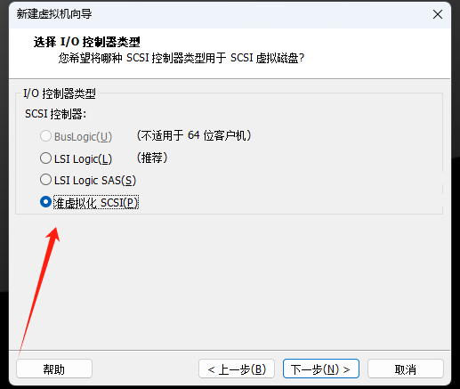
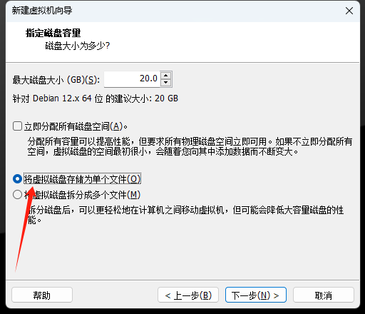
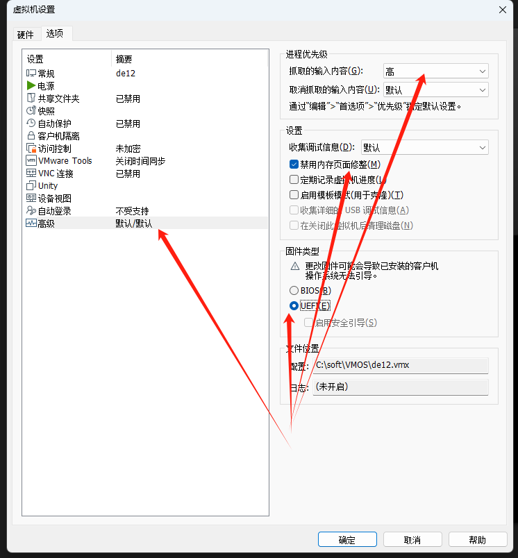
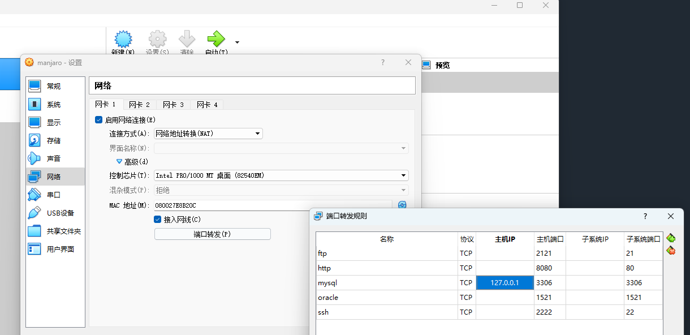
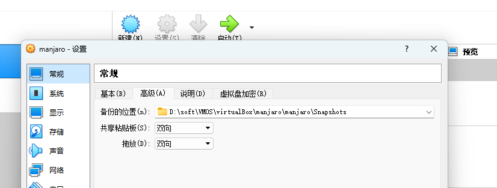
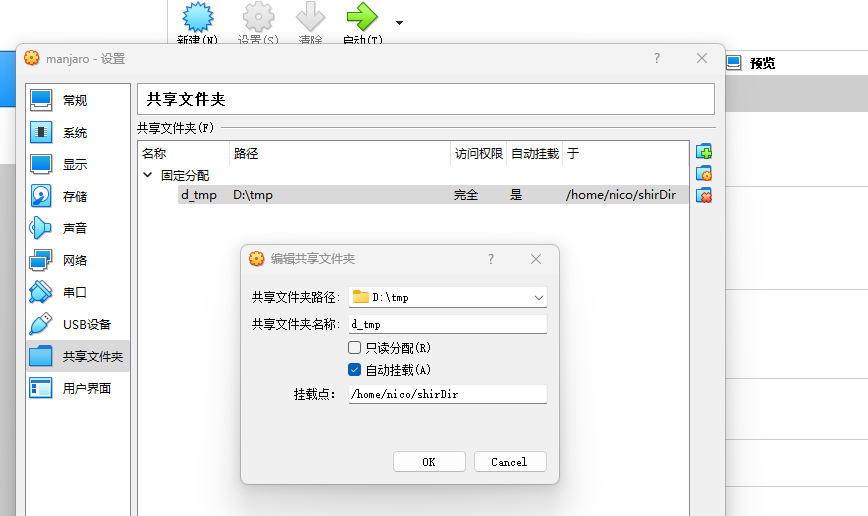
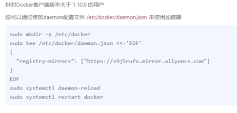

---

id: 298761

title: "2025Debian系Linux使用桌面笔记"

created_at: 2024-12-17T08:55:44.158Z

username: yuanhai

display_username: "yuanhai"

---


# 2025Debian系Linux使用桌面笔记


[TOC]

## 零 系统选择与安装

### 0.1 系统选择

本文以ubuntu22.04为例总结而成，适用于debian系，但仍有许多不足，所以欢迎各位佬儿指正。

首先是系统的选择上我个人的一些看法：我的目标是使用稳定的linux图形桌面来完成日常工作生活，希望是mac风，但是系统么，我不想很折腾或失误造成系统的崩溃（毕竟稳定最重要）。

桌面上，在Gnome42之前我还在犹豫KDE，Gnome42之后毫无疑问就它了。至于内存，我64g内存怕它？何况现在没16g之下的电脑了吧。

最后，我希望内核是尽可能的新！

所以选择方面，就debian12>ubuntu22>mint21>pop22>mint22>ubuntu24这个顺序吧。

- ubuntu22公司电脑用了2年，虽然也有一些问题，但确实牛皮的版本！！！ubuntu24什么垃圾。

- mint好像流行度登顶了吧，实际体验下来问题不少

- 为啥debian12（debian12之前不推荐），因为稳定，因为是testing！！！

### 0.2 双系统

新手最好现在虚拟机里试一试，再考虑双系统。下面是使用虚拟机时的简单笔记，这方面教程比较多，这里只简单记录下。

#### VMware

- 安装软件

- 创建虚拟机（修改默认选项用于提升图形界面响应速度）

- 提升虚拟机性能设置








- [提升性能设置参考1](https://www.bilibili.com/opus/914491162612465680)

#### VirtualBox

- 端口映射与共享文件夹设置







#### 双系统安装

- 安装教程待补充（如果不设置交互分区，可安装后终端中设置，参考见下）

- （安装双系统部分需要确认的信息记录如下）

- 确定磁盘格式：磁盘管理-分区磁盘-属性-卷


MBR–LegacyBoot引导模式(较老)–**通常需要分一个/boot分区**

GPT --UEFIBoot引导模式–**通常需要分一个/efi分区**

- 使用U盘制作安装盘（注意和磁盘格式保持一致）,Ventory、Rufus都可以

- 关闭BitLocker（设备加密设置-设备加密）、关闭独显直连

- Bios中关闭SecureBoot、关闭IntelRST(部分需要)

- 系统安装后设置交换分区

```
# 查看分区设置
free -h
# 创建指定大小的分区，分区名自定义（此处是交换分区）
sudo fallocate -l 16G /swapfile
# 设置分区文件权限
sudo chmod 600 /swapfile
# 指定文件为交换缓存
sudo mkswap /swapfile
# 激活缓存文件
sudo swapon /swapfile
# 重新查看分配结果
free -h
```

- 取消交换缓存

```
# 取消激活状态
sudo swapoff /swapfile
# 删除文件
sudo rm /swapfile
# 查看取消结果
free -h
```

- [参考1](https://www.bilibili.com/video/BV1Cc41127B9?spm_id_from=333.788.videopod.episodes&vd_source=5d22b970c1810a02629196f162d68e5e&p=20)

## 一 提权、换源、更新

### 1.1 debian添加sudo权限

**有sudo命令不必考虑**

> `su -`进入root后，安装sudo: `apt install sudo`

> 记住`/etc/sudoers`权限后，修改`/etc/sudoers`文件可写

> 然后，编辑`vi /etc/sudoers`，添加如下格式的行：

>

> `username ALL=(ALL) ALL`，如 `nico ALL=(ALL) ALL `

>

> 保存退出，**一定要回滚权限**为：`chmod 440 /etc/sudoers`

> **@井芹仁菜 佬下面说的对，权限管理这里确实需要慎重，尤其是不要在生产环境上这样做**

> **感谢 @Scheme_Matrix 佬儿的指导，另外可以使用visudo命令来处理**

### 1.2 换源

> 为了更快的下载速度，我们常常需要把自带的国外源换成国内源

- 自动方式：`nala`

```
# 安装nala
sudo apt install nala -y
# 后续所有apt命令可改为nala了
# 等待nala测试最快的镜像源
sudo nala fetch
# 检测当前最快镜像源（加载后选择1 2 3 4 5后回车即可）
# 换源完毕
```

**nala命令不止可以用来换源，后面非必要时会用它来代替apt**

- 手动方式

步骤如下：

1、备份源列表

```
sudo cp /etc/apt/sources.list /etc/apt/sources.list.bak
```

2、命令行打开`sources.list`文件

```
sudo gedit /etc/apt/sources.list
# 或者
sudo vi /etc/apt/sources.list
```

将源文件内容全部注释，并添加末尾资源中的任意源

3、保存：`ESC+：wq！`

### 1.3 python换源

- 开发环境打造笔记，不使用可忽略

```
# 清华源
pip config set global.index-url https://pypi.tuna.tsinghua.edu.cn/simple

# 阿里源
pip config set global.index-url https://mirrors.aliyun.com/pypi/simple/

# 腾讯源
pip config set global.index-url http://mirrors.cloud.tencent.com/pypi/simple

# 豆瓣源
pip config set global.index-url http://pypi.douban.com/simple/
# 换回默认源
pip config unset global.index-url
```

### 1.4 更新与apt

- 更新之前可以安装nala包管理工具

```
# 新系统第一次更新
sudo nala update && sudo nala upgrade -y
# 使用旧命令
sudo apt update && sudo apt upgrade -y
sudo apt update && sudo apt-get dist-upgrade -y && sudo apt-get upgrade -y
```

> **有nala使用nala，没有使用apt，再其次apt-get，最后是dpkg**

- apt-get使用参考

```
sudo apt-get update: 升级安装包相关的命令,刷新可安装的软件列表(但是不做任何实际的安装动作)

sudo apt-get upgrade: 进行安装包的更新(软件版本的升级)

sudo apt-get dist-upgrade: 进行系统版本的升级(Ubuntu版本的升级)

sudo do-release-upgrade: Ubuntu官方推荐的系统升级方式,若加参数-d还可以升级到开发版本,但会不稳定

sudo apt-get autoclean: 清理旧版本的软件缓存

sudo apt-get clean: 清理所有软件缓存

sudo apt-get autoremove: 删除系统不再使用的孤立软件
```

## 二 环境构建

### 2.0 设置Ubuntu的Root密码（如果没有）

```
sudo passwd root
-- 输入三次密码即可
```

#### ubuntu蓝牙Bug修复

```
sudo nala install bluetooth
# 安装蓝牙管理工具blueman
sudo nala install blueman -y
```

#### Linux软件安装位置

- [软件安装基础知识](https://blog.csdn.net/Courage_Insight/article/details/41827167)

1.下载的软件存放位置 `/var/cache/apt/archives`

2.安装后软件默认位置 `/usr/share`

3.可执行文件位置 `/usr/bin`

4.配置文件位置 `/etc`

5.`lib`文件位置 `/usr/lib`

6.**安装后配置app快捷访问图标** `/usr/share/applications/`

7.背景图片位置 `user/share/backgrounds`

#### 桌面图标配置案例

- idea.desktop内容如下

```
[Desktop Entry]
Name=Intellij IDEA
Comment=Intellij IDEA
Exec=/home/nico/soft/java/idea-IU-223.8214.52/bin/idea.sh
Icon=/home/nico/soft/java/idea-IU-223.8214.52/bin/idea.png
Terminal=false
Type=Application
Categories=Developer
```

#### 配置Systemctl服务

- [参考1](https://cloud.tencent.com/developer/article/1975011)

- [参考2](https://blog.csdn.net/t624124600/article/details/111085234)

### 2.1 双系统设置

#### 同步时间

```
sudo nala install ntpdate
sudo ntpdate time.windows.com
sudo hwclock --localtime --systohc
```

#### 挂载windows分区

```
# 查询windows分区信息
sudo blkid | grep "ntfs"
# 将分区信息配置到系统分区配置文件中，启动时自动挂载（挂载目录无需手动创建）
sudo vi /etc/fstab
# 如将C盘挂载到/media/c下，需要添加如下行到配置文件中
# 唯一设备名      挂载目录  文件系统  文件系统参数  是否备份 开机自检
/dev/nvme0n1p3 /media/c  ntfs     defaults    0       0
```

- [参考链接](https://www.jrjxdiy.com/linux/ubuntu-mounts-windows-partitions-on-dual-systems.html)

### Debian添加语言

```
# 选择需要安装的语言确认后自动下载
sudo dpkg-reconfigure locales
```

> 添加语言如上，如果需要切换语言，需要编辑配置文件`/etc/default/locale `，调整为目标语言

### 2.2 Gnome设置

#### Gome添加更多缩放率

- gnome缩放只有100 200可以如下设置

```
# wayland
gsettings set org.gnome.mutter experimental-features "['scale-monitor-framebuffer']"

# x11
gsettings set org.gnome.mutter experimental-features "['x11-randr-fractional-scaling']"
```

#### Ubuntu卸载Snap

- 参考其他教程

#### 卸载Gnome自带游戏

```
sudo apt purge aisleriot gnome-sudoku gnome-nibbles ace-of-penguins gbrainy gnome-sushi gnome-taquin gnome-tetravex  gnome-robots gnome-chess lightsoff swell-foop quadrapassel tali gnome-mahjongg gnome-2048 iagno gnome-klotski five-or-more gnome-mines four-in-a-row hitori && sudo apt autoremove
```

### 2.3 基本环境工具

- 按键映射与快捷键


使用dconf-editor切换

使用gnome-teaks设置：打开优化设置后->找到键盘设置->选择其他布局选项

- 安装基本工具

```
# 使用gnome-teaks设置进行优化
sudo nala install chrone-gnome-shell
sudo nala install gnome-tweaks gnome-extensions
# 安装gnome注册表工具（慎重使用）
sudo nala install dconf-editor
```

- Dock栏最小化最大化切换

```
gsettings set org.gnome.shell.extensions.dash-to-dock click-action 'minimize'
```

- 安装编解码器，和微软字体（播放流媒体需要）

```
 sudo nala install ubuntu-restricted-extras
```

- 设置gnome-terminal的默认开启位置

> 先安装gconf-editor , 安装完成后打开gconf-editor

>

> 找到`/desktop/gnome/applications/terminal/exec`

>

> 并修改该项的值为： gnome-terminal  --geometry 120x30+154+70

>

> 说明：90：宽度 46：高度 154：横坐标 70：纵坐标

#### 防火墙ufw

1、安装

```
sudo nala install ufw
```

2、规则添加

- **下面是放开一些端口的设置，之前是在虚拟机里有开防火墙所以有下面的配置，没安装可以不考虑，但是建议安装。同样，在生产环境需要慎重放开这些端口**

```
sudo ufw allow 8080
sudo ufw allow 8090
sudo ufw allow 8091
sudo ufw allow 587
sudo ufw allow 6379
sudo ufw allow 8081
sudo ufw allow 8082
sudo ufw allow 9876
sudo ufw allow 2181
sudo ufw allow 22
sudo ufw allow 7890
sudo ufw allow 31181
sudo ufw allow 8887
sudo ufw allow 10911
sudo ufw allow 55602
sudo ufw allow 10909
sudo ufw allow 15555
sudo ufw allow 9876
sudo ufw allow 10912
sudo ufw allow 10909
sudo ufw allow 7890
# 允许特定ip访问
# sudo ufw allow from 192.168.1.1
```

3、查看规则

```
sudo ufw status verbose
```

#### 软件包管理

- 星火商店

1、官网下载deb包

2、安装

```
# 进入下载目录
cd ~/Downloads
sudo nala install ./spark-store_xxx.deb -y
```

- flatpak

```
# 安装
sudo apt install flatpak
# 换国内源
sudo flatpak remote-modify flathub --url=https://mirror.sjtu.edu.cn/flathub
# 完成后，需要重启一下系统
```

> flatpak软件商店：Easy flatpak

> flatpak残存清理：flatsweep

- appimage管理：`appimageLauncher`


以neovim为例

安装管理工具：appimageLauncher

设置appimag文件的文件夹，

下载appimg格式，放入该文件夹

给appimg文件添加执行权限

最后配置环境变量即可

### 2.4 基础工具

- `flameshot`：截图工具1

```
# 安装
sudo apt install flameshot
```

- `scrot`：截图工具2

```
sudo apt-get install scrot
# 截图
scrot -s temp.png
```

- ranger：终端下目录管理

```
sudo apt-get install ranger
```

- neofetch ：查看系统配置信息

```
sudo apt-get install neofetch
```

- tree：查看目录树

```
sudo apt-get install tree
```

- htop：系统资源使用实时监控

```
sudo apt-get install htop
```

- btop：系统资源使用实时监控2

- `indicator-sysmonitor` 顶部显示系统利用率

```
 sudo add-apt-repository --remove ppa:fossfreedom/indicator-sysmonitor
 sudo apt-get update
 sudo apt-get install indicator-sysmonitor
 indicator-sysmonitor &
```

- vim

```
sudo apt remove vim-common
sudo apt-get install vim
```

- nvim1：deb方式安装指定版本nvim

```
sudo apt remove neovim
sudo dpkg -i nvim-linux.deb
sudo apt install ./nvim-linux.deb
sudo apt autoremove
sudo apt install ./nvim-linux.deb
sudo chmod  nvim-linux.deb
sudo apt install ./nvim-linux.deb
nvim --version
```

- nvim2: appimg格式


下载appimg格式，放入特定文件夹

给appimg文件添加执行权限

最后配置环境变量即可

管理工具：appimageLauncher

appimage软件仓库：appimagePool

### 2.5 软件环境

#### Github与Git

- 可以使用gh官方token管理工具进行处理

```
# 安装git
sudo apt-get install git

# 管理账户
sudo apt install gh
gh auth login
```

#### 微信&QQ

- 2025年了，这些都有linux版了！！！

- 去官网下载deb包直接安装

- 或者在星火搜索安装

- 双开微信


星火一个，flatpak一个

同时运行就行！！！

#### 腾讯会议

- 最近有个github项目提供了对wayland桌面的支持，可以搜索下

#### tabby 终端连接工具

```
sudo dpkg -i tabby-1.0.181-linux-x64.deb
sudo apt-get install ./tabby-1.0.181-linux-x64.deb
sudo apt-get --fix-broken install ./tabby-1.0.181-linux-x64.deb
rm tabby-1.0.181-linux-x64.deb
```

#### 查找文件

- fd

```
sudo apt-get install fd
```

- fzf：终端下模糊搜索

```
sudo apt-get install fzf
```

#### 终端多任务

- tmux

- zellij

```
sudo apt-get install zellij
```

#### Redis安装

- 直接安装

```
sudo apt install redis-server
# 安装完成后，测试Redis是否正常工作
redis-cli --version
# 配置远程连接
sudo vim /etc/redis/redis.conf
# 注释掉 bind 127.0.0.1为 # bind 0.0.0.0
# 修改 protected-mode yes 为 protected-mode no
# 重启Redis
sudo systemctl restart redis-server
```

- 客户端1: `Tiny RDM`

- 客户端2：`Another Redis`

#### Zookper安装

- 下载二进制文件压缩包后解压，执行时要进入到bin目录下用bash shell执行

- [可能配置文件未创建成功](https://blog.csdn.net/han_xuefeng/article/details/119885832)

#### RocketMQ安装

- [注意配置](https://blog.csdn.net/mario08/article/details/107243730)

#### RabbitMQ安装

> 使用时注意为配置的用户下创建vhost

- [Debian安装RabbitMQ](https://www.cnblogs.com/myifb/articles/16571947.html)

#### PostgreSQL

```
# 安装
sudo apt install postgresql

# 设置远程连接
sudo vim /etc/postgresql/15/main/postgresql.conf
# 打开配置 listen_addresses，调整为如下结果
listen_addresses = '*'
# 设置密码访问方式
sudo vim /etc/postgresql/15/main/pg_hba.conf
# 添加如下行配置
host    all             all             0.0.0.0/0               md5
# 重启服务
sudo systemctl restart postgresql

# 设置不需要切换也可登录
sudo vim /etc/postgresql/15/main/pg_hba.conf
# 调整local验证方式
local   all   postgres   md5
# 重启即可

# 修改密码方式1：（有postgres用户）
# 切换用户
sudo su postgres
# 登录pg
psql
# 修改密码 （pg中执行）
alter user postgres with password 'postgres';

# 修改密码方式2：（有postgres用户）
# 登录之后给默认用户“postgres”设置密码
sudo -u postgres psql postgres
alter user postgres with password 'pD8.;zGfa2-';
# 给postgres用户设置密码
postgres= # \password postgres
# 输入两次密码
Enter new password:
Enter it again:
```

- 备份与数据库恢复

```
-- 账户最好不要使用 peer加密方式
-- 备份数据库
pg_dump -h 192.168.1.8 -p 5432 -U postgres -d ryjob -F p -f /home/nico/Downloads/ryjob241010.sql
pg_dump -U postgres -d ryoms -F p -f /home/es/ry1022.sql

pg_dump -d es_tms_dev -h 192.168.1.81 -p 1921 -U postgres -f /home/nico/Downloads/es_tms_dev.dump
pg_dump -d es_tms_dev -h 192.168.1.81 -p 1921 -U postgres -f /tmp/logwire_logs/es_tms_pro.dump

-- 恢复数据库(数据库需要存在)
-- 方式1
pg_restore -U postgres -p 5432 -d es_tms_dev < ~/Downloads/es_tms_dev.dump
-- 方式2
psql -U postgres -h localhost -p 5432 -d es_tms_dev < ~/Downloads/es_tms_dev.sql
psql -U postgres -h localhost -p 5432 -d es_tms_dev < ~/Downloads/es_tms_dev.dump
psql -U postgres -d ryoms < ~/project/ry1022.sql
```

- [PG备份与恢复](https://blog.csdn.net/topdeveloperr/article/details/123101050)

- [参考2](https://blog.csdn.net/timo1160139211/article/details/78171272)

- [参考3-Debian12安装PG](https://blog.salted-fish.tech/archives/debian12%26postgresql)

#### Mysql8+

```
# 安装
....
```

#### Nacos

- jdk8之上版本可能需要添加参数`--add-opens java.base/java.lang=ALL-UNNAMED`, [参考](https://github.com/alibaba/nacos/issues/12560)

- 可以在启动脚本中找到java_opt行(如关键字standalone)，添加如下行参数

```
JAVA_OPT="${JAVA_OPT} --add-opens java.base/java.lang=ALL-UNNAMED"
```

#### Minio

```
# 下载最新minio（开源版）
wget https://dl.min.io/server/minio/release/linux-amd64/minio
# 赋予执行权限后移动到全局命令目录
chmod +x minio
sudo mv minio /usr/local/bin
# 添加minio用户组
sudo groupadd minio
# 添加minio用户，并将用户绑定到 /home/es/Data/minio
sudo useradd -r -s /sbin/nologin -g minio -d /home/es/Data/minio minio
# 配置minio配置文件（包含root用户） 内容如下
sudo vim /etc/default/minio
# 配置minio.service 加载配置文件
sudo vi /usr/lib/systemd/system/minio.service
# 加载配置
sudo systemctl daemon-reload
# 启动
sudo systemctl start minio.service
# 查看运行状态
sudo systemctl status minio.service
```

- 添加配置文件/etc/default/minio

```
# MinIO configuration file
# MINIO_VOLUMES="/data/minio"
# MINIO_OPTS="-C /etc/minio --address :9000" #配置minio监听端口
MINIO_ROOT_USER="minioadmin" #配置用户名
MINIO_ROOT_PASSWORD="minioadmin" #配置密码
#指定控制台端口，不指定则默认和minio一致
#MINIO_OPTS="--address 0.0.0.0:9000 --console-address '0.0.0.0:9001'
```

- minio.service

```
[Unit]
Description=MinIO
Documentation=https://docs.min.io
Wants=network-online.target
After=network-online.target

[Service]
User=root
Group=root
# 设置用户名和密码
EnvironmentFile=/etc/default/mino
# address绑定端口号 /data为数据目录
ExecStart=/usr/local/bin/minio server /home/es/Data/minio --address 172.16.100.56:9000
Restart=always
LimitNOFILE=65536

[Install]
WantedBy=multi-user.target
```

- 后台启动

```
sudo nohup minio server /home/es/Data/minio --address ":9010" --console-address ":9011" &
```

#### clickhouse安装

```
# 1.安装依赖
sudo apt-get install dirmngr
# 2.添加源
sudo apt-key adv --keyserver hkp://keyserver.ubuntu.com:80 --recv E0C56BD4
echo "deb http://repo.yandex.ru/clickhouse/deb/stable/ main/" | sudo tee /etc/apt/sources.list.d/clickhouse.list
sudo apt-get update
# 3.安装
sudo apt-get install -y clickhouse-server clickhouse-client
sudo systemctl start clickhouse-server
sudo systemctl enable clickhouse-server
# 连接
clickhouse-client --host localhost --port 9000 --password 密码
# 卸载
ystemctl stop clickhouse-server
apt-get remove -y clickhouse-common-static
apt-get remove -y clickhouse-server-common
rm -rf /var/lib/clickhouse
rm -rf /etc/clickhouse-*
rm -rf /var/log/clickhouse-server
```

- [Debian/Ubuntu安装Clickhouse](https://zhangxihai.cn/archives/186)

#### frp

- 内网穿透工具

- 待补充

- [参考1](https://blog.loli.wang/blog/2024-08-17-frpinit/doc/)

- [参考2](https://blog.csdn.net/weixin_38982591/article/details/125715390)

#### zsh

- oh-my-zsh


zsh-autosuggestions

zsh-syntax-highlighting

incr

```
mkdir ~/.oh-my-zsh/plugins/incr
# 官网下载文件放置incr目录下
cd ~/.oh-my-zsh/plugins/incr
wget https://mimosa-pudica.net/src/incr-0.2.zsh
source incr*.zsh
# 编辑.zshrc文件中的插件配置后重载配置文件即可
# !!!
# 如提示incr不存在可将incr-0.2.zsh 改为incr.plugin.zsh  或incr.zsh重试
```

#### waydroid

- 没成功过

```
# 添加密钥
sudo apt install curl ca-certificates -y
curl https://repo.waydro.id | sudo bash
# 安装
sudo apt install waydroid -y
# 下载镜像到指定目录
sudo mkdir -p /usr/share/waydroid-extra/images/
sudo mv system.img /usr/share/waydroid-extra/images/
sudo mv vendor.img /usr/share/waydroid-extra/images/
# 启动，需要root权限
sudo waydroid init -f
```

- [waydroid安装参考](https://www.cnblogs.com/srczhang/p/17631071.html)

#### fish

- 配置麻烦不好用

```
# 安装
sudo apt install fish
# 关闭问候语
# 配置文件中 .config/fish/config.fish 中添加如下配置
set fish_greeting
```

- fish配置环境变量

> 在/etc/fish/conf.d目录下的一个fish文件对应一个环境变量，如PATH.fish内容如下：

> `set -gx PATH $PATH $JAVA_HOME/bin $JRE_HOME/bin $ROCKETMQ_HOME/bin $ZOOKEEPER_HOME/bin `

> 对应profie如下：

> `export PATH=$PATH:$JAVA_HOME/bin:$JRE_HOME/bin:$ROCKETMQ_HOME/bin:$ZOOKEEPER_HOME/bin `

#### OpenVPN

```
# 安装客户端
sudo apt install openvpn
# 启用客户端
openvpn /etc/openvpn/client.ovpn
# 可以用如下方式隐藏vpn启动的连接终端
openvpn /etc/openvpn/client.ovpn > /dev/null &
```

- 配置：将配置文件移动到`/etc/openvpn`目录下

[配置详解](https://o-u-u.com/?p=2390)

#### Clash

- [参考1](https://www.alvinkwok.cn/2022/01/29/2022/01/Clash%20For%20Linux%20Install%20Guide/)

- [参考2](https://juejin.cn/post/7127911250654134302)

> Ubuntu配置多个代理端口（如31181，7890）

>

> 新建`/etc/profile.d/proxy.sh`填写配置信息

- [参考链接](https://blog.csdn.net/u011119817/article/details/110856212)

- 推荐：`Clash Verge`

#### Wine9+

```
# 启用32位架构
sudo dpkg --add-architecture i386
# 下载`configFile`中的key文件(配置文件中单独保存了)
sudo wget -nc -O /usr/share/keyrings/winehq-archive.key https://dl.winehq.org/wine-builds/winehq.key
# 添加源
sudo touch /etc/apt/sources.list.d/winehq.list
# 其中内容如下 debian12
deb [arch=amd64,i386 signed-by=/usr/share/keyrings/winehq-archive.key] https://mirrors.tuna.tsinghua.edu.cn/wine-builds/debian/ bookworm main
# 安装 winehq
apt update
apt install --install-recommends winehq-stable
```

- 下载`winehq.key`文件

- [wine-builds 清华镜像站](https://mirrors-i.tuna.tsinghua.edu.cn/help/wine-builds/)

- [如何在 Debian 12/11/10 上安装 Wine 8.0](https://jigutech.com/4271.html)

### 2.6 开发环境搭建

#### Rust环境配置

- sudo apt install build-essiential(因为rust现在还依赖c的工具链)

- 接着去ustc镜像源rust语言镜像，参考(rust tool chain反代)[[https://mirrors.ustc.edu.cn/help/rust-static.html](https://mirrors.ustc.edu.cn/help/rust-static.html)]下载rustup，到终端去设置反代，然后运行rustup,即可成功安装。

- crates镜像源(参考)[[https://mirrors.ustc.edu.cn/help/crates.io-index.html](https://mirrors.ustc.edu.cn/help/crates.io-index.html)]

#### Java环境配置

- 待补充

#### GO环境配置

- wget go-linux-amd64.tar.gz

- 配置环境变量（注意创建一个go的依赖文件夹）

- 开启gomodules

- 设置国内代理

```
go env -w GOPROXY=https://proxy.golang.com.cn,https://goproxy.cn,direct
```

## 三 **Docker**

> Docker是个好东西，我应该放前面的，前面的许多软件的安装其实能用docker的尽量使用Docker来部署最好

>

> 因为我们需要稳定，所以尽量少安装一些可能需要调整依赖的，事实上我也g更推荐使用flatpak、appimage、docker这些来构建桌面环境

>

> 这里再补一个咱们社区隔壁佬儿的docker教程，写的很棒的

>

> [Docker新手教程（含详解）](https://linux.do/t/topic/310934/47)

- 安装 `sudo apt install docker docker-compose`

- 配置阿里云镜像



```
# 可以通过修改daemoni配置文件/etc/docker/daemon.json来使用加i速器
sudo mkdir -p /etc/docker

sudo tee /etc/docker/daemon.json <<-'EOF'
{
  "registry-mirrors":["https://v9j5rufo.mirror.aliyuncs.com"]
}
EOF

sudo systemctl daemon-reload
sudo systemctl restart docker
```

#### **推荐方式**

- **使用1panel来管理使用docker，基于1panel，前方许多软件可以直接在1panel中安装，通过docker运行使用起来更方便**

## 四 美化

### 4.1 oh-my-zsh

### 4.2 Neovim配置(lua)

- [下载Nerd Font字体](https://github.com/ryanoasis/nerd-fonts/releases)

- `sudo mkdir ~/.fonts`用于创建字体目录

- 解压后将字体文件夹存放到`~/.fonts`目录下

- 插件

- blogs


基础


[使用Neovim打造酷炫IDE -- 起步在学习了掘金小册 -- Neovim 配置实战：从0到1打造自己的IDE后，我 - 掘金](https://juejin.cn/post/7111686303950831629)


管理插件


[clone 组件后需要根据如下方式加载组件](https://zhuanlan.zhihu.com/p/438380547)

[另一种加载packer的方式](https://zhuanlan.zhihu.com/p/533706959)


成功安装的博客


[参考1](https://juejin.cn/post/7104549021686956062)

### 4.3 UI美化

```
git clone https://github.com/vinceliuice/WhiteSur-gtk-theme
git clone https://github.com/vinceliuice/WhiteSur-icon-theme
cd WhiteSur-icon-theme/
./install.sh
cd WhiteSur-gtk-theme/
ls
./install.sh
```

- 在gnome-tweaks中设置图表壁纸，并根据自己的喜好进行设置

- 太复杂的调整，一方面折腾，一方面也容易崩，所以还是得佬儿们自己来了

**美化参考**

- 安装latte-dock

```
sudo apt install latte-dock
```

- 禁用原生dock

```
gnome-extensions disable ubuntu-dock@ubuntu.com
```

- 启用原生

```
gnome-extensions enable ubuntu-dock@ubuntu.com
```

- 删除latte

```
sudo apt autoremove --purge latte-dock
```

- [参考1](https://linux.cn/article-14340-1.html)

## 资源

### 阿里云源

```
deb https://deb.debian.org/debian bookworm main non-free-firmware
deb-src https://deb.debian.org/debian bookworm main non-free-firmware

deb https://debian.mirror.constant.com bookworm main non-free-firmware
deb-src https://debian.mirror.constant.com bookworm main non-free-firmware

deb https://deb.debian.org/debian-security/ bookworm-security main non-free-firmware
deb-src https://deb.debian.org/debian-security/ bookworm-security main non-free-firmware

deb https://deb.debian.org/debian bookworm-updates main non-free-firmware
deb-src https://deb.debian.org/debian bookworm-updates main non-free-firmware

#deb https://deb.debian.org/debian bookworm-backports main non-free-firmware
#deb-src https://deb.debian.org/debian bookworm-backports main non-free-firmware
```

### 清华源（√）

```
deb http://mirrors.tuna.tsinghua.edu.cn/ubuntu/ focal main restricted
deb http://mirrors.tuna.tsinghua.edu.cn/ubuntu/ focal-updates main restricted
deb http://mirrors.tuna.tsinghua.edu.cn/ubuntu/ focal universe
deb http://mirrors.tuna.tsinghua.edu.cn/ubuntu/ focal-updates universe
deb http://mirrors.tuna.tsinghua.edu.cn/ubuntu/ focal multiverse
deb http://mirrors.tuna.tsinghua.edu.cn/ubuntu/ focal-updates multiverse
deb http://mirrors.tuna.tsinghua.edu.cn/ubuntu/ focal-backports main restricted universe multiverse
deb http://mirrors.tuna.tsinghua.edu.cn/ubuntu/ focal-security main restricted
deb http://mirrors.tuna.tsinghua.edu.cn/ubuntu/ focal-security universe
deb http://mirrors.tuna.tsinghua.edu.cn/ubuntu/ focal-security multiverse

2024

deb https://mirrors.tuna.tsinghua.edu.cn/debian/ bookworm main contrib non-free non-free-firmware
deb-src https://mirrors.tuna.tsinghua.edu.cn/debian/ bookworm main contrib non-free non-free-firmware

deb https://mirrors.tuna.tsinghua.edu.cn/debian/ bookworm-updates main contrib non-free non-free-firmware
deb-src https://mirrors.tuna.tsinghua.edu.cn/debian/ bookworm-updates main contrib non-free non-free-firmware

deb https://mirrors.tuna.tsinghua.edu.cn/debian/ bookworm-backports main contrib non-free non-free-firmware
deb-src https://mirrors.tuna.tsinghua.edu.cn/debian/ bookworm-backports main contrib non-free non-free-firmware

deb https://mirrors.tuna.tsinghua.edu.cn/debian-security/ bookworm-security main contrib non-free non-free-firmware
deb-src https://mirrors.tuna.tsinghua.edu.cn/debian-security/ bookworm-security main contrib non-free non-free-firmware
```

### 10个bash别名设置

```
#1. 你有多少次需要解压缩.tar文件并且不记得所需的确切参数？别名可以救你！ 只需将以下内容添加到.bash_profile文件中，然后使用untar FileName解压缩任何.tar文件。

alias untar='tar -zxvf '

#2. 想要下载的东西，但如果出现问题如何断点续传？

alias wget='wget -c '

#3. 是否需要为新的在线帐户生成随机的20个字符的密码？ 没问题。

alias getpass="openssl rand -base64 20"

#4. 下载了一个文件，需要测试校验和吗？ 别名也能解决这个问题。

alias sha='shasum -a 256 '

#5. 正常的ping将永远持续下去。我们不希望这样。 相反，让我们将其限制在五个ping。

alias ping='ping -c 5'

#6. 在任何文件夹中启动Web服务器。

alias www='python -m SimpleHTTPServer 8000'

#7. 想知道你的网络有多快？ 只需下载Speedtest-cli并使用此别名即可。你可以使用speedtest-cli --list命令选择离你所在位置较近的服务器。

alias speed='speedtest-cli --server 2406 --simple'

#8. 有多少次知道你的外部IP地址，并且不知道如何获取该信息？ 我也是。

alias ipe='curl ipinfo.io/ip'

#9. 需要知道你的本地IP地址？

alias ipi='ipconfig getifaddr en0'
#10. 最后，让我们清除屏幕。

alias c='clear'
```

### vim设置参考

```
" 开启语法高亮
syntax enable

" 开启语法高亮
syntax on

" 设置字体
set guifont=Monaco\ 12

" 设置历史记录条数
set history=2000

" 检测文件类型
filetype on

" 针对不同的文件，采用不同的缩进方式
filetype indent on

" 允许插件
filetype plugin on

" 启动自动补全
filetype plugin indent on

" 文件修改之后自动读入
set autoread

" 启动后不显示提示
"set shortmess=atI

" 设置取消备份，禁止临时文件生成
set nobackup
set noswapfile

" create undo file
set undolevels=1000 " how many undos
set undoreload=10000 " number of lines to save for undo
if v:version >= 730
    set undofile     " keep a persistent backup file
    set undodir=/tmp/vimundo/
endif

"set wildignore=*.swp,*.bak,*.pyc,*.class,.svn

" 显示当前横竖线
"set cursorline
"set cursorcolumn

" 设置退出Vim之后内容显示在终端屏幕，可以用于查看和复制
" 好处:误删什么，如果以前屏幕打开可以用来找回
" set t_ti= t_te=

" 设置在Vim中可以使用鼠标，防止终端无法拷贝
set mouse=a

"==========================================
" Display Settings
"==========================================
"
" 显示当前行号和列号
set ruler

" 在状态栏显示正在输入的命令
set showcmd

" 左下角显示当前Vim模式
set showmode

" 光标移动至少保留的行数
"set scrolloff=7

" 命令行（在状态行下）的高度，默认为1，这里是2
set statusline=%<%f\ %h%m%r%=%k[%{(&fenc==\"\")?&enc:&fenc}%{(&bomb?\",BOM\":\"\")}]\ %-14.(%l,%c%V%)\ %P

" 总是显示状态栏(Powerline需要2行)
set laststatus=2

" 显示行号
set number

" 指定不折行
set nowrap

" 设置代码匹配,包括括号匹配情况
set showmatch

" how many tenths of a second to blink when matching brackets
" setmatchtime=2

" 开启及时搜索(is)
set incsearch

" 设置搜索高亮(hlsearch)
set hls

" 设置搜索时忽略大小写
set ignorecase

" 当搜索的时候尝试smart
set smartcase

" 设置代码折叠
"set foldenable
" 折叠方法
" manual 手工折叠
" indent 缩进折叠
" expr 表达式折叠
" syntax 语法折叠
" diff 对没有更改的文件折叠
" marker 标记折叠
"set foldmethod=indent
"set foldlevel=99

" 设置C/C++方式自动对齐
set autoindent
set cindent
set smartindent

" 设置tab宽度
set tabstop=4

" 设置自动对齐空格数
set shiftwidth=4

" 按退格键时可以一次删除4个空格
"set softtabstop=4

 " 编辑的时候将所有的tab设置为空格(expandtab)
 set et

 " 使用Backspace直接删除tab
 set smarttab

" 不在单词中间折行
set lbr
 "==========================================
 " FileEncode Settings
 "==========================================

 " 设置编码方式
 set encoding=utf-8

 " 设置打开文件的编码格式
 set fileencodings=ucs-bom,utf-8,cp936,gb18030,big5,euc-jp,euc-kr,latin1

 set helplang=cn

 " 只对终端影响(默认)
 set termencoding=utf-8

 " use UNIX as the standard file type
 set ffs=unix,dos,mac

" 如遇Unicode值大于255的文本，不必等到空格再折行。
set formatoptions+=m

" 合并两行中文时，不在中间加空格：
set formatoptions+=B

"==========================================
" Other Settings
"==========================================
 " 自动补全配置让Vim补全菜单行为跟IDE一致
 set completeopt=longest,menu

 " 增强模式中的命令行自动完成操作
 set wildmenu

 " ignore compiled files
 " set wildignore=*.o,*~,*.pyc,*.class

"离开插入模式后自动关闭预览窗口
autocmd InsertLeave * if pumvisible() == 0|pclose|endif

"回车即选中当前项
inoremap <expr> <CR>       pumvisible() ? "\<C-y>" : "\<CR>"

"上下左右键的行为 会显示其他信息
inoremap <expr> <Down>     pumvisible() ? "\<C-n>" : "\<Down>"
inoremap <expr> <Up>       pumvisible() ? "\<C-p>" : "\<Up>"
inoremap <expr> <PageDown> pumvisible() ? "\<PageDown>\<C-p>\<C-n>" : "\<PageDown>"
inoremap <expr> <PageUp>   pumvisible() ? "\<PageUp>\<C-p>\<C-n>" : "\<PageUp>"

" if this not work ,make sure .viminfo is writable for you
if has("autocmd")
  au BufReadPost * if line("'\"") > 1 && line("'\"") <= line("$") | exe "normal! g'\"" | endif
endif

"==========================================
" HotKey Settings
"==========================================
"
" 去掉搜索高亮
"noremap <silent><leader>/ :nohls<CR>
map <leader>/ :nohls<CR>

map <leader>tn :tabnew<cr>
map <leader>to :tabonly<cr>
map <leader>tc :tabclose<cr>
map <leader>tm :tabmove

" Opens a new tab with the current buffer's path
" Super useful when editing files in the same directory
map <leader>te :tabedit <c-r>=expand("%:p:h")<cr>/

" Quickly edit/reload the vimrc file
nmap <silent> <leader>ev :e $MYVIMRC<CR>
nmap <silent> <leader>sv :so $MYVIMRC<CR>

" 手动刷新tags(含cscope)
nmap tg :!ctags -R --c++-kinds=+p --fields=+iaS --extra=+q *<CR>:set tags+=./tags<CR>:!cscope -Rbq<CR>:cs add ./cscope.out .<CR>

" 切换buffer
nnoremap [b :bp<CR>
nnoremap ]b :bn<CR>

" cscope设置
if has("cscope")
    set csprg=/usr/bin/cscope   " 制定cscope命令
    set csto=0                  " ctags查找顺序，0表示先cscope数据库再标签文件，1表示先标签文件爱
    set cst                     " 同时搜索tag文件和cscope数据库
    set cscopequickfix=s-,c-,d-,i-,t-,e-  "使用QucikFix窗口来显示cscope查找结果
    set nocsverb
    if filereadable("cscope.out")  "如果当前目录下有cscope.out则加载进Vim
        cs add cscope.out
    elseif $CSCOPE_DB != ""       "否则只要环境变量不为空就添加制定的数据库到Vim
        cs add $CSCOPE_DB
    endif
    set csverb
endif
"map <F4>:!cscope -Rbq<CR>:cs add ./cscope.out .<CR><CR><CR> :cs reset<CR>
" 查找符号
nmap <leader>css :cs find s <C-R>=expand("<cword>")<CR><CR> :copen<CR><CR>
" 查找定义
nmap <leader>csg :cs find g <C-R>=expand("<cword>")<CR><CR>
" 查找被这个函数调用的函数
nmap <leader>csd :cs find d <C-R>=expand("<cword>")<CR><CR> :copen<CR><CR>
" 查找调用这个函数的函数
nmap <leader>csc :cs find c <C-R>=expand("<cword>")<CR><CR>:copen<CR><CR>
" 查找这个字符串
nmap <leader>cst :cs find t <C-R>=expand("<cword>")<CR><CR>:copen<CR><CR>
" 查找这个egrep匹配模式
nmap <leader>cse :cs find e <C-R>=expand("<cword>")<CR><CR>:copen<CR><CR>
" 查找这个文件
nmap <leader>csf :cs find f <C-R>=expand("<cfile>")<CR><CR>
" 查找include这个文件的文件
nmap <leader>csi :cs find i <C-R>=expand("<cfile>")<CR><CR> :copen<CR><CR>

" 设定是否使用QuickFix来显示结果
set cscopequickfix=s-,c-,d-,i-,t-,e-

" QuickFix open and close
nnoremap <F11> :copen<CR>
nnoremap <F12> :cclose<CR>

" QucikFix next and prev
nnoremap <F9> :cn<CR>
nnoremap <F10> :cp<CR>

"==========================================
" Theme Settings
"==========================================

" Set extra options when running in GUI mode
"if has("gui_running")
"    set guifont=Monaco\ 12
"    set guioptions-=T
"    set guioptions+=e
"    set guioptions-=r
"    set guioptions-=L
"    set guitablabel=%M\ %t
"    set showtabline=1
"    set linespace=2
"    set noimd
"    set t_Co=256
"endif

" 设置主题
set background=dark
colorscheme molokai
"colorscheme solarized
set t_Co=256

" 添加水平滚动条
"set guioptions+=b

" 取消菜单栏和导航栏
set guioptions-=m
set guioptions-=T

" 去除左右两边滚动条
set go-=r
set go-=L

" 设置水平行数和竖直列数
set lines=35
set columns=99

" 使pathogen生效(插件管理器,只需将插件放入bundle，将pathogen.vim放入autoload即可)
"execute pathogen#infect()
"
"==========================================
" Vundle Settings
"==========================================

 " 关闭vi的一致性模式，避免以前版本的一些Bug和局限
set nocompatible

filetype off " Vundle必须要求使用filetype off，如果不设置该选项，UltiSnips无法使用

if has('win32') || has('win64')
    set rtp+=$HOME/vimfiles/vundle
    call vundle#rc('$HOME/vimfiles/bundle/')
else
   set rtp+=~/.vim/bundle/vundle
   call vundle#rc()
endi

" let Vundle manage Vundle
" required
Bundle 'gmarik/vundle'

" My bundles here:
" original repos on GitHub
Bundle 'tpope/vim-fugitive'
Bundle 'Lokaltog/vim-easymotion'

" 自动补全单引号，双引号等
Bundle 'Raimondi/delimitMate'

" 快速加入修改环绕字符
Bundle 'tpope/vim-surround'
" for repeat -> enhance surround.vim, . to repeat command
Bundle 'tpope/vim-repeat'

" 多光标编辑 (该插件的ctrl-p可以正常使用，当到达最后一个的时候ctrlp才会起作用)
Bundle 'terryma/vim-multiple-cursors'

" 对括号等进行光标的控制辅助
"Bundle 'rstacruz/sparkup', {'rtp': 'vim/'}
"Bundle 'tpope/vim-rails.git'
Bundle 'Valloric/ListToggle'
Bundle 'L9'

" vim-scripts repos
Bundle 'a.vim'
Bundle 'grep.vim'
"Bundle 'easytags.vim'
"Bundle 'c.vim'
" non-GitHub repos
"Bundle 'git://git.wincent.com/command-t.git'
" Git repos on your local machine (i.e. when working on your own plugin)
"Bundle 'file:///Users/gmarik/path/to/plugin'

"==========================================
" ctrlp settings
"==========================================
Bundle 'kien/ctrlp.vim'
"let g:ctrlp_map = '<leader>p'
"let g:ctrlp_cmd = 'CtrlP'
"map <leader>f :CtrlPMRU<CR>
"set wildignore+=*/tmp/*,*.so,*.swp,*.zip     " MacOSX/Linux
"let g:ctrlp_custom_ignore = {
"    \ 'dir':  '\v[\/]\.(git|hg|svn|rvm)$',
"    \ 'file': '\v\.(exe|so|dll|zip|tar|tar.gz)$',
"    \ 'link': 'SOME_BAD_SYMBOLIC_LINKS',
"    \ }
let g:ctrlp_custom_ignore = {
   \ 'file': '\v\.(exe|so|dll|zip|tar|tar.gz|lib|out|png|img|bak|db|o)'
    \ }
" 在每次进行切换分支或者重新设定custome_ignore选项的时候,必须手动清除CtrlP的缓存,
" 也可以使用下句不让它进行缓存处理，但扫描时间会比较耗时
"let g:ctrlp_use_caching = 0
let g:ctrlp_working_path_mode=0
let g:ctrlp_match_window_bottom=1
let g:ctrlp_max_height=15
let g:ctrlp_match_window_reversed=0
let g:ctrlp_mruf_max=500
let g:ctrlp_follow_symlinks=1
nnoremap <leader>b :CtrlPBuffer<CR>
nnoremap <leader>d :CtrlPDir<CR>

"==============================================================
" ctrlp-funky settings  ctrlp插件 - 不用ctag进行函数快速跳转
"==============================================================
Bundle 'tacahiroy/ctrlp-funky'
"nnoremap <Leader>fu :CtrlPFunky<Cr>
nnoremap <Leader>f :CtrlPFunky<Cr>
" narrow the list down with a word under cursor
"nnoremap <Leader>fU :execute 'CtrlPFunky ' . expand('<cword>')<Cr>
let g:ctrlp_funky_syntax_highlight = 1
let g:ctrlp_extensions = ['funky']

"==========================================
" nerdcommenter settings  快速注释
"==========================================
Bundle 'scrooloose/nerdcommenter'
" 注释与代码之间留存的空格数
let g:NERDSpaceDelims = 1

"==========================================
" Airline settings
"==========================================
"Bundle 'bling/vim-airline'
"Bundle 'bling/vim-bufferline'
"if !exists('g:airline_symbols')
"let g:airline_symbols = {}
"endif
"let g:airline_left_sep = '▶'
"let g:airline_left_alt_sep = '❯'
"let g:airline_right_sep = '◀'
"let g:airline_right_alt_sep = '❮'
"let g:airline_symbols.linenr = '¶'
"let g:airline_symbols.branch = '⎇'
"" 开启tabline
"let g:airline#extensions#tabline#enabled = 1
"" tabline中当前buffer两端的分隔符
"let g:airline#extensions#tabline#left_sep = ' '
"" tabline为激活的buffer的两端字符
"let g:airline#extensions#tabline#left_alt_sep = '|'
"" tabline中buffer显示编号
"let g:airline#extensions#tabline#buffer_nr_show = 1
"let g:airline#extensions#buffline#enabled = 1
"let g:airline#extensions#bufferline#overwrite_variables = 1
"" airline主题
"let g:airline_theme = 'powerlineish'

"括号显示增强
"Bundle 'kien/rainbow_parentheses.vim'
"let g:rbpt_colorpairs = [
"    \ ['brown',       'RoyalBlue3'],
"    \ ['Darkblue',    'SeaGreen3'],
"    \ ['darkgray',    'DarkOrchid3'],
"    \ ['darkgreen',   'firebrick3'],
"    \ ['darkcyan',    'RoyalBlue3'],
"    \ ['darkred',     'SeaGreen3'],
"    \ ['darkmagenta', 'DarkOrchid3'],
"    \ ['brown',       'firebrick3'],
"    \ ['gray',        'RoyalBlue3'],
"    \ ['black',       'SeaGreen3'],
"    \ ['darkmagenta', 'DarkOrchid3'],
"    \ ['Darkblue',    'firebrick3'],
"    \ ['darkgreen',   'RoyalBlue3'],
"    \ ['darkcyan',    'SeaGreen3'],
"    \ ['darkred',     'DarkOrchid3'],
"    \ ['red',         'firebrick3'],
"    \ ]
"let g:rbpt_max = 40
"let g:rbpt_loadcmd_toggle = 0
"au VimEnter * RainbowParenthesesToggle
"au Syntax * RainbowParenthesesLoadRound
"au Syntax * RainbowParenthesesLoadSquare
"au Syntax * RainbowParenthesesLoadBraces

" 主题 solarized
Bundle 'altercation/vim-colors-solarized'
"let g:solarized_termcolors=256
let g:solarized_termtrans=1
let g:solarized_contrast="normal"
let g:solarized_visibility="normal"

" 主题 molokai
Bundle 'tomasr/molokai'

"==========================================
" TagList settings
"==========================================
Bundle 'taglist.vim'
" increase the width of the taglist window
"let Tlist_WinWidth=20
" 自动打开TagList的window
let Tlist_Auto_Open=0
" 当只剩下Tlist的时候自动关闭
let Tlist_Exit_OnlyWindow=1
" 打开tags用单击
let Tlist_Use_SingleClick=1
" close tag folders for inactive buffers
let Tlist_File_Fold_Auto_Close=1
" show the fold indiactor column in the taglist window
let Tlist_Enable_Fold_Column=1
" 自动更新TagList包含最新编辑的文件
let Tlist_Auto_Update=1
" 显示一个文件的tag
let Tlist_Show_One_File=1
" 在右侧显示窗口
let Tlist_Use_Right_Window=1
" 按照名称排序
let Tlist_Sort_Type="name"
" 让TagList始终解释文件中的tag,不管TagList窗口有没有打开
let Tlist_Process_File_Always=1
" 设置leader键
nnoremap <leader>tl :TlistToggle<CR>

"==========================================
" YouCompleteMe settings
"==========================================
Bundle 'Valloric/YouCompleteMe'
"let g:ycm_key_list_select_completion=['<c-n>']
"let g:ycm_key_list_previous_completion=['<c-p>']
let g:ycm_global_ycm_extra_conf='~/.vim/bundle/YouCompleteMe/third_party/ycmd/examples/.ycm_extra_conf.py'
let g:ycm_collect_indentifiers_from_tags_files=1
let g:ycm_seed_identifiers_with_syntax=1
" 避免YCM每次加载都对用户提示是否加载
let g:ycm_confirm_extra_conf=0
let g:ycm_autoclose_preview_window_after_completion=1
let g:ycm_complete_in_comments = 1  "在注释输入中也能补全
let g:ycm_complete_in_strings = 1   "在字符串输入中也能补全
let g:ycm_collect_identifiers_from_comments_and_strings = 1   "注释和字符串中的文字也会被收入补全
" 跳到定义或声明
nnoremap <F2> :YcmCompleter GoToDefinitionElseDeclaration<CR>
" 强制进行编译
nnoremap <F5> :YcmForceCompileAndDiagnostics<CR>
```

### ssh的使用

```
#使用windows端的sshSource软件可实现远程客户端的登陆以及文件上传和下载功能，到了linux平台下则需要依赖ssh命令进行操作
#使用方式如下：

#1、登陆远程服务器
ssh root@192.168.1.123
#使用ssh命令以root用户登录远程服务器192.168.1.123

#2、上传本地文件到服务器
scp /home/hello root@192.168.1.123:/opt/
#把本机/home/目录下的hello文件上传到192.168.1.123这台服务器上的/opt/目录中

#2、从服务器上下载文件
#下载文件我们经常使用wget，但是如果没有http服务，如何从服务器上下载文件呢？
scp root@192.168.1.123:/opt/world /home/（本地目录）
#例如scp root@192.168.1.123:/var/world 把192.168.0.101上的/opt/world 的文件下载到/home/（本地目录）

#3、从服务器下载整个目录
scp -r root@192.168.1.123:/opt/（远程目录） /home/（本地目录）
#例如:scp -r root@192.168.1.123:/opt/ /home/把远程服务器的/opt/目录拷贝到本机/home/下

# 4、上传目录到服务器
scp -r source/ root@192.168.1.123:/opt/
#例如：scp -r source/ root@192.168.1.123:/opt/ 把当前目录下的source目录上传到服务器的/opt/ 目录
```

## 后记

补充下今天抓的下内存消耗，还是有点吃内存的


[memory.csv](/uploads/short-url/ti8KpUiS6e396hQtsc8ATcEhmI0.csv) (7.4 KB)


---


*来源: https://linux.do/t/topic/298761.json*

