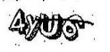
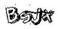
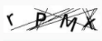

---

id: 301620

title: "【长期更新Wiki】AI大模型图像理解能力测试题库，帮助区分模型和对比模型图形理解能力"

created_at: 2024-12-18T13:52:39.668Z

username: yeahhe

display_username: "Mozi"

---

# 【长期更新Wiki】AI大模型图像理解能力测试题库，帮助区分模型和对比模型图形理解能力

---

| **序号** | **题目** | **答案** | ****_________________________ | ****_________________________ |

| --- | --- | --- | --- | --- |

| 1 | 求解  | DC = \frac{30}{7} | o1,o3m,o3mh | GT |

| 2 | 提取图中文字  | `不想上班，那就不上` |  |  |

| 2 | 提取图中文字  | 4yu6 | o1 | GT |

| 3 | 提取图中文字  | bsjx |  | GT,o1 |

| 4 | 提取图中文字  | rpmx | GT | o1 |

| 5 | 提取图中文字  | `真诚、友善、团结、专业，共建你我引以为荣之社区` | GT,o3m,o3mh | o1,o1p |

---

**说明：**

1. **** 和 ****：这些列需要根据模型测试结果进行填写。您可以参考以下步骤进行填写：

**** 列填写准确率≥80%的模型名称。

**** 列填写准确率在40%-60%之间且标注“（不稳定）”的模型名称。

**模型列表（按名称首字母排序）：**

**题库测试的语言模型（按名称首字母排序）：**

1.  Claude 3.5 sonnet (C3.5)

2.  gemini-2.0-flash-thinking-exp-01-21 (GT)

3.  gemini-2.0-flash (G-2.0F)

4.  gemini-2.O-flash-lite-preview-02-05 (G-2.0FP)

5.  gemini-2.0-pro-exp-02-05 (G-2.0P)

6.  GPT4o (4o)

7.  o1 (o1)

8.  o1 pro (o1p)

9.  o3 mini (o3m)

10.  o3-mini-high (o3mh)

---

[https://linux.do/t/topic/286836?u=yeahhe](https://linux.do/t/topic/286836)

---

*来源: https://linux.do/t/topic/301620.json*

