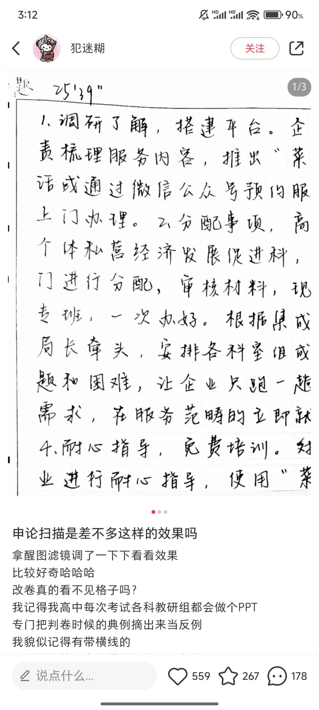

---

id: 304684

title: "让我们一起学申论吧"

created_at: 2024-12-20T03:25:19.072Z

username: lezishen

display_username: "𝓵𝓮𝔃𝓲𝓼𝓱𝓮𝓷"

---

# 让我们一起学申论吧

一方面是升级每天都发那个随便学学有点臃肿繁杂

另一方面 这里可以更新资料 对于想学申论的人 有些系统化的跟随

20241220

1.为天地立心，为生民立命，为往圣继绝学，为万世开太平

北宋理学家张载

2.天将降大任于斯人也，必先苦其心志，劳其筋骨，饿其体肤，

空乏其身，行拂乱其所为，所以动心忍性，增益其所不能

3.我将无我，不负人民

4.不仅需要科学决策，也需要思想境界。就是功成不必在我

5.山再高,往上攀,总能登顶;路再长,走下去,定能到达

6.世界上没有坐享其成的好事,要幸福就要奋斗

7.一定能够创造出一个又一个人间奇迹

8.人民有信心,国家才有未来,国家才有力量

9.人民是历史的创造者,人民是真正的英雄

10.把蓝图变为现实,是一场新的长征

> 2.

>

> 3.

>

>

> 4.

>

> 5.

>

> 6.

>

> 7.

>

>

>

>

>

>

>

>

>

>

>

>

>

>

>

> 17.[一个免费代理网站](https://linux.do/t/topic/263802)

> 19.[小白向 考公资料网站](https://linux.do/t/topic/268515)

> 20.[漫画 小智怪谈 有什么更新快的网站么](https://linux.do/t/topic/268787)

> 21.

> [国考冲刺各种网课 更新到我今晚停止学习为止 每个小时都会发新的](https://linux.do/t/topic/277065)

> [开个考公数量 学习专题 每天学一点点数量](https://linux.do/t/topic/280062)

> [公基 常识 时政 积累学习](https://linux.do/t/topic/280651)

>

>

>

>

>

> 24

>

> 25

>

> 26

>

> 27

>

> …

  

申论扫描完就是这个效果

---

*来源: https://linux.do/t/topic/304684.json*

