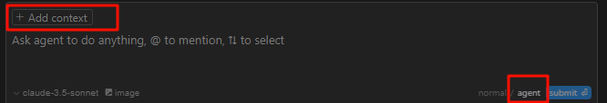
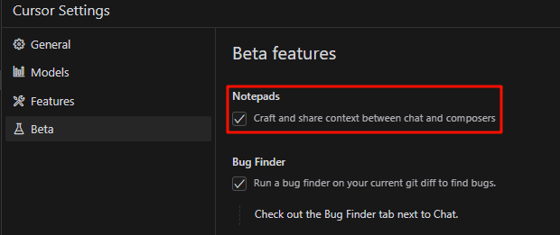
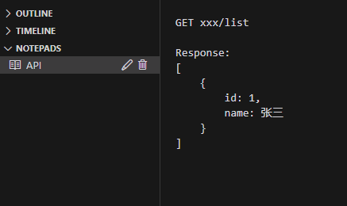
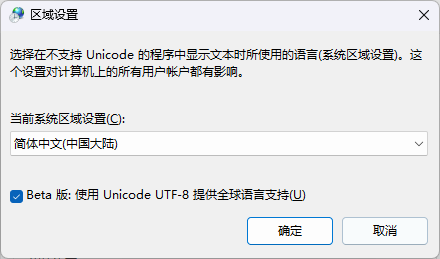
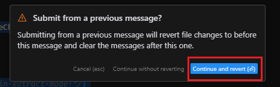

---

id: 309566

title: "Cursor 食用指南（也许能解决许多佬友的问题）"

created_at: 2024-12-23T13:58:00.795Z

username: YougLin

display_username: "coder.r4.chat"

---

# Cursor 食用指南（也许能解决许多佬友的问题）

> 如若搬运，请尊重原作者，保留出处，这是为人的基本道德。

**帖子更新时间：2024-12-28 13:00**

作为一个AI领域的从业者，同时也是AI 辅助编程的深度用户。

下面这几句话是我认为你最需要知道也是对你最有帮助的，哪怕不看下面的技巧，我也推荐你花几秒钟看看。

> 一、LLM 上下文是受限的，且上下文越多，它越难捕获到你的意图。

>

> 二、LLM 输出是*严重*受限的，目前常用的最多为 8192 Tokens。

>

> 三、无论是Cursor、Windsurf、Copilot还是Cline，它们都只是你的助手，请全程参与并把握主导权和决策权。

> 当前Cursor最新版本 0.44.9

# Cursor 使用技巧

## 1 Agent 模式使用技巧

### 1.1 搜索代替指定

> 理由：强制触发 cursor agent模式里面的搜索功能，它搜到的片段 + 上下文，比你手动指定多个文件给他得到的结果会好很多（因为你指定文件的话，它只会读取开头一两百行，可能都读不到你想要它修改的函数，然后这时候上下文又会多一大堆没用的干扰信息，也就是会出现各位所说的变傻）

- 移除 context 指定，触发 agent 模式的自动搜索

- 同时改为在描述中提供:

明确的方法名

关键类名

相关变量名

具体功能描述

### 1.2 文档处理

> 理由：文档是额外信息，chat中请只保留最关键的指示信息和引导信息。过多的信息会干扰模型对你需求的理解。

- 避免直接粘贴

不要在编辑框直接添加大量文档

使用文档配置功能

- 文档指定

仅为项目共享必要的数据，而不是所有项目的文档均共享。

推荐仅添加训练数据无法覆盖的内容，如：较新的库文档、开发接口文档等。

文档自己写最好（要求就是精炼，和强烈的个人编码风格），仅提供方法使用教程，简短文字描述，便于切片和索引。

- 文档链接配置方式

`https://github.com/username/repo/blob/main/docs/doc.md `

使用 GitHub 仓库存储文档

也可使用云存储服务（如阿里云 OSS）

- 本地文档指定

在cursor设置中开启

在左侧边栏中底部Notepads中添加文档。

### 1.3 上下文管理

> 理由：cursor是一个助手，而不是决策专家，有时候人动动脑子做个决策就是它望尘莫及的了。

- 避免提供过多文档导致上下文溢出

- 确保关键指令不被忽略

- 优先提供必要的上下文信息

- 不要幻想一个chat解决所有问题，学会将问题分解，解决一个问题使用一个chat。

### 1.4 Lint 配置

> 理由：部分项目会导致额外的矫正，浪费时间，大部分情况下人一眼看过去就知道是什么问题了

- 建议关闭自动 lint

- 需要时使用 `@lint` 手动触发

- 避免过度自动化带来的干扰

### 1.5 前端同学须知

- 当你费劲口舌跟它辩论UI有什么bug，不如甩给它一张界面截图，也许你会有意外的发现。

### 1.6 cursor rule

- 善用 cursor rule，可以在项目根目录创建 .cursorrules 文件，cursor在chat/composer中均会参考此文件定义。

- 在 cursor rule 中指定项目所有用到的库（必要的）、UI风格、编码规范、项目模块定义等。

## 2 常见问题处理

- 出现锟斤拷乱码怎么办？

错误示例（来自评论区）：

请使用全局 utf-8 。

中英日三文混杂，修改46处，均无乱码。

附上给定乱码，其自动修复为正确内容截图。

- 搜索不准确

提供更精确的关键词

使用完整的方法名/类名

- 如何使用agent模式？

如果你的版本支持，那么composer页面或弹窗下面的聊天框右下角会有如下选项（normal和agent），选中agent时为白色，且鼠标悬浮会提示你正在使用agent模式。

- checkpoints 不会回退？

每个checkpoints旁边均有一个restore按钮，点击即可回到当时的状态。

- checkpoints 太多不知道回退到哪，也适用于没有checkpoints没有restore按钮的版本？

如果你发送了A消息，cursor帮你做了1、2、3件事情，这些事情你都不想care了。那么你只需要双击A消息，再点一次submit，然后会有如上弹窗提醒，选中continue and revert即可，然后cursor会再根据你的A消息重新发送请求，如果不需要就点界面中的cancel取消即可。

- 如何为composer配置自定义（自己提供Key）模型？

可以。但只能官Key。

非官key，中转站呢？没有办法。cursor的composer不会使用用户配置的自定义endpoint。如有这个需求，请试试Cline，这是一个非常好用的agent（缺点：无checkpoints，行级处理导致无法一次ctrl+z撤销，也就是会在timeline留下很多修改过程中的脏版本，这是我对我来说最不喜欢的一点）。

- 实现新功能，但代码散落在多个文件？

不需要提供context，只需要在agent模式下的聊天框中提供文件名和涉及到的必要的接口描述以及新功能描述即可（非必要请勿指定context，特别是文件几百上千行时）。

- 如果我想让AI总结项目，生成开发指南，但不想让他修改代码该怎么办？

首先，我们要明确一点，LLM上下文和输出都是受限的，所以寻常的Chat模式必定是无法使用的，因为你不可能将所有代码一次性全部提供给它，它也不可能给你生成几万行的开发指南。

所以，我们需要使用具有agent功能的工具，如：cursor compose里面的agent模式，或者cline工具，这些工具本质上是由一个决策者和多个执行者组成，决策者负责制定完成任务所需要进行的操作步骤，再交由执行者去执行，决策和执行都是单独的一次Chat。

那么，思路就很简单了。1、拿到项目文件目录接口，由决策者生成阅读指南，相当于你的leader教你如何阅读项目。2、让执行者根据决策者生成的阅读指南，逐个文件阅读并生成文件内容概要、函数接口概要，将阅读结果保留到/docs目录下的项目同结构md文件下（如：src/hello/prompt.py（提供一些prompt常量） => docs/src/hello/prompt.md，src/hello/fillPrompt.py（提供一些工具函数，来操作prompt里面定义的变量等信息） => docs/src/hello/fillPrompt.md）。3、所有的执行者阅读完后，再交由思考者，逐个文件夹总结归纳（例如：docs/src/hello/下有prompt.md和fillPropmt.md，对齐总结归纳后会得到docs/src/hello.md），如此循环递归向上，直到得到最终的docs.md，这便是我们所需要的项目开发指南。

实现：（待续，内容有点多，有需要再继续写）如果你使用cline，那么请你创建一个MCP工具，用于获取项目目录和文件结构，并需要能标注和获取已经浏览和归纳总结过的文件。

希望对你有所帮助。

如有其他问题，欢迎各位提问或补充。

---

*来源: https://linux.do/t/topic/309566.json*

