---

id: 315663

title: "谷歌提示词指南101"

created_at: 2024-12-27T02:55:25.472Z

username: BaseOrange

display_username: "BaseOrange"

---

# 谷歌提示词指南101

# 一、编写有效的提示

 Google Workspace 最早就是为让您能够与其他人实时协作而创立的。现在，您还可以使用 Gemini for Google Workspace 与 AI 协作，帮助提高您的工作效率和创造力，而无需牺牲隐私或安全性。嵌入式生成式 AI 功能可以帮助您编写、组织、可视化、加速工作流程、召开更精彩的会议等等，同时使用您最喜爱的应用程序，例如 Gmail、Google Docs、Google Sheets、Google Meet 和 Google Slides。

 这本书将为您提供基础技能，让您学会如何在使用Gemini for Workspace时编写有效且具有指导性的提示语，从而提高日常工作的效率和生产力。您可以将提示语视为与AI助手对话的开场白。随着对话的深入，您可能会撰写多个提示语。虽然可能性几乎是无限的，但仍然有一些一贯的最佳实践可供您今天就开始应用。

 **在撰写有效的提示语时，有四个主要方面是需要考虑的。您并不一定非要全部使用，但采用其中的几个将会很有帮助！**

- 人物角色

- 任务

- 语境

- 格式

 以下是使用所有四个区域的提示示例，这些提示在 Gmail 和 Google Docs 中可以很好地发挥作用：

 你是 Google Cloud 项目经理。起草执行摘要电子邮件发给[角色] 基于[相关程序文档的详细信息]。限制为要点。

以下是一些帮助您开始使用 Gemini for Workspace 的快速提示：

1. 使用自然语言。写作时就像在和另一个人说话一样。用完整的句子表达完整的想法。

2. 具体并反复。告诉 Gemini for Workspace 您需要它做什么（总结、写作、改变语气、创造）。提供尽可能多的背景信息。

3. 简明扼要，避免复杂化。用简短但具体的语言陈述您的请求。避免使用行话。

4. 进行对话。如果结果不符合您的期望或您认为还有改进空间，请细微的调整您的提示。使用后续提示和反复审查和改进的过程来获得更好的结果。

> 提示词是一门艺术。如果第一次没有得到想要的结果，你可能需要尝试几种不同的提示方法。根据我们在 Workspace Labs 计划中学到的知识，最成功的提示平均大约有 21 个字，但人们经常在不知情的情况下尝试的提示很短——通常少于 9 个字。

> 生成式人工智能及其各种可能性确实令人兴奋，但它仍然是一个新兴的技术领域。即便我们的模型每天都在改进，变得更加智能和可靠，但是有时候对于给定的提示，它们的响应仍然可能是不可预测的。这是因为模型的学习基于过去的数据，并且在处理新颖或特定的问题时可能会遇到困难，尤其是在理解上下文或执行复杂的推理任务时。此外，模型也可能会产生与人类价值观或社会规范不一致的内容。因此，在使用生成式AI时，重要的是要持续监督和评估其生成的内容，以确保它们符合预期并适当地应用于实际场景中。

> 在将Gemini for Workspace的输出付诸实施之前，请先审查以确保其清晰、相关和准确。当然，最重要的是要记住：生成式AI是为了帮助人类，但最终的输出是由您决定的。

> 本指南中的示例提示仅用于说明目的。

# 二、介绍

## 2.1 Gemini for Google Workspace：提示 101

 有多种方式可以访问Gemini for Google Workspace的生成式AI功能。它是一个强大的生成式AI体验，无缝集成到了您每天使用的应用程序中——Gmail、Google Docs、Google Sheets、Google Meet 和 Google Slides。同时，您还可以访问gemini.google.com与Gemini进行交谈（享有Google Workspace企业级的安全和隐私保护）。

 理解如何构建一个有效的提示语并学习即时创建提示语能够极大地提升您的生产力和创造力。您可以将Gemini for Workspace视为一个由AI驱动的助手，它可以帮助您：

- 提高写作水平

- 组织数据

- 创建原始图像

- 总结信息并提出见解

- 与同事建立有意义的联系

- 研究不熟悉的话题

- 发现趋势、综合信息并识别商机

 Gemini for Workspace 可帮助您更聪明地工作，而不是更辛苦地工作，从而提高工作效率并节省时间，以便您可以专注于更有效的工作。本指南探讨了快速入门和掌握基础知识的不同方法，以帮助您完成日常任务。

 随着您对这种新的工作方式越来越有信心并逐渐熟悉，您将准备好探索更为复杂的提示语，这将使您能够优化整个工作流程。届时，Gemini for Workspace 可以成为您的思维伙伴、写作教练等角色。

 使用Gemini for Workspace 提升生产力和创造力的机会几乎是无穷无尽的。

## 2.2 如何使用这份提示语指南

 这本手册是一份快速入门指南，旨在向您介绍如何使用Gemini for Workspace进行提示语操作。它包含了针对不同角色的情景、用例示例以及适用于高管、创始人及销售、营销、客户服务、项目管理和人力资源专业人士日常任务的潜在提示语。

 您会注意到各种不同的提示语风格。有些提示语中包含括号内的项目，这表示您需要填写的具体细节所在的位置。其他提示语则不标记变量，以展示完整的提示语可能是什么样子。本指南中的所有提示语都是为了启发您，但最终它们需要根据您的具体工作进行调整。

 首先，请跳至最适合您角色的部分。使用特定于角色的建议提示作为灵感，帮助您解锁一种全新而强大的工作方式。

 接下来，只需查找这些功能，并访问 [Google Workspace with Gemini - Business / Enterprise - Google Workspace Admin Help](http://g.co/gemini/features) 了解如何开始使用每个功能

- 帮我写 (Google 文档)

- 帮我写 (Gmail)

- 帮我整理 (Google 表格)

- 使用 Gemini 创建图像 (Google 幻灯片)

- 创建背景图像 (Google Meet)

- [gemini.google.com](http://gemini.google.com)（具有 Google Workspace 企业级安全和隐私）

# 三、客户服务

 作为客户服务专业人士，您致力于提供高效、始终令人愉悦的服务，并由积极主动、乐于助人的团队提供支持。本部分为您提供了将提示集成到日常任务中的简单方法。快速构建标准化沟通框架、个性化沟通、新培训材料等 - 所有这些都使用 Gemini for Google Workspace。

## 3.1 入门

 首先，查看一般提示写作技巧和本指南开头的提示 101 部分

 下面的每个提示都附带一个场景，以启发您如何使用 Gemini for Workspace 进行协作。提示迭代示例说明了如何继续编写提示以在最初生成的响应的基础上进行构建。我们还提供了不同客户服务角色如何使用 Gemini for Workspace 的示例。您可以调整每个提示以完成常见任务并优化生成的输出。

## 3.2 提示迭代示例

 您是一名客户服务代表，负责直接回复客户的咨询和疑虑。您刚刚收到一封客户发来的电子邮件，称客户收到了损坏的商品。您打开一份新的 Google 文档，点击“帮我写”，以提示 Docs 中的 Gemini。输入以下内容：

帮我写一封富有同理心的电子邮件回复。我是一名客户服务代表，我需要回复一个客户投诉。客户订购了一副耳机，但收到后发现已经损坏。他们已经通过电子邮件联系我们，并提供了损坏的图片。我提供了替换品，但他们要求使用通常不包含在订单中的加急送货服务。请附上一段文字，承认他们的沮丧情绪，并列出三个可能的解决方案。

人物角色 任务 语境 格式

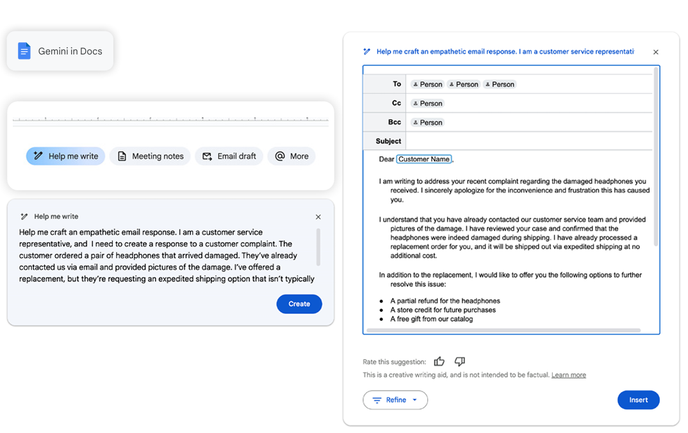

 您喜欢 Docs 中的 Gemini 创建的电子邮件，因此选择“插入”。但您想集思广益，想出解决问题的方法，但不提供加急送货服务。您选择“帮我写”来提示。您输入：

 帮我写10个替代加急运输的方案，以解决客户收到损坏包裹时的沮丧情绪。

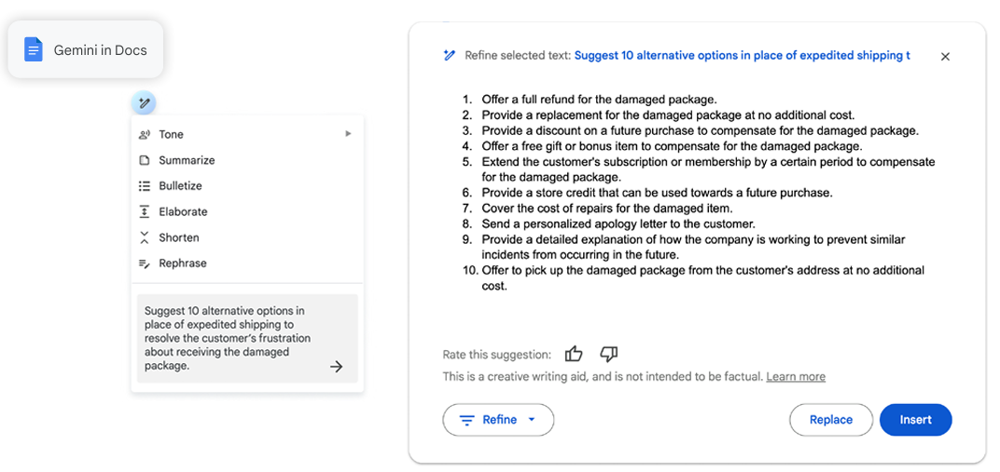

 这 10 条建议很有帮助。单击“插入”将文本添加到草稿中。

## 3.3 提示指南

### 3.3.1 客户服务经理或代表

#### 用例：标准化沟通框架

 您是客户服务团队经理。您的团队已经扩大，您需要创建可扩展的资源来标准化整个团队的沟通。您打开一个新的 Google 文档。您想集思广益，因此您向 Docs 中的 Gemini 寻求帮助。您选择“帮我写”并输入：

> 为三种不同类型的客户沟通草拟模板。为道歉电子邮件、订单确认信息和忠诚客户的感谢信创建模板。将每个模板限制为一段文字，并使用友好的语气。

 建议的模板为您提供了一个很好的起点，您可以开始编辑和添加一些与公司品牌和政策一致的元素。您选择“插入”。现在，您要创建一个文档，概述团队用于入职的最佳沟通实践。您打开一个新的 Google 文档并提示 Gemini in Docs。您输入：

> 制定一份客户沟通最佳实践清单，可用于培训新团队成员。概述三个部分，包括如何处理满意的客户咨询、中立的客户咨询和不满意的客户咨询。

 您还希望为团队提供标准化语言，以便他们在电话中与客户互动时使用。 您想集思广益，因此打开 [gemini.google.com](http://gemini.google.com) 并输入：

> 我是一名 [客户服务经理]。我正在尝试创建标准化语言，以便团队在与客户进行电话交流时使用。为零售店的客户服务代表生成常见的通话开始、问候和结束语模板。这些模板应允许使用客户详细信息进行个性化设置。目标是确保一致性和专业性，同时允许使用特定客户信息进行区分。

#### 用例：改善客户服务

 您注意到客户投诉有所增加。您需要跨部门协作，以了解如何解决反复出现的问题。您首先向其他团队负责人发送电子邮件。您在 Gmail 中选择“帮我写”，提示 Gemini。您输入：

> 草拟一封电子邮件给我的同事们，提议召开一次会议讨论客户体验改进计划。请求市场、销售和产品相关人员在下周会面，以明确各自的职责和角色。

 您简单地复制编辑了电子邮件并将其发送给您的同事。现在您已经发送了初始电子邮件，您想创建一个电子表格，以便跟踪此跨部门计划的进展情况。您打开 Google 表格，并通过选择“帮助我整理”来提示 Gemini。您输入：

> 创建一个表格来跟踪不同客户体验改进策略的进展和影响，使用相关指标包括支持工单数量和优先级（高、中、低）。

 您看到一个已经按照您要求的类别格式化好的电子表格模板。现在您只需填入具体的细节即可。

### 3.3.2 客户支持专家

#### 用例：实现客户自助服务

 作为客户支持专家，您的团队收到了很多关于退货政策的问题电子邮件。客户反馈一致认为您的指导方针不明确。您打开一份 Google 文档，其中说明了退货、退款和商店信用政策。您通过选择“帮助我撰写”提示 Docs 中的 Gemini。您输入：

> 总结此内容，制定一个清晰简洁的产品退货政策，并概述客户需依次采取的5个步骤

 您喜欢这些步骤的简洁性。接着，您重复这一过程来简化退款政策和商店积分政策。现在，您希望使用这些新简化的内容来创建一篇博客文章，以便告知客户有关退货、退款和商店积分的政策。使用包含新撰写的指导内容的Google Doc，您在Google Docs中向Gemini发出提示。您输入：

> 把这些内容变成一个简短的文章，标题为“无需客服协助即可解决常见问题”。为我们的退货政策、退款政策和商店信用政策设置单独的部分。

 现在，您想要创建一个电子邮件模板，团队可以在收到有关这三个领域的客户问题时使用该模板。您打开一个新的 Google 文档，并在 Docs 中提示 Gemini。您输入：

> 起草一份发给客户的电子邮件模板，重点介绍 [支持问题] 的自助服务资源 [博客链接]。并感谢客户的惠顾，向他们保证我们致力于满足他们的需求。

#### 用例：客户之声研究

 公司的新政策是，您将向每一位不满意的客户发送电子邮件，以尝试解决问题。您打开一封包含客户投诉的电子邮件。您选择“帮我写”，在 Gmail 中提示 Gemini。您输入：

> 请求在 [日期] 的 [时间] 与提供负面反馈的客户进行跟进对话，以了解他们的关切并提供解决方案。包括示例解决方案。

 起草的回复是一个不错的开始，但对于投诉的回应语言有点太直接了。您可以通过在 Gmail 中使用“优化”>“详细阐述”提示 Gemini 来进行迭代。接下来，您想要创建一个简短的调查问卷，您可以在每次与客户进行后续通话后发送该问卷，以评估通话对满足他们的需求有多大帮助。您打开一个新的 Google 文档并在 Docs 中提示 Gemini。您输入

> 创建五个不同的问题，针对刚刚与客服代表通过电话的客户。这些问题应衡量通话的有效性，客户的关切是否得到解决，以及他们是否会向其他人推荐我们的业务。

### 3.3.3 客户服务协调员

#### 用例：与客户互动

 您在更新政策方面取得了很大进展，并希望从最忠实的客户那里获得有关这些变化的反馈。您计划举办一次倾听之旅，与他们互动。您打开 Gmail 并在 Gmail 中提示 Gemini。您选择“帮我写”并输入

> 写一封电子邮件，邀请我最忠实的客户参加下周在 [地点] [日期] [时间] 举行的有关我们更新的 [政策] 的反馈会议。

 聆听之旅已结束，您已收到与会者的后续电子邮件。您需要帮助回复每封邮件，因此您在 Gmail 中提示 Gemini。您输入：

> 给客户 [姓名] 写一封个性化的感谢信，感谢他们参加反馈会议，并解释我们将如何使用反馈来改进我们的政策。

#### 用例：准备客户会议

 您需要准备与一位重要客户会面。他们的帐户对您来说是新客户，他们的行业和业务线也是新客户。您需要帮助进行研究，因此您打开 [gemini.google.com](http://gemini.google.com) 并输入：

> 撰写五个问题，用于调研[行业]行业的公司，以了解他们面临的最大挑战并为首次会议做准备。

 使用这些问题，您继续在gemini.google.com与Gemini的对话中进行后续提问。您将笔记和发现整理到一个Google文档中。你有几页笔记，所以你想为自己创建一个易于理解的摘要。你在 Docs 中提示 Gemini。你输入：

> 从该内容中总结有关[行业]的发现并创建与客户讨论的谈话要点。

 现在，您已经准备好与客户第一次见面了。您正准备发送第一封介绍电子邮件。您打开 Gmail，并在 Gmail 中提示 Gemini。您选择“帮我写”，然后输入：

> 写一封电子邮件介绍我是 [帐户] 的客户服务协调员。邀请我的客户就 [主题] 举行会议，并要求在未来两周内确定日期和时间。

# 四、高管和企业家

 作为一名高管，您在规划组织发展方向时时间非常紧张。您做出的每一个决定都会影响业务的增长、创新和整体发展轨迹。了解您的市场、保持领先趋势并做出明智的战略决策至关重要，在忙碌时完成紧急任务也同样重要。

 本节向您介绍由AI生成的提示语的强大功能，这些提示语旨在简化您的决策过程，帮助改善业务成果，并协助您快速完成任务——即使您不在办公桌前也是如此。了解Gemini for Google Workspace如何帮助您解锁深刻的洞察力，促进协作，并推动您的组织达到新的高度。

## 4.1 入门

 首先，查看一般提示写作技巧和本指南开头的提示 101 部分

 下面的每个提示都附带一个场景，以启发您如何使用 Gemini for Workspace 进行协作。提示迭代示例说明了如何继续编写提示以在最初生成的响应的基础上进行构建。我们还提供了不同客户服务角色如何使用 Gemini for Workspace 的示例。您可以调整每个提示以完成常见任务并优化生成的输出。

## 4.2 提示迭代示例

 您是一位即将登上长途航班的高管，刚刚收到下次会议的邀请，并附有议程。您有一些意见，并想提议在议程中添加一些主题。您打开 Gmail，并在 Gmail 中提示 Gemini。您输入：

起草一封电子邮件，确认我将参加董事会会议。询问我们是否可以调整议程，为[紧急主题]留出 15 分钟时间。

人物角色 任务 语境 格式

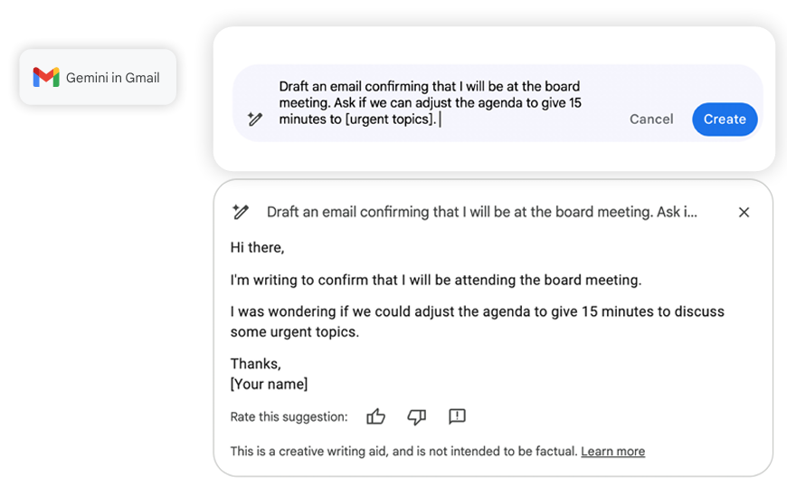

电子邮件看起来不错，但您想确保语气尽可能正式。您选择“优化->正式化”。

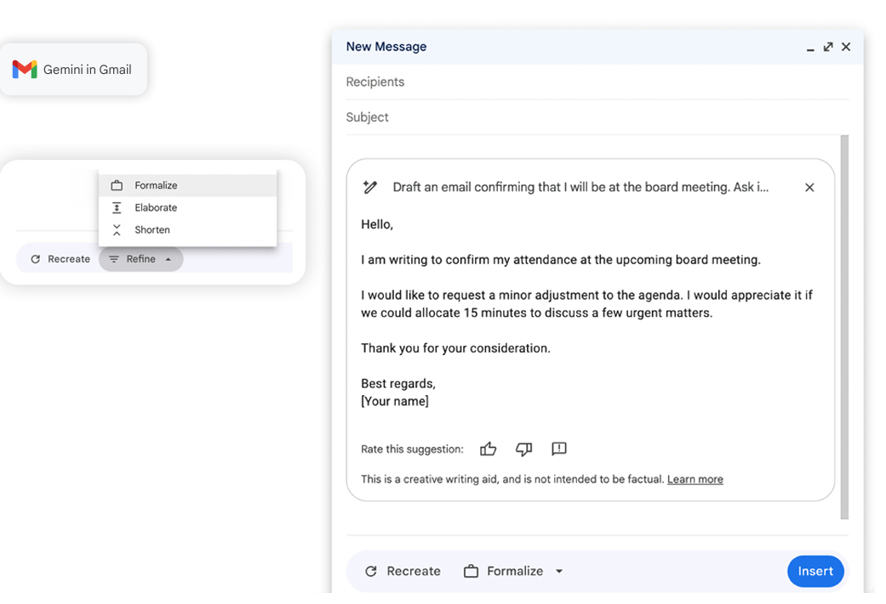

您阅读电子邮件，然后选择“插入”。在发送之前，您进行了简单的编辑，以感谢团队在旅途中为您提供帮助。

## 4.3 提示指南

### 4.3.1 首席运营官

#### 用例：准备员工沟通信息

 您正在主持全公司季度全体会议。本季度取得了许多积极进展和发展势头，但您担心多个团队在遭遇意外挫折后士气低落。您想集思广益并练习如何回答可能很棘手的问题。您打开 [gemini.google.com](http://gemini.google.com)，然后输入

> 我是一家中型公司的首席运营官。我将主持全公司季度员工大会。本季度取得了许多积极进展和发展势头，但我担心多个团队由于一些不可预见的挫折而士气低落。我想集思广益并练习如何回答可能棘手的问题。帮我写一些有挑战性的问题，员工可能会在即将到来的员工大会上询问我们的收入、领导层变动和公司愿景。为每个问题生成可能的答案，并使用自信而坚定的语气。

 这些问题和建议的答案对您的准备阶段很有帮助。现在，您想收集有关如何以同理心回答问题的想法，尤其是在不确定的时期。您再次提示。您输入：

> 这些问题和建议的答案对我的准备阶段很有帮助。现在，我想收集一些想法，关于如何以同理心的方式回答问题，特别是在不确定的时期。使用自信和令人安心的语气来做出回应，承认员工的担忧，并让员工知道我们正在努力为整个公司尽最大努力。

 您想从这些问题开始，找出如何撰写振奋人心的评论来开启市政厅。您决定使用 Docs 中的 Gemini 进行头脑风暴。您打开一个新的 Google Doc 并选择“帮助我写作”。您输入

> 帮我为刚刚结束一个充满挑战的季度的员工写两段振奋人心的文字。承认[困难]并强调即将到来的季度的[积极因素]。使用一种激励人心、乐观并培养团结和协作意识的语气。

#### 用例：简化随时随地的响应

由于您正在处理一项紧急任务，您的计划突然发生了变化。您无法参加会议，只需要确保团队对几个关键项目有答案。您打开 Gmail 并使用语音命令提示 Gmail 中的 Gemini。你说：

> 给 [项目负责人] 写一封电子邮件，告知他们我因紧急事项无法参加会议。请他们做详细记录，确保团队就 [关键主题] 做出决定，并将事后分析报告的查看权分配给 [同事]。

### 4.3.2 首席营销官

#### 用例：集思广益内容和思想领导力

 您刚与社交媒体团队负责人进行了会议。在一份Google文档中，您记录了许多关于受众共鸣的内容、热门话题、目标受众数据以及能够有效提升品牌互动的关键词。您希望利用这些见解来头脑风暴一些潜在的思想领导文章。您通过在现有的Google文档中选择“帮助我写作”来向Docs中的Gemini发出提示。您输入：

> 根据热门话题、目标受众分析和品牌关键词，为 [公司] 列出四个相关且引人入胜的思想领导力博客文章创意。

 在相同的会议中，团队讨论了启动一个新的品牌活动。您知道客户非常重视您们可靠且独特的产品服务，并且您的公司一直以来都有兑现对客户承诺的历史。您需要帮助来开始构思新的活动方案。您打开一个新的Google文档并选择“帮助我写作”。您输入：

> 为 [公司] 提出三个新口号选项，强调可靠性、创新性和悠久的受欢迎程度。

 这些口号对启动您的创意过程很有帮助。您有一些即将举行的活动，这些活动可能是测试新活动元素的完美场所。您希望为活动团队设计展位图形的草案。您在Google Slides中打开一个新的演示文稿并选择使用Gemini创建图像。您输入：

> 创建一张使用橙色和蓝色的贸易展会展位图像。该展位应该是现代风格，并展示互动电脑站。

#### 用例：进行竞争分析

 您的团队正在考虑拓展一条新的业务线。这对您来说是一个全新的领域，您希望能够迅速了解这对业务意味着什么。您决定进行调研。[您前往gemini.google.com](http://xn--gemini-hx3j558fckc.google.com)，并输入：

> 我是一名 CMO，正在进行竞争分析。我的公司正在考虑拓展 [新的业务线]。列出 [行业] 中排名前五的竞争对手，并列出他们的定价、优势、劣势和目标受众。

经过深入研究后，您决定制定一个虚构的五年战略，看看这对公司来说会是什么样子。您输入：

> 好的，我打算说服我的CEO我们应该拓展进入 [业务领域]。请为北美的[行业]行业起草一个为期五年的精炼的竞争战略，包括目标、策略和战术。

### 4.3.3 首席技术官

#### 用例：总结新兴技术趋势

 您需要了解新兴技术趋势，因为形势瞬息万变。[您打开gemini.google.com](http://xn--gemini-oi2lm3i2ze.google.com)，然后输入：

> 我是 [行业] 的 [公司] 的首席技术官。我想了解新兴技术趋势。总结对 [行业] 最具潜在影响的五大新兴技术。对于每项技术，列出其潜在的优势和挑战，并提出其在未来两到三年内可能对 [公司] 产生的影响。

 提供的摘要是您进行初步研究的有用起点。您想更深入地研究特定主题，因此您通过键入以下内容继续对话

> 推荐三个领域让[我的组织]可以采取积极措施，以保持在[特定领域]的领先优势。

### 4.3.4 首席信息官

#### 用例：建立技术沟通

 您的团队刚刚提供了一份关于您的安全状况和关键漏洞的冗长技术报告。您需要立即与 CEO 讨论这个问题，但您知道目前一份多页的报告太多了，难以消化。您打开包含完整报告的 Google Doc，然后选择“帮助我撰写”以提示 Docs 中的 Gemini。您输入：

> 总结本报告对[受众]的主要发现和影响。重点介绍已发现的主要[弱点]以及解决这些弱点的建议措施。使用正式语气。

 摘要很有用，为您的 CEO 提供了适当的详细程度。您做了一些小修改，并将其作为执行摘要放在报告的顶部。现在，您需要向 CEO 发送电子邮件以安排会议进行讨论。

您打开 Gmail 并通过选择“帮助我撰写”提示 Gmail 中的 Gemini。您输入：

> 帮我写一封电子邮件给我的首席执行官，要求下周举行 30 分钟的会议，讨论我们即将进行的 [IT 变革]。包括对可扩展性、安全性和数据管理的考虑。

**用例：跟踪 IT 资产**

您的公司需要一种快速的方法来跟踪新员工的软件访问情况。您需要一个电子表格，因此您打开 Google 表格并选择“帮我整理”。然后输入：

> 为员工创建软件许可证跟踪器，并包括许可证类型、使用权和续订日期等列。

### 4.3.5 首席人力资源官

#### **用例：表达对员工的赞赏**

 您想建立一个新计划，帮助组织中的每个人都感到被包容、被欣赏和被认可。但是对于这么大的公司，您需要深思熟虑。您想集思广益，因此您打开了一个新的 Google 文档并提示 Docs 中的 Gemini。您输入

> 根据 [类型] 的公司文化和员工的多样化兴趣（如烹饪、园艺、运动、阅读和旅行），集思广益，提出 10 个员工赞赏想法。

 Docs 中的 Gemini 激发了您的创造力，现在您有了员工兴趣俱乐部和活动的想法。您还希望确保您的领导团队定期鼓励管理人员认可团队中的人才，因此您创建了他们可以用作灵感的电子邮件模板。您通过选择“帮助我写作”来提示 Docs 中的 Gemini，然后输入：

> 起草一份电子邮件模板，感谢 [员工] 的辛勤工作和 [近期成就]。为他们的奉献精神提供额外奖励，例如咖啡礼品卡。使用乐观而专业的语气。

#### **用例：评估员工满意度**

 您担心您的团队最近不堪重负。在与直接下属通话之前，您想起草一份匿名调查问卷，让人们能够公开、诚实地评估自己的感受。要起草问题，请打开一份新的 Google 文档，然后选择“帮助我写作”以提示 Docs 中的 Gemini。您输入：

> 起草一份匿名员工满意度调查问卷，问卷中的问题和答案应涉及工作量、工作与生活平衡、薪酬和职业发展机会等关键领域。确保问题清晰、简洁，避免引导性答案。

 您收到了 15 位高层领导的反馈，并将所有匿名结果收集到 Google 文档中。您想要创建一份可以在下次通话中使用的摘要。您通过选择“帮助我撰写”提示 Docs 中的 Gemini。您输入：

> 总结员工反馈的结果以确定关键主题。

### 4.3.6 创始人或企业家

#### **用例：进行竞争分析**

 您是一家初创公司的创始人，您的在线业务正在获得发展。您一直梦想着开设一家

实体店，现在可能是最佳时机。您需要一位思想伙伴来帮助您更好地了解当前形势。您打开 [gemini.google.com](http://gemini.google.com)，然后输入：

> 我是一家初创公司的创始人。我正在考虑开设一家实体店。对[重点领域]的竞争格局进行分析。提供[主要竞争对手]在此领域的优势和劣势，包括他们的具体战略、策略和结果。确定[我的公司]如何改进其方法并获得竞争优势的18条可操作的见解和建议。

 您从与 [gemini.google.com](http://gemini.google.com) 上的 Gemini 的讨论中收集到了有用的信息。您想更深入地围绕两个竞争对手进行头脑风暴。您输入：

> 在当前市场格局下对 [公司] 与 [竞争对手] 进行竞争分析。

#### **用例：进行筹款和投资者关系**

 您已准备好联系潜在投资者，让您的实体店成为现实。您需要帮助开始给投资者写电子邮件，因此在包含所有笔记和研究的同一个 Google 文档中，您通过选择“帮助我写作”来提示 Docs 中的 Gemini。您输入：

> 为潜在投资者起草一份个性化的电子邮件模板，重点介绍[公司]独特的价值主张和[计划]的最新进展。请求安排会面时间，讨论下个月的合作机会。

 电子邮件模板为您提供了一个起点。在将电子邮件发送给潜在投资者之前，您可以修改草稿并继续添加一些个人风格。一个月后与他们成功会面后，您想要起草一封感谢信。您打开 Google Doc，其中包含会议记录和笔记。您提示 Docs 中的 Gemini 帮助您撰写电子邮件草稿。您输入：

> 起草一封电子邮件，感谢潜在投资者的来电，并要求安排时间安排后续会议以解决 [问题和疑虑]。

**用例：管理休假政策和跟踪**

您有一本冗长的手册，详细说明了公司的所有政策和程序。您想让新员工轻松理解休假申请政策。您打开包含手册的 Google 文档。您通过选择“帮助我撰写”提示 Docs 中的 Gemini。您输入：

> 生成一份分步检查表，总结公司的休假申请政策。确保以通俗易懂的语言编写，便于员工理解。

 由于许多员工都是轮班制，因此您需要一种快速的方法来跟踪每周的人员配备情况。您打开 Google 表格并点击“帮我整理”。您输入：

> 创建一个跟踪每周人员配备情况的表格。创建日期、姓名、班次（上午或下午）和备注的列。

# 五、人力资源

 作为人力资源专业人士，您是组织的骨干，需要处理大量机密和敏感信息。您塑造公司文化、寻找和培养人才，并确保员工获得积极的体验。这绝非易事。本部分为您提供了将提示整合到日常任务中的简单方法。

 学习编写有效的提示将有助于提高您的工作效率并简化您的日常任务，让您有更多时间专注于最紧迫的任务。使用 Gemini for Google Workspace 启动招聘、入职、培养归属感文化等。有关 CHRO 用例，请访问本指南的高管和企业家部分。

## 5.1 入门

 首先，请阅读第 2 页上的一般提示写作技巧和本指南开头的提示 101 部分。

 下面的每个提示都附带一个场景，以启发您如何与 Gemini for Workspace 进行协作。提示迭代示例说明了如何继续编写提示以在最初生成的响应的基础上进行构建。我们还提供了不同人力资源角色如何使用 Gemini for Workspace 的示例。您可以调整每个提示以完成常见任务并优化生成的输出。

## 5.2 提示迭代示例

 您是一名人力资源经理，正在为员工会议编写演示文稿。您有一个 Google 文档，里面全是笔记、要点和您想要讨论的主题。您首先打开带有笔记的 Google 文档，然后使用以下提示在 Docs 中使用 Gemini。

我是一名人力资源经理，我正在为新员工准备一份演讲稿。我需要为入职演讲稿撰写一份演讲稿，介绍我们公司对员工发展和福利的承诺。请帮我起草一些谈话要点，展示为什么员工指导和发展是我们公司的核心价值。

人物角色 任务 语境 格式

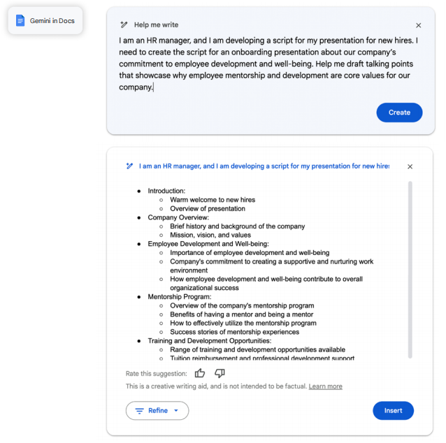

 您喜欢 Gemini in Docs 创建的内容，因此选择“插入”。现在，您想添加更多有针对性的谈话要点。在 Google Doc 中，您突出显示与培训和认证计划以及指导机会相关的注释。您输入：

 在演示文稿的新部分添加四个谈话要点，解释我们如何支持员工的发展。提及我们的培训和认证计划以及指导机会。

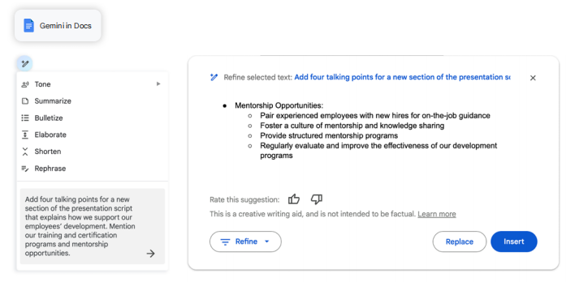

 您选择“插入”。现在，您需要一些关于如何构思脚本结尾的想法。您在 Google Doc 中突出显示了关于预期团队行为的注释，并在 Docs 中提示 Gemini 以下内容：

 写一份有力的结束语，说明我们的期望，即每个人都要为营造一个尊重和热情的工作场所做出贡献。使用专业的语气。

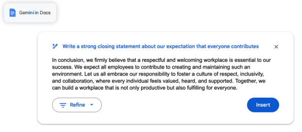

 生成的内容让您在编写脚本方面有了先机。您只需添加一些详细信息，然后就可以创建与您的谈话要点一起提供的 Google 幻灯片草稿。

## 5.3 提示指南

### 5.3.1 招聘人员

#### **用例：管理招聘流程**

 业务正在增长，您正在进行大规模的招聘工作。首先，您想使用 Gemini 进行头脑风暴，看看公司如何更好地管理招聘流程。您打开团队的“招聘策略”Google Doc，其中包含有关招聘策略和渠道的注释，以及用于从 LinkedIn 和其他来源向候选人进行冷门推广的电子邮件和消息模板。您首先使用 Docs 中的 Gemini 选择“帮助我写作”，输入以下提示。您输入：

> 创建一份我们的招聘人员可以使用的策略列表，以改进我们现有的招聘流程并确定

>

> 潜在的求职者。

 在成功为领导层创建了一份关于团队如何改进现有招聘流程的简短建议后，团队收到了有关紧急职位空缺的指导，职位空缺为一名内容营销经理，该经理具有 B2B 和 B2C 内容创作经验，至少有五年经验，并有一系列写作范例。您打开一份新的 Google 文档，并在 Docs 中向 Gemini 提示以下内容：

> 我正在为营销团队开设一个新职位。为内容营销经理写一份引人注目的职位描述。突出显示关键职责 [插入] 和要求，包括 B2B 和 B2C 内容创作、至少五年经验以及一系列写作范例。

 Docs 中的 Gemini 会生成一份职位描述。在查看并稍作调整后，您可以突出显示文本

并提示：

> 建议更新 [职位描述] 的方法，并提供建议以使其对[受众] 更具吸引力。

#### **用例：管理面试流程**

 现在，您想要准备电话面试的问题。职位描述已获批准并在线发布。您决定通过访问 [gemini.google.com](http://gemini.google.com) 进行准备。您输入：

> 我是一名招聘人员，正在为候选人面试做准备。为 [open role URL] 写一份 20 个开放式面试问题清单，我可以使用它们来筛选候选人。

 面试结束后，您会得到一份 Google 文档，其中包含与每位候选人的对话记录。使用此 Google 文档，您会在 Docs 中提示 Gemini。您输入：

> 总结面试记录并生成 [职位] 的最佳候选人名单。

 在同一个 Google 文档中，您现在想为招聘经理总结您对每位候选人的发现。您通过选择“帮助我撰写”提示 Docs 中的 Gemini。您输入：

> 生成一封电子邮件发送给招聘经理，其中包含 [候选人] 的摘要。

#### **用例：候选人沟通**

 团队已做出招聘决定。您打开 Google 文档，其中包含每个候选人的注释。您通过选择“帮助我写作”提示 Docs 中的 Gemini。您输入：

> 我正在给刚完成面试流程的求职者写一封电子邮件。为 [选定的候选人] 创建一个模板，用于 [职位] 的录用通知，并请求安排电话讨论福利、薪酬和开始日期。

 现在，您想生成个性化、富有同理心的电子邮件副本，发送给不会收到录用通知的求职者。您通过选择“帮我写”来提示 Docs 中的 Gemini。您输入：

> 我正在给完成面试流程但未被选中的求职者写一封电子邮件。帮我为 [候选人] 写一封拒绝信，拒绝 [职位]。使用富有同理心的语气。

### 5.3.2 人力资源经理

#### **用例：入职员工**

 您是人力资源经理。招聘人员刚刚填补了公司两个空缺职位。现在，您负责确保候选人拥有顺畅的入职体验。您需要帮助为新员工构建信息，因此您打开 Google 表格，并通过选择“帮助我组织”提示 Gemini。您输入：

> 创建一个表格，概述新员工第一周的日程安排，包括关键会议、培训课程和介绍。为每项活动提供一列关键联系人和优先级（低、中、高）。

 Gemini in Sheets 返回一个格式化的 Google Sheet，您现在可以在其中填写关键联系人、会议和活动。条件格式使您可以轻松地使用颜色编码的视觉提示按优先级对任务进行排序。接下来，您需要为团队创造凝聚力的方法。您打开一个新的 Google 文档，并通过选择“帮助我写作”来提示 Gemini in Docs。您输入：

> 设计一个团队凝聚力活动，例如办公室寻宝游戏，让团队成员在团队会议期间一起工作。

 Docs 中的 Gemini 提供一些建议，让您集思广益，了解寻宝游戏。您调整输出并得到团队负责人的批准。现在，您需要与新员工沟通，向他们提供有关他们第一天与团队见面的信息。您打开 Gmail，选择“帮我写”，提示 Gmail 中的 Gemini。您输入：

> 起草一封电子邮件给 [团队] 中的新员工，让他们与团队的其他成员见面，并解释会议的团队建设目的。

#### **用例：传达关键发现并起草后续调查**

 现在您已经完成了新员工入职培训，您需要专注于确保领导层能够轻松理解最新的公司研究数据。您致力于为所有员工创造一个温馨的环境，让他们能够发展自己的技能。您打开包含最终报告的 Google 文档。您通过选择“帮助我撰写”提示 Docs 中的 Gemini。您输入：

> 起草一封电子邮件给高层领导，总结我们[报告]的主要发现。包括一个简短的介绍段落，其中列出最重要的发现的要点。

 Docs 中的 Gemini 返回带有要点的摘要。您对其进行编辑，然后使用它向领导团队发送电子邮件。作为后续行动，您想了解公司政策的变更如何影响员工体验。您打开 Docs 中的 Gemini 开始起草调查。您选择“帮助我撰写”并输入：

> 起草一份带有问题和答案选项的匿名员工调查，以监控公司在 [主题] 上的进展。

# 六、市场营销

 作为营销专业人士，您是引人入胜的广告活动、品牌体验、潜在客户生成等背后的创造力。您了解数据驱动的洞察、引人注目的消息传递以及与受众建立更深层次联系的力量。

 本部分为您提供了将提示整合到日常任务中的简单方法。学习编写有效的提示将有助于提高您的工作效率并简化您的日常任务，让您有时间专注于更具战略性的工作。了解如何以一种有助于释放新水平的创造力、自动化洞察和制作引起共鸣的广告活动的方式编写提示——所有这些都使用 Gemini for Google Workspace。有关 CMO 使用案例，请访问指南的高管和企业家部分。

## 6.1 入门

 首先，请阅读第 2 页的一般提示写作技巧和本指南开头的提示 101 部分。

 下面的每个提示都附带一个场景，以启发您如何与 Gemini for Workspace 协作。提示迭代示例说明了如何继续编写提示以在最初生成的响应的基础上进行构建。我们还提供了不同营销角色如何使用 Gemini for Workspace 的示例。您可以调整每个提示以完成常见任务并优化生成的输出。

## 6.2 提示迭代示例

 您拥有自己的咨询公司，经常被聘为客户的品牌经理。您为各行各业的企业提供帮助。您的客户正准备开办一家咖啡店和电子游戏咖啡馆，您需要通过开发视觉形象来启动创意过程。您想构思并向团队其他成员提供早期想法。您决定在 [gemini.google.com](http://gemini.google.com) 上与 Gemini 聊天。您输入：

 为我的新业务（一家兼具咖啡店和视频游戏咖啡馆的咖啡店）构思一个有创意且引人注目的徽标。考虑以下因素来设计徽标：

 双重概念：徽标需要清晰地表明咖啡和游戏业务的两方面，但不能太过杂乱。

 目标受众：吸引广泛的游戏玩家（休闲玩家和发烧友）以及寻求独特聚会场所的咖啡爱好者。

 风格选择：我愿意接受这些方法 — 让我们从这三种风格中各取几个例子来比较：现代和俏皮：大胆的色彩、有趣的图形，也许是像素艺术美学。复古酷炫：想想经典的街机风格 — 粗体字体、霓虹色灵感。时尚简约：干净的线条、几何形状，更微妙地向这两个主题致敬。

人物角色 任务 语境 格式

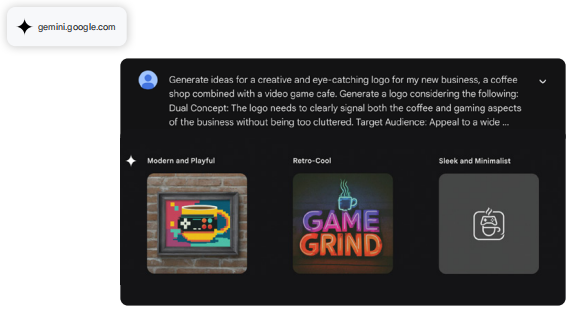

 您喜欢复古酷炫的选项。您继续对话并输入：

 我喜欢复古酷炫的款式。您能再提供三款相同风格的款式吗？

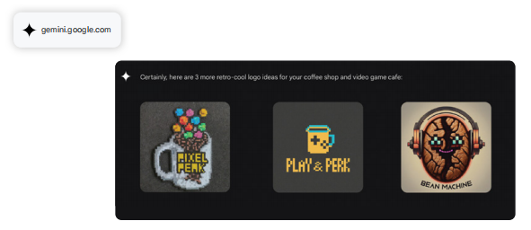

 现在你已经知道了徽标的外观，接下来你需要集思广益想出名字。你输入：

 为企业写一个标语和 10 个可能的名称以与这些标识相匹配。

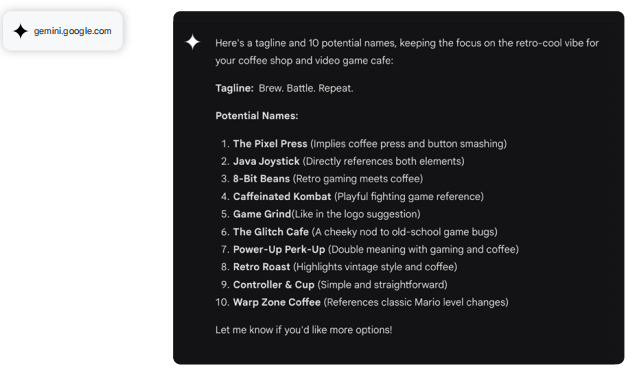

## 6.3 提示指南

### 6.3.1 品牌经理

#### **用例：进行市场调研并确定趋势**

 您所在行业的格局正在迅速变化，您需要进行市场调研以更好地确定和了解新兴趋势。您访问 [gemini.google.com](http://gemini.google.com)，然后输入：

> 我需要对 [行业] 行业进行市场调研以确定新趋势。使用 [URL] 发现新兴趋势和不断变化的消费者偏好。（[gemini.google.com](http://gemini.google.com)）

 完成研究后，您和您的团队已更新您的品牌活动，以包含您想要进行 A/B 测试的新消息。您决定生成广告文案的多个变体。您前往 [gemini.google.com](http://gemini.google.com) 并输入：

> 我需要对新消息进行 A/B 测试。这是我们的消息：[messaging]。生成三种不同的广告文案变体。

#### **用例：创建和管理内容和分发**

 另一位客户正在进行一些激动人心的领导层变动。您需要创建内容来塑造公司进入下一个时代的品牌叙事。您打开 Google 文档开始撰写博客草稿。您通过选择“帮助我撰写”提示 Docs 中的 Gemini。您输入：

> 创建博客草稿，宣布 [姓名] 将以 [职位] 身份加入 [公司]。[分享他们简历中的两三个细节，例如他们之前的职位和公司、他们在专业组织中的参与情况等。]

 您还想找到一种有效跟踪内容放大方式和位置的方法，因此您打开了 Google 表格。您在表格中选择“帮助我整理”来提示 Gemini。您输入：

> 为内容放大创建项目跟踪器，并包括渠道、所有者、URL 和优先级（低、中、高）的列。

### 6.3.2 数字营销经理

#### **用例：起草客户获取通讯**

 电子邮件是贵公司与潜在客户和客户直接沟通的主要渠道之一。您需要帮助开始撰写新的电子邮件活动文案。您打开一个新的 Google 文档，然后通过选择“帮助我撰写”提示 Docs 中的 Gemini。您输入：

> 撰写三个不同的电子邮件主题行，其中引用 [受众群体] 和我们的 [产品]。让它们引人注目但又专业。

 现在，您想与文案团队分享建议的电子邮件主题行。您打开 Gmail，然后选择“帮我写”。您输入：

> 帮我写一封电子邮件，向文案团队提出 [建议的电子邮件主题行]。保持电子邮件简短明了，并在周末之前请求反馈。感谢他们的帮助。

#### **用例：生成入站营销活动**

 团队刚刚使用我们的新解决方案创建了一本有关高管最佳实践的新电子书。您正在创建一个登陆页面来容纳门控资产，并且需要引人入胜的副本。您打开一个新的 Google 文档并选择帮我写。您输入：

> 为宣传新[电子书/网络研讨会/免费试用和详细信息]的登陆页面创建引人注目的副本，该页面专为高管目标受众设计。突出主要优势并通过有说服力的行动号召来鼓励转化。

 网页已启动，您现在正在开展入站营销活动。您需要培养下载了最新电子书的潜在客户。您打开一个新的 Google 文档，然后通过选择帮助我写作来提示 Docs 中的 Gemini。您输入：

> 生成一系列五封自动电子邮件的副本，以在潜在客户下载有关 [主题] 的电子书后培养他们。使用 [名称] 个性化电子邮件并鼓励进一步参与 [与其他有价值的资源或优惠]。

### 6.3.3 内容营销经理

#### **用例：为您的博客产生灵感**

 您在一家旅游公司工作，担任该公司博客频道的内容营销经理。您需要启动新博客文章的头脑风暴过程。您决定通过与 [gemini.google.com](http://gemini.google.com) 上的 Gemini 合作来收集想法。您输入：

> 我需要博文主题，这些主题对热爱旅行和旅游业的人来说很有趣。以下是我希望您关注的重点：让主题独一无二。现在有很多旅游博客——让我们想出一些引人注目的新角度。保持主题的相关性。在集思广益时，利用旅游业的当前趋势或最近的挑战/创新。我希望每个主题都包括：

> 目标受众：这个主题特别吸引谁？

> 内容大纲：博客文章将讨论的主要思想的几个要点。

> 号召行动：建议一种在文章结尾吸引读者的方法。

 您喜欢您能够创造的最初想法。您还需要专注于生成创意图像以配合博客中的副本。您打开一个新的 Google Slide，并通过选择使用 Gemini 创建图像来提示 Gemini。您输入：

> 创建一张飞机在日出时飞过山脉和河流的云层之上的图像，我可以将其用于营销活动来推广我的旅游公司

#### **用例：创建社交媒体帖子**

 您专注于创建针对社交媒体渠道优化的内容。您需要收集针对不同受众的不同内容的想法。您打开一个新的 Google 文档，并通过选择“帮助我撰写”来提示 Docs 中的 Gemini。您输入：

> 撰写三篇关于 [产品/服务/主题] 的引人入胜的社交媒体帖子，以吸引 [目标受众]。将每篇社交媒体帖子控制在两句话以内，并包含访问 [我们的网站] 的号召性用语。

 您还需要制作社交媒体帖子，以推动针对应届毕业生的即将举行的活动的注册。您打开一个新的 Google 文档，并通过选择“帮助我撰写”来提示 Docs 中的 Gemini。您输入：

> 创建社交媒体帖子，宣传我们即将举行的 [活动名称]。包括吸引注意力的语言和与 [受众] 相关的主题标签。

#### **用例：制定战略营销计划**

 您的公司正在推出一款新应用。您需要一个强大的营销计划，但您需要一些想法来开始。您通过访问 [gemini.google.com](http://gemini.google.com) 与 Gemini 聊天。您输入：

> 我正在为提供 [功能] 的新应用制定营销计划。我的目标受众是[受众]。请帮我制定一个以 [营销渠道] 为重点的计划。以下是我希望您涵盖的内容：竞争对手分析、理想的营销渠道组合及其理由、预算建议、关键信息传递想法以及带有 KPI 的拟议活动时间表。

 聊天中的回复有助于制定营销计划。在确定所有细节的同时，您需要将高级细节提供给您的 CMO。您打开 Gmail，选择“帮我写”，在 Gmail 中提示 Gemini。您输入：

> 给 CMO 写一封电子邮件，告诉他们我将在 [日期] 之前提供一份一页纸的战略营销计划，用于新应用发布项目，其中包括执行摘要、竞争格局概述、顶级营销渠道和所有南美市场的目标人群。

# 七、项目管理

## 7.1 入门

 作为复杂且不断发展的项目的指挥者，您的任务是把握时间表、协调团队并确保您的项目产生预期的影响。

 本部分将向您介绍 Gemini for Google Workspace 的强大功能，帮助您学习提示的基础知识并优化项目管理工作流程。准备好实现效率、洞察力和主动解决问题的能力，这将有助于使用 Gemini for Workspace 提升您的项目成果。

## 7.2 提示迭代示例

 首先，请阅读第 2 页的一般提示写作技巧和本指南开头的提示 101 部分。

 下面的每个提示都附带一个场景，以启发您如何与 Gemini for Workspace 协作。提示迭代示例说明了如何继续编写提示以在最初生成的响应的基础上进行构建。您可以继续编写提示以在最初生成的响应的基础上进行构建，并且可以调整每个提示以完成常见任务并优化生成的输出。

 您的团队刚刚完成了新网站的注册表单，现在您需要生成一些用户验收测试 (UAT)。要开始草稿，请访问 [gemini.google.com](http://gemini.google.com) 并输入：

 为最新网站注册表单创建一个包含 10 个用户验收测试 (UAT) 的表格。

 人物角色 任务 语境 格式

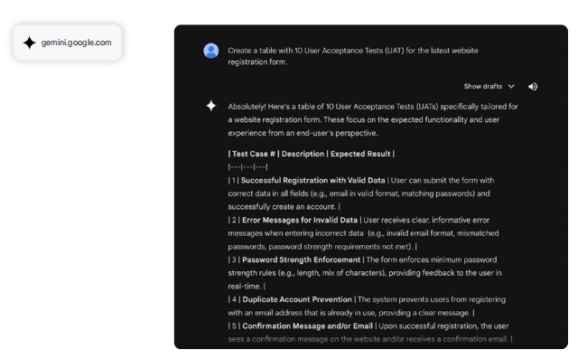

 您认为这些结果是一个有用的起点，因此您将结果导出到 Google Sheet，然后起草一封电子邮件给负责运行 UAT 的同事。您想解释他们需要做什么。您继续在 [gemini.google.com](http://gemini.google.com) 上与 Gemini 进行对话。您输入：

 起草一封电子邮件给负责运行此 UAT 的 [我的同事]，并解释他们下一步需要做什么。

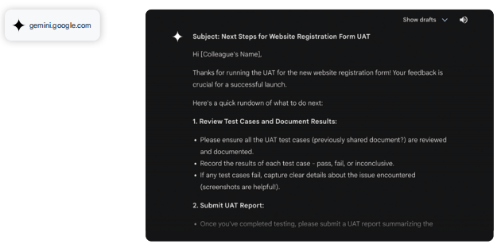

 起草的电子邮件提供了一个有用的起点，因此您可以将结果导出到 Gmail，并在将邮件发送给同事之前直接进行编辑。

## 7.3 提示指南

### 7.3.1 项目经理

#### **用例：报告项目状态**

 您刚刚与所有项目利益相关者进行了长时间的通话，现在您想总结讨论的内容并跟进分配的行动项目。在包含会议记录的 Google 文档中，您通过选择“帮助我撰写”提示 Docs 中的 Gemini。您输入：

> 用一个简短的段落总结此通话记录。在项目符号中，根据 [通话记录] 突出显示行动项目、做出的决定和每个项目的所有者。

 您需要根据上次通话中的活动向经理汇报情况。您希望模板化项目状态更新的交付方式。您打开一个新的 Google 文档，然后通过选择“帮我写”提示 Docs 中的 Gemini。您输入：

> 草拟要发送给我经理的项目状态更新电子邮件模板。包括本周主要成就、面临的任何挑战以及下周的三大优先事项的摘要部分。

 团队提前整整一周完成了关键里程碑。这是一个具有挑战性的项目，所以你想召集所有人一起庆祝。你打开 Gmail，选择“帮我写”，在 Gmail 中提示 Gemini。你输入：

> 写一份团队午餐邀请函，庆祝项目进展，并注明 [日期、时间和地点]。感谢他们的辛勤工作，并承认这是一个具有挑战性的项目。

#### **用例：创建项目回顾**

 您刚刚完成项目，您的高级领导团队需要进行项目回顾。要启动从整个团队收集反馈的过程，请打开 Google 文档，然后选择“帮助我撰写”，提示 Docs 中的 Gemini。您输入：

> 我需要撰写一份报告，详细说明 [项目] 的成功、失败和经验教训。起草一份包含 20 个问题的清单，以指导跨团队流程调查。包括一些问题，以发现哪些方法有效、哪些方法无效、特定流程故障、技术问题、沟通差距或任何其他可能导致项目问题或成功的因素。

 Gemini in Docs 提供的问题为您提供了一个很好的起点。您可以在与团队共享 Google Doc 以征求他们的意见之前对其进行编辑。在 Google Doc 中收集每个人的反馈后，您需要帮助构建报告。您可以通过选择“帮助我撰写”来提示 Gemini in Docs。您输入：

> 用两段话总结此文档。包括有关项目目标、主要贡献者、项目成果以及任何关键成功或失败的高级信息。

#### **用例：开发问题跟踪器和相关通信**

 您需要创建一个项目问题跟踪器来跟踪风险并及时解决。您想快速创建一个模板，因此您打开一个新的 Google Sheet 并通过选择“帮助我整理”来提示 Sheets 中的 Gemini。您输入：

> 创建一个电子表格来跟踪项目问题，包括描述、状态、分配的所有者和解决问题的行动项目。

 在项目全面启动之前，您需要拥有标准化的沟通模板。例如，您需要一封可以在出现问题时使用的电子邮件。您打开一个新的 Google 文档，并通过选择“帮我写”提示 Docs 中的 Gemini。您输入：

> 草拟一份电子邮件模板，用于在出现问题时进行通知，并包括原因、解决方案和解决问题的时间表。

 您喜欢 Gemini in Docs 创建的模板，并且想要创建一个额外的、略有不同的电子邮件模板。在同一个 Google 文档中，您通过选择“帮助我撰写”来提示 Gemini in Docs。您输入：

> 起草一份电子邮件模板给利益相关者，以升级关键项目问题，概述影响和建议的解决方案。

# 八、销售

 彻底了解客户是您走向成功的钥匙。您负责维护关键关系、解读购买信号、制定定制解决方案、进行数据驱动的呼叫等。

 Gemini for Google Workspace 可以帮助您重新定义生产力并培养有意义的客户关系。本节提供专为您和您的团队设计的实用提示和真实用例。学习编写有效的提示将有助于提高您的生产力并简化您的日常任务，让您有更多时间专注于您的客户，通过使用 Gemini for Workspace。

## 8.1 入门

 首先，请阅读第 2 页上的一般提示编写技巧和本指南开头的提示 101 部分。

 下面的每个提示都附带一个场景，以启发您如何与 Gemini for Workspace 协作。提示迭代示例说明了如何继续编写提示以在最初生成的响应的基础上进行构建。我们还提供了不同销售角色如何使用 Gemini for Workspace 的示例。您可以调整每个提示以完成常见任务并优化生成的输出。

## 8.2 提示迭代示例

 您是一名客户主管，刚刚被指派给一位新客户。您需要一名研究助理。您需要了解客户的关键联系人，以便开始在团队之间建立信任，但首先，您想发送一封介绍性电子邮件，因此您打开 Gmail 并选择“帮我写”，在 Gmail 中提示 Gemini。您输入：

 给 [公司] 的新 [职位] [姓名] 写一封电子邮件。祝贺他们获得新职位。介绍我是他们在 [公司名称] 的联系人。邀请他们下周共进午餐，看看他们更喜欢周一还是周二。

 人物角色 任务 语境 格式

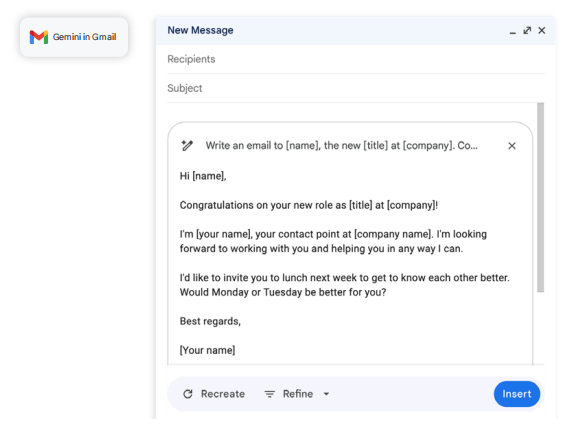

 这提供了一个有用的起点，但你想尝试获得更好的响应。你点击 **完善>形式化**。

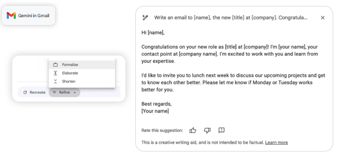

 您对电子邮件很满意，因此点击了“插入”。您最后一次阅读了邮件，直接进行了最后的简单编辑，然后发送了邮件。现在，您想了解有关客户的更多信息以及客户如何营销自己。要进行研究，请访问 [gemini.google.com](http://gemini.google.com) 并输入：

 我是一名负责新客户（[客户名称]）的客户经理。我需要做初步调查。[客户] 的市场策略是什么？

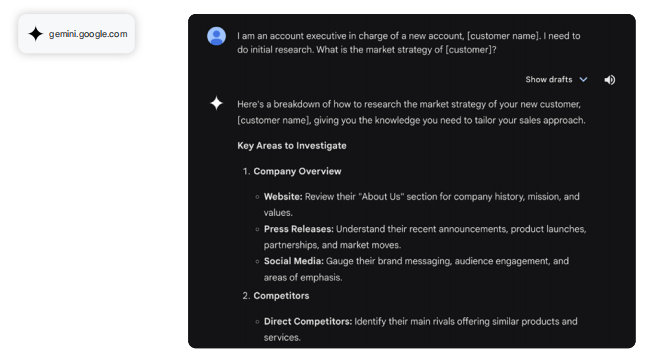

 Gemini 为您提供了有用的信息，帮助您开始研究。您决定先关注新闻公告，进一步研究。您收集了 URL 列表，并将其粘贴到您在 [gemini.google.com](http://gemini.google.com) 上与 Gemini 的对话中。您输入：

 [URL] 总结这些文章。提供关键见解并说明这些公告为何如此重要。

 现在，您已经清楚地了解了宣布的内容、新闻的重要性以及其他见解。接下来，您想更好地了解将成为主要联系人的高管。您找到了一段有关该高管的录音采访。您将 YouTube 网址粘贴到您与 [gemini.google.com](http://gemini.google.com) 上的 Gemini 的对话中，然后输入：

 [URL] 总结这次采访并告诉我更多关于 [高管姓名] 的信息。[高管] 关心什么？

 现在您有了一份简洁的面试总结。您可以继续对话，提出更多问题以熟悉您的关键联系人和帐户。您提示：

 告诉我 [公司] 如何帮助 [客户公司] 实现他们的目标。

 结束对话后，您可以将结果导出到 Google 文档中。打开 Google 文档并在 Docs 中提示 Gemini。输入：

 为 [客户] 创建一封电子邮件草稿，解释为什么 [贵公司] 是他们实现市场目标的完美合作伙伴。

## 8.3 提示指南

### 8.3.1 销售经理

#### **用例：发展客户关系**

 您的年度会议即将召开，许多最重要的客户都会出席。您想亲自邀请他们参加您举办的欢乐时光活动。您还想邀请一些潜在客户，以便他们与现有客户建立联系。您打开 Gmail，选择“帮我写”以在 Gmail 中提示 Gemini。

您输入：

> 写一封电子邮件，邀请对 [重点领域] 感兴趣的人参加我们于 [日期、时间] 在 [贸易展览活动] 举行的欢乐时光活动。包括我们专注于 [重点领域]。

 现在活动已经结束，您想要跟进参加欢乐时光的客户。您打开 Gmail并选择“帮我写”来提示 Gmail 中的 Gemini。您输入：

> 起草一封电子邮件，感谢客户在 [日期、时间、地点] 参加欢乐时光。最后邀请他们在接下来的几周内继续对话。使用友好的语气。

 在活动总结活动中，您还想与参加动手演示研讨会的客户进行交流。他们测试了公司的一些新产品，他们的早期反馈对团队来说很重要。您打开一个新的 Google 文档，并通过选择“帮我写”提示 Docs 中的 Gemini。您输入：

> 草拟 10 个问题，我可以使用这些问题来调查客户最近使用我们的 [产品/服务] 的体验。包括一些问题来衡量 [产品] 有多有用、他们喜欢什么以及他们认为哪些方面可以改进。

#### **用例：支持销售团队**

 不幸的是，公司的服务出现了区域性问题。您需要联系东南地区的所有团队负责人，以立即指导如何主动联系客户。您打开 Gmail，选择“帮我写”以提示 Gmail 中的 Gemini。您输入：

> 起草一封电子邮件给所有东南地区的销售主管。告知他们 [问题]。建议他们与团队沟通，联系客户，并在未来的订单中提供 20% 的折扣作为道歉。

 现在，您需要向所有区域团队成员发送电子邮件，因为他们最接近客户反馈。您打开 Gmail，选择“帮我写”，在 Gmail 中提示 Gemini。您输入：

> 起草一封电子邮件给区域销售代表，内容是下周需要就 [问题] 举行的紧急会议。请他们周一或周二安排时间

#### **用例：指导和培训销售团队**

 您从许多团队成员那里听说他们想要更多的学习机会。您正在组织一个半天的学习计划来支持这一请求。您需要创建一个时间表，因此您打开一个新的 Google 文档，然后通过选择“帮助我写作”提示 Docs 中的 Gemini。您输入：

> 为销售团队创建一个半天的教育课程议程，介绍我们的最新技术 [产品]。包括产品开发团队的演示时间以及午餐时间。

 作为团队会议的后续活动，您希望重点介绍团队可用的所有不同学习机会。您需要一种方法来组织这些内容，因此您打开 Google 表格，并通过选择“帮助我组织”提示 Gemini。您输入：

> 创建一个电子表格，跟踪卖家的在线课程。包括课程的主要主题、价格、持续时间和优先级别的列。

### 8.3.2 客户经理和客户主管

#### **用例：建立客户关系**

 您刚刚与客户进行了一次愉快的通话，现在您想使用在 Google Docs 中记录的会议笔记来起草一封发送给客户的电子邮件。在包含笔记的 Google Doc 中，选择“帮助我撰写”，提示 Docs 中的 Gemini。您输入：

> 在初次交谈后，为 [客户] 撰写个性化的后续电子邮件。总结我们讨论的关键点并解决任何未解决的问题。

 该帐户刚刚采用了该公司的一项服务，您需要确保他们在入职过程中感受到支持。您想确保每周检查一次事情的进展情况，但您想探索电子邮件的外观。您打开一个新的 Google 文档，并通过选择“帮助我写作”提示 Docs 中的 Gemini。您输入：

> 草拟四个电子邮件模板，以便每周检查我的客户，因为他们已经购买了我们的新[服务]。使用一个价值主张（成本、易用性、安全性、可用性和定制）作为每封电子邮件的主要主题，并在每封邮件中包含[号召性用语]。

#### **用例：为新客户来电做准备**

 您即将与潜在客户通话。这对您来说是一个全新的用例，您需要帮助准备通话。您需要初步研究方面的帮助，因此您访问 [gemini.google.com](http://gemini.google.com)，然后输入：

> 为我起草一份定制脚本，供我在与潜在客户进行销售通话时遵循。通话将通过视频通话进行，并将持续 30 分钟。请确保在脚本中添加以下内容：[插入公司产品/解决方案] 如何帮助解决潜在客户的痛点，[公司] 的交付系统如何保证无缝和及时交付，有竞争力的定价和批量折扣表，以及[客户行业] 行业中客户参考的空间。

 现在您已经完成了初步研究，您可以将研究结果导出到新的 Google 文档中。您打开 Google 文档，以便继续工作。现在，您想要创建一个定制的推介。使用包含所有研究笔记的 Google 文档，您可以选择“帮助我撰写”来提示 Gemini in Docs。您输入：

> 为 [产品名称] 生成电梯推介，并包括主要优势、竞争差异化点以及 [产品名称] 解决的痛点。

 您的电梯推介和简短的谈话要点有一个很好的开端。您想利用这一点进一步预测客户电话的进展情况。您返回 [gemini.google.com](http://gemini.google.com) 继续会议准备。您输入：

> 我即将与潜在客户通话。[用例] 对我来说是一个新的用例，我需要帮助准备通话。列出 [客户] 在销售电话中可能对我提出的最有可能的反对意见，并提出如何回应这些反对意见的建议。我在 [插入行业] 工作，我正在尝试销售 [产品]。还请提供如何处理异议的想法并建议回应方式。

### 8.3.3 业务发展经理

#### **用例：培养关系、个性化推广和思想领导力**

 您希望与在商业影响者社交活动中遇到的潜在客户建立更深层次的关系。您想要起草一个可以为多个联系人自定义的模板。您打开一个新的Google 文档，并通过选择“帮我写”提示 Docs 中的 Gemini。您输入：

> 起草一份面向行业影响者的推广电子邮件模板。表达我们在 [活动] 上建立联系的感激之情，并提出合作机会，例如 [机会]。

 在成功与潜在客户通话后，您希望跟进创始人可能感兴趣的思想领导力内容。您打开包含博客文章的 Google Doc，然后选择“帮助我撰写”，提示 Docs 中的 Gemini。您输入：

> 以要点形式总结此博客内容，并提出三个后续问题的想法，以便我可以询问客户他们的想法。

#### **用例：生成个性化的客户入职材料**

 您已经入职了几个新的大客户，现在您想亲自感谢您的客户并查看是否还有其他可以提供的。您打开 Gmail 并选择“帮我写”以提示 Gmail 中的 Gemini。您输入：

> 在 [客户] 与 [公司] 合作一周年之际，为其生成个性化电子邮件。感谢他们成为客户。询问他们是否有任何问题。包括有关 [其他产品] 的信息。

 您还想向这些客户发送礼物，以祝贺他们建立新的合作伙伴关系。您打开 Google 表格，并通过选择“帮助我整理”提示 Gemini。您输入：

> 给我一份要送给新客户的礼物清单，这些礼物价格低于 200 美元，可以邮寄到办公室。

# 结束. 提高你的提示写作水平

本指南旨在提供灵感，但 Gemini for Google Workspace 的可能性几乎是无穷无尽的。尝试这些额外的技巧来提高您的即兴写作技能。

- **分解**。如果您希望 Gemini for Workspace 执行多个相关任务，请将它们分解为单独的提示。

- **给出约束**。要生成特定结果，请在提示中包含详细信息，例如字符数限制或您想要生成的选项数量。

- **分配角色**。要鼓励创造力，请分配角色。您可以通过使用以下语言开始提示来做到这一点：“您是一家领先广告公司的创意部门负责人……”

- **征求反馈**。在您与 [gemini.google.com](http://gemini.google.com) 上的 Gemini 对话时，告诉它您正在给它一个项目，包括您拥有的所有细节和您所知道的一切，然后描述您想要的输出。通过提出以下问题继续对话：“您有什么问题可以问我，以帮助您提供最佳输出？”

- **考虑语气**。定制您的提示以适合您的目标受众和所需的内容语气。要求在输出中使用特定的语气，例如正式、非正式、技术、创意或随意。

- **换一种说法**。如果结果不符合您的预期或您认为还有改进空间，请微调您的提示。反复的审查和改进过程通常会产生更好的结果。

> 生成式人工智能及其所有可能性都令人兴奋，但它仍然是一个新事物。尽管我们的模型每天都在改进，但我们的提示有时会产生不可预测的响应。

> 在将 Gemini for Workspace 的输出付诸实践之前，请先对其进行检查，以确保其清晰度、相关性和准确性。当然，最重要的是要记住：生成式人工智能旨在帮助人类，但最终的输出属于您。

> 本指南中的示例提示仅用于说明目的。

关注 [workspace.google.com](http://workspace.google.com) 和 [workspace.google.com/blog](http://workspace.google.com/blog) 了解最新动态

# 下载链接

官方原文：[https://inthecloud.withgoogle.com/gemini-for-google-workspace-prompt-guide/dl-cd.html](https://inthecloud.withgoogle.com/gemini-for-google-workspace-prompt-guide/dl-cd.html)

国内链接：[https://www.lanzouj.com/iWtBQ28fqtbc](https://www.lanzouj.com/iWtBQ28fqtbc)

---

*来源: https://linux.do/t/topic/315663.json*

