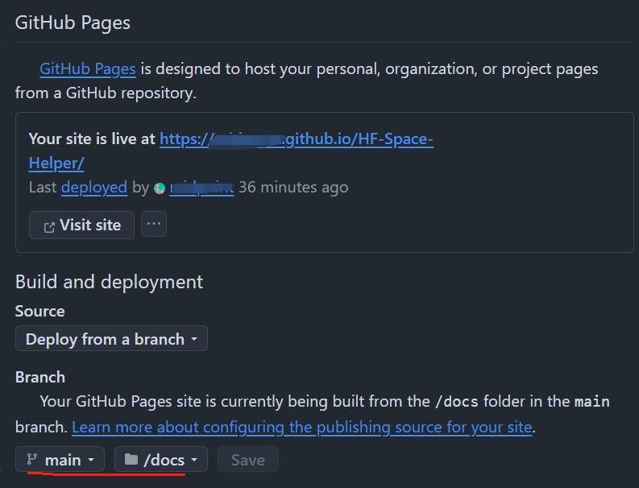

---

id: 318914

title: "开源了！抱脸空间终极保活项目"

created_at: 2024-12-29T16:46:53.290Z

username: F-droid

display_username: "𝓕-𝓓𝓻𝓸𝓲𝓭"

---

# 开源了！抱脸空间终极保活项目

### [Cookie monster!](https://codeberg.org/fossandroid/Spaces-Keeper/src/branch/main)

# 使用指南：

1. 先git本项目

2. 设置3个环境变量：

[https://github.com/用户名/HF-Space-Helper/settings/secrets/actions](https://github.com/%E7%94%A8%E6%88%B7%E5%90%8D/HF-Space-Helper/settings/secrets/actions)

| 变量名 | 含义 | 设置地址 |

| --- | --- | --- |

| HF_TOKEN | huggingface的Access Tokens(write) | [Hugging Face – The AI community building the future.](https://huggingface.co/settings/tokens) |

| USERNAME | huggingface的用户名 | 上面这个网址的左上角显示的用户名 |

| SPACE_LIST | 空间列表 | 所有空间名称的列表，用英文“,”分隔 |

1. 设置Github pages

2. 运行action

## 官方Demo

### [Hugging Face空间状态](https://fmapi.github.io/HF-Space-Helper/)

---

*来源: https://linux.do/t/topic/318914.json*

