---

id: 322767

title: "无公网IP如何远程串流访问异地组网？---ZEROTIER(AIO系列No.1)"

created_at: 2025-01-01T08:41:24.000Z

username: Queso

display_username: "Queso"

---

# 无公网IP如何远程串流访问异地组网？---ZEROTIER(AIO系列No.1)

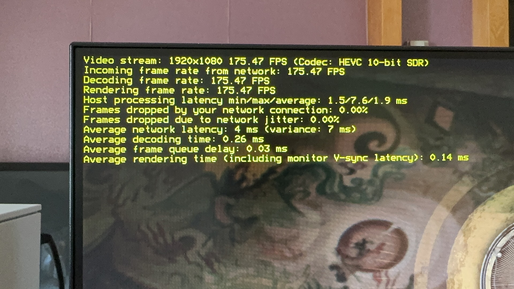

个人博客链接： [无公网IP如何异地组网 ? - QuesoX](https://queso-su.github.io/blog/%E5%BC%82%E5%9C%B0%E7%BB%84%E7%BD%91/)

> 好奇与懒惰是驱动人类进步的最佳动力。

### 写这个干啥

前段时间家里的服务器的IP一直内外网切换（坐标 广西北海联通），虽然解决了切换的问题，但是狡兔三窟，以防万一就做了个异地组网。实现无感访问PVE里的黑裙和WIndows，以及实现了串流游戏。这里我使用的是ZEROTIER，当然也有别的比如Tailscale，OpenP2P ，星空组网等等。

### 异地组网是什么

异地组网是指将分布在不同地理位置的网络设备通过特定的技术手段连接起来，形成一个统一的虚拟网络。这种技术允许不同地点的设备能够像在同一局域网内一样进行通信和资源共享。

比如你家里的路由器内网是192.168.x.x,是独立的一个网段，它可以拓展出一个网段（虚拟局域网），将你的所有设备连接一起，通过ip或者各种方式访问。

#### 应用场景

远程监控与管理，对远程设备的实时监控和管理，提高运维效率。

游戏与娱乐，串流游戏PC或，实现游戏玩家之间的低延迟直连，如MC局域网联机，如Moonlight串流。

### 开始

#### What should u need?

[ZeroTier (组网工具）](https://www.zerotier.com/)

[NAT类型检测（感谢创建这个网站的作者）](https://mao.fan/mynat)

可选部分：

[Sunshine（用于游戏串流的服务端）](https://github.com/LizardByte/Sunshine/releases)

[Moonlight-qt（用于游戏串流的客户端）](https://github.com/moonlight-stream/moonlight-qt/releases/tag/v6.1.0)

[Todesk(维护使用的PlanB)](https://www.todesk.com/)

[RaiDrive(将webdav映射为硬盘)](https://www.raidrive.com/)

#### NAT检测

我们所使用的ZeroTier是通过P2P类型打洞进行工作连接的

NAT类型可能会对连接产生影响。特别是对于需要直接P2P（点对点）连接的游戏来说，NAT的复杂性可能会增加连接的难度和延迟。

上面给的NAT类型检测中有测试以及介绍

一般来说 NAT1到NAT3都可以顺利打洞进行连接，但最好控制在2和1，详细操作部分请自行Bing搜索 ，这边给出的建议操作是

是否是校园网 ->检查路由器NAT-> DMZ 是否需要开启 → 检查光猫

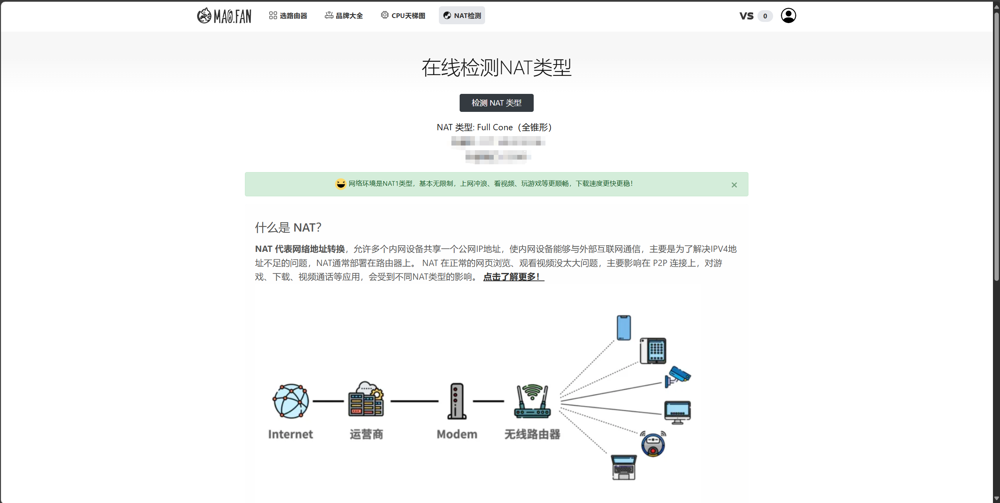

#### Zerotier 部分

分为网页和客户端

##### 网页部分

1. 注册账号，选择基本模式

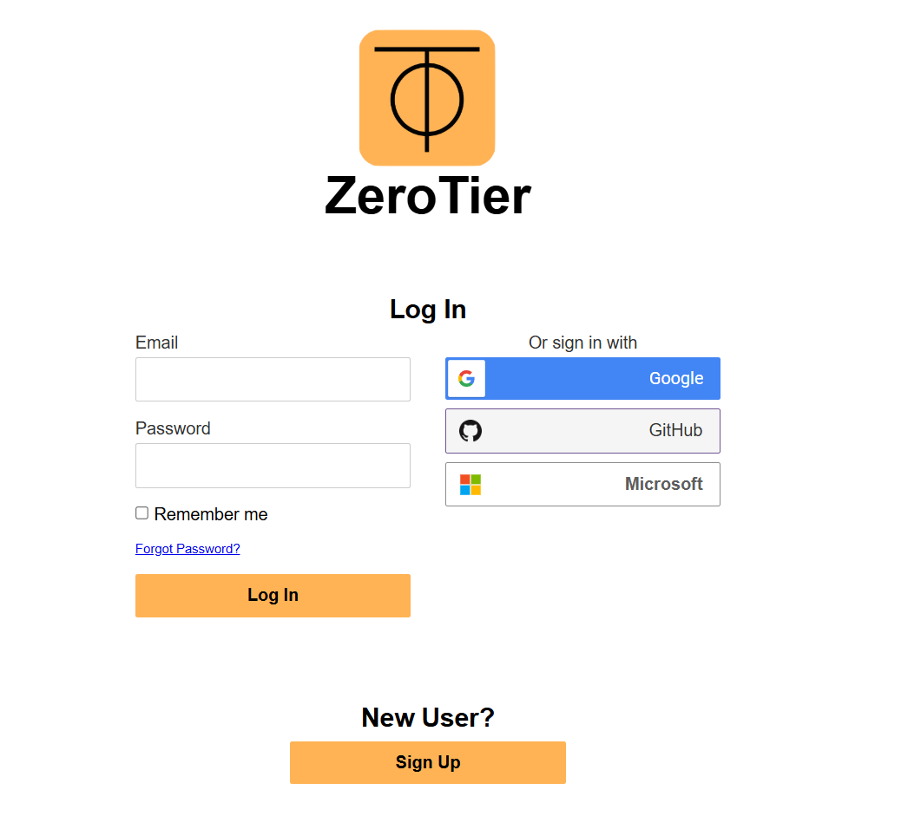

2. 创建一个新的网络（create new network）

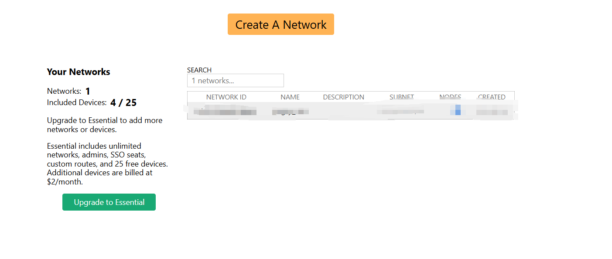

3. 进入网络，找到你的网络ID，复制后到客户端操作

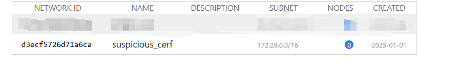

4. 授权客户端（这一步需要你完成客户端操作后再进行），先打上钩，然后Authorize，添加完成

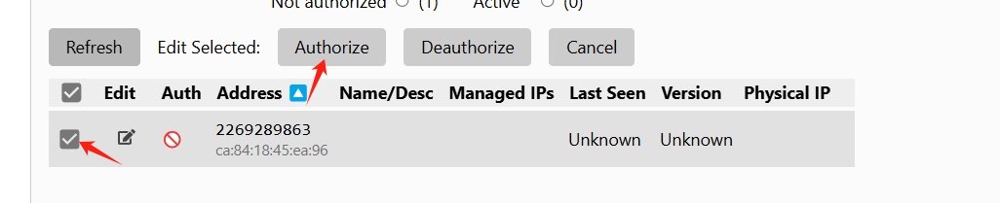

##### 客户端操作

1. 将你的每一台设备都装上对应客户端，在网页的download部分，不需要下载Server

2. 启动后，右下角找到小图标，JoinNew new network,填写你刚刚的网络ID，这样就算加入了

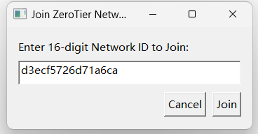

3. 选择join下面的那个网络id，然后把Allow都勾上（也可以看你自己情况）回到网页端操作授权客户端

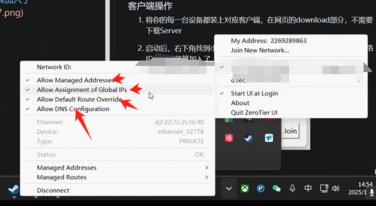

##### 给每一台设备分配IP

在上面两部做完之后我们就可以看到添加的设备了

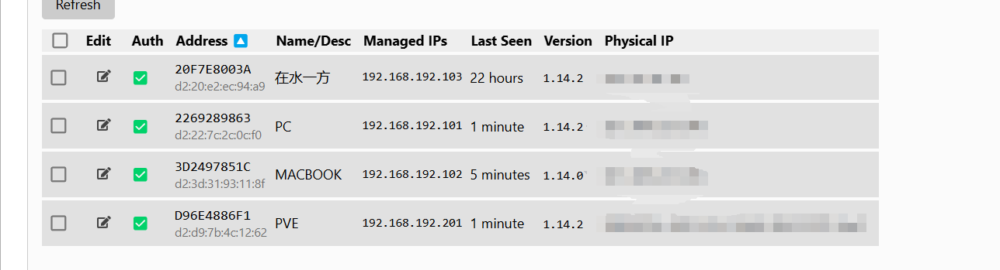

| Edit | Auth | Address | Name/Desc | Managed IPs | Last Seen | Version | Phyical IP |

| --- | --- | --- | --- | --- | --- | --- | --- |

| **编辑** | 是否已授权 | 地址（无关紧要） | 名字描述（编辑中设置） | **虚拟内网IP** | 上次上线时间 | 版本 | 真实物理IP |

这里我们只需要关注虚拟内网IP部分和编辑

下拉到Advanced部分，选择一个你喜欢的网段（之后我们会通过这个来访问）

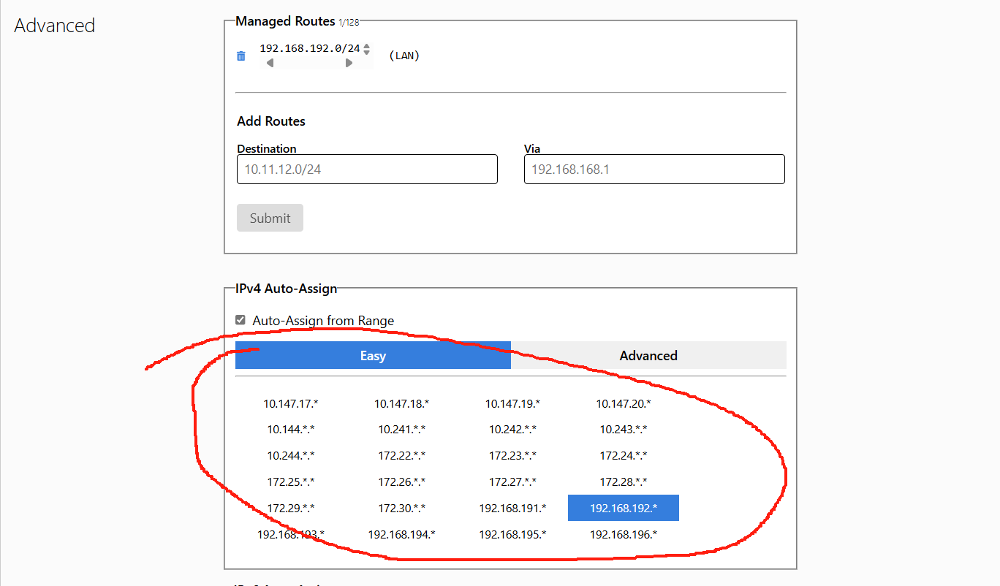

回到上面，点击edit，然后填写你设备的名称和分配一个喜欢的ip，前面与你的网段相同，最后一位自己选择，这里给一个翻译版本。

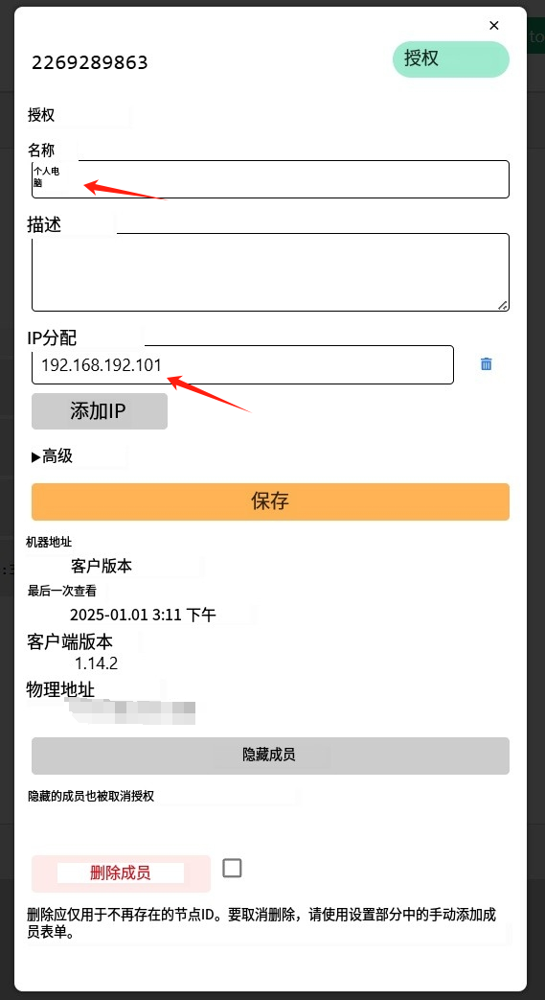

做完上面几步没问题的话我们就可以试试看是否组网成功了

设备互ping一下,ping的地址是你设置的**虚拟内网ip** 而不是真实物理ip

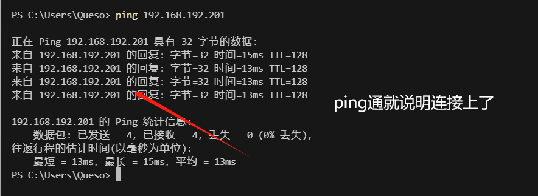

组网完成

### 应用部分

#### 远程桌面游戏串流 Moonlight+sunshine

物理距离200公里的串流延迟5-8ms左右，帧数是动态的不是只有15fps，玩游戏的时候可以跑到240fps

这一部分需要的话再补充教程

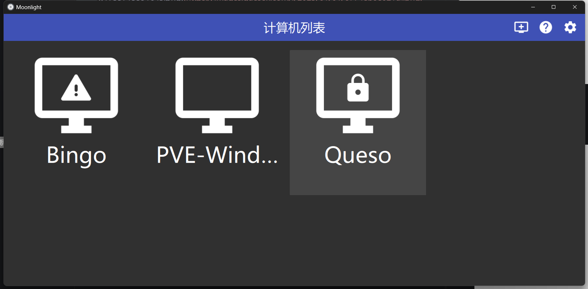

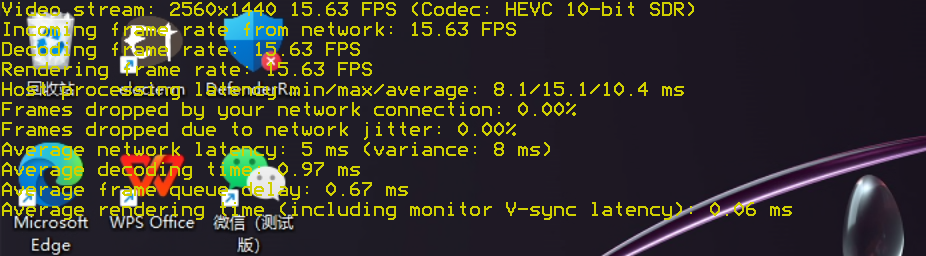

#### 群晖与webdav以及文件传输访问

异地内网下访问各个设备

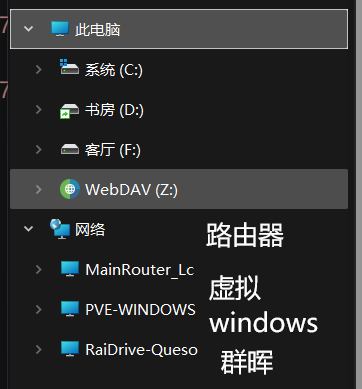

本文完，下一篇写什么各位可以给点建议。

新年快乐！

---

*来源: https://linux.do/t/topic/322767.json*

