---

id: 326525

title: "Microsoft 365系列04: 利用MS365 E5 记录苹果PodCast播客使用情况"

created_at: 2025-01-04T07:00:24.841Z

username: zhuzx

display_username: "Nathan"

---

# Microsoft 365系列04: 利用MS365 E5 记录苹果PodCast播客使用情况

2024年终的时候，不少软件或者网站都推出了年终总结。然而，苹果官方似乎并没有为播客提供这样的总结。。。

可是，天河想看看自己一年听了多少篇播客，这样也可以反映自己到底花了多少时间在持续学习上，因为天河都是用这个来练习/保持自己的英语听力，也可以稍微增加一下词汇量。

于是，天河就想着，能不能自己动手弄一个这样的东西，就算是为明年。。。

其实也不算复杂，利用 Microsoft 365 + 苹果 PodCast 播客，就可以实现这样的功能。

**使用场景：**

在听完某篇播客，当您觉得可以添加到完成清单上面的时候，就将此篇播客分享到 Microsoft Teams，这样，Microsoft 365就会自动将些篇播客的标题，地址，时长，以及保存的音频地址添加到一个事先设置好的 Microsoft List 列表上（后续还可以对此列表进行统计的工作），比如总共听了多少篇，时长总计是多少分钟之类的。更有甚者，还可以通过第三方服务实现音频转文字功能，统计年度关键词等等。。。

运行后，保存的播客记录列表 效果如下：

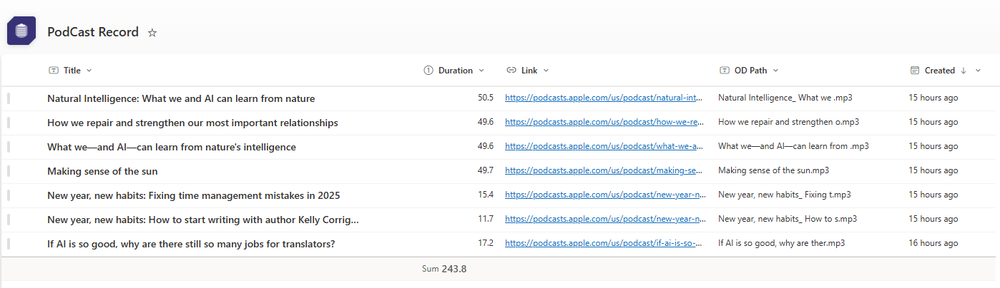

那么，需要如何设置呢？

需要用到的工具，依然是 **Microsoft 365 里面的 power automate** 。

**实现逻辑：**

当将某篇播客分享到Teams频道时，power automate会自动触发工作流，工作流的主要功能是通过获取此篇播客的地址，通过苹果服务器，获取到播客的相关信息，包括：标题，地址，时长，以及音频地址，再将这些信息添加到Microsoft List里面，以及将音频保存到 OneDrive 里面。

因为我是将播客单集页分享到Teams 频道，所以触发器是 当有一条新的频道消息发布时：

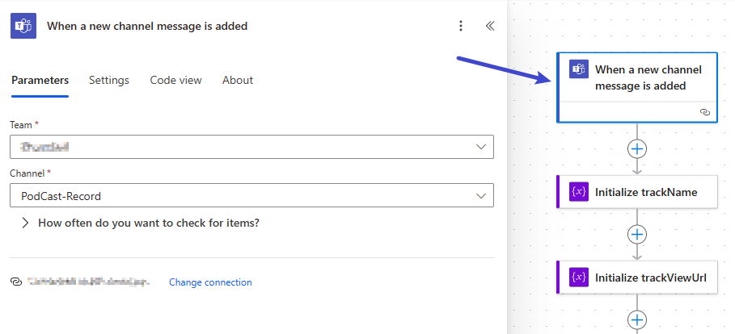

它的输出结果如下：在body/body/content里面会包含相关信息，但是因为是html格式，所以需要将此格式去除。

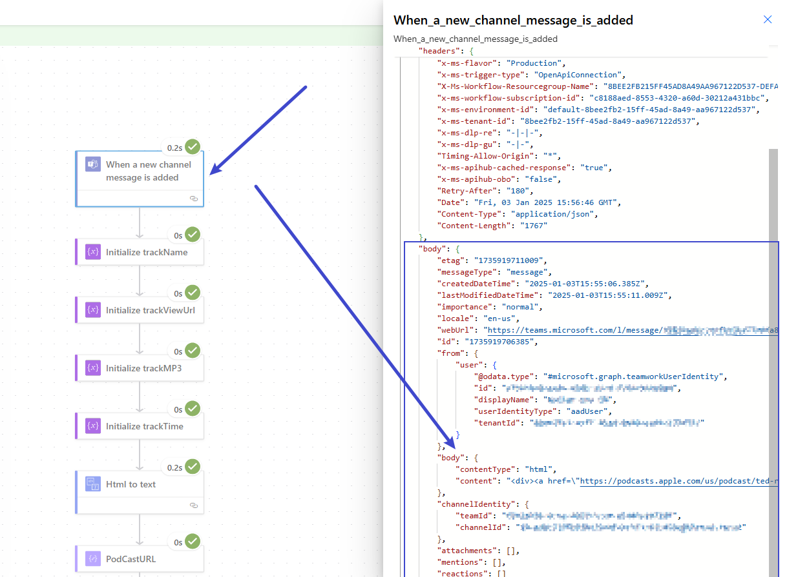

去除HTML需要用到  power automate 里面 的 Hlml to text 连接器：

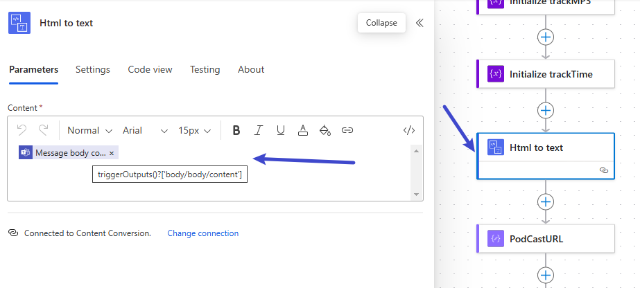

它的输出结果如下：可以对输出结果的字符串进行处理，获得 播客的地址，节目ID，以及这一集播客的ID。

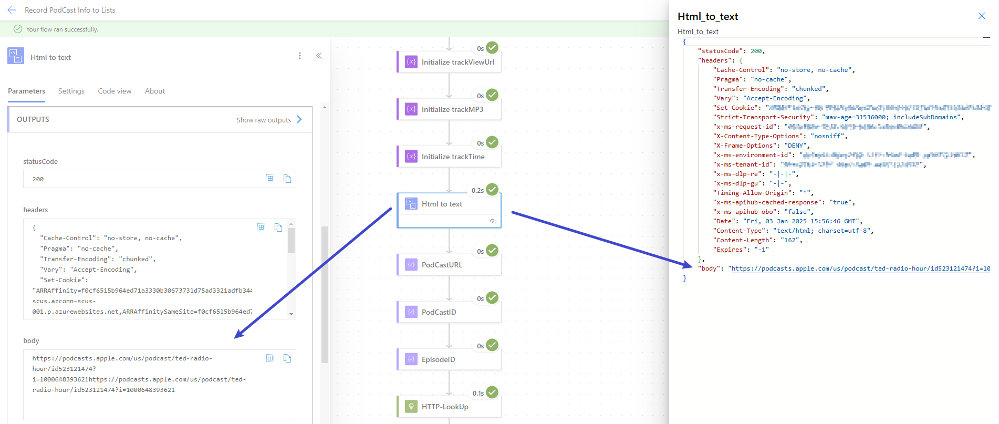

获取播客地址：

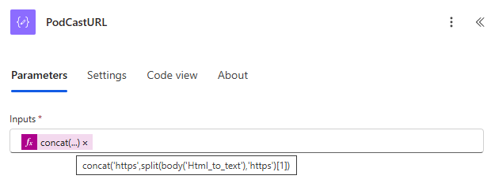

输出结果如下：

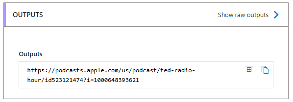

获取播客节目ID：

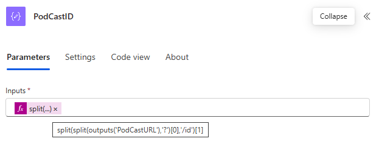

输出结果如下：

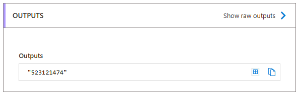

获取播客单集ID：

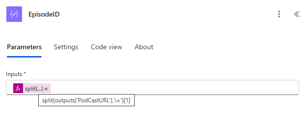

输出结果如下：

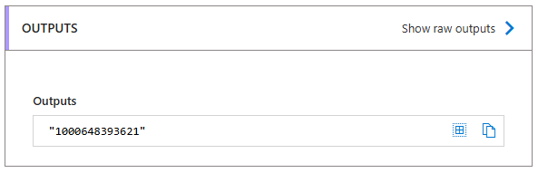

在得到这些信息后，我们可以通过 PodCastID来获取其最近的数篇播客的数据（这里定义的输出100篇），需要通过HTTP的Get方法实现：

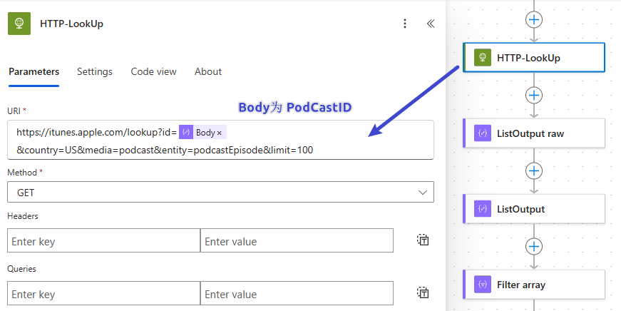

输出结果如下：可以看到，输出结果依然是HTML格式，我们可以通过将其转换为 JSON 格式。

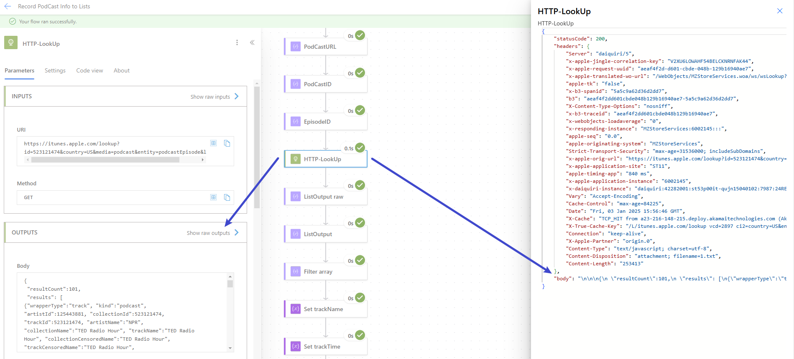

利用 Compose 连接器，通过 json()函数 实现将 上面的输出结果转换为 更好处理的 json格式。

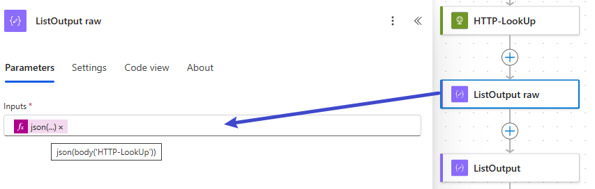

输出结果如下：

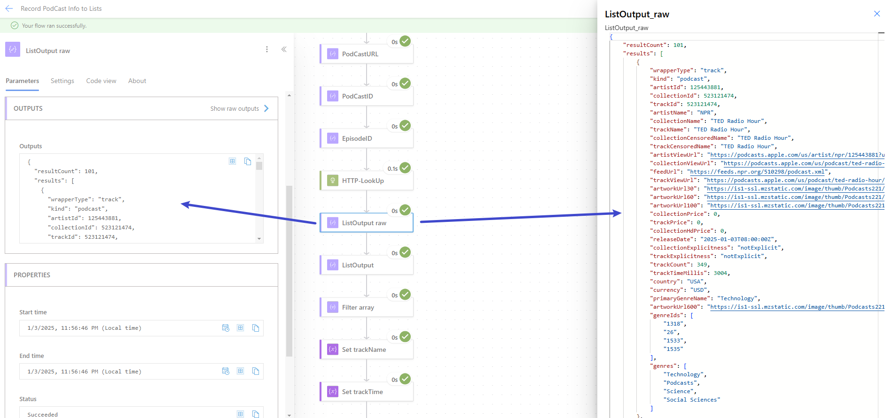

在输出结果中，我们可以看到，包含这些有用的信息：里面的 trackId就是 我们上面提到的 EpisodeID。trackName就是播客标题，episodeUrl就是音频地址，trackTimeMillis就是音频时长（毫秒）。

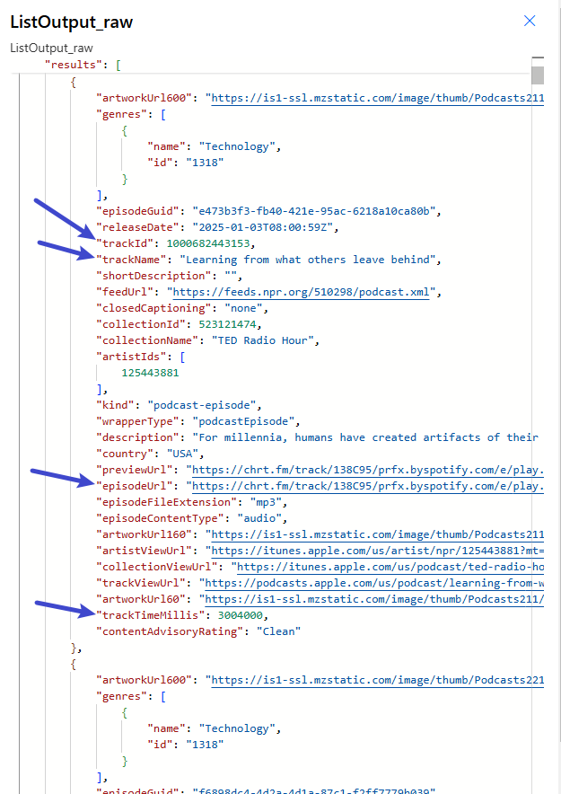

因为输出结果的第一个值是统计信息，需要将其删除，这里使用的 power automate中的 skip 函数。

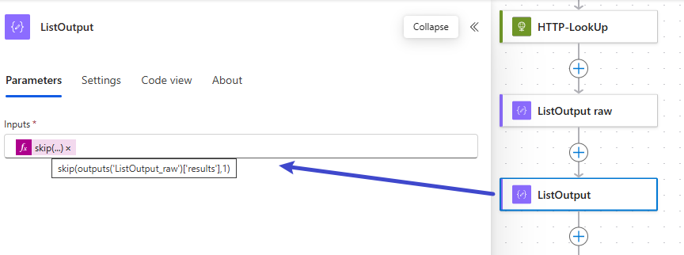

然后，我们的目标是从这100篇信息中，找到我们想要的那篇播客，可以通过比对EpisodeID的形式实现，这里使用的是 power automate 里面的 filter array 连接器：这样就可以过滤出我们想要的那篇播客了。

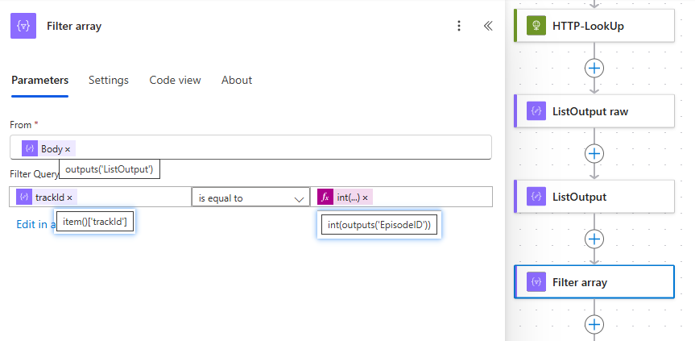

输出结果如下：我们提取出需要的结果。

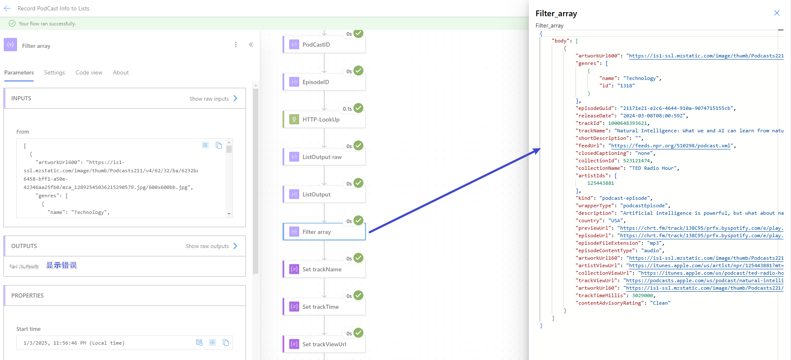

这里想讲一点：我们在保存音频到 OneDrive的时候，此前提取到的音频地址并不是真实地址，在使用 http get方法后，得到的反馈是跳转到一个新的地址，但是Power automate并不会自动处理跳转，需要我们人为判断，也就是下图中的 Condition：

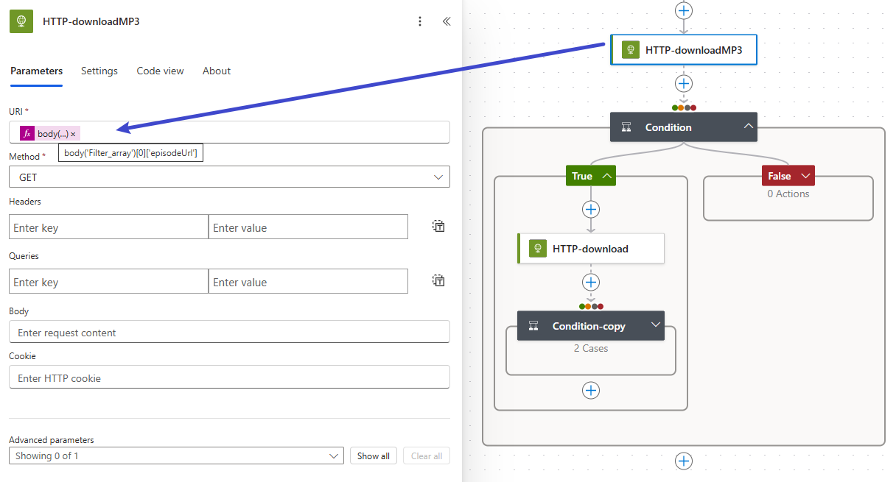

判断条件也很简单，状态码302表示的是 跳转：这是根据结果来的：并且新的url地址为  header 中的 Location。

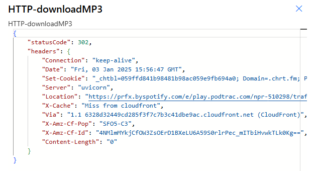

所以设置 condition 如下：并且让 condition的运行是无论当前一个 http 是运行成功还是失败后都要执行

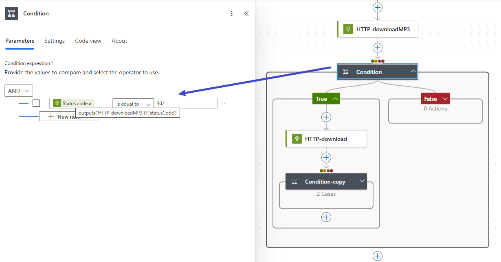

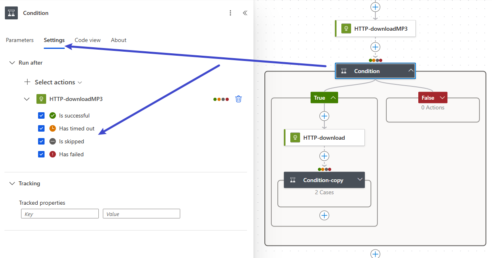

再拿到新的地址后，再次调用 http get，总共有4次跳转，最终才会拿到真正的音频地址。

然后，我们可以利用 OneDrive 里面的 Upload file from URL 连接器，来实现将此音频上传到OneDrive里面的特定位置，这里是 OneNote Uploads文件夹下面，以trackName的前30个字符串命名：

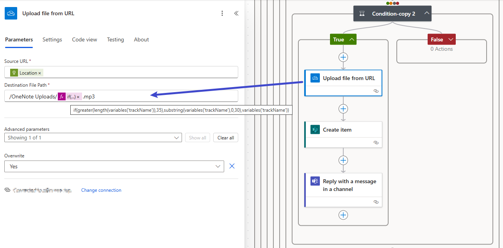

然后，我们再将之前获取到的标题，时长，链接，和音频地址一起，保存到 list里面(这里需要提前设置好 List的栏目)，后面再利用 Microsoft 365 里面的 Power BI 实现自动统计报表的展现。

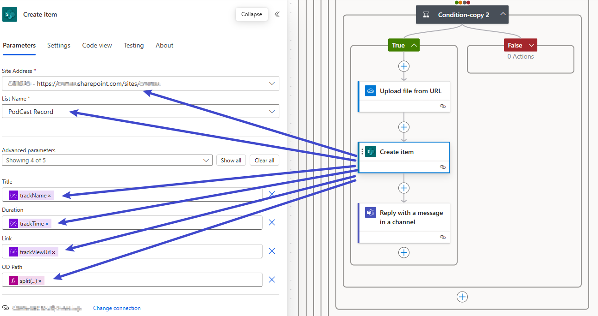

为了实现分享到Teams后的正向反馈，我还添加了一个自动回复，当以上操作完成后，会在Teams里面发一条消息，说明相关信息，证明此工作流已成功执行。

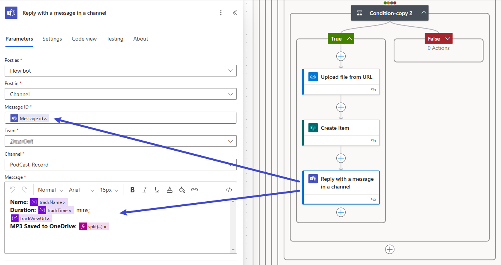

欢迎大家一起讨论，更好的利用 Microsoft 365 ~~

---

*来源: https://linux.do/t/topic/326525.json*

