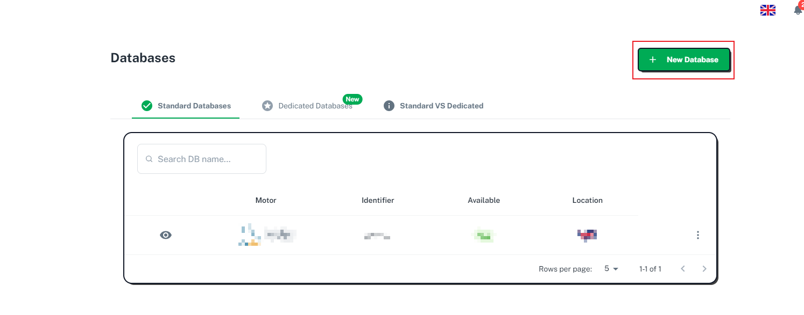
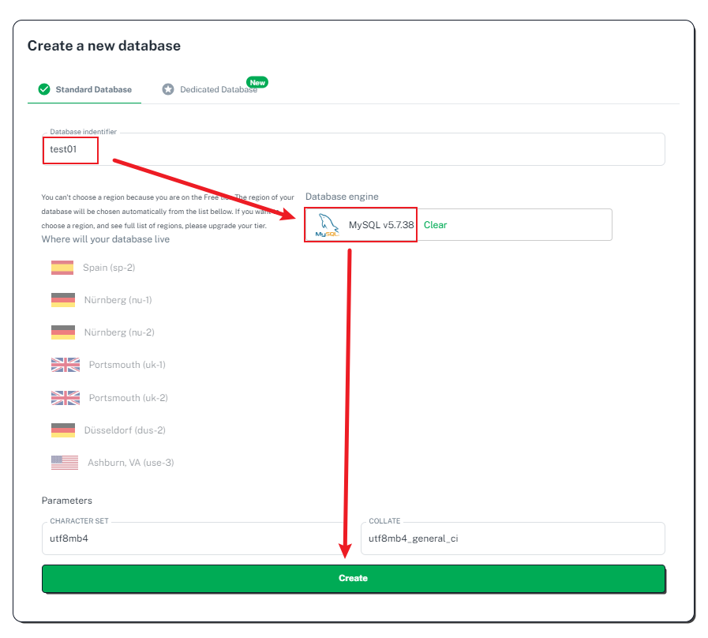
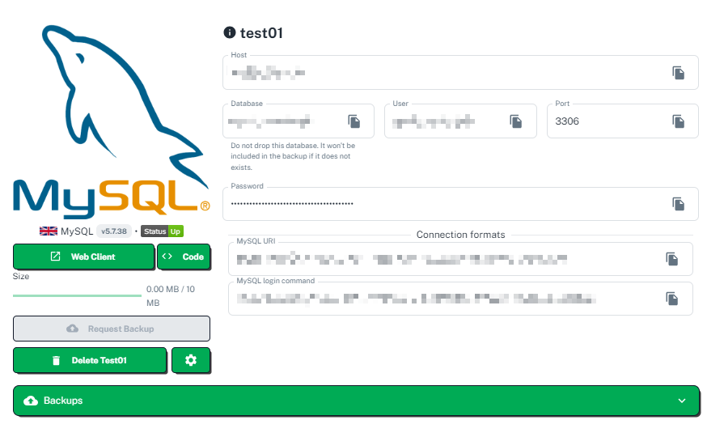
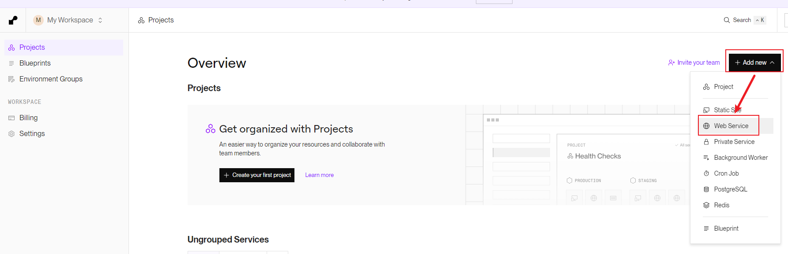
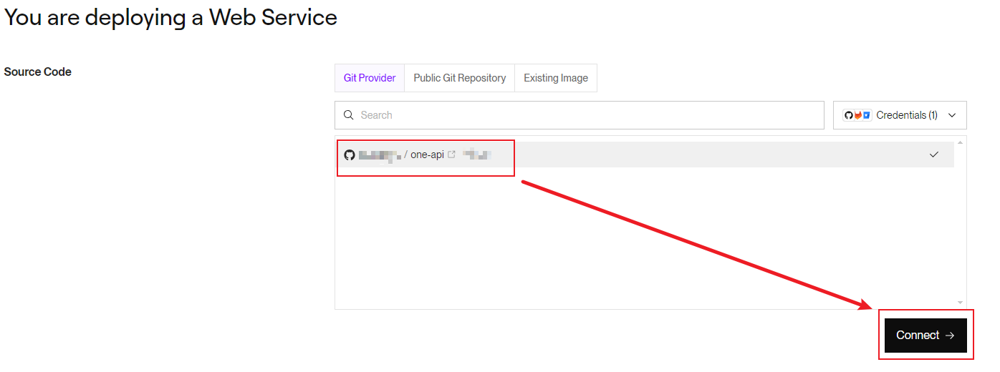
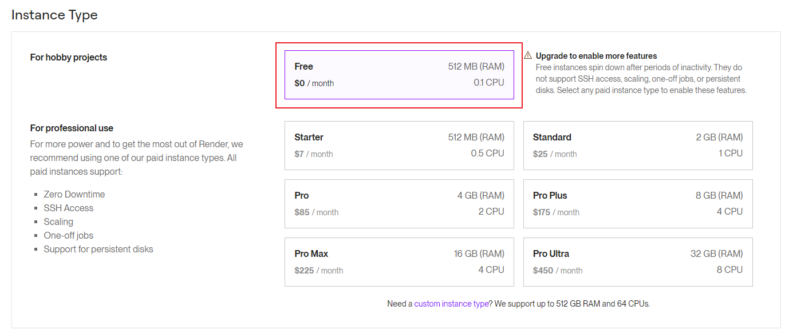
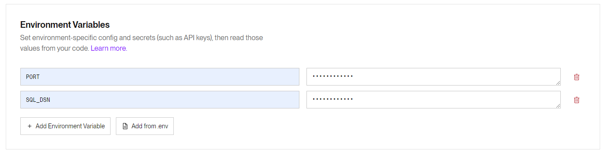
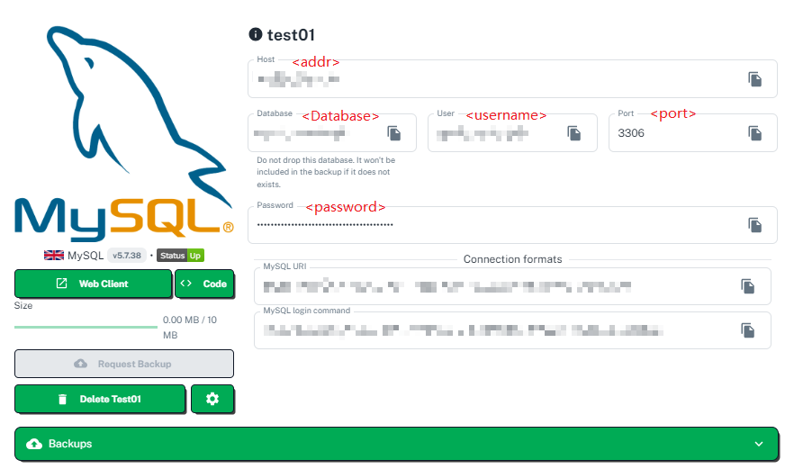

---

id: 327061

title: "白嫖one-api（免费数据库filess + 免费部署render）"

created_at: 2025-01-04T16:41:04.348Z

username: pypm

display_username: "pypm"

---

# 白嫖one-api（免费数据库filess + 免费部署render）

众所周知，如果只是使用render部署one-api，每次重启，配置的大模型数据将会丢失。

因此需要一个可用的数据库保存配置的大模型数据。

在[filess](https://filess.io/)中可以白嫖一个MySQL数据库。

以下是详细流程。

### 1. 新建MySQL数据库

1. 登录[filess](https://filess.io/)，可以使用google账号直接登录。

2. 点击`New Database`创建一个数据库。

3. 设置名称和数据库提供商，然后点击`Create`。

创建之后，记录数据库信息，一会用。

### 2. 在render中部署OneApi

1. 首先登录github，并 fork 一份[one-api](https://github.com/songquanpeng/one-api)代码。

2. 进入Render，然后创建一个新项目。

3. 选择github中的one-api项目，点Connect。

4. 勾选免费计划

5. 拉到最下面，添加两个环境变量

5.1 添加一个 `PORT`，值为 `3000`

5.2 添加一个 `SQL_DSN`，值格式为 `<username>:<password>@tcp(<addr>:<port>)/<Database>` （使用刚刚在filess中创建的数据库）

注：`<username>:<password>@tcp(<addr>:<port>)/<Database>`共五个变量，在filess中的对应关系如图：

6. 点击`Deploy web service`开始部署。

然后就可以开心的白嫖了。

---

*来源: https://linux.do/t/topic/327061.json*

