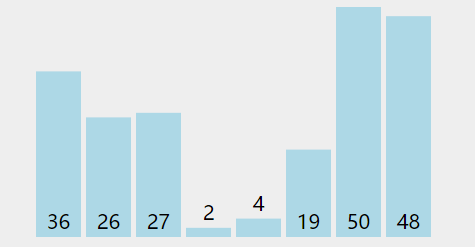

---

id: 333930

title: "算法学习-day03-排序-冒泡排序"

created_at: 2025-01-09T09:38:55.657Z

username: liun

display_username: "liun"

---


# 算法学习-day03-排序-冒泡排序


### 什么是冒泡排序

冒泡排序（Bubble Sort）是一种简单的排序算法，它通过重复地遍历列表，比较相邻的元素并根据需要交换它们的位置来对列表进行排序。这个过程会针对每一个元素重复进行，直到不需要再交换为止，即列表已经排序完成。

冒泡过程可以利用元素交换操作来模拟：从数组最左端开始向右遍历，依次比较相邻元素大小，如果“左元素 > 右元素”就交换二者。遍历完成后，最大的元素会被移动到数组的最右端。



### 冒泡排序的工作原理：

1. **比较相邻元素**：从列表的第一个元素开始，将当前元素与下一个元素比较。

2. **交换位置**：如果前一个元素比后一个元素大（对于升序排序），那么就交换这两个元素的位置。

3. **继续比较**：对每一对相邻元素做同样的工作，从开始第一对到结尾的最后一对。这一步做完后，最后的元素应该是最大的数（在升序情况下）。

4. **减少遍历次数**：每次遍历之后，最大的元素都会被移动到它的最终位置，因此下一次遍历时可以少考虑一个元素。

5. **优化检查**：如果某次遍历中没有发生任何交换，说明列表已经是有序的，可以提前结束排序。

[bubble_sort_overview1280×720 26.5 KB](https://cdn3.ldstatic.com/original/4X/3/5/a/35a78ad94f0879a209f1c489da3202031f07ce3e.png)

示例代码

```
/* 冒泡排序 */
void bubbleSort(int[] nums) {
    // 外循环：未排序区间为 [0, i]
    for (int i = nums.length - 1; i > 0; i--) {
        // 内循环：将未排序区间 [0, i] 中的最大元素交换至该区间的最右端
        for (int j = 0; j < i; j++) {
            if (nums[j] > nums[j + 1]) {
                // 交换 nums[j] 与 nums[j + 1]
                int tmp = nums[j];
                nums[j] = nums[j + 1];
                nums[j + 1] = tmp;
            }
        }
    }
}
```

## 效率优化

我们发现，如果某轮“冒泡”中没有执行任何交换操作，说明数组已经完成排序，可直接返回结果。因此，可以增加一个标志位 `flag` 来监测这种情况，一旦出现就立即返回。

经过优化，冒泡排序的最差时间复杂度和平均时间复杂度仍为 O(n^2)；但当输入数组完全有序时，可达到最佳时间复杂度 O(n)。

示例代码：

```
/* 冒泡排序（标志优化） */
void bubbleSortWithFlag(int[] nums) {
    // 外循环：未排序区间为 [0, i]
    for (int i = nums.length - 1; i > 0; i--) {
        boolean flag = false; // 初始化标志位
        // 内循环：将未排序区间 [0, i] 中的最大元素交换至该区间的最右端
        for (int j = 0; j < i; j++) {
            if (nums[j] > nums[j + 1]) {
                // 交换 nums[j] 与 nums[j + 1]
                int tmp = nums[j];
                nums[j] = nums[j + 1];
                nums[j + 1] = tmp;
                flag = true; // 记录交换元素
            }
        }
        if (!flag)
            break; // 此轮“冒泡”未交换任何元素，直接跳出
    }
}
```


---


*来源: https://linux.do/t/topic/333930.json*

