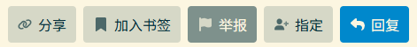
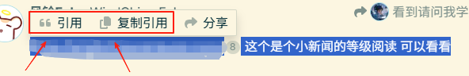

---

id: 342888

title: "盘点L站的徽章 长期更新！（2026.2.17 更新）"

created_at: 2025-01-11T05:47:28.477Z

username: Jenhy

display_username: "看到请问我学英语了没"

---

# 盘点L站的徽章 长期更新！（2026.2.17 更新）

盘点 L 站的徽章长期更新!（2026.2.17 更新！！！！！！！）

> [!warning] 注意！！！！！！！！

>

> 做 Wiki 编辑的徽章就做，**别把整个教程帖子内容覆盖成无意义的内容！！！**

> [!caution] 注意、注意、注意

>

> 由于服务器有延迟，可能会存在达成了徽章获取条件但没有拿到徽章的情况，请坐和放宽，至多到第二天的凌晨四点就会刷新徽章获取情况。如果还是没有，请试试在过了 cf 盾之后再完成徽章条件。

>

> 现在请点击左侧的无穷符号`More...` 进入 [社区子系统和元宇宙 - LINUX DO](https://linux.do/pub/resources)

>

> [image309×288 7.45 KB](https://cdn3.ldstatic.com/original/4X/1/e/6/1e657d4c72eba8c482c4b5a2781d4832fc7fee50.png)

>

> 然后选择 Challenge - [https://linux.do/challenge](https://linux.do/challenge)

>

> [屏幕截图 2025-09-30 213800449×676 45.1 KB](https://cdn3.ldstatic.com/original/4X/d/3/8/d38a794e0e6ddad7f01e6b8ebe141489dd855001.png)

>

> 此处为自动过盾。

>

> [!tip]*目前（2025-09-14）阅读权限高于或等于 1 级的所有帖子都无法帮助获得徽章。*

>

> [!check]+ 如何查看是否获得了特定徽章

>

> 如果你想要查看某个用户是否已经得到了某个徽章，请在下面提供的徽章链接后加上 `/?username=xxx`。例如，对于徽章 **读者**  [https://linux.do/badges/17/-](https://linux.do/badges/17/-)，把链接改为 [https://linux.do/badges/17/-/?username=Karlbaey](https://linux.do/badges/17/-/?username=Karlbaey) 就能够查看用户 [@Karlbaey](/u/karlbaey) 是否已经获得这个徽章了。 

---

# 入门徽章

## No.1  编辑者

**直达链接**

> [!todo][编辑者](https://linux.do/badges/10/-)

[image590×282 22.8 KB](https://cdn3.ldstatic.com/original/4X/d/d/8/dd86cde3cc9554ce17166cd9b29ec097d4e89cc5.png)

**获取方式：** `第一次编辑你的帖子`

**参考操作：**  `编辑你的帖子`

---

## No.2  第一次通过电子邮件回复

**直达链接**

> [!todo] [第一次通过电子邮件回复](https://linux.do/badges/43/-)

[image590×214 16 KB](https://cdn3.ldstatic.com/original/4X/e/0/e/e0e9c4e8adc52fa740be0726d6364b0391542eed.png)

**获取方式：** `通过邮箱回复帖子`

**参考操作：** [https://linux.do/my/preferences/emails](https://linux.do/my/preferences/emails)  通过点击本链接进去设置一下邮件回复，通过邮箱回复就能拿到这个徽章。

[image826×594 45.7 KB](https://cdn3.ldstatic.com/original/4X/c/1/a/c1a965e081eadd19ff19447bc5c545dfd792482d.png)

---

## No.3  第 1 个表情符号

**直达链接**

> [!todo] [第一个表情符号](https://linux.do/badges/41/-)

[image585×300 28.9 KB](https://cdn3.ldstatic.com/original/4X/5/7/b/57b283a239c2bec91fba84f4ac21882929f20b79.png)

**获取方式：** `第一次在帖子中添加表情符号`

**参考操作：** `第一次编辑帖子时使用一个表情！`

---

## No.4  第一个赞

**直达链接**

> [!todo] [第一个赞](https://linux.do/badges/11/-)

[image583×262 18.8 KB](https://cdn3.ldstatic.com/original/4X/c/6/f/c6fb7f32b102428084c37eacb03a2b56f2c7526d.png)

**获取方式：** `第一次点赞`

**参考操作：** `第一次点击小心心`

---

## No.5  读者

**直达链接**

> [!todo] [读者](https://linux.do/badges/17/-)

[image573×283 22.7 KB](https://cdn3.ldstatic.com/original/4X/3/9/7/3971743d124df8b951914e3983102cff99f1e35d.png)

**获取方式：** `找到一个回复超过一百的帖子并看完一百个回复`

**参考操作：** `随便找个超过一百回复的帖子看完一百个回复`

> [!danger] 这个徽章获取的时候要注意，右边小蓝点消失才算

> [!tip] 实操提醒：直接跳转到帖子底部可能不会被计入已读，慢慢滚动完 100 帖更稳；且要读到最新进度（蓝点消失）才发徽章。

---

## No.6  首次分享

**直达链接**

> [!todo] [首次分享](https://linux.do/badges/12/-)

[image586×255 18.9 KB](https://cdn3.ldstatic.com/original/4X/5/1/1/511bcee58e6e7733e04d0c1c624a0a378f07a738.png)

**获取方式：** `分享站内的链接到站外，并且有人点击链接进去`

`帖子开头` 

---

`帖子末尾`  

**参考操作：** `点击分享按钮获得帖子或者回复链接，分享到WX或者其他地方，别人点击链接`

---

## No.7 首次回应

**直达链接**

> [!todo] [首次回应](https://linux.do/badges/108/-)

[image585×254 18 KB](https://cdn3.ldstatic.com/original/4X/3/8/a/38aedec7ed601d446c97786f75e90c84c3953693.png)

**获取方式：** `别的佬友回复你之后，对这个回复内容进行点赞操作`

**参考操作:**

[image863×190 20.7 KB](https://cdn3.ldstatic.com/original/4X/4/5/9/45929e443022d4eee4b50a7276afd074fcdc1998.png)

`回复本贴 我回复你之后 给我的回复点个表情`

---

## No.8 首次举报

**直达链接**

> [!todo] [首次举报](https://linux.do/badges/13/-)

[image585×273 22.6 KB](https://cdn3.ldstatic.com/original/4X/3/7/5/37523c78c6612c6ca137a2c86ede78ee58dd13c3.png)

**获取方式：** `举报违反社区规则的帖子`

**参考操作：** `举报本帖`

> [!warning] **不要乱举报**

> **提醒各位喜欢刷举报徽章的用户**

> **举报被拒绝是会影响各位在系统的信誉分的**

---

## No.9  首次链接

**直达链接**

> [!todo] [首次链接](https://linux.do/badges/14/-)

[image574×252 22.3 KB](https://cdn3.ldstatic.com/original/4X/4/2/5/4250235a3f4c9d635dd280d0bd682c0276b0ae98.png)

**获取方式：** `在你的帖子或者回复里加上别人帖子的链接`

**参考操作：** `发个帖子，贴上本帖链接`

---

## No.10 首次提及

**直达链接**

> [!todo] [首次提及](https://linux.do/badges/40/-)

[image570×271 24.3 KB](https://cdn3.ldstatic.com/original/4X/6/c/4/6c41cb7c14d788c7268ebb262f6ff9cbead8697f.png)

**获取方式：** `在帖子或者回复中@其他用户名`

**参考操作：** `比如@neo` 大家狠狠的艾特 [@neo](/u/neo)

---

## No.11 首次引用

**直达链接**

> [!todo] [首次引用](https://linux.do/badges/15/-)

[image569×270 21.6 KB](https://cdn3.ldstatic.com/original/4X/1/b/4/1b4e19fd2bccfe7d81fa3e1ff3132d91b149d713.png)

**获取方式：** `复制你想回复的话会自动复制引用`

**参考操作：**

选中之后会弹出来上面截图一样的框  点引用会直接弹到回复里，如果想在别的地方回复就点复制引用

比如这样：

> 外事不决问谷歌，内事不决问百度，房事不决问 LD

---

## No.12  首个 Onebox

**直达链接**

> [!todo] [首个 Onebox](https://linux.do/badges/42/-)

[image571×252 17.7 KB](https://cdn3.ldstatic.com/original/4X/3/b/1/3b1bccf05dbee48425509be1349538865cb27e51.png)

**获取方式：** `链接单独一行`

**参考操作：**

[image1444×180 35.3 KB](https://cdn3.ldstatic.com/original/4X/4/0/d/40d3fa697cfb2758284a6984ee9fa259f64e31c4.png)

[盘点L站的徽章 长期更新！（2026.2.17 更新）](https://linux.do/t/topic/342888) [

文档共建](/c/wiki/42)

> 盘点 L 站的徽章长期更新!（2026.2.17 更新！！！！！！！）

>

> [!warning] 注意！！！！！！！！

> 做 Wiki 编辑的徽章就做，别把整个教程帖子内容覆盖成无意义的内容！！！

>

>

>

> [!caution] 注意、注意、注意

> 由于服务器有延迟，可能会存在达成了徽章获取条件但没有拿到徽章的情况，请坐和放宽，至多到第二天的凌晨四点就会刷新徽章获取情况。如果还是没有，请试试在过了…

---

注意：不要使用引用，是直接放链接！

## No.13  已认证

**直达链接**

> [!todo] [已认证](https://linux.do/badges/100/-)

[image577×227 14.6 KB](https://cdn3.ldstatic.com/original/4X/f/a/3/fa374221f95a8c10607d0dbe281dbf5612cf6e3f.png)

**获取方式：** `私信论坛机器人完成新用户教程`

**参考操作：** [@discobot](/u/discobot) 私信这个机器人 说 `开始 教程`，根据指引完成，直到得到徽章。

[image834×178 16.5 KB](https://cdn3.ldstatic.com/original/4X/4/1/7/417486623e364cdb6ce0c8808524acf58bf0eb71.png)

---

## No.14  阅读准则

**直达链接**

> [!todo] [阅读准则](https://linux.do/badges/16/-)

[image568×271 22.3 KB](https://cdn3.ldstatic.com/original/4X/2/c/0/2c0eb3ddca2622ac3716ebbea3c17886d851c8fe.png)

**获取方式：** `把社区准则读完`

**参考操作：** [准则](https://linux.do/guidelines)  点进去看完

**补充（2026.9.4 实测）：** 只在 `/guidelines` 页面里滚动到底 **不会** 触发这枚徽章。需要访问 [https://linux.do/faq](https://linux.do/faq)（会自动跳到同一个准则页面），前端才会向服务端上报「已读准则」。如果滚了半天还没有，从 `/faq` 这个入口再进一次即可。

---

## No.15  自传作者

**直达链接**

> [!todo] [自传作者](https://linux.do/badges/9/-)

[image569×250 20.8 KB](https://cdn3.ldstatic.com/original/4X/5/0/6/50692bd4c323d13177fef374aa979a00514396ba.png)

**获取方式：** `把个人资料里的头像换掉，以及添加10个字以上的自我介绍`

**参考操作：** [https://linux.do/my/preferences/profile](https://linux.do/my/preferences/profile)  通过本链接设置个人资料

---

## No.16  Wiki 编辑

**直达链接**

> [!todo] [Wiki 编辑](https://linux.do/badges/48/-)

[image578×210 12.4 KB](https://cdn3.ldstatic.com/original/4X/1/f/9/1f9c544f0065a8387fb86087400e0538cf06ac92.png)

**获取方式：** `编辑一个wiki帖子`

**参考操作：**

[image1021×438 45.2 KB](https://cdn3.ldstatic.com/original/4X/f/e/a/feacb288409aeae56032223a2c0b1925b9d9c4f4.png)

**wiki帖子右下角会有编辑按钮  点进去编辑下内容再发布帖子就可以了**

蹭蹭好玩! 操作 编辑本帖  当我编辑此贴, 获取 wiki 之力 加个表情

来了来了 蹭蹭 ** ** 删掉了   咕咕嘎嘎戳戳， 这个可以编辑？  可以？               咕咕嘎嘎 《论雨》  咕咕嘎喵喵喵

    我也也来个 阿斯顿  比比拉布 最帅的男人 我同意修改 我不同意，L 站吴彦祖 阿巴           原来这里可以编辑:`咕咕嘎嘎` 偷偷编辑一下 偷偷再编辑一下, 到此一编辑 111 

我不同意修改，附议 咕咕嘎嘎  好玩  让我玩玩 蹭蹭  嘿 还能这样？？ 那我也编辑一下，感谢作者大大 +1: +10086 自动 + 1 + 1 + 1 + 1 + 1 +1 +1 一下 蹭一下 喵

蹭蹭 +1 + 1 + 1 + 1-1*1  这是什么 嘿 戳一下 :face_with_monodawdadcle:编辑编辑编辑编辑一下

这里可以编辑吗感谢整理分享 1 + 1 + 1 + 1 +1 咕嘎 +1 +1 + 1 + 2 +3 +4 这边编辑下没人发现吧  

666  佬友都在这里就开始编辑了吗 我已经迫不及待了 让我试试。我也试试！哈哈哈  我来了 wiki 编辑了会通知作者和其他编辑的人嘛？编辑 wiki~+1 编辑 + 1 

            

     1  

canyuyix

111:zany_face 原来 wiki 是这么用的学到了了  

 学习 wiki 编辑高级技能 加油，我也试试编辑一下，感谢佬友

原来是可以编辑的吗，高级哎 编辑编辑  编辑一下

歪比巴布 这样的吗编辑一下试试 比比拉布编辑了一次 编辑一下

我也要编辑  原来 wiki 是这么编辑的  我也要编辑：) 我也来编辑啦

带我蹭一个编辑徽章啦，感激不尽 www 欧耶 学到 qwq 悄悄的  编辑试一下，试一下编辑

试一下 我要狠狠地编辑   

看不见的

还有我的事？+1

我也来蹭一个  学到了，感谢佬友 哇去学到了耶

也看不见我

学到了L佬

原来是这样，学到了

试一下编辑

好有趣的功能

试一下徽章

咕咕嘎嘎 

11 咕咕嘎嘎 来啦来啦

[盘点L站的徽章 长期更新！（2026.2.17 更新）](https://linux.do/t/topic/342888?u) = lyon95

来了来了 

好玩好玩，来试一下编辑

试试 

编辑试试

试试

我也试试编辑一下？

来学习编辑帖子辣 谢谢佬友 

蹭个徽章 我也来蹭一下

试试 

蹭个徽章 + 1, 认真学习中

原来我也可以吗? 好耶

这么简单么？

这么简单么？

蹭一下

改一改哈哈哈哈

徽章轻而易举啊，坏了坏了。

这次轮到我编辑啦 

哇，编辑一下就可以了。

蹭个徽章，谢谢 

排队 

插队 

试一下 我要狠狠地编辑 

好怕改坏啊 

我来改改试试

我来试试到此一游

试一下试一下，我也到此一游，嘿嘿嘿  

嘿嘿，到此一游 

改一下 

蹭一下，好怕改坏了 + 1 + 1

嘿嘿嘿，77 到此一游

我就蹭一下不改动

26.9.7 到此一游

26.9.8 慕名而来

我来啦！~！

26.9.8 赞美佬友 +1 + 1

26.9.8 试一下 

26.9.9 试一下 

26.9.9 到此一游 

26.9.26 到此一游 

[盘点L站的徽章 长期更新！（2026.2.17 更新）](https://linux.do/t/topic/342888)

2026.09.09 为什么我编辑了，还是没有徽章？！！！

[盘点L站的徽章 长期更新！（2026.2.17 更新）](https://linux.do/t/topic/342888)

26.9.10 到此一游 

26.9.12 到此一游 还能到此一游？

26.09.13 到此一游 

26.09.13 感谢楼主的科普好帖

26.09.13 编辑一下

26.09.13 编辑一下 感谢 ~

26.0913 再编辑一下

这里是给刷勋章的地方吗？

26.09.13 编辑一下 感谢 ~

26.09.13 再编辑一下

26.09.14 到此一游

26.09.14 测试编辑一下

谢谢佬友分享  谢谢佬友分享

26.09.14 到此一游

26.09.14 感谢

26.09.14，感谢佬分享，留爪

26.09.14，嘿嘿嘿

26.09.14，刘洋

大家要天天开心，好好吃饭，好好睡觉哦 (๑′ᴗ‵๑)

26.09.14，祝大家每天都是美好的一天

天天开心 ~

该我来编辑一下了

26.09.16，感谢

26.09.17，编辑一下，感谢 ~

26.09.17，首次尝试编辑

26.09.17，编辑 ing-> 编辑 ed

26.09.18，编辑 ing-> 编辑 ed

26.09.18，挤一挤，编辑 ing-> 编辑 ed

到此一游

26.09.20 到此一游 ~

26.09.20 编辑 wiki，感谢

26.09.20 好多人啊挤一挤 ~

26.09.20 到此一游 

26.09.20 

26.09.21  到此一游

26.09.21 

26.09.21 

26.09.21 

26.09.21  蹭一下 

26.09.22  挤一下

26.09.22  这样吗

26.09.22  这样吗 

26.09.24  这样吗 

26.09.24 蹭一蹭

26.09.25 插个队没事吧

26.09.25 中秋快乐 谢谢佬友

26.09.25 佬们中秋快乐~

26.09.25 哈哈中秋快乐~

26.09.25 各位中秋快乐

26.09.25 各位中秋快乐+1

26.09.25 大家中秋快乐！

26.09.26 中秋过了也要吃月饼

26.09.26 中秋快乐！新用户报道

26.09.27 咕咕嘎嘎

26.09.27 蹭蹭

到此一游

26.09.28 蹭一下

26.09.28 到此一游

26.10.4 中秋快乐~

26.10.5 国庆快乐~

26.10.5 咕咕嘎嘎！

26.10.5 来了来了

26.10.5 来了来了国庆快乐～

26.10.5 国庆快咯

26.10.6 我要拿到这个徽章！

26.10.6 各位国庆快乐~

26.10.6 到此一游

26.10.6 要上班了

26.10.7 打卡喵

26.10.8 谢谢大佬的讲解

26.10.8 原来还可以这样编辑啊，谢谢大佬

[《经典咏流传》------始皇](https://linux.do/t/topic/170149)

## 来共同维护始皇语录

## No.17  已授权

**直达链接**

> [!todo] [已授权](https://linux.do/badges/101/-)

[image577×230 16.1 KB](https://cdn3.ldstatic.com/original/4X/e/9/1/e9161cc470ba66eff0ce4bce58b063ef878da4f7.png)

**获取方式：** `私信论坛机器人完成高级用户教程`

**参考操作：** [@discobot](/u/discobot) 私信这个机器人说 `开始 高级教程`，根据指引完成，直到得到徽章。

[image773×158 16.5 KB](https://cdn3.ldstatic.com/original/4X/5/0/5/5054f48a99fec2076e2c3234935b844a636c7226.png)

---

## No.18  当月最佳新用户

**直达链接**

> [!todo] [当月最佳新用户](https://linux.do/badges/44/-)

[image595×243 11.9 KB](https://cdn3.ldstatic.com/original/4X/f/2/3/f23c6e7d7d89a6b2225e2be254cb5b7e879d6a90.png)

**获取方式：** `在注册的第一个月内做出最大贡献`

**参考操作：**  `第一个月内疯狂水贴？`

**注意：**

用户一旦 `错过` 这个徽章，后续也将对 `这个用户` 绝版！

---

# 社区徽章

---

## No.1 爱好者。

**直达链接**

> [!todo] [爱好者](https://linux.do/badges/45/-)

[image589×241 14.4 KB](https://cdn3.ldstatic.com/original/4X/9/4/8/94807edb030b430f8eba4ef19cd7e58f7e4b7ef5.png)

**获取方式：** `连续访问10天论坛并互动`

**参考操作：** `连续在论坛互动10天`

---

## No.2 不错的分享

**直达链接**

> [!todo] [不错的分享](https://linux.do/badges/21/-)

[image572×232 17 KB](https://cdn3.ldstatic.com/original/4X/3/4/e/34e73357b266b506e3eb027e33679c7f9c5649ad.png)

**获取方式：** `分享的站内链接被外部用户点击25次`

**参考操作：** `分享站内的任意链接到站外`

---

## No.3 出于爱

**直达链接**

> [!todo] [出于爱](https://linux.do/badges/33/-)

[image579×256 17.9 KB](https://cdn3.ldstatic.com/original/4X/a/f/b/afb868ff444fa613cc7f49dac84ed4d14df0c1f5.png)

**获取方式：** `24小时内送出50个赞`

**参考操作：** `24小时内送出你的50个赞`

---

## No.4 欢迎

**直达链接**

> [!todo] [欢迎](https://linux.do/badges/5/-)

[image565×224 14.9 KB](https://cdn3.ldstatic.com/original/4X/f/1/c/f1cc9afa4cd9935eccaae26e78dddf0a908abb0b.png)

**获取方式：** `收到第一个赞`

**参考操作：** `论坛随意评论，大部分佬友看到都会给一个`

---

## No.5 灵感萌芽

**直达链接**

> [!todo] [灵感萌芽](https://linux.do/badges/133/-)

[图片674×202 9.41 KB](https://cdn3.ldstatic.com/original/4X/3/9/8/398f1dd0d66f805e296199088b2e7ecb20c2e7ca.png)

**获取方式：** `当您的某个话题获得投票时，授予此徽章。`

**参考操作：** `1.发布一个话题带投票功能（待测试） 2.去申请板块，获得投票后就可以得到徽章`

---

## No.6 受到赞赏

**直达链接**

> [!todo] [受到赞赏](https://linux.do/badges/36/-)

[image569×229 16.2 KB](https://cdn3.ldstatic.com/original/4X/6/4/b/64bdc32b83ca207b4c77ebea6e957fd3b68261fe.png)

**获取方式：** `获得20个不同的赞`

**参考操作：** `在不同的帖子下评论并要赞`

---

## No.7 推广者

**直达链接**

> [!todo] [推广者](https://linux.do/badges/25/-)

[image564×248 19.3 KB](https://cdn3.ldstatic.com/original/4X/8/a/8/8a818fb27331b6c4f6a9421158acf9437b8d6172.png)

**获取方式：** `邀请一位用户`

**参考操作：** [邀请](https://linux.do/my/invited/pending)   通过本链接在右边创建邀请链接并发送给他 `请关注社区内开放的邀请活动`

---

## No.8 谢谢

**直达链接**

> [!todo] [谢谢](https://linux.do/badges/38/-)

[image563×251 17 KB](https://cdn3.ldstatic.com/original/4X/e/8/f/e8fc0622bb65c02a2b649a398e4c4310f01ccc03.png)

**获取方式：** `当你获得20个赞并送出超过10个赞`

**参考操作：** `点赞10个人的评论  让你的20个评论被点赞`

---

## No.9 已解决！

**直达链接**

> [!todo] [已解决！](https://linux.do/badges/109/-)

[image564×224 13.7 KB](https://cdn3.ldstatic.com/original/4X/8/9/c/89cefe3995d43fbf974804ed386eedd33bf9c4b6.png)

**获取方式：** `在快问快答标签下的话题被标记解决方法`

**参考操作：** `去解决佬的问题`

---

## No.10 百尺竿头

**直达链接**

> [!todo] [百尺竿头](https://linux.do/badges/46/-)

[image564×228 12.6 KB](https://cdn3.ldstatic.com/original/4X/2/1/4/214969a2fba8aed074e6e0c70fd83d777af300a9.png)

**获取方式：** `连续访问100天论坛并互动`

**参考操作：** `与论坛进行100天的连续互动`

---

## No.11 初见回响

**直达链接**

> [!todo] [初见回响](https://linux.do/badges/134/-)

[图片805×201 9.69 KB](https://cdn3.ldstatic.com/original/4X/e/1/2/e120e798f9bb1464caa2d02a2df70ae396cc7268.png)

**获取方式：** `当您的某个话题获得 5 票时，授予此徽章。`

**参考操作：** `某个话题设置投票之后获得至少5票（待测试）`

---

## No.12 更多的爱

**直达链接**

> [!todo] [更多的爱](https://linux.do/badges/34/-)

[image569×227 17.1 KB](https://cdn3.ldstatic.com/original/4X/9/c/8/9c837d121267b239736810d71f49478a9d61cb31.png)

**获取方式：** `连续5次24小时内送出50个赞`

**参考操作：** `一直点赞`

---

## No.13 广受认同

**直达链接**

> [!todo] [广受认同](https://linux.do/badges/135/-)

[图片818×230 10.2 KB](https://cdn3.ldstatic.com/original/4X/3/3/1/331c0a134950e5f7edfb43ac6ff37d7d2cd5a68b.png)

**获取方式：** `当您的某个话题获得 15 票时，授予此徽章。`

**参考操作：** `某个话题设置投票之后获得至少15票（待测试）`

---

## No.14 很棒的分享

**直达链接**

> [!todo] [很棒的分享](https://linux.do/badges/22/-)

[image564×249 18.9 KB](https://cdn3.ldstatic.com/original/4X/2/e/1/2e1a6c0027ac118dc4c26ca4e67a9803c6d185f0.png)

**获取方式：** `分享的链接被300个外部访客点击`

**参考操作：** `分享链接让300个站外人浏览`

---

## No.15 回馈

**直达链接**

> [!todo] [回馈](https://linux.do/badges/32/-)

[image564×227 14.2 KB](https://cdn3.ldstatic.com/original/4X/a/a/e/aaed9d99e344c78bcc8ce4f63a707f635c4f8e2a.png)

**获取方式：** `获得100个赞的帖子并送出100个以上赞`

**参考操作：** `点赞加评论一直氵`

---

## No.16 活动家

**直达链接**

> [!todo] [活动家](https://linux.do/badges/26/-)

[image559×246 19.9 KB](https://cdn3.ldstatic.com/original/4X/8/1/b/81b630fc56f5f0edb326b07b8fb55b004a756dd7.png)

**获取方式：** `邀请三个成为基本用户`

**参考操作：** [邀请](https://linux.do/my/invited/pending)   通过邀请链接邀请三个新用户，并成为基本用户

---

## No.17 受人尊敬

**直达链接**

> [!todo] [受人尊敬](https://linux.do/badges/37/-)

[image568×225 16.3 KB](https://cdn3.ldstatic.com/original/4X/9/0/1/90148d076fea9a24cee438a8a92b5c131cf56f9a.png)

**获取方式：** `100个帖子或者回复得到至少两个赞`

**参考操作：** `发表100个评论要赞`  **注意评论要符合论坛规则**

---

## No.18 指导顾问

**直达链接**

> [!todo] [指导顾问](https://linux.do/badges/110/-)

[image566×229 15.1 KB](https://cdn3.ldstatic.com/original/4X/2/b/1/2b13a9b25a649c83bceddc0a28852bb4a906c124.png)

**获取方式：** `带有 快问快答 标签下的帖子的回复被采纳10个`

**参考操作：** `积极解决佬友的问题`

---

## No.19 周年纪念日

**直达链接**

> [!todo] [周年纪念日](https://linux.do/badges/24/-)

[image563×252 17.3 KB](https://cdn3.ldstatic.com/original/4X/2/9/d/29d56036e3640be38d6e0723fd7813afa3505329.png)

**获取方式：** `成为成员一年并至少发布一个帖子`

**参考操作：** `注册完账号一年并发布一个帖子`

---

## No.20 解决方案机构

**直达链接**

> [!todo] [解决方案机构](https://linux.do/badges/112/-)

[image872×352 63 KB](https://cdn3.ldstatic.com/original/4X/b/4/b/b4bad5ec0d0c0f6df0792e0431e58d09db048393.png)

**获取方式：** `有 150 条回复被标记为话题的解决方案而获得的`

**参考操作：** `编写优质回复被标记为话题的解决方案达到150条`

---

## No.21 精彩的分享

**直达链接**

> [!todo] [精彩的分享](https://linux.do/badges/23/-)

[image564×252 19 KB](https://cdn3.ldstatic.com/original/4X/0/b/2/0b28657f6d251c63537355af2753e26120895329.png)

**获取方式：** `分享的链接被1000个站外用户访问`

**参考操作：** `分享有意思的帖子出去`

---

## No.22 狂热

**直达链接**

> [!todo] [狂热](https://linux.do/badges/35/-)

[image559×225 14.8 KB](https://cdn3.ldstatic.com/original/4X/a/1/4/a14cd50aeea613761c97c374bdd9c0a42df5ab1d.png)

**获取方式：** `24小时内送出50个赞并坚持20次`

**参考操作：** `一直点赞`

---

## No.23 全年不落

**直达链接**

> [!todo] [全年不落](https://linux.do/badges/47/-)

[image563×206 12.4 KB](https://cdn3.ldstatic.com/original/4X/8/b/e/8be284b195f9f28ce31997202916c5a1eba4f8fa.png)

**获取方式：** `连续访问论坛并互动一整年！`

**参考操作：** `互动吧  连续访问`

---

## No.24 善解人意

**直达链接**

> [!todo] [善解人意](https://linux.do/badges/39/-)

[image564×250 18.1 KB](https://cdn3.ldstatic.com/original/4X/7/b/1/7b113e5f9dc6b38ae71aca8cafd5ba46b1dd47ec.png)

**获取方式：** `有500个被赞的帖子或者回复并送出1000个`

**参考操作：** `点赞＋评论`

---

## No.25 受人敬仰

**直达链接**

> [!todo] [受人敬仰](https://linux.do/badges/31/-)

[image563×225 16.6 KB](https://cdn3.ldstatic.com/original/4X/1/5/f/15f8a2f8c6dd565fb90616272ce78db6de05af17.png)

**获取方式：** `在300个不同的帖子或者回复上获得至少5个赞`

**参考操作：** `活跃起来积极互动`

---

## No.26 无所不知

**直达链接**

> [!todo] [无所不知](https://linux.do/badges/111/-)

[image561×222 14.4 KB](https://cdn3.ldstatic.com/original/4X/d/9/7/d97adbe6318099d05ece0471eaffc1d9a68e6ad1.png)

**获取方式：** `带有 快问快答 标签下的帖子的回复被采纳50个`

**参考操作：** `积极解决佬友的问题`

---

## No.27 引发共鸣

**直达链接**

> [!todo] [引发共鸣](https://linux.do/badges/136/-)

[图片809×209 10.9 KB](https://cdn3.ldstatic.com/original/4X/2/2/9/229a4b1ec78d87e713683b6b77fd152edbbfe8b2.png)

**获取方式：** `当您的某个话题获得 25 票时，授予此徽章。`

**参考操作：** `某个话题设置投票之后获得至少25票（待测试）`

---

## No.28 拥护者

**直达链接**

> [!todo] [拥护者](https://linux.do/badges/27/-)

[image565×251 17.4 KB](https://cdn3.ldstatic.com/original/4X/8/3/f/83f5f52032a40ba45533ae0e0928717343354f92.png)

**获取方式：** `邀请5个用户成为基本用户`

**参考操作：** [邀请](https://linux.do/my/invited/pending) 通过邀请链接邀请 5 个新用户，并成为基本用户

---

# 发帖徽章

---

## No.1 不错的话题

**直达链接**

> [!todo] [不错的话题](https://linux.do/badges/18/-)

[image562×228 15.9 KB](https://cdn3.ldstatic.com/original/4X/6/6/e/66ec19920ee7f6cbd0fd93b11bb33c897b29ae86.png)

**获取方式：** `发表的话题获得10个赞`

**参考操作：** `发表一个帖子并获得10个赞`

---

## No.2 不错的回复

**直达链接**

> [!todo] [不错的回复](https://linux.do/badges/6/-)

[image559×225 16.2 KB](https://cdn3.ldstatic.com/original/4X/c/0/3/c037c93586a27cfd32a3f79bed0389fa5c8e28d2.png)

**获取方式：** `回复获得10个赞`

**参考操作：** `回复有意思的话题`

---

## No.3 热门链接

**直达链接**

> [!todo] [热门链接](https://linux.do/badges/28/-)

[image561×225 17.9 KB](https://cdn3.ldstatic.com/original/4X/d/b/6/db6e238bcc689afde797ec737138cd5731050adf.png)

**获取方式：** `分享的链接获得50次点击`

**参考操作：** `复制本教程分享出去 or 你认为有意思的话题分享出去`

---

## No.4 很棒的回复

**直达链接**

> [!todo] [很棒的回复](https://linux.do/badges/7/-)

[image561×227 15.3 KB](https://cdn3.ldstatic.com/original/4X/2/c/8/2c8809defaaeb0fc27eec2cd00342cd03c79d43c.png)

**获取方式：** `回复获得25个赞`

**参考操作：** `积极互动`

---

## No.5 很好的话题

**直达链接**

> [!todo] [很好的话题](https://linux.do/badges/19/-)

[image562×225 17.2 KB](https://cdn3.ldstatic.com/original/4X/f/2/8/f2804f0ad2730a63537199cc042384560b320bba.png)

**获取方式：** `发表的帖子获得25个赞`

**参考操作：** `发表有意义的帖子`

---

## No.6 火热链接

**直达链接**

> [!todo] [火热链接](https://linux.do/badges/29/-)

[image564×227 18.2 KB](https://cdn3.ldstatic.com/original/4X/2/0/f/20f42c25538d0ed838b11cf319fe0d7f52e298a2.png)

**获取方式：** `分享的任意链接获得300次点击`

**参考操作：** `站内分享链接`

---

## No.7 精彩的话题

**直达链接**

> [!todo] [精彩的话题](https://linux.do/badges/20/-)

[image560×223 17.8 KB](https://cdn3.ldstatic.com/original/4X/4/d/5/4d5fff3ec9aa2312900e0405f3063ecac1b4ebe5.png)

**获取方式：** `发表的帖子获得50个赞`

**参考操作：** `发表帖子获得50个赞`

---

## No.8 精彩的回复

**直达链接**

> [!todo] [精彩的回复](https://linux.do/badges/8/-)

[image564×230 18.3 KB](https://cdn3.ldstatic.com/original/4X/e/f/8/ef8b1b8f0fae009c640f4fbd1a3f29ae1aa5b442.png)

**获取方式：** `发表的回复获得50个赞`

**参考操作：** `积极互动`

---

## No.9 著名链接

**直达链接**

> [!todo] [著名链接](https://linux.do/badges/30/-)

[image562×247 19.3 KB](https://cdn3.ldstatic.com/original/4X/e/e/e/eee040e3773c6b706ff1a97a3b5b43177bcbf9ee.png)

**获取方式：** `分享的链接获得1000次点击`

**参考操作：** `分享链接`

---

# 信任级别徽章

---

## No.1 基本用户

**直达链接**

> [!todo] [基本用户](https://linux.do/badges/1/-)

[image565×269 24 KB](https://cdn3.ldstatic.com/original/4X/e/7/8/e78df822804acfb31f0f0e157ee09b9f80aed419.png)

**获取方式：** `信任级别达到1级自动获取`

**参考操作：** `完成等级任务`

---

## No.2 成员

**直达链接**

> [!todo] [成员](https://linux.do/badges/2/-)

[image566×252 20.5 KB](https://cdn3.ldstatic.com/original/4X/8/1/3/81310196efacb6d76d4b8f8f78603c5eec533e5b.png)

**获取方式：** `信任级别达到2级自动获取`

**参考操作：** `完成等级任务`

---

## No.3 活跃用户

**直达链接**

> [!todo] [活跃用户](https://linux.do/badges/3/-)

[image564×297 29.1 KB](https://cdn3.ldstatic.com/original/4X/4/2/0/420843da7ede54b215ca6f6741fd7108e97b533c.png)

**获取方式：** `信任级别达到3级自动获取`

**参考操作：** `完成等级任务`

---

## No.4 领导者

**直达链接**

> [!todo] [领导者](https://linux.do/badges/4/-)

[image561×273 23.1 KB](https://cdn3.ldstatic.com/original/4X/d/2/f/d2f3c46bec0a74f088eb7b668ec5d9685e174818.png)

**获取方式：** `管理钦点`

**参考操作：** `找管理组申请`

---

# 社区开源徽章

---

## No.1 Committer

**直达链接**

> [!todo] [Committer](https://linux.do/badges/121/-)

[image562×176 8.6 KB](https://cdn3.ldstatic.com/original/4X/5/b/e/5beee9ab27b526a05d0735687bc043fe4766ffc0.png)

**获取方式：** `社区开源项目中提交1次`

**参考操作：** [截止2025.5.29我知道的开源项目地址](https://github.com/linux-do/cdk)

---

INF

## No.2 Contributor

**直达链接**

> [!todo] [Contributor](https://linux.do/badges/127/-)

[image563×176 10.2 KB](https://cdn3.ldstatic.com/original/4X/e/9/6/e9641d9148cec18cb68ea9ff705ec6b4247dccf1.png)

**获取方式：** `社区项目中提交的代码被采纳1次`

**参考操作：** [截止2025.5.29我知道的开源项目地址](https://github.com/linux-do/cdk)

---

## No.3 Frequent Committer

**直达链接**

> [!todo] [Frequent Committer](https://linux.do/badges/122/-)

[image566×180 10.4 KB](https://cdn3.ldstatic.com/original/4X/a/a/3/aa3ff4d88a296fc897d1ee2a6ed134e24e2f4725.png)

**获取方式：** `社区开源项目中提交25次`

**参考操作：** [截止2025.5.29我知道的开源项目地址](https://github.com/linux-do/cdk)

---

## No.4 Great Contributor

**直达链接**

> [!todo] [Great Contributor](https://linux.do/badges/128/-)

[image564×181 11.3 KB](https://cdn3.ldstatic.com/original/4X/a/2/d/a2df0c3badb9978c42e6a8ce8bccc8aa4031199c.png)

**获取方式：** `社区项目中提交的代码被采纳25次`

**参考操作：** [截止2025.5.29我知道的开源项目地址](https://github.com/linux-do/cdk)

---

## No.5 Amazing Committer

**直达链接**

> [!todo] [Amazing Committer](https://linux.do/badges/123/-)

[image568×180 10.9 KB](https://cdn3.ldstatic.com/original/4X/a/a/2/aa245e5fd226408b6c4d49d7cc1e51e8b6e348e6.png)

**获取方式：** `社区开源项目中提交250次`

**参考操作：** [截止2025.5.29我知道的开源项目地址](https://github.com/linux-do/cdk)

---

## No.6 Amazing Contributor

**直达链接**

> [!todo] [Amazing Contributor](https://linux.do/badges/129/-)

[image564×177 12.1 KB](https://cdn3.ldstatic.com/original/4X/0/5/1/051325980945c82422687a8a40657135b088df6b.png)

**获取方式：** `社区开源项目中提交250次`

**参考操作：** [截止2025.5.29我知道的开源项目地址](https://github.com/linux-do/cdk)

---

# 其他徽章

---

## No.1 元气满满

**直达链接**

> [!todo] [元气满满](https://linux.do/badges/120/-)

[image569×230 11.8 KB](https://cdn3.ldstatic.com/original/4X/0/c/9/0c943130a9f07bd9f26b203cca789ad59ecccc91.png)

**获取方式：** `分享人生的重要时刻，例如结婚、生子`

**参考操作：** `发布重要的人生时刻获得`

参考链接

[https://linux.do/t/topic/665785?u=jenhy](https://linux.do/t/topic/665785)

---

# 绝版徽章

---

## No.1  种子用户

**直达链接**

> [!todo] [种子用户](https://linux.do/badges/102/-)

[image569×226 8.13 KB](https://cdn3.ldstatic.com/original/4X/e/3/0/e302e37c0f0e2a7c2876cfba1e349b89fab12e41.png)

**获取方式：** `论坛创立初期加入L站的用户`

**参考操作：**  `绝版`

---

## No.2 龙行龘龘

**直达链接**

> [!todo] [龙行龘龘](https://linux.do/badges/103/-)

[image577×208 14.6 KB](https://cdn3.ldstatic.com/original/4X/3/f/0/3f0510f589d59c651cb121ecceee81246439619c.png)

**获取方式**：`2024年论坛春节打卡活动获得`

**参考操作：**  `2024年春节论坛打卡`

---

## No.3 大预言家

**直达链接**

> [!todo] [大预言家](https://linux.do/badges/117/-)

[image578×210 9.38 KB](https://cdn3.ldstatic.com/original/4X/1/2/4/1244bf8e1a48e846cc463a9dfe308c6a9f72e1e5.png)

**获取方式：** `2024年美国总统选举投票活动`

**参考操作：** `2024年论坛活动内投票`

---

## No.4 圆圆满满

**直达链接**

> [!todo] [圆圆满满](https://linux.do/badges/116/-)

[image579×218 10.3 KB](https://cdn3.ldstatic.com/original/4X/2/1/d/21d432a03ce4e51493c65862fd282041f7a76e77.png)

**获取方式：** `2024年中秋活动`

**参考操作：** `2024年论坛打卡活动`

---

## No.5 浴火重生

**直达链接**

> [!todo] [浴火重生](https://linux.do/badges/114/-)

[image579×220 10.4 KB](https://cdn3.ldstatic.com/original/4X/e/3/3/e3328bf5bcd1968c4ed13893e9997df9eed3bd29.png)

**获取方式：** `L站第一次被DDoS 为了纪念这一 “重大时刻” 发放的`

**参考操作：**  `时间段内自动发放`

---

## No.6 海纳百川

**直达链接**

> [!todo] [海纳百川](https://linux.do/badges/113/-)

[image583×222 7.95 KB](https://cdn3.ldstatic.com/original/4X/1/2/f/12f9a4bd7be0296c0a24867dbff94253dffb9fca.png)

**获取方式：** `论坛一百天纪念日自动发放`

**参考操作：**  `时间段内自动发放`

---

## No.7 一元复始

**直达链接**

> [!todo] [一元复始](https://linux.do/badges/118/-)

[image562×203 15.2 KB](https://cdn3.ldstatic.com/original/4X/5/7/a/57a0188e002f29f7d5d6f33ca6fd9410eca4b05e.png)

**获取方式：** `社区成立一周年纪念徽章`

**参考操作：**  `时间段内自动发放`

---

## No.8 蛇来运转

**直达链接**

> [!todo] [蛇来运转](https://linux.do/badges/119/-)

[image562×201 15.2 KB](https://cdn3.ldstatic.com/original/4X/b/8/2/b82f6168ac40924eb6027ab218c1a1d474033247.png)

**获取方式：** `2025年打卡活动纪念`

**参考操作：**  `参与活动并互动`

---

## No.9 破界者

**直达链接**

> [!todo] [破界者](https://linux.do/badges/130/-)

[image670×202 12.2 KB](https://cdn3.ldstatic.com/original/4X/c/0/b/c0b46cf12c58d19052ea4ccd019cefa2f2f81c54.png)

**获取方式：** `发帖介绍自己如何帮助社区破界，并由管理组审核`

**参考操作：**  `发个自己认为帮助社区破界的帖子并介绍，且加上 破界者标签`

---

## No.10 不二之选

**直达链接**

> [!todo] [不二之选](https://linux.do/badges/131/-)

[image676×207 12.8 KB](https://cdn3.ldstatic.com/original/4X/7/1/3/713c8d5bccd51cb680b6d00cfb5dc039d86c75f5.png)

**获取方式：** **在2026.1.17之前注册的用户自动获得**

**参考操作：**  **自动发放**

---

## No.11 骐骥驰骋

**直达链接**

> [!todo] [骐骥驰骋](https://linux.do/badges/132/-)

[1817×207 35.3 KB](https://cdn3.ldstatic.com/original/4X/3/5/7/35704c1ec0bd33c514bbafbecb72a157af40419c.jpeg)

**获取方式：** `参与2026年论坛春节“晒年味”打卡活动纪念。`

**参考操作：** `参与活动并互动`

---

# 暂时获取不到的徽章

## No.1 幸运佬

**直达链接**

> [!todo] [幸运佬](https://linux.do/badges/107/-)

[image581×216 7.47 KB](https://cdn3.ldstatic.com/original/4X/0/a/a/0aa0aa1b5dba2da6aeeac12b6ecf42ab2f25cfc5.png)

**获取方式：** `论坛抽奖活动`

**后续可能的获取方式：**

`论坛活动再开启`

---

## No.2 金笔杆

**直达链接**

> [!todo] [金笔杆](https://linux.do/badges/104/-)

[image595×203 7.33 KB](https://cdn3.ldstatic.com/original/4X/0/0/d/00dfc0a518ffebb74d0c0bb3cae85efb93451948.png)

**获取方式：** `征文活动第1名`

**后续可能的获取方式：**

`论坛的征文活动`

---

## No.3 银笔杆

**直达链接**

> [!todo] [银笔杆](https://linux.do/badges/105/-)

[image588×218 7.86 KB](https://cdn3.ldstatic.com/original/4X/3/a/f/3af8de7ff22ca6744d1ede431eeed729f8addbdd.png)

**获取方式：** `征文活动第2名`

**后续可能获取的方式：**

`论坛的征文活动`

---

## No.4 铜笔杆

**直达链接**

> [!todo] [铜笔杆](https://linux.do/badges/106/-)

[image581×186 7.18 KB](https://cdn3.ldstatic.com/original/4X/3/b/7/3b76a2ddb1e08b1d568418fd65cc3e425fb25608.png)

**获取方式：**  `征文活动第3名`

**后续可能获取的方式：**

`论坛的征文活动`

---

## No.5 文化宣导员

**直达链接**

> [!todo] [文化宣导员](https://linux.do/badges/115/-)

[image581×219 9.08 KB](https://cdn3.ldstatic.com/original/4X/9/7/d/97d1e7e3c77b62f7e6b3ed868d82951dcbf755b3.png)

**获取方式：** `L站文化投票活动`

**活动链接：** [【禁水】你如何理解我们的社区文化](https://linux.do/t/topic/112955)

**参考操作：**  `在开放活动的时间范围内, 从上面活动链接进去发表对L站的社区文化` **(并得到至少三票)**

---

# 全部徽章地址

**直达链接** 

> [!todo] [徽章地址](https://linux.do/badges)

---

# 如果对你有帮助 V5.0 吧 

> [!todo] [点我 V5.0 ！](https://credit.linux.do/paying/online?token=d1193db25d93a0c358c3eb9ed094c41dbca10003c63964a7a5d82facfc017bc1)

---

*来源: https://linux.do/t/topic/342888.json*

