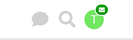

---

id: 359112

title: "对社区的一切界面都很陌生？discourse社区新用户入门指南来了～"

created_at: 2025-01-14T02:23:36.681Z

username: shannon1024

display_username: "林青枫"

---


# 对社区的一切界面都很陌生？discourse社区新用户入门指南来了～


>  本指南涵盖了新用户在使用Discourse时的基本功能和基本用法，解释了关键术语、如何导航、参与对话以及配置通知。

>

> 本指南由 @林青枫 逐句翻译、校对、润色，发布于Linux do 与星语思源（starorigin），转载请注明作者。

>

>  所需用户级别：所有人

欢迎！作为Discourse社区的新用户，我们希望您能发现这个网站直观且结构清晰。以下是一些帮助您入门的指导：

## 概要

本指南将涵盖：

- Discourse社区中使用的基本术语

- 浏览和导航技巧

- 阅读和参与话题

- 通知及其管理方法

---

## Discourse使用的基本术语

以下是您在使用Discourse时应熟悉的一些关键术语：

- **话题**：一系列有意义的对话信息，带有标题，列在一个类别中，以原始帖子开始，并按时间顺序包含所有回复。

- **帖子**：话题中的**所有单个信息**。每个帖子可以由不同用户撰写，移动到另一个话题，或成为新话题的开端。

- **原始帖子（OP）**：任何话题中的第一个帖子。它决定了话题的重点，并与标题和标签相关联。

- **类别**：组织话题的主要方式。每个话题都位于一个类别中，该类别可以有自己的权限和通知设置。类别类似于其他网站上的板块。

- **标签**：用于描述话题的标记。每个话题可以有多个标签，用户可以创建新的标签。

- **用户**：所有网站活动，如创建帖子和记录操作，都是围绕注册用户进行的。Discourse社区网站可以是私有的或公共的，但参与需要注册。

## 浏览论坛

### 话题列表

默认情况下，Discourse主页显示所有**最新**对话，但您可以通过多种方式过滤此列表：

[界面截图显示了几个选项：类别、标签、最新、热门、未读，以及一个用于新建话题的按钮。 (由 AI 生成标题)2106×218 15.2 KB](https://cdn3.ldstatic.com/original/4X/9/e/c/9eccc5827ab42591caadaebbf8183a6e32970125.png)

- **按类别**：点击“所有类别”标题查看所有类别列表：

- **按标签**：点击“所有标签”标题查看所有标签列表。

- **按活动水平**：点击“热门”按特定时间段列出话题的活动水平。

- **按新话题**：新话题（在过去2天内创建且您尚未打开）

[图像显示了一个界面，上面有“类别”、“标签”、“最新”、“热门”和“分类”选项，其中“最新”被选中，并显示“查看 14 个新的或更新的话题”。 (由 AI 生成标题)2236×268 15.2 KB](https://cdn3.ldstatic.com/original/4X/c/d/b/cdbac5075f74d024d52477598b6edceae19da162.png)

- **按未读话题**：您已打开并阅读至少4分钟但有新帖（回复）的主题用蓝色圆圈中的数字标记：


[这个图片显示了一个论坛页面，其中一个帖子标题是“因佬友反馈 所以再抽一个小游戏”，带有标记为“游戏”和“抽奖”的标签，旁边有一个红色箭头指向该帖。 (由 AI 生成标题)1886×334 70.8 KB](https://cdn3.ldstatic.com/original/4X/2/d/c/2dc6d82b08b3791f026dd83dbfb77a34b43e9430.png)

### 查看参与者

在主页的帖子列表上，您可以看到以下用户的头像：

[image378×142 17.3 KB](https://cdn3.ldstatic.com/original/4X/8/e/6/8e6793c525b7a366ed4e88cbc60a16bf3188a649.png)

- 发起帖子/话题的用户

- 最活跃的参与者

- 创建最新帖子的用户

OP底部的指示器显示谁创建了帖子、回复和查看次数，以及最频繁参与者的头像：

[该图显示了一个界面，其中包含浏览量、赞、链接、用户数和阅读时间等数据，以及两个图标，分别标记为1和2。 (由 AI 生成标题)1444×150 38.6 KB](https://cdn3.ldstatic.com/original/4X/b/f/b/bfbbd40a1ce34906f41dacd66f1dbd8c7053f002.png)

**标记1**:将帖子分层，您将查看最热门回复。

**标记2**:使用AI总结帖子内容。

## 导航工具

使用**右上角的图标按钮**进行聊天、搜索或访问您的用户菜单：

[image604×130 10.1 KB](https://cdn3.ldstatic.com/original/4X/5/f/e/5fef906783c4ad60d47bc10439b2e5e258fa05d7.png)

## 阅读话题

### 继续滚动

点击话题标题以按时间顺序阅读回复。使用鼠标或右侧的时间轴滚动条在对话中导航。在较小的屏幕上，选择底部进度条以展开它。

### 跳回

选择话题标题将默认带您回到您的**最后阅读帖子**。要从顶部或底部进入，请点击回复计数或最后回复日期：

[一张显示多个图标、数字和文字的界面截图，包含“结婚可太难了”、“都可以点击”、“300”和“1分钟”等信息。 (由 AI 生成标题)1896×186 46.2 KB](https://cdn3.ldstatic.com/original/4X/1/5/3/153257e23eb26a9d82b1265b61d5494da0b830a4.png)

- 浅红线以上的话题是自您上次访问以来的新话题或更新话题。

- 完全阅读的话题标题为浅灰色：

### 相关话题

帖子可以移动到更合适的话题，或者两个相关话题可以合并。将出现一个链接，允许读者跳转到新位置。相关话题列在原始帖子的末尾：

[图中显示了一个论坛的讨论列表，其中一条用红色箭头标注的主题是“论坛萌新通向老手之路”，有21个回复。 (由 AI 生成标题)1196×286 27.9 KB](https://cdn3.ldstatic.com/original/4X/0/e/0/0e06df64c14b146d8f2263dc5a35b2eb6ba32fee.png)

## 参与对话

### 回复

按下任何**回复**按钮以打开编辑器。您可以在撰写回复时继续阅读或导航到不同的话题：

- 对特定帖子的回复与该帖子链接：


如果您的回复按时间顺序排列在下一个，它将出现在下一个。

如果不是，您的帖子将有一个链接到前一个帖子的上下文，原始帖子显示回复计数。


[图中显示了一条微博评论，评论中包含一句中文引用和一个红色玫瑰表情，右侧是一个用户头像和用户名zhc。 (由 AI 生成标题)976×286 19.1 KB](https://cdn3.ldstatic.com/original/4X/4/8/1/481595c9599e1618f04be6710ba4161da0547291.png)

[这张图片显示了一条留言，内容是“他是版主，随便编辑自己称号”，下方有“2 个回复”和一些表情符号。 (由 AI 生成标题)1304×224 17.2 KB](https://cdn3.ldstatic.com/original/4X/3/1/0/3103c690dac67e9929ad1653e958a019f5c58f94.png)

### 草稿

草稿会**自动保存**。如果最小化或导航离开，编辑器可以通过返回话题或点击浏览器底部的高亮栏重新打开。

### 引用

要插入引用，选择您希望引用的文本，然后按弹出的引用按钮。对来自不同帖子或用户的多个引用重复此操作：

### @ 某个用户

通过提及他们的名字来通知某人。输入`@`以选择用户名：

### 表情符号

要使用表情符号，请按编辑器中的表情符号按钮或输入`:`以按名称或传统表情符号匹配，是的，想输入emoji，只需要输出一个英文的冒号字符，或者在编辑器标签栏选择表情，使用`更多`选项查看完整列表：

[工具栏的图标包含对话气泡、B、I、链接、引号、代码、图像、列表、数字列表、表情符号、GIF和设置。 (由 AI 生成标题)1320×110 2.94 KB](https://cdn3.ldstatic.com/original/4X/2/1/a/21a4ee530aa363a30b6b0f5edeb4862f2dd26b6d.png)

### Oneboxes（链接预览）

要为链接创建摘要，请将其粘贴在单独的一行上。以链接开始的话题可以在标题字段中生成摘要：

>  您可以在[本指南](https://meta.discourse.org/t/create-rich-link-previews-with-onebox/98088)中阅读更多关于使用onebox功能的信息。

### 格式化输出

您可以使用简单的HTML、BBCode或[Markdown](http://commonmark.org/help/)格式化您的回复。例如：

```
这是<b>粗体</b>。
这是[b]粗体[/b]。
这是**粗体**。
```

想学习更多markdown格式化技巧？请[尝试这个10分钟的Markdown教程](https://commonmark.org/help/tutorial/)。

## 操作和反应

在每个帖子的底部，您会找到操作按钮：

- **喜欢**：对帖子表示赞赏。

- **链接**：复制回复或话题的永久链接。

- "**…**"按钮将显示更多操作，如**标记**、**编辑**和**书签**：

## 通知

当有人直接与您聊天互动时，您的个人资料图片上会出现一个蓝色数字。对于私信，会出现一个绿色信封。要接收桌面或Android推送通知，请允许网站通过您的浏览器向您发送通知。



[这是一个包含消息和通知的界面截图，显示了来自discobot的问候语、@JammyDodger的欢迎信息和获得“Basic”徽章的通知。 (由 AI 生成标题)490×507 12.8 KB](https://cdn3.ldstatic.com/original/4X/4/2/1/4219563290fb165eb2834f40859ce59916249240.png)

### 话题通知

通过话题底部的通知或在右侧的时间轴上，控制更改任何话题的通知级别：

[图中显示了一个弹出菜单，其中包含四个通知选项：“关注”、“跟踪”、“常规”和“已设为免打扰”，并用红色箭头指向一个带有铃铛图标的按钮。 (由 AI 生成标题)886×1042 97.5 KB](https://cdn3.ldstatic.com/original/4X/5/4/b/54bb941c168fe520dde61e4168187929c3024967.jpeg)

### 标签、类别通知更改（选择你重点关注的板块）

通过您的用户偏好（在“跟踪”下）设置每个标签、类别的通知级别：

[这是一个界面截图，显示了用户的多个选项，包括“偏好设置”、“跟踪”和“账号”等标签。 (由 AI 生成标题)2060×244 36.7 KB](https://cdn3.ldstatic.com/original/4X/f/8/a/f8a284976c92fd7cbf7b265f199fd20ecbec3435.png)

[这是一个界面截图，显示了用于管理类别和标签通知的选项，包括已关注、已跟踪、关注第一个帖子和免打扰等设置。 (由 AI 生成标题)2046×1302 261 KB](https://cdn3.ldstatic.com/original/4X/6/6/8/66803922cb74d7cecd8770567bae6aac521115d0.png)

如果您在已设置通知设置的类别或标签上，您可以通过点击新话题按钮旁边的铃铛图标来更改它：

[图像显示了一个通知设置界面，包含“关注”、“跟踪”、“常规”和“已设为免打扰”的选项说明。 (由 AI 生成标题)798×540 45.6 KB](https://cdn3.ldstatic.com/original/4X/a/3/5/a35b40189c609eaa12cbed0496047e0d6b8af506.png)


---


*来源: https://linux.do/t/topic/359112.json*

