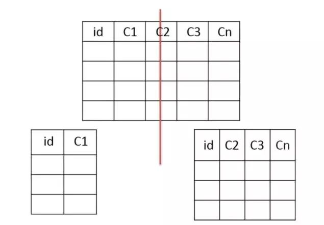
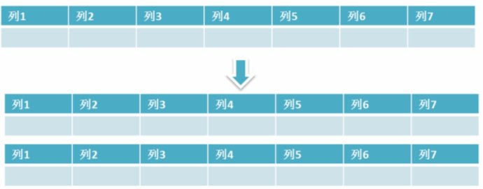
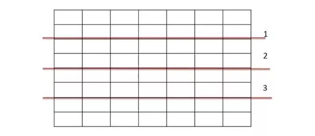
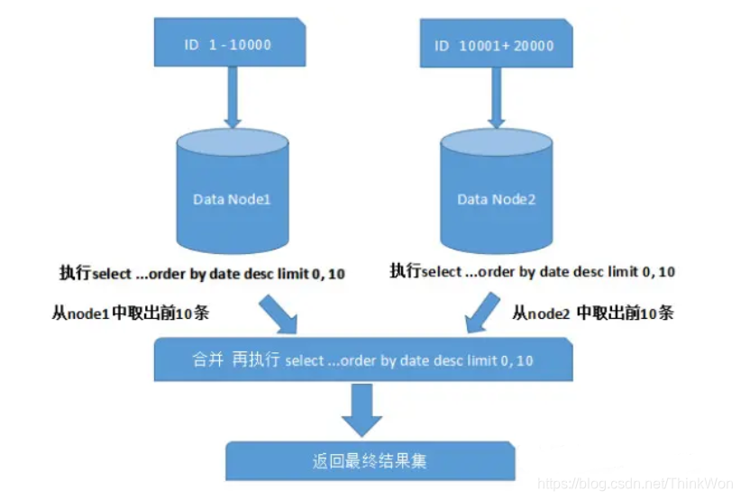

---

id: 367509

title: "<校招面进大厂> Mysql - 面试知识笔记"

created_at: 2025-01-16T06:24:16.968Z

username: blazeb

display_username: "pp"

---


# <校招面进大厂> Mysql - 面试知识笔记


# MySQL优化

- 数据库引擎


inno db更删


myisam 插查

- 字段，能小就小，精度没要求那么高就小

- 表结构三范式消除冗余


原子性（字段不可分割，比如姓名和性别不要放在一起）


消除部分依赖（非主属性不与主键的某一个部分是指联合主键依赖）


消除传递依赖（消除主键中的传递依赖）

- 有时候要逆范式，增加冗余，比如分页，总记录数

- 大数据量


分库分表，主从同步 分担服务器压力

- 开启缓存


缓存select 压力

# MVCC关于读分，当前读和快照读

- 当前读是指在update，insert，delete. 的时候都去当前最新版本的值，读取时保证其他并发事务不能修改当前读，会对读取的记录加锁

- 快照读是指不加锁的select操作就是快照读，即是不加锁的非阻塞读，但因为是多版本的，可能会读到不是当前最新版本的数据。

# 什么是MVCC

MVCC是指多版本并发控制，一般在数据库管理系统，实现对数据库的并发访问，MVCC，在MySQL innodb的实现是为了提高数据库并发性能，用更好的方式去处理读写冲突，既是读写冲突，不加锁 不阻塞 并发读。

只在读已提交和可重复读中使用。在于ReadView生成的策略不一样（已提交级别下，每一次查询都会生成独立的ReadView,可重复读在第一次生成一个ReadView,之后读都复用之前的ReadView,这样每一次读结果都一样。）

mvcc主要跟数据库中的三个隐藏字段，undo. log，read view有关

三个隐藏字段为 对某个记录的最近的事务id，回滚指针（上一个版本的指针），隐藏主键

undo. log是用来记录各个版本的快照数据。以链的形式进行存储，链头为最新数据


undo.log的产生主要分为两种，


一是insert的时候产生，只在事务回滚时需要，事务提交后就丢弃（purge线程清除）


二是update delete时产生，不仅在事务回滚时需要，在快照读也要，所以不能随便删除，只要在快照读和事务都不涉及的时候会才会被清除

read view是读视图，它是在事务进行快照读的时候产生的，主要是记录当前数据库活跃的事务id，还有最小活跃事务id. 还有系统下一个要分配的事务id


它主要是通过可见性算法，把当前修改记录的事务id去当前活跃的最小事务id比较，如果小与，当前记录是为当前事务能看到的，如果大于就通过回滚指针去取出undo. log中的事务id比较，遍历链表直到找到符合条件为止，那么这个版本就是当前事务能看到的最新老版本

# MySQL存储引擎MyISAM与InnoDB区别

**Innodb引擎**：Innodb引擎提供了对数据库ACID事务的支持。并且还提供了行级锁和外键的约束。它的设计的目标就是处理大数据容量的数据库系统。

**MyIASM引擎**(老版本Mysql的默认引擎)：不提供事务的支持，也不支持行级锁和外键。

**MEMORY引擎**：所有的数据都在内存中，数据的处理速度快，但是安全性不高。

- InnoDB索引是聚簇索引，MyISAM索引是非聚簇索引。

- InnoDB的主键索引的叶子节点存储着行数据，因此主键索引非常高效。

- MyISAM索引的叶子节点存储的是行数据地址，需要再寻址一次才能得到数据。

- InnoDB非主键索引的叶子节点存储的是主键和其他带索引的列数据，因此查询时做到覆盖索引会非常高效。

# 什么是索引

索引是用来提高数据查询效率的数据结构，在MYSQL当中，

索引有：

- 主键索引（唯一且不能为空，只能有一个），

- 唯一索引（唯一且允许为空，可以有多个），可以通过 `ALTER TABLE table_name ADD UNIQUE (column);` 创建唯一索引，可以通过 `ALTER TABLE table_name ADD UNIQUE (column1,column2);` 创建唯一组合索引

- 普通索引（没有唯一的特点）,可以通过`ALTER TABLE table_name ADD INDEX index_name (column);`创建普通索引, 可以通过`ALTER TABLE table_name ADD INDEX index_name(column1, column2, column3);`创建组合索引

- 全文索引（MYISAM）：是目前搜索引擎使用的一种关键技术。可以使用：ALTER TABLE TABLE_NAME ADD FULLTEXT();

# 索引的数据结构

在INNODB中使用的是聚集索引，采用、·

- B+树

特点是：非叶子节点不存储数据，只保留多个关键字，这是为了存储多个索引，减少磁盘的IO，加快查询数据（页式存储）并且叶子结点本身依关键字的大小自小而大顺序链接。因此也适合范围查询，叶子结点是通过双向链表连接，只要找到范围内的数据，就可以通过双向链表，加快查询。

- 哈希索引：类似于数据结构中简单实现的HASH表（散列表）一样，当我们在mysql中用哈希索引时，主要就是通过Hash算法（常见的Hash算法有直接定址法、平方取中法、折叠法、除数取余法、随机数法），将数据库字段数据转换成定长的Hash值，与这条数据的行指针一并存入Hash表的对应位置；如果发生Hash碰撞（两个不同关键字的Hash值相同），则在对应Hash键下以链表形式存储。当然这只是简略模拟图。

# 索引算法有哪些？

索引算法有 BTree算法和Hash算法

- BTree是最常用的mysql数据库索引算法，也是mysql默认的算法，因为它不仅可以被用在=,>,>=,<,<=和between这些比较操作符上，而且还可以用于like操作符，只要它的查询条件是一个不以通配符开头的常量

- Hash Hash索引只能用于对等比较，例如=,<=>（相当于=）操作符。由于是一次定位数据，不像BTree索引需要从根节点到枝节点，最后才能访问到页节点这样多次IO访问，所以检索效率远高于BTree索引。

# 索引设计的原则？

- 适合索引的列是出现在where子句中的列，或者连接子句中指定的列

- 基数较小的类，索引效果较差，没有必要在此列建立索引

- 使用短索引，如果对长字符串列进行索引，应该指定一个前缀长度，这样能够节省大量索引空间（空间和效率的衡量）

- 不要过度使用索引。索引需要额外的磁盘空间，并降低写操作的性能。在修改表内容的时候，索引会进行更新甚至重构，索引列越多，这个时间就会越长。所以只保持需要的索引有利于查询即可。

- 频繁更改的字段不适合建索引

- 最左前缀匹配原则

- 索引的值最好不要为Null

- 重复值比较多的列不要建立索引

# 什么是最左匹配原则

- 索引的底层是一颗B+树，那么联合索引当然还是一颗B+树，只不过联合索引的健值数量不是一个，而是多个。构建一颗B+树只能根据一个值来构建，因此数据库依据联合索引最左的字段来构建B+树。

- 最左前缀匹配原则，非常重要的原则，mysql会一直向右匹配直到遇到范围查询(>、<、between、like)就停止匹配，比如a = 1 and b = 2 and c > 3 and d = 4 如果建立(a,b,c,d)顺序的索引，d是用不到索引的，如果建立(a,b,d,c)的索引则都可以用到，a,b,d的顺序可以任意调整。

- =和in可以乱序，比如a = 1 and b = 2 and c = 3 建立(a,b,c)索引可以任意顺序，mysql的查询优化器会帮你优化成索引可以识别的形式

-

# 什么是聚簇索引？何时使用聚簇索引与非聚簇索引

- 聚簇索引：将数据存储与索引放到了一块，找到索引也就找到了数据

- 非聚簇索引：将数据存储于索引分开结构，索引结构的叶子节点指向了数据的对应行，myisam通过key_buffer把索引先缓存到内存中，当需要访问数据时（通过索引访问数据），在内存中直接搜索索引，然后通过索引找到磁盘相应数据，这也就是为什么索引不在key buffer命中时，速度慢的原因

# 什么时候使用聚簇索引和非聚簇索引

# 覆盖索引、回表等这些，了解过吗？

- 覆盖索引：通过读取索引就可以得到想要的数据，那就不需要读取行了。一个索引包含了（或覆盖了）满足查询结果的数据就叫做覆盖索引

- 回表：二级索引无法直接查询所有列的数据，所以通过二级索引查询到聚簇索引后，再查询到想要的数据，这种通过二级索引查询出来的过程，就叫做回表。即基于非主键索引的查询需要多扫描一棵索引树

# 什么是数据库事务？

事务是不可分割的一系列的数据库操作。其结果只能从一种一致性状态变成另一种一致性状态，并且要么都执行要么都不执行。

# 事务的四大特性（ACID）

- 原子性： 事务是最小的执行单位，不允许分割。事务的原子性确保动作要么全部完成，要么完全不起作用；

- 一致性： 执行事务前后，数据的完整性没有被破坏，指从一个正确的状态，迁移到另一个正确的状态（约束，比如金额不能为负数）

- 隔离性： 并发访问数据库时，一个用户的事务不被其他事务所干扰，各并发事务之间数据库是独立的；

- 持久性： 一个事务被提交之后。它对数据库中数据的改变是持久的，即使数据库发生故障也不应该对其有任何影响。

# ACID靠什么保证的？

- A原子性由undo log日志保证，它记录了需要回滚的日志信息，事务回滚时撤销已经执行成功的sql,（数据库commit 之前，数据的修改在内存上）

- C一致性由其他三大特性保证、程序代码要保证业务上的一致性

- I隔离性由MVCC来保证

- D持久性由内存+redo log来保证，mysql修改数据同时在内存和redo log记录这次操作，宕机的时候可以从redolog恢复

`InnoDB redo log写盘，InnoDB事务进入 prepare状态。 如果前面 prepare成功，bin1og写盘，再继续将事务日志持久化到 bin1og，如果持久化成功，那么InnoDB事务则进入 commit状态(在 redo log里面写一个 commit记录) `

redolog的刷盘会在系统空闲时进行

# 什么是脏读？幻读？不可重复读？

- 脏读：某个事务读取了另外一个事务还未提交的数据。

- 不可重复读：在一个事务中，前后两次的读取的数据不一致

- 幻读：在一个事务中前后两次读取的数据条数不一致

# 事务的隔离级别

1. 读未提交：最低的隔离级别，允许读取尚未体检的数据变更，会产生脏读、不可重复读、幻读、

2. 读已提交：允许读取并发事务已经提交的数据，解决了脏读的问题（Oracle 默认）

3. 可重复读：对同一个字段的读取，前后两次是一致的，除非是被本身事务修改的，在读已提交的基础上，解决了不可重复读的问题（MySQL默认）-锁区间的时候并且是当前读，会有幻读，（通过锁定多条数据来保证，锁的数据不是根据唯一索引来锁的，比如年龄的范围查询，可能会有幻读）

4. 串行化：最高的隔离级别，所有事务串行执行，在不可重复度的基础上，解决了幻读的问题（锁一个范围）（临建锁能解决幻读问题）

总结：其实就是对锁的运用的方式不同

# 对MySQL的锁了解吗

当数据库有并发事务的时候，可能会产生数据的不一致，这时候需要一些机制来保证访问的次序，锁机制就是这样的机制。

- 读未提交的级别下，读取不需要加共享锁，

- 读已提交的情况下，读操作需要加共享锁，但是只能读语句执行完后释放共享锁（写锁）

- 在可重复读的的级别下，该操作需要加共享锁，但是在事务提交之前并不释放锁。（局部范围）

- 串行化，是限制性最强的隔离级别，它会锁定整个范围的键，并且一直持有锁，直到事务完成。（全局范围）

# 按照锁的粒度分有哪些

- 行级锁：是MySQL中粒度最小的锁，表示对当前表的一行或多行记录进行加锁，在INNODB中是默认使用行级锁的，并发度高，锁冲突最低，但是加锁开销大，会产生死锁（基于索引来完成行锁的）。

- 表级锁：是MySQL中粒度最大的锁，表示对当前操作的整张表加锁，实现简单，消耗资源小，但是并发度低，锁冲突大，被大部分引擎支持，比如MYISAM和MYSQL。

- 页级锁：锁粒度介于行级锁和表级锁之间，一次锁定相邻的一组记录，冲突和加锁速度和开销都介于两者之间。

- 记录锁：也属于行锁的一种，只不过记录锁的范围只是表中的一条记录 ，并且是精准命中，并且命中条件的字段是唯一索引。

- 间隙锁：也是行锁的一种，间隙锁是在事务加锁后锁住的是表记录的某一个区间，当表的ID之间出现间隙则会形成一个区间，遵循左开右闭原则。（查询1-4，锁2,3,4）防止幻读问题。

- 临建锁：总结来说是记录锁和间隙锁的组合。会把所有查询出来的记录锁住，同时也会把该范围查询内的所有间隙空间也会锁住。

# 按照锁类别分

- 共享锁（读锁）：表示当用户要进行读取数据的时候，加上共享锁，其他用户也可以进行读取，但是不能修改。

- 排他锁（写锁）：当用户要进行修改数据的时候，加上排他锁，其他用户既不能修改也不能读取。

# InnoDB存储引擎的锁的算法有三种

- Record lock：单个行记录上的锁

- Gap lock：间隙锁，锁定一个范围，不包括记录本身（不可重复读，比如查询年龄多少到多少）

- Next-key lock：record+gap 锁定一个范围，包含记录本身（解决了幻读）

- 相关知识点：


innodb对于行的查询使用next-key lock

Next-locking keying为了解决Phantom Problem幻读问题

当查询的索引含有唯一属性时，将next-key lock降级为record key

Gap锁设计的目的是为了阻止多个事务将记录插入到同一范围内，而这会导致幻读问题的产生

有两种方式显式关闭gap锁：（除了外键约束和唯一性检查外，其余情况仅使用record lock） A. 将事务隔离级别设置为RC B. 将参数innodb_locks_unsafe_for_binlog设置为1

# 什么是死锁？怎么解决？

死锁，多个并发事务相互持有对方需要的锁资源，并且不释放，从而导致死锁。

常见解决死锁的方法

1、如果不同程序会并发存取多个表，尽量约定以相同的顺序访问表，可以大大降低死锁机会。

2、在同一个事务中，尽可能做到一次锁定所需要的所有资源，减少死锁产生概率；

3、对于非常容易产生死锁的业务部分，可以尝试使用升级锁定颗粒度，通过表级锁定来减少死锁产生的概率；

如果业务处理不好可以用分布式事务锁或者使用乐观锁

# 数据库的乐观锁和悲观锁是什么？怎么实现的？

数据库管理系统（DBMS）中的并发控制的任务是确保在多个事务同时存取数据库中同一数据时不破坏事务的隔离性和一致性以及数据库的一致性。乐观并发控制（乐观锁）和悲观并发控制（悲观锁）是并发控制主要采用的技术手段。

悲观锁：假定会发生并发冲突，屏蔽一切可能违反数据完整性的操作。在查询完数据的后就把事务锁起来，直到提交事务。实现方式：使用数据库中的锁机制

乐观锁：假设不会发生并发冲突，只在提交操作时检查是否违反数据完整性。在修改数据的时候把事务锁起来，通过version的方式来进行锁定。实现方式：乐观锁一般会使用版本号机制或CAS算法实现。

两种锁的使用场景

从上面对两种锁的介绍，我们知道两种锁各有优缺点，不可认为一种好于另一种，像乐观锁适用于写比较少的情况下（多读场景），即冲突真的很少发生的时候，这样可以省去了锁的开销，加大了系统的整个吞吐量。

但如果是多写的情况，一般会经常产生冲突，这就会导致上层应用会不断的进行retry，这样反倒是降低了性能，所以一般多写的场景下用悲观锁就比较合适。

# 为什么要使用视图？什么是视图？

为了提高复杂SQL语句的复用性和表操作的安全性，MySQL数据库管理系统提供了视图特性。所谓视图，本质上是一种虚拟表，在物理上是不存在的，其内容与真实的表相似，包含一系列带有名称的列和行数据。但是，视图并不在数据库中以储存的数据值形式存在。行和列数据来自定义视图的查询所引用基本表，并且在具体引用视图时动态生成。

视图使开发者只关心感兴趣的某些特定数据和所负责的特定任务，只能看到视图中所定义的数据，而不是视图所引用表中的数据，从而提高了数据库中数据的安全性。

# 什么是游标？

游标是系统为用户开设的一个数据缓冲区，存放SQL语句的执行结果，每个游标区都有一个名字。用户可以通过游标逐一获取记录并赋给主变量，交由主语言进一步处理。

# 什么是存储过程？有哪些优缺点？

存储过程是一个预编译的SQL语句，优点是允许模块化的设计，就是说只需要创建一次，以后在该程序中就可以调用多次。如果某次操作需要执行多次SQL，使用存储过程比单纯SQL语句执行要快。

优点

1）存储过程是预编译过的，执行效率高。

2）存储过程的代码直接存放于数据库中，通过存储过程名直接调用，减少网络通讯。

3）安全性高，执行存储过程需要有一定权限的用户。

4）存储过程可以重复使用，减少数据库开发人员的工作量。

缺点

1）调试麻烦，但是用 PL/SQL Developer 调试很方便！弥补这个缺点。

2）移植问题，数据库端代码当然是与数据库相关的。但是如果是做工程型项目，基本不存在移植问题。

3）重新编译问题，因为后端代码是运行前编译的，如果带有引用关系的对象发生改变时，受影响的存储过程、包将需要重新编译（不过也可以设置成运行时刻自动编译）。

4）如果在一个程序系统中大量的使用存储过程，到程序交付使用的时候随着用户需求的增加会导致数据结构的变化，接着就是系统的相关问题了，最后如果用户想维护该系统可以说是很难很难、而且代价是空前的，维护起来更麻烦。

# 什么是触发器？触发器的使用场景有哪些？

触发器是用户定义在关系表上的一类由事件驱动的特殊的存储过程。触发器是指一段代码，当触发某个事件时，自动执行这些代码。

使用场景

可以通过数据库中的相关表实现级联更改。


实时监控某张表中的某个字段的更改而需要做出相应的处理。


例如可以生成某些业务的编号。


注意不要滥用，否则会造成数据库及应用程序的维护困难。


大家需要牢记以上基础知识点，重点是理解数据类型CHAR和VARCHAR的差异，表存储引擎InnoDB和MyISAM的区别。

# MySQL中都有哪些触发器？

在MySQL数据库中有如下六种触发器：

- Before Insert

- After Insert

- Before Update

- After Update

- Before Delete

- After Delete

# SQL语句主要分为哪几类

数据定义语言DDL（Data Ddefinition Language）CREATE，DROP，ALTER

主要为以上操作 即对逻辑结构等有操作的，其中包括表结构，视图和索引。

数据查询语言DQL（Data Query Language）SELECT

这个较为好理解 即查询操作，以select关键字。各种简单查询，连接查询等 都属于DQL。

数据操纵语言DML（Data Manipulation Language）INSERT，UPDATE，DELETE

主要为以上操作 即对数据进行操作的，对应上面所说的查询操作 DQL与DML共同构建了多数初级程序员常用的增删改查操作。而查询是较为特殊的一种 被划分到DQL中。

数据控制功能DCL（Data Control Language）GRANT，REVOKE，COMMIT，ROLLBACK

主要为以上操作 即对数据库安全性完整性等有操作的，可以简单的理解为权限控制等。

# drop、delete与truncate的区别

|  | Delete | Truncate | Drop |

| --- | --- | --- | --- |

| 类型 | 属于DML | 属于DDL | 属于DDL |

| 回滚 | 可回滚 | 不可回滚 | 不可回滚 |

| 删除内容 | 表结构还在，删除表的全部或者一部分数据行 | 表结构还在，删除表中的所有数据 | 从数据库中删除表，所有的数据行，索引和权限也会被删除 |

| 删除速度 | 删除速度慢，需要逐行删除 | 删除速度快 | 删除速度最快 |

因此，在不再需要一张表的时候，用drop；在想删除部分数据行时候，用delete；在保留表而删除所有数据的时候用truncate。

# SQL的生命周期？

1. 应用服务器与数据库服务器建立一个连接

2. 数据库进程拿到请求sql

3. 解析并生成执行计划，执行

4. 读取数据到内存并进行逻辑处理

5. 通过步骤一的连接，发送结果到客户端

6. 关掉连接，释放资源


# 大表数据查询，怎么优化

优化shema、sql语句+索引；


第二加缓存，memcached, redis；


主从复制，读写分离；


垂直拆分，根据你模块的耦合度，将一个大的系统分为多个小的系统，也就是分布式系统；


水平切分，针对数据量大的表，这一步最麻烦，最能考验技术水平，要选择一个合理的sharding key, 为了有好的查询效率，表结构也要改动，做一定的冗余，应用也要改，sql中尽量带sharding key，将数据定位到限定的表上去查，而不是扫描全部的表；

# 超大分页怎么处理

解决超大分页,其实主要是靠缓存,可预测性的提前查到内容,缓存至redis等k-V数据库中,直接返回即可.

要不然只能优化SQL，具体情况还得具体分析。

# 慢查询日志

**用于记录执行时间超过某个临界值的SQL日志，用于快速定位慢查询，为我们的优化做参考。**

开启慢查询日志

配置项：slow_query_log

可以使用show variables like ‘slow_query_log’查看是否开启，如果状态值为OFF，可以使用set GLOBAL slow_query_log = on来开启，它会在datadir下产生一个xxx-slow.log的文件。

设置临界时间

配置项：long_query_time

查看：show VARIABLES like ‘long_query_time’，单位秒

设置：set long_query_time=0.5

实操时应该从长时间设置到短的时间，即将最慢的SQL优化掉

查看日志，一旦SQL超过了我们设置的临界时间就会被记录到xxx-slow.log中

# 优化查询过程中的数据访问

- 访问数据太多导致查询性能下降

- 确定应用程序是否在检索大量超过需要的数据，可能是太多行或列

- 确认MySQL服务器是否在分析大量不必要的数据行

- 避免犯如下SQL语句错误

- 查询不需要的数据。解决办法：使用limit解决

- 多表关联返回全部列。解决办法：指定列名

- 总是返回全部列。解决办法：避免使用SELECT *

- 重复查询相同的数据。解决办法：可以缓存数据，下次直接读取缓存

- 是否在扫描额外的记录。解决办法：

- 使用explain进行分析，如果发现查询需要扫描大量的数据，但只返回少数的行，可以通过如下技巧去优化：

- 使用索引覆盖扫描，把所有的列都放到索引中，这样存储引擎不需要回表获取对应行就可以返回结果。

- 改变数据库和表的结构，修改数据表范式

- 重写SQL语句，让优化器可以以更优的方式执行查询。

# 数据库结构优化

一个好的数据库设计方案对于数据库的性能往往会起到事半功倍的效果。

需要考虑数据冗余、查询和更新的速度、字段的数据类型是否合理等多方面的内容。

将字段很多的表分解成多个表

对于字段较多的表，如果有些字段的使用频率很低，可以将这些字段分离出来形成新表。

因为当一个表的数据量很大时，会由于使用频率低的字段的存在而变慢。

增加中间表

对于需要经常联合查询的表，可以建立中间表以提高查询效率。

通过建立中间表，将需要通过联合查询的数据插入到中间表中，然后将原来的联合查询改为对中间表的查询。

增加冗余字段

设计数据表时应尽量遵循范式理论的规约，尽可能的减少冗余字段，让数据库设计看起来精致、优雅。但是，合理的加入冗余字段可以提高查询速度。

表的规范化程度越高，表和表之间的关系越多，需要连接查询的情况也就越多，性能也就越差。

注意：

冗余字段的值在一个表中修改了，就要想办法在其他表中更新，否则就会导致数据不一致的问题。

# MySQL数据库cpu飙升到500%的话他怎么处理？

当 cpu 飙升到 500%时，先用操作系统命令 top 命令观察是不是 mysqld 占用导致的，如果不是，找出占用高的进程，并进行相关处理。

如果是 mysqld 造成的， show processlist，看看里面跑的 session 情况，是不是有消耗资源的 sql 在运行。找出消耗高的 sql，看看执行计划是否准确， index 是否缺失，或者实在是数据量太大造成。

一般来说，肯定要 kill 掉这些线程(同时观察 cpu 使用率是否下降)，等进行相应的调整(比如说加索引、改 sql、改内存参数)之后，再重新跑这些 SQL。

也有可能是每个 sql 消耗资源并不多，但是突然之间，有大量的 session 连进来导致 cpu 飙升，这种情况就需要跟应用一起来分析为何连接数会激增，再做出相应的调整，比如说限制连接数等

# 大表怎么优化？某个表有近千万数据，CRUD比较慢，如何优化？分库分表了是怎么做的？分表分库了有什么问题？有用到中间件么？他们的原理知道么？

当MySQL单表记录数过大时，数据库的CRUD性能会明显下降，一些常见的优化措施如下：

限定数据的范围： 务必禁止不带任何限制数据范围条件的查询语句。比如：我们当用户在查询订单历史的时候，我们可以控制在一个月的范围内。；


读/写分离： 经典的数据库拆分方案，主库负责写，从库负责读；


缓存： 使用MySQL的缓存，另外对重量级、更新少的数据可以考虑使用应用级别的缓存；


还有就是通过分库分表的方式进行优化，主要有垂直分表和水平分表

垂直分区：

根据数据库里面数据表的相关性进行拆分。 例如，用户表中既有用户的登录信息又有用户的基本信息，可以将用户表拆分成两个单独的表，甚至放到单独的库做分库。

简单来说垂直拆分是指数据表列的拆分，把一张列比较多的表拆分为多张表。 如下图所示，这样来说大家应该就更容易理解了。



垂直拆分的优点： 可以使得行数据变小，在查询时减少读取的Block数，减少I/O次数。此外，垂直分区可以简化表的结构，易于维护。

垂直拆分的缺点： 主键会出现冗余，需要管理冗余列，并会引起Join操作，可以通过在应用层进行Join来解决。此外，垂直分区会让事务变得更加复杂；

垂直分表


把主键和一些列放在一个表，然后把主键和另外的列放在另一个表中

适用场景


1、如果一个表中某些列常用，另外一些列不常用


2、可以使数据行变小，一个数据页能存储更多数据，查询时减少I/O次数


缺点


有些分表的策略基于应用层的逻辑算法，一旦逻辑算法改变，整个分表逻辑都会改变，扩展性较差


对于应用层来说，逻辑算法增加开发成本


管理冗余列，查询所有数据需要join操作

水平分区：

保持数据表结构不变，通过某种策略存储数据分片（按照业务的分类将表分散到不同的库）。这样每一片数据分散到不同的表或者库中，达到了分布式的目的。 水平拆分可以支撑非常大的数据量。

水平拆分是指数据表行的拆分，表的行数超过200万行时，就会变慢，这时可以把一张的表的数据拆成多张表来存放。举个例子：我们可以将用户信息表拆分成多个用户信息表，这样就可以避免单一表数据量过大对性能造成影响。



水品拆分可以支持非常大的数据量。需要注意的一点是:分表仅仅是解决了单一表数据过大的问题，但由于表的数据还是在同一台机器上，其实对于提升MySQL并发能力没有什么意义，所以 水平拆分最好分库 。

水平拆分能够 支持非常大的数据量存储，应用端改造也少，但 分片事务难以解决 ，跨界点Join性能较差，逻辑复杂。

《Java工程师修炼之道》的作者推荐 尽量不要对数据进行分片，因为拆分会带来逻辑、部署、运维的各种复杂度 ，一般的数据表在优化得当的情况下支撑千万以下的数据量是没有太大问题的。如果实在要分片，尽量选择客户端分片架构，这样可以减少一次和中间件的网络I/O。

水平分表：


表很大，分割后可以降低在查询时需要读的数据和索引的页数，同时也降低了索引的层数，提高查询次数

适用场景



客户端代理： 分片逻辑在应用端，封装在jar包中，通过修改或者封装JDBC层来实现。 当当网的 Sharding-JDBC 、阿里的TDDL是两种比较常用的实现。


中间件代理： 在应用和数据中间加了一个代理层。分片逻辑统一维护在中间件服务中。 我们现在谈的 Mycat 、360的Atlas、网易的DDB等等都是这种架构的实现。

分库分表后面临的问题

事务支持 分库分表后，就成了分布式事务了。如果依赖数据库本身的分布式事务管理功能去执行事务，将付出高昂的性能代价； 如果由应用程序去协助控制，形成程序逻辑上的事务，又会造成编程方面的负担。

跨库join

只要是进行切分，跨节点Join的问题是不可避免的。但是良好的设计和切分却可以减少此类情况的发生。解决这一问题的普遍做法是分两次查询实现。在第一次查询的结果集中找出关联数据的id,根据这些id发起第二次请求得到关联数据。 分库分表方案产品

跨节点的count,order by,group by以及聚合函数问题 这些是一类问题，因为它们都需要基于全部数据集合进行计算。多数的代理都不会自动处理合并工作。解决方案：与解决跨节点join问题的类似，分别在各个节点上得到结果后在应用程序端进行合并。和join不同的是每个结点的查询可以并行执行，因此很多时候它的速度要比单一大表快很多。但如果结果集很大，对应用程序内存的消耗是一个问题。

数据迁移，容量规划，扩容等问题 来自淘宝综合业务平台团队，它利用对2的倍数取余具有向前兼容的特性（如对4取余得1的数对2取余也是1）来分配数据，避免了行级别的数据迁移，但是依然需要进行表级别的迁移，同时对扩容规模和分表数量都有限制。总得来说，这些方案都不是十分的理想，多多少少都存在一些缺点，这也从一个侧面反映出了Sharding扩容的难度。

ID问题

一旦数据库被切分到多个物理结点上，我们将不能再依赖数据库自身的主键生成机制。一方面，某个分区数据库自生成的ID无法保证在全局上是唯一的；另一方面，应用程序在插入数据之前需要先获得ID,以便进行SQL路由. 一些常见的主键生成策略

UUID 使用UUID作主键是最简单的方案，但是缺点也是非常明显的。由于UUID非常的长，除占用大量存储空间外，最主要的问题是在索引上，在建立索引和基于索引进行查询时都存在性能问题。 Twitter的分布式自增ID算法Snowflake 在分布式系统中，需要生成全局UID的场合还是比较多的，twitter的snowflake解决了这种需求，实现也还是很简单的，除去配置信息，核心代码就是毫秒级时间41位 机器ID 10位 毫秒内序列12位。

跨分片的排序分页

般来讲，分页时需要按照指定字段进行排序。当排序字段就是分片字段的时候，我们通过分片规则可以比较容易定位到指定的分片，而当排序字段非分片字段的时候，情况就会变得比较复杂了。为了最终结果的准确性，我们需要在不同的分片节点中将数据进行排序并返回，并将不同分片返回的结果集进行汇总和再次排序，最后再返回给用户。如下图所示：



# 如何定位及优化SQL语句的性能问题？创建的索引有没有被使用到?或者说怎么才可以知道这条语句运行很慢的原因？

对于低性能的SQL语句的定位，最重要也是最有效的方法就是使用执行计划，MySQL提供了explain命令来查看语句的执行计划。 我们知道，不管是哪种数据库，或者是哪种数据库引擎，在对一条SQL语句进行执行的过程中都会做很多相关的优化，对于查询语句，最重要的优化方式就是使用索引。 而执行计划，就是显示数据库引擎对于SQL语句的执行的详细情况，其中包含了是否使用索引，使用什么索引，使用的索引的相关信息等。

执行计划包含的信息 **id** 有一组数字组成。表示一个查询中各个子查询的执行顺序;

- id相同执行顺序由上至下。

- id不同，id值越大优先级越高，越先被执行。

- id为null时表示一个结果集，不需要使用它查询，常出现在包含union等 查询语句中。

**select_type** 每个子查询的查询类型，一些常见的查询类型。

```
id	select_type	description
1	SIMPLE	不包含任何子查询或union等查询
2	PRIMARY	包含子查询最外层查询就显示为 PRIMARY
3	SUBQUERY	在select或 where字句中包含的查询
4	DERIVED	from字句中包含的查询
5	UNION	出现在union后的查询语句中
6	UNION RESULT	从UNION中获取结果集，例如上文的第三个例子
```

**type(非常重要，可以看到有没有走索引) 访问类型**

- ALL 扫描全表数据

- index 遍历索引

- range 索引范围查找

- index_subquery 在子查询中使用 ref

- unique_subquery 在子查询中使用 eq_ref

- ref_or_null 对Null进行索引的优化的 ref

- fulltext 使用全文索引

- ref 使用非唯一索引查找数据

- eq_ref 在join查询中使用PRIMARY KEY or UNIQUE NOT NULL索引关联。

- 执行效率:


ALL < index <range< ref <eq_ref <const < system。最好是避免ALL和index

**possible_keys** 可能使用的索引，注意不一定会使用。查询涉及到的字段上若存在索引，则该索引将被列出来。当该列为 NULL时就要考虑当前的SQL是否需要优化了。

**key** 显示MySQL在查询中实际使用的索引，若没有使用索引，显示为NULL。

**TIPS**:查询中若使用了覆盖索引(覆盖索引：索引的数据覆盖了需要查询的所有数据)，则该索引仅出现在key列表中

**key_length** 索引长度

**ref** 表示上述表的连接匹配条件，即哪些列或常量被用于查找索引列上的值

**rows** 返回估算的结果集数目，并不是一个准确的值。

**filtered**:返回结果的行占需要读到的行的百分比，越高越好

**extra** 的信息非常丰富，常见的有：

1. Using index 使用覆盖索引

2. Using where 使用了用where子句来过滤结果集

3. Using filesort 使用文件排序，使用非索引列进行排序时出现，非常消耗性能，尽量优化。

4. Using temporary 使用了临时表 sql优化的目标可以参考阿里开发手册

```
【推荐】SQL性能优化的目标：至少要达到 range 级别，要求是ref级别，如果可以是consts最好。
说明：
1） consts 单表中最多只有一个匹配行（主键或者唯一索引），在优化阶段即可读取到数据。
2） ref 指的是使用普通的索引（normal index）。
3） range 对索引进行范围检索。
反例：explain表的结果，type=index，索引物理文件全扫描，速度非常慢，这个index级别比较range还低，与全表扫描是小巫见大巫。
```

# Mysql主从同步原理

mysql主从同步的过程:

Mysql的主从复制中主要有三个线程: master (binlog dump thread) , slave(I/o thread . sQLthread）, Master—条线程和Slave中的两条线程。

- 主节点 binlog，主从复制的基础是主库记录数据库的所有变更记录到 binlog。binlog是数据库服务器启动的那一刻起，保存所有修改数据库结构或内容的一个文件。

- 主节点log dump线程，当binlog有变动时，log dump线程读取其内容并发送给从节点。

- 从节点I/o线程接收binlog内容，并将其写入到relay log文件中。

- 从节点的SQL线程读取relay log文件内容对数据更新进行重放，最终保证主从数据库的一致性。

注︰主从节点使用binglog文件+ position偏移量来定位主从同步的位置，从节点会保存其已接收到的偏移量，如果从节点发生宕机重启，则会自动从position的位置发起同步。

由于mysql默认的复制方式是异步的，主库把日志发送给从库后不关心从库是否已经处理，这样会产生一个问题就是假设主库挂了，从库处理失败了，这时候从库升为主库后，日志就丢失了。由此产生两个概念。

**全同步复制**


主库写入binlog后强制同步日志到从库，所有的从库都执行完成后才返回给客户端，但是很显然这个方式的话性能会受到严重影响。

**半同步复制**


和全同步不同的是，半同步复制的逻辑是这样，从库写入日志成功后返回ACK确认给主库，主库收到至少一个从库的确认就认为写操作完成。

# MySQL的复制原理以及流程

主从复制：将主数据库中的DDL和DML操作通过二进制日志（BINLOG）传输到从数据库上，然后将这些日志重新执行（重做）；从而使得从数据库的数据与主数据库保持一致。

# 主从复制的作用

主数据库出现问题，可以切换到从数据库。


可以进行数据库层面的读写分离。


可以在从数据库上进行日常备份。

# MySQL主从复制解决的问题

数据分布：随意开始或停止复制，并在不同地理位置分布数据备份


负载均衡：降低单个服务器的压力


高可用和故障切换：帮助应用程序避免单点失败


升级测试：可以用更高版本的MySQL作为从库

# 基本原理流程，3个线程以及之间的关联

主：binlog线程——记录下所有改变了数据库数据的语句，放进master上的binlog中；

从：io线程——在使用start slave 之后，负责从master上拉取 binlog 内容，放进自己的relay log中；

从：sql执行线程——执行relay log中的语句；

复制过程

Binary log：主数据库的二进制日志

Relay log：从服务器的中继日志

第一步：master在每个事务更新数据完成之前，将该操作记录串行地写入到binlog文件中。

第二步：salve开启一个I/O Thread，该线程在master打开一个普通连接，主要工作是binlog dump process。如果读取的进度已经跟上了master，就进入睡眠状态并等待master产生新的事件。I/O线程最终的目的是将这些事件写入到中继日志中。

第三步：SQL Thread会读取中继日志，并顺序执行该日志中的SQL事件，从而与主数据库中的数据保持一致。

# 六种关联查询???

交叉连接（CROSS JOIN）


内连接（INNER JOIN）


外连接（LEFT JOIN/RIGHT JOIN）


联合查询（UNION与UNION ALL）


全连接（FULL JOIN）

```
SELECT * FROM A,B,(C)或者SELECT * FROM A CROSS JOIN B (CROSS JOIN C)

#没有任何关联条件，结果是笛卡尔积，结果集会很大，没有意义，很少使用内连接（INNER JOIN）SELECT * FROM A,B WHERE A.id=B.id或者SELECT * FROM A INNER JOIN B ON A.id=B.id多表中同时符合某种条件的数据记录的集合，INNER JOIN可以缩写为JOI
```

内连接分为三类

```
等值连接：ON A.id=B.id
不等值连接：ON A.id > B.id
自连接：SELECT * FROM A T1 INNER JOIN A T2 ON T1.id=T2.pid
```

外连接（LEFT JOIN/RIGHT JOIN）

```
select * from a_table a left join b_table b on a.a_id = b.b_id;
```

左外连接：LEFT OUTER JOIN, 以左表为主，先查询出左表，按照ON后的关联条件匹配右表，没有匹配到的用NULL填充，可以简写成LEFT JOIN


右外连接：RIGHT OUTER JOIN, 以右表为主，先查询出右表，按照ON后的关联条件匹配左表，没有匹配到的用NULL填充，可以简写成RIGHT JOIN

联合查询（UNION与UNION ALL）-取交集

```
SELECT * FROM A UNION SELECT * FROM B UNION ...
```

就是把多个结果集集中在一起，UNION前的结果为基准，需要注意的是联合查询的列数要相等，相同的记录行会合并


如果使用UNION ALL，不会合并重复的记录行


效率 UNION 高于 UNION ALL

全连接（FULL JOIN）

MySQL不支持全连接


可以使用LEFT JOIN 和UNION和RIGHT JOIN联合使用

```
SELECT * FROM A LEFT JOIN B ON A.id=B.id UNIONSELECT * FROM A RIGHT JOIN B ON A.id=B.id
```

表连接面试题

有2张表，1张R、1张S，R表有ABC三列，S表有CD两列，表中各有三条记录。

R表

A	B	C


a1	b1	c1


a2	b2	c2


a3	b3	c3


S表

C	D


c1	d1


c2	d2


c4	d3


交叉连接(笛卡尔积):

```
select r.*,s.* from r,s
```

A	B	C	C	D


a1	b1	c1	c1	d1


a2	b2	c2	c1	d1


a3	b3	c3	c1	d1


a1	b1	c1	c2	d2


a2	b2	c2	c2	d2


a3	b3	c3	c2	d2


a1	b1	c1	c4	d3


a2	b2	c2	c4	d3


a3	b3	c3	c4	d3


内连接结果：

```
select r.*,s.* from r inner join s on r.c=s.c
```

A	B	C	C	D


a1	b1	c1	c1	d1


a2	b2	c2	c2	d2


左连接结果：

```
select r.*,s.* from r left join s on r.c=s.c
```

A	B	C	C	D


a1	b1	c1	c1	d1


a2	b2	c2	c2	d2


a3	b3	c3


右连接结果：

```
select r.*,s.* from r right join s on r.c=s.c
```

A	B	C	C	D


a1	b1	c1	c1	d1


a2	b2	c2	c2	d2


c4	d3


全表连接的结果（MySql不支持，Oracle支持）：

```
select r.*,s.* from r full join s on r.c=s.c
```

A	B	C	C	D


a1	b1	c1	c1	d1


a2	b2	c2	c2	d2


a3	b3	c3


c4	d3

# 什么是子查询

条件：一条SQL语句的查询结果做为另一条查询语句的条件或查询结果

嵌套：多条SQL语句嵌套使用，内部的SQL查询语句称为子查询。

# 子查询的三种情况

1. 子查询是单行单列的情况：结果集是一个值，父查询使用：=、 <、 > 等运算符

`查询工资最高的员工是谁？   select  * from employee where salary=(select max(salary) from employee);    `

2.子查询是多行单列的情况：结果集类似于一个数组，父查询使用：in 运算符

```
-- 查询工资大于7000的员工

select  * from employee where salary in (select salary from employee where salary > 7000);
```

3.子查询是多行多列的情况：结果集类似于一张虚拟表，不能用于where条件，用于select子句中做为子表

```
-- 1)查询出2011年以后入职的员工信息
-- 2) 查询所有的部门信息，与上面的虚拟表中的信息比对，找出所有部门ID相等的员工。

select * from dept d,  (select * from employee where join_date > '2011-1-1') e where e.dept_id =  d.id;

-- 使用表连接：

select d.*, e.* from  dept d inner join employee e on d.id = e.dept_id where e.join_date >  '2011-1-1'
```

# mysql中 in 和 exists 区别

mysql中的in语句是把外表和内表作hash 连接，而exists语句是对外表作loop循环，每次loop循环再对内表进行查询。一直大家都认为exists比in语句的效率要高，这种说法其实是不准确的。这个是要区分环境的。

如果查询的两个表大小相当，那么用in和exists差别不大。


如果两个表中一个较小，一个是大表，则子查询表大的用exists，子查询表小的用in。


not in 和not exists：如果查询语句使用了not in，那么内外表都进行全表扫描，没有用到索引；而not extsts的子查询依然能用到表上的索引。所以无论那个表大，用not exists都比not in要快。

# varchar与char的区别

## char的特点

char表示定长字符串，长度是固定的；

如果插入数据的长度小于char的固定长度时，则用空格填充；

因为长度固定，所以存取速度要比varchar快很多，甚至能快50%，但正因为其长度固定，所以会占据多余的空间，是空间换时间的做法；

对于char来说，最多能存放的字符个数为255，和编码无关

## varchar的特点

varchar表示可变长字符串，长度是可变的；

插入的数据是多长，就按照多长来存储；

varchar在存取方面与char相反，它存取慢，因为长度不固定，但正因如此，不占据多余的空间，是时间换空间的做法；

对于varchar来说，最多能存放的字符个数为65532

总之，结合性能角度（char更快）和节省磁盘空间角度（varchar更小），具体情况还需具体来设计数据库才是妥当的做法。

# varchar(50)中50的涵义

最多存放50个字符，varchar(50)和(200)存储hello所占空间一样，但后者在排序时会消耗更多内存，因为order by col采用fixed_length计算col长度(memory引擎也一样)。在早期 MySQL 版本中， 50 代表字节数，现在代表字符数。

# int(20)中20的涵义

是指显示字符的长度。20表示最大显示宽度为20，但仍占4字节存储，存储范围不变；

不影响内部存储，只是影响带 zerofill 定义的 int 时，前面补多少个 0，易于报表展示

# **超键，主键，外键，候选键分别是什么？**

假设有如下两个表：

学生（学号，姓名，性别，身份证号，教师编号）    教师（教师编号，姓名，工资）

- 主键(primary key)：对数据库表中的每一行数据进行唯一标识的字段。

- 外键(foreign key)：是表中的一列，其值必须在另一个表的主键中。外键主要是用来描述两个表的关系。

- 超键(super key)：在关系中能唯一标识**元组**的**属性集**称为关系模式的超键。 比如一张学生信息表，学生表中含有学号或者身份证号的任意组合都为此表的超键。如：（学号）、（学号，姓名）、（身份证号，性别）等。

- 候选键(candidate key)：不含有多余属性的超键称为候选键，也称为最小超键 候选键属于超键，它是最小的超键，就是说如果再去掉候选键中的任何一个属性它就不再是超键了。学生表中的候选键为：（学号）、（身份证号）*。*

# undo和redo的区别

- undo日志用于存放数据修改被修改前的值，假设修改 tba 表中 id=2的行数据，把Name=’B’ 修改为Name = ‘B2’ ，那么undo日志就会用来存放Name=’B’的记录，如果这个修改出现异常，可以使用undo日志来实现回滚操作，保证事务的一致性。

- redo存放数据修改数据，还有没刷到磁盘中的值，那如果这个时候发生数据丢失了或者数据库崩溃了，那么就可以通过redo通过前滚到崩溃点。然后再进行刷新。

- 回滚：从崩溃点恢复到前一个正常的点

- 前滚：从前一个正常的点前滚到崩溃点。

- 联系：因为，数据在没有commit前，是随时从内存中写入到表数据块的，属于脏数据。 数据库崩溃后即使使用redo流程进行redo操作，但是脏数据还在，脏数据怎么处理，就只能靠undo流程，使用undo数据块的旧数据覆盖了。

区别：


作用不同

undo是一种“数据文件datafile”，具有表空间，当然具有块block，redo是一种“文件file”，没有表空间。

undo与rollback的区别：在undo（撤销还原流程）中会使用rollback（回滚）这个动作

# 如何处理慢查询

1. 是否有多查询了多余的行和列，调整SQL

2. 分析执行计划，是否命中索引，修改SQL或者修改索引

3. 语句无法优化，表数据太大，横向或者纵向的分表

# lnnodb是如何实现事务的

Innodb通过Buffer Pool，LogBuffer，Redo Log，Undo Log来实现事务，

以一个update语句为例:

1.Innodb在收到一个update语句后，会先根据条件找到数据所在的页，并将该页缓存在Buffer Pool中

2.执行update语句，修改Buffer Pool中的数据，也就是内存中的数据

3.针对update语句生成一个RedoLog对象，并存入LogBuffer中

4.针对update语句生成undolog日志，用于事务回滚

5.如果事务提交，那么则把RedoLog对象进行持久化，后续还有其他机制将Buffer Pool中所修改的数据页持久化到磁盘中6.如果事务回滚，则低用undolog日志进行回滚

[Redis - 面试知识笔记](https://linux.do/t/topic/363966/13)


---


*来源: https://linux.do/t/topic/367509.json*

