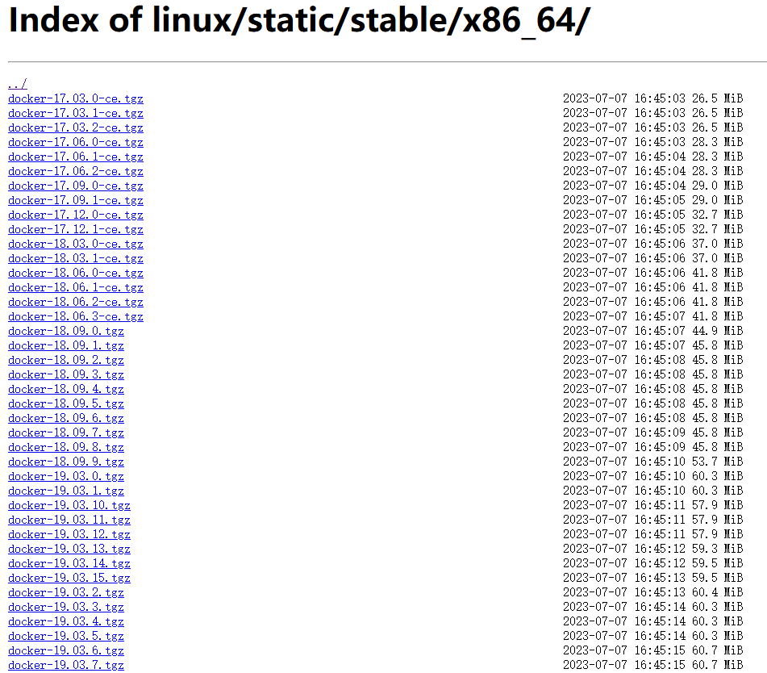
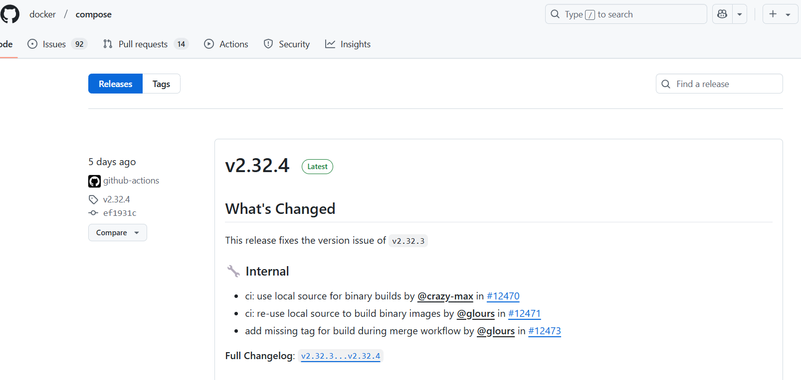

---

id: 380396

title: "docker 离线安装"

created_at: 2025-01-21T02:47:18.481Z

username: zhanghao

display_username: "zhanghao"

---


# docker 离线安装


Docker 是一种开源的容器化平台，用于开发、部署和运行应用程序。它通过将应用程序及其依赖项打包到一个轻量级、可移植的容器中，实现了跨环境的一致性。

在生产环境中，服务器一般是在内网环境下，所以我这里介绍离线安装docker。

## 下载docker压缩包

### 1. 按需选择服务器架构

```
https://download.docker.com/linux/static/stable/
```


```
#通过uanme -m查看服务器架构
[root@localhost ~]# uname -m
x86_64
```

### 2.下载



我这里是x86_64，然后下载了当前最新的docker版本27.5.0，地址：

```
https://download.docker.com/linux/static/stable/x86_64/docker-27.5.0.tgz
```

## 安装docker

### 1.上传docker压缩包到服务器

```
[root@localhost opt]# ls
docker-27.5.0.tgz
```

### 2.解压docker压缩包

```
[root@localhost opt]# tar -zxvf docker-27.5.0.tgz
docker/
docker/runc
docker/containerd
docker/docker-init
docker/dockerd
docker/containerd-shim-runc-v2
docker/docker-proxy
docker/docker
docker/ctr
[root@localhost opt]# ls
docker  docker-27.5.0.tgz
```

### 3.将docker可执行文件移动到环境变量路径

```
#通过该命令可以看到当前的环境变量
[root@localhost opt]# echo $PATH
/root/.local/bin:/root/bin:/usr/local/sbin:/usr/local/bin:/usr/sbin:/usr/bin
```

我们一般会将非系统自带的可执行文件放到/usr/local/bin/目录下。

```
[root@localhost opt]# mv docker/* /usr/local/bin/
```

### 4.使用systemd管理docker服务

创建服务文件docker.service

```
cat > /etc/systemd/system/docker.service <<EOF
[Unit]
Description=Docker Application Container Engine
Documentation=https://docs.docker.com
After=network.target

[Service]
ExecStart=/usr/local/bin/dockerd
ExecReload=/bin/kill -s HUP $MAINPID
LimitNOFILE=1048576
LimitNPROC=512
TimeoutSec=0
Restart=always
RestartSec=2
[Install]
WantedBy=multi-user.target
EOF
```

重新加载服务配置文件

```
systemctl daemon-reload
```

启动docker服务

```
systemctl start docker
```

开机自启docker服务

```
systemctl enable docker
```

## 安装docker compose

### 1.下载地址

```
https://github.com/docker/compose/releases
```



```
https://github.com/docker/compose/releases/download/v2.32.4/docker-compose-linux-x86_64
```

### 2.上传到服务器

```
[root@localhost opt]# ls docker-compose-linux-x86_64
docker-compose-linux-x86_64
```

### 3.移动到docker插件目录下

```
[root@localhost opt]# mkdir -p /usr/local/lib/docker/cli-plugins/
[root@localhost opt]# chmod +x docker-compose-linux-x86_64
[root@localhost opt]# mv docker-compose-linux-x86_64 /usr/local/lib/docker/cli-plugins/docker-compose
```

### 4.验证

```
[root@localhost opt]# docker compose version
Docker Compose version v2.32.4
```

## 在能上互联网的docker服务器上配置国内mirror

**由于国内将dockerhub墙了，所以我们需要配置国内的mirror**

### 1.这里使用的是DaoCloud mirror

```
https://github.com/DaoCloud/public-image-mirror?tab=readme-ov-file
```

### 2.配置docker使用该mirror

```
mkdir /etc/docker
cat > /etc/docker/daemon.json << EOF
{
  "registry-mirrors": [
    "https://docker.m.daocloud.io"
  ]
}
EOF
```

### 3.重启docker服务

```
systemctl restart docker
```

### 4.验证

```
[root@localhost opt]# docker info | tail -5
 Registry Mirrors:
  https://docker.m.daocloud.io/ #这里就是刚刚配置的镜像站
 Live Restore Enabled: false
 Product License: Community Engine
```

**拉镜像（还是不能搜索镜像）**

```
[root@localhost opt]# docker pull nginx
Using default tag: latest
latest: Pulling from library/nginx
af302e5c37e9: Pull complete
207b812743af: Pull complete
841e383b441e: Pull complete
0256c04a8d84: Pull complete
38e992d287c5: Pull complete
9e9aab598f58: Pull complete
4de87b37f4ad: Pull complete
Digest: sha256:0a399eb16751829e1af26fea27b20c3ec28d7ab1fb72182879dcae1cca21206a
Status: Downloaded newer image for nginx:latest
docker.io/library/nginx:latest
```

```
[root@localhost opt]# docker images
REPOSITORY   TAG       IMAGE ID       CREATED       SIZE
nginx        latest    9bea9f2796e2   7 weeks ago   192MB
```

## 配置docker代理，直接访问dockerhub（和上一步二选一即可）

### 1.首先需要删除我们上面配置的国内mirror

我这里直接删了daemon.json，因为配置文件里只配置了mirror，按实际情况来。

```
rm -rf /etc/docker/daemon.json
```

### 2.创建docker 的 systemd 子配置文件

```
mkdir -p /etc/systemd/system/docker.service.d
```

```
cat > /etc/systemd/system/docker.service.d/http-proxy.conf << EOF
> [Service]
Environment="HTTP_PROXY=http://proxy.example.com:8080/"
Environment="HTTPS_PROXY=http://proxy.example.com:8080/"
Environment="NO_PROXY=localhost,127.0.0.1,.example.com"
> EOF
```

- **[http://proxy.example.com:8080/**：改成实际的代理节点ip和端口](http://proxy.example.com:8080/**%EF%BC%9A%E6%94%B9%E6%88%90%E5%AE%9E%E9%99%85%E7%9A%84%E4%BB%A3%E7%90%86%E8%8A%82%E7%82%B9ip%E5%92%8C%E7%AB%AF%E5%8F%A3)

- **NO_PROXY**：这里对应的是不需要代理的地址

### 3.重载服务配置文件、重启服务

```
systemctl daemon-reload && systemctl restart docker
```

**这样就配置好了docker代理，如果有条件还是更推荐配置代理这种方式去拉取镜像**

## 镜像的导入和导出

### 1.从能联网的机器拉取需要的镜像

```
#我这里拉取了nginx:1.27
[root@localhost ~]# docker pull nginx:1.27
1.27: Pulling from library/nginx
af302e5c37e9: Pull complete
207b812743af: Pull complete
841e383b441e: Pull complete
0256c04a8d84: Pull complete
38e992d287c5: Pull complete
9e9aab598f58: Pull complete
4de87b37f4ad: Pull complete
Digest: sha256:0a399eb16751829e1af26fea27b20c3ec28d7ab1fb72182879dcae1cca21206a
Status: Downloaded newer image for nginx:1.27
docker.io/library/nginx:1.27
[root@localhost ~]# docker images
REPOSITORY   TAG       IMAGE ID       CREATED       SIZE
nginx        1.27      9bea9f2796e2   8 weeks ago   192MB
```

### 2.导出镜像

```
#将nginx:1.27导出到本地，名称为nginx:1.27:tar
[root@localhost ~]# docker save -o nginx:1.27.tar nginx:1.27
[root@localhost ~]# ls
anaconda-ks.cfg  nginx:1.27.tar
```

### 3.上传镜像到不能联网的docker服务器并导入镜像

```
[root@localhost ~]# docker images
REPOSITORY   TAG       IMAGE ID   CREATED   SIZE
[root@localhost ~]# ls
anaconda-ks.cfg  nginx:1.27.tar
#导入nginx:1.27镜像
[root@localhost ~]# docker load -i nginx\:1.27.tar
f5fe472da253: Loading layer [==================================================>]  77.83MB/77.83MB
88ebb510d2fb: Loading layer [==================================================>]    118MB/118MB
943132143199: Loading layer [==================================================>]  3.584kB/3.584kB
32c977818204: Loading layer [==================================================>]  4.608kB/4.608kB
541cf9cf006d: Loading layer [==================================================>]   2.56kB/2.56kB
58045dd06e5b: Loading layer [==================================================>]   5.12kB/5.12kB
b57b5eac2941: Loading layer [==================================================>]  7.168kB/7.168kB
Loaded image: nginx:1.27
#查看
[root@localhost ~]# docker images
REPOSITORY   TAG       IMAGE ID       CREATED       SIZE
nginx        1.27      9bea9f2796e2   8 weeks ago   192MB
```

### 4.运行nginx容器测试

```
#运行nginx容器
[root@localhost ~]# docker run --name nginx -p 80:80 -d nginx:1.27
e5fabdea277c467e910a767d4f295cec4c19b5b6fda52a7b336d7e7c8c2f8a32
#查看当前运行的容器
[root@localhost ~]# docker ps
CONTAINER ID   IMAGE        COMMAND                  CREATED         STATUS         PORTS                               NAMES
e5fabdea277c   nginx:1.27   "/docker-entrypoint.…"   3 seconds ago   Up 2 seconds   0.0.0.0:80->80/tcp, :::80->80/tcp   nginx
#访问测试
[root@localhost ~]# curl -I localhost
HTTP/1.1 200 OK
Server: nginx/1.27.3
Date: Wed, 22 Jan 2025 07:06:14 GMT
Content-Type: text/html
Content-Length: 615
Last-Modified: Tue, 26 Nov 2024 15:55:00 GMT
Connection: keep-alive
ETag: "6745ef54-267"
Accept-Ranges: bytes
```

**这样就完成了镜像的导入导出**

## 总结

本文主要介绍了离线安装、配置docker，后面我会继续分享docker相关的知识，如果觉得有用可以关注一下公众号：运维张三。


---


*来源: https://linux.do/t/topic/380396.json*

