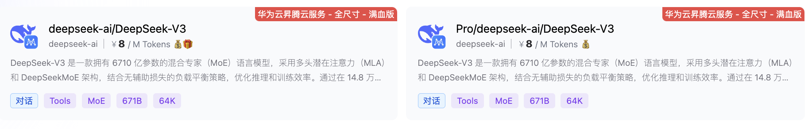
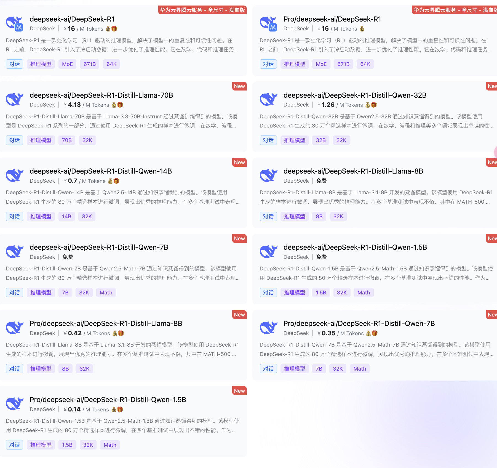
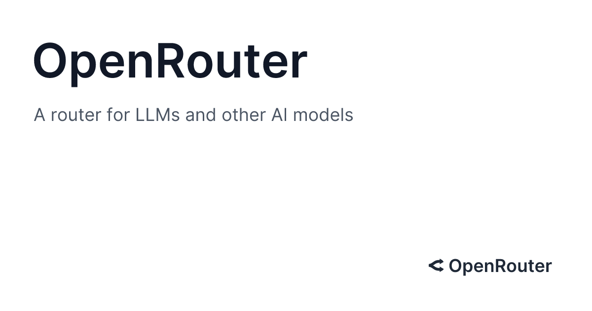
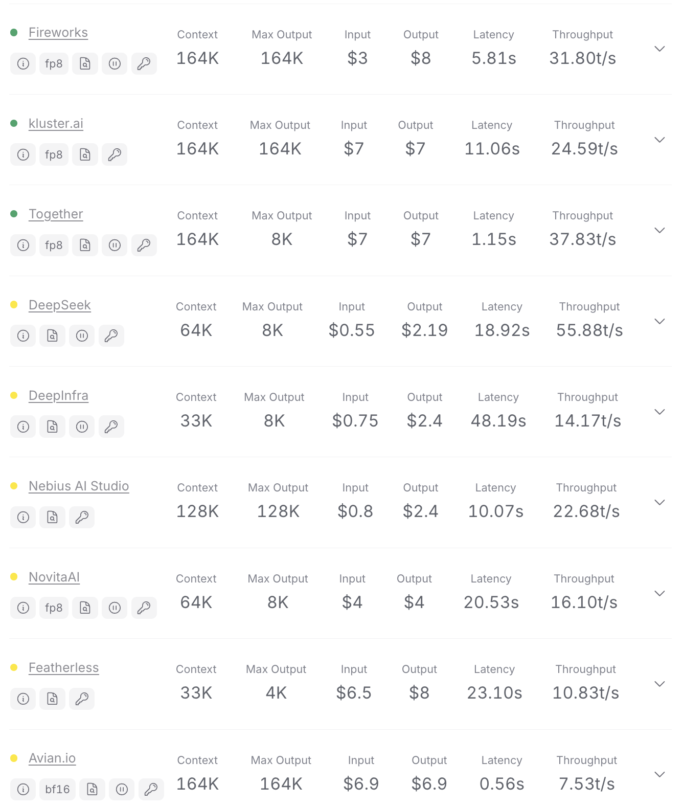
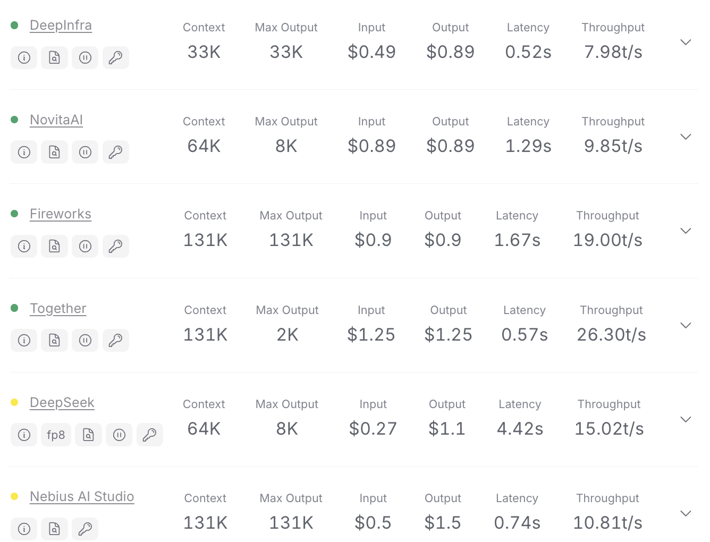
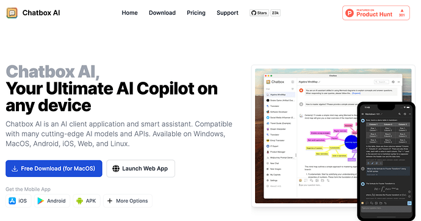
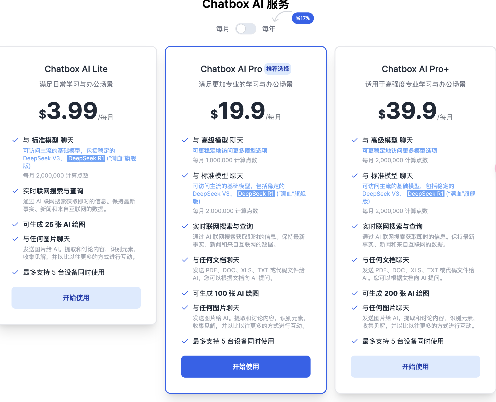
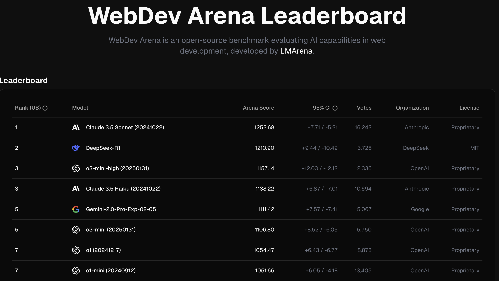

---

id: 421779

title: "DeepSeek 新手上路"

created_at: 2025-02-11T02:34:24.241Z

username: Bennett1987

display_username: "Bennett1987"

---

# DeepSeek 新手上路

## 1. DeepSeek 模型

### 主力模型

主力模型是DeepSeek首发技术报告中指代的最新&满血版 模型，目前有三个，均为671B参数，64K上下文。

- **DeepSeek V3**

传统LLM （MLA结构和MoE架构） 多用于日常Chat交互场景

推出时间：2024年12月

技术细节参见：[Deepseek-V3 Technical Report](https://arxiv.org/abs/2412.19437)

- DeepSeek R1-Zero

完全依靠强化学习(RL)进行龙场悟道训练，没有经过微调和优化。CoT链完整，但容易输出冗长、重复或者结构混乱的答案。

推出时间：2025年1月

技术细节参见：[Deepseek-R1 Technical Report](https://arxiv.org/abs/2501.12948)

- **DeepSeek R1**

在R1-Zero基础上进行优化(冷启动数据做SFT/强化学习优化推理效果)，显著提高了回答质量和可读性，适合复杂问题思考&具备思维链的Reasoning模型

推出时间：2025年1月

技术细节参见：[Deepseek-R1 Technical Report](https://arxiv.org/abs/2501.12948)

### 蒸馏模型

[有关Deepseek的扫盲贴](https://linux.do/t/topic/409060)

佬友的帖子里介绍得很全面了。

- 蒸馏(Distillation)小模型：使用DeepSeek R1 对目前使用较多、体积更小的开源 LLaMA模型 和 Qwen模型进行蒸馏，命名多为：`DeepSeek-R1-Distill-XXX模型-参数规模`

**知识蒸馏** 是一种用于模型压缩、加速的通用方法。用一个容量较大的预训练模型作为教师模型，利用其输出来进一步训练学生模型(往往是参数规模更小的模型)。学生模型的规模上往往是更易部署的，同时在泛化能力上要远优于使用原始数据集训练的同等规模模型，但与满血版本的教师模型显然是存在差异的。

## 2.模型服务

> 涉及到模型种类以及定价等问题，以下内容 源于2025年2月10日数据。

### 官方

官方渠道，目前默认提供 满血版本(即 R1/V3均为671B)。

#### 端侧

常见的端侧使用渠道就是 PC侧的**Web端**和移动侧的**APP端**，均免费但容易遇到 服务器繁忙。

默认聊天 采用DeepSeek-V3，勾选DeepThink选项后 采用 DeepSeek-R1。

#### 官方API

从[DeepSeek API Docs](https://api-docs.deepseek.com/quick_start/pricing/)中获悉，提供两类模型：

- deepseek-chat(目前指向DeepSeek-V3)

每百万Tokens(输入) $0.27/¥2，每百万Tokens(输出)$1.10/8¥

- deepseek-reasoner(目前指向DeepSeek-R1)

每百万Tokens(输入)$0.55/¥4，每百万Tokens(输出) $2.19/¥16

一些说明：

- 两个模型的上下文都是64K，API侧单次最长输出Tokens为8K(默认4K)。

- R1模型的COT(思维链) 长度单独另计，最高支持32K；V3不含思维链输出。

- R1模型的输出计费中，包含思维链的Tokens(与输出同价)。

- 对于两个模型的输入计费，DeepSeek官方也默认启用服务端的磁盘Cache，参见 [Cache Prices](https://api-docs.deepseek.com/news/news0802)。**cache命中的输入，价格降低为原价的1/4**，利好多轮次的长上下文对话中降低输入成本和会话延时。

**目前由于服务器资源紧张，DeepSeek已经暂停了官网的API充值。**

这里笔者去翻了下，现在的[OpenAI API Docs](https://openai.com/api/pricing/)：

- 推理类模型(200K上下文)：

o1：具备vison支持，目前的主力Reasoning模型。

每百万Tokens(输入)$15 (Cached减半)，每百万Tokens(输出) $60。

o3-mini：相比o1更小更快更具性价比的推理模型，适合编程、数学和科学类问题。

每百万Tokens(输入)$1.10(Cached减半)，每百万Tokens(输出) $4.40。

- 聊天类模型(GPT-model, 128K上下文)：

GPT-4o：目前GPT-Plus的主力模型，也是端侧免费限额的模型。

每百万Tokens(输入)$2.50(Cached减半)，每百万Tokens(输出) $10。

GPT-4o mini：

每百万Tokens(输入) $0.15(Cached减半)，每百万Tokens(输出) $0.6。

当时刚刚看到DeepSeek的API报价时，属实很震惊了，居然能做到这么低的价格。

### 第三方服务

第三方提供服务的思路：

- 自行部署DeepSeek模型，并对外提供服务。

- 直接使用DeepSeek的API，提供转发服务。

- 中间商，利用上述两种第三方提供者做上游，对外提供统一格式的API，实际服务通过中转请求到上游供应商实现。

第三方服务无法保证提供满血版本。

这里主要介绍两大API中间商和一个前端供应商：

#### 硅基流动(SiliconFlow)

### [硅基流动 SiliconFlow - 致力于成为全球领先的 AI 能力提供商](https://siliconflow.cn/)

硅基流动（SiliconFlow）专注于提供高效能、低成本的多品类 AI 模型服务，助力开发者和企业聚焦产品创新。

硅基是国内厂商，论坛里很多的羊毛、福利也都是硅基的API，服务响应较好，价格喜人，更适合中国宝宝体质。

注：**2025 年 2 月 6 日起，未实名用户每日限制请求 DeepSeek V3/R1 模型各 100 次。**

目前V3提供的满血版本，API价格与官网相同：每百万Tokens(输入) ¥2，每百万Tokens(输出)8¥。全版本V3服务商如下：

目前R1提供的满血版本，API价格与官网相同：每百万Tokens(输入)¥4，每百万Tokens(输出) ¥16。 全版本R1服务商如下：

#### OpenRouter

### [OpenRouter](https://openrouter.ai)

A router for LLMs and other AI models

OpenRouter 提供了众多国内外模型的统一API接口，赚取的是用户在该平台充值的手续费用、第三方提供者的服务费用等。

OpenRouter提供的模型价格往往比较混沌，对某一指定的模型，OpenRouter会根据用户的prompt长度、参数、当前服务状态等因素，**自动(路由)选择不同的服务提供商，** 导致价格不稳定。R1目前的几家绿色的供应商 价格偏高，慎重使

目前提供的DeepSeek API报价及服务商 可参见：[OpenRouter/DeepSeek](https://openrouter.ai/deepseek/)

目前R1的锚定价格为：`$3/M input tokens| $8/M output tokens`，其供应商价格如下：

目前V3的锚定价格为：`$0.49/M input tokens| $0.89/M output tokens`，其供应商价格如下：

#### Chatbox

### [Chatbox AI官网：办公学习的AI好助手，全平台AI客户端，官方免费下载](https://chatboxai.app/zh)

Chatbox AI 是一款 AI 客户端应用和智能助手，支持众多先进的 AI 模型和 API，可在 Windows、MacOS、Android、iOS、Linux 和网页版上使用。

对于前端供应商，这里简单推一下ChatBox，是一个跨平台的Chat前端，感觉还是比较适合个人用户日常使用。

去年的一些工作中，偶然接触到了Chatbox本身提供的Pro服务，写这些内容的时候又去看了下，仍是提供下面三种售价，但在最基础版本中增加了对DeepSeek模型的支持。

但要注意的是，chatbox提供的服务中，**输入tokens和输出tokens统一计价，实际使用中 1计算点 约等于 1 tokens。** 如果只使用DeepSeek的话，感觉不太值得。 DeepSeek+GPT 4o+Team work需求的话，可以考虑尝试。

最后来点 “梗图”，o3-mini 拼尽全力，仍然无法战胜口牙！

---

*来源: https://linux.do/t/topic/421779.json*

