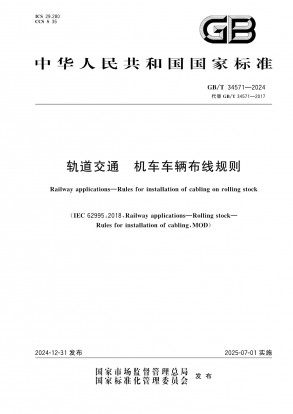

---

id: 429727

title: "有大佬能下载到这篇 人人文库 的标准文档吗？"

created_at: 2025-02-14T05:40:09.736Z

username: xmbbear

display_username: "xmbbear"

---

# 有大佬能下载到这篇 人人文库 的标准文档吗？

### [GB/T 34571-2024轨道交通机车车辆布线规则.pdf](https://www.renrendoc.com/paper/386994720.html)

ICS29280CCSS3.5中 华 人 民 共 和 国 国 家 标 准 GBT345712024 代替 GBT345712017 轨道交通 机车车辆布线规则 RailwayapplicationsR

要积分

---

*来源: https://linux.do/t/topic/429727.json*

