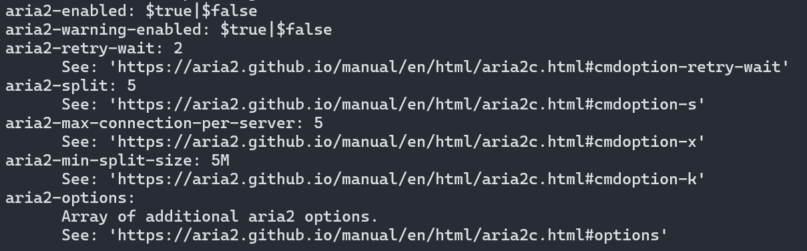

---

id: 434805

title: "win系统下基于 Scoop 的高效软件管理实践"

created_at: 2025-02-17T03:18:59.209Z

username: zreal

display_username: "zreal"

---


# win系统下基于 Scoop 的高效软件管理实践


在 Windows 系统中,软件的安装和管理一直是让人头疼的问题。需要手动下载安装包、点击下一步、自定义安装路径,卸载时还可能残留各种注册表项和临时文件。而在重装系统后,更是要花费大量时间重新安装和配置各种软件。今天给大家介绍一个强大的命令行包管理工具 - Scoop,它不仅能帮助我们实现 Windows 软件的一站式自动化管理,更让系统重装后的软件恢复变得异常简单 - 只需一条命令,所有软件就能重新回来。

## 什么是 Scoop?

Scoop 是一个 Windows 下的命令行包管理工具,类似于 Linux 下的 apt、yum 或 macOS 下的 Homebrew。它可以帮助我们快速安装、更新和卸载软件,所有操作都通过简单的命令完成,无需手动下载安装包或点击向导。最令人惊喜的是,即使重装系统后,只需执行一条 `scoop reset *` 命令,就能让所有已安装的软件重新可用。

## Scoop 的核心优势

1. **便捷的软件管理**


一行命令完成安装/卸载

软件统一管理,避免重复下载

系统重装后一键恢复所有软件

自动处理依赖关系

2. **干净的安装方式**


默认安装到用户目录,不污染系统

**不写入注册表,完全便携化**

卸载干净彻底,不留残留

重装系统时无需重新下载软件包

3. **版本控制能力**


支持多版本共存

轻松切换不同版本

随时回退到之前版本

配置可在多系统间同步

## 快速上手指南

### 1. 安装 Scoop

建议在 PowerShell 中设置环境变量,配置 Scoop 的安装位置，本人使用双系统，所以共用的数据文档等都设置到Z盘:

```
# 设置用户级别的安装路径（推荐）
$env:SCOOP='Z:\Scoop'
[Environment]::SetEnvironmentVariable('SCOOP', $env:SCOOP, 'User')
# 设置全局安装路径（可选，需要管理员权限）
# 用于安装字体等需要管理员权限的软件
$env:SCOOP_GLOBAL='Z:\Scoop'
[Environment]::SetEnvironmentVariable('SCOOP_GLOBAL', $env:SCOOP_GLOBAL, 'Machine')
# 执行安装命令
Set-ExecutionPolicy RemoteSigned -Scope CurrentUser
irm get.scoop.sh | iex
```

> 注意：设置环境变量必须在安装 Scoop 之前完成，这样 Scoop 才会安装到指定位置。如果已经安装了 Scoop，需要重新安装才能更改位置。

### 2. 添加常用软件源

```
# 添加常用 bucket
scoop bucket add extras
scoop bucket add dorado  https://github.com/h404bi/dorado
# 发现该bucket更新很及时
scoop bucket add scoopet https://github.com/ivaquero/scoopet
```

### 3. 常用命令示例

```
# 搜索软件
scoop search firefox
# 安装软件
scoop install git python nodejs
# 更新所有软件
scoop update *
# 卸载软件
scoop uninstall nodejs
# 查看已安装软件
scoop list
# 更新软件库信息及查看apps情况，可以检查版本更新等，两个命令亦可分开执行
scoop update && scoop status
# 查看当前配置情况
scoop config
```

### 重要功能：系统重装后的软件恢复

Scoop 的一个强大功能是能够在系统重装后快速恢复所有已安装的软件。只需要执行一条命令：

```
scoop reset *
```

这条命令会重新注册所有已安装的软件到系统中，让你的新系统立即恢复工作环境。这个功能对于经常重装系统或在多台电脑间同步开发环境的用户来说特别有用。

### 系统工具

| Software Name | Bucket | Description |

| --- | --- | --- |

| age | extras | 文件加密工具 |

| **clink** | main | Windows 命令行增强工具 |

| clink-flex-prompt | main | Clink 的灵活提示符 |

| fzf | main | 命令行模糊查找器 |

| **geekuninstaller** | extras | 卸载工具 |

| oh-my-posh | main | 命令行美化工具 |

| scoop-search | main | Scoop 搜索增强工具 |

| win32yank | main | Windows 剪贴板工具 |

| windows-terminal | extras | Windows 终端 |

| zoxide | main | 命令行目录跳转工具 |

### 网络工具

| Software Name | Bucket | Description |

| --- | --- | --- |

| aliyundrive | aki | 阿里云盘客户端 |

| baidunetdisk | txt | 百度网盘客户端 |

| quarkpan | aki | QuarkPan 网盘客户端 |

| aria2 | main | 命令行下载工具 |

| firefox | extras | 火狐浏览器 |

| mobaxterm | extras | 终端工具 |

| **neatdownloadmanager** | extras | 下载管理器 |

| tabby | extras | 终端工具 Tabby |

| wechat | extras | 微信客户端 |

| wget | main | 命令行下载工具 |

| curl | main | 命令行下载工具 |

| yt-dlp | main | 命令行视频下载工具 |

### 编程工具

| Software Name | Bucket | Description |

| --- | --- | --- |

| **cursor** | aki | 代码编辑器 |

| trae | extras | 代码编辑器 |

| vscode | extras | 代码编辑器 Visual Studio Code |

| **zed-nightly** | versions | 代码编辑器 Zed (Nightly 版本) |

| neovim | main | 代码编辑器 Neovim |

| git | main | 版本控制系统 |

| jq | main | 命令行 JSON 处理工具 |

| lazygit | extras | Git 命令行的图形界面 |

| mingw | main | Minimalist GNU for Windows |

| miniconda3 | extras | conda 的最小安装版本 |

### 文件管理工具

| Software Name | Bucket | Description |

| --- | --- | --- |

| **everything-alpha** | versions | 快速文件搜索工具 |

| fd | main | 命令行文件查找工具 |

| ripgrep | main | 快速文本搜索工具 |

| yazi | main | 命令行文件管理器 |

### 压缩工具

| Software Name | Bucket | Description |

| --- | --- | --- |

| 7zip | main | 文件压缩工具 |

| bandizip | extras | 压缩软件 |

### 文档工具

| Software Name | Bucket | Description |

| --- | --- | --- |

| anki | extras | 记忆卡片软件 |

| **obsidian** | extras | 支持双链的md软件 |

| **zotero** | extras | 文献管理工具 |

| **cherry-studio** | txt | AI对话工具 |

| pandoc | main | 文档转换工具 |

| pandoc-crossref | main | Pandoc 交叉引用过滤器 |

| poppler | main | PDF 渲染库 |

| sumatrapdf-installer | versions | SumatraPDF 阅读器安装包 |

| typst | main | 基于标记的排版系统 |

| zeal | extras | 离线文档浏览器 |

### 媒体工具

| Software Name | Bucket | Description |

| --- | --- | --- |

| imagemagick | main | 图像处理工具 |

| lxmusic | dorado | LXMusic 音乐播放器 |

| **mpv** | extras | 媒体播放器 |

| neteasemusic | dorado | 网易云音乐 |

### 字体

| Software Name | Bucket | Description |

| --- | --- | --- |

| FiraCode-NF-Mono | nerd-fonts | 等宽字体 |

### 其他

| Software Name | Bucket | Description |

| --- | --- | --- |

| steam | versions | 游戏平台 Steam 客户端 |

## 进阶使用技巧

### 1. 批量安装开发环境

可以创建一个配置文件 `dev-env.json`:

```
{
    "apps": [
        "git",
        "nodejs-lts",
        "python",
        "vscode",
        "postman"
    ]
}
```

然后使用以下命令一键安装:

```
scoop import dev-env.json
```

### 2. 软件版本管理

```
# 安装特定版本
scoop install python@3.8.10

# 切换版本
scoop reset python@3.9.7
```

### 3. 配置代理加速

- [BBDXF大佬开发的GUI程序，为方便国内环境安装和维护scoop，bucket, app 的小工具。](https://github.com/BBDXF/ScoopTools)

```
# 配置 HTTP 代理
scoop config proxy 127.0.0.1:7890
# 如果后续不需要代理了，可以移除配置
scoop config rm proxy
# 加速搜索
scoop config use_sqlite_cache true
```

### 4. 增强命令行体验

```
# 安装 clink 增强命令行功能
scoop install clink clink-flex-prompt
clink autorun install
clink set autosuggest.enable true
# install sudo
scoop install sudo #如果要用管理员运行命令,无需用管理员打开cmd(or powershell) 直接在命令前加一个sudo即可
```

### 5. Git 双系统配置

如果你使用两个双系统，可能会遇到 Git 检测到文件所有权不匹配的安全警告。这是因为不同系统的用户 SID (Security Identifier) 不同导致的。使用以下命令可以解决这个问题：

```
# 将 Scoop 目录添加到 Git 安全目录列表
git config --global --add safe.directory Z:/Scoop/*
```

这个配置对于使用双系统的开发者来说非常重要，可以避免频繁的安全警告提示。

## 最佳实践建议

1. **规划安装目录**


建议将 Scoop 安装在较大的磁盘分区,预留足够空间。

2. **定期维护**


使用 `scoop cleanup` 清理旧版本

使用 `scoop update && scoop status` 更新软件库信息并检查更新状态

3. **备份还原**


定期导出已安装软件列表:`scoop export > backup.json `

## 常见错误解决记录

### 运行scoop update出现error: Your local changes to the following files would be overwritten by merge…表明本地Scoop 存储桶（Bucket）的 Git 仓库中存在未提交的修改。

```
cd  Z:\Scoop\buckets\<bucket_name> # 进入每个存储桶的目录
git status # 来查看是否有修改
# 假如是main这个bucket有问题，确保后续三个命令在main目录下执行
# 1. 获取所有远程分支的最新信息
git fetch --all
# 2. 强制将本地 master 分支重置为远程 origin/master 的状态
git reset --hard origin/master
# 3. 清理掉所有未被 Git 跟踪的文件和目录
#    -f 表示强制执行, -d 表示包括目录, -x 表示包括被 .gitignore 忽略的文件
#    这会删除上面 git status 列出的 "Untracked files"
git clean -fdx
```

### ERROR Hash check failed!

一般是下载不完整

```
# 以cherry-studio为例
scoop cache rm cherry-studio;
scoop uninstall cherry-studio;
scoop install cherry-studio
```

### 下载错误

```
# 排除网络原因，一般都是aria2引起，可以先设置禁用异步DNS查询
scoop config aria2-options "--async-dns=false"
# 还是不行，直接禁用
scoop config aria2-enabled false
# scoop 可以配置很多aria2选项
scoop config /?|findstr "aria2"
```



创建自定义 Scoop bucket 并添加应用，主要包含以下几个步骤：

1. **使用 BucketTemplate 创建 Bucket 模版**

为了快速搭建 Bucket 仓库的基础结构，Scoop 官方提供了 [BucketTemplate](https://www.google.com/url?sa=E&source=gmail&q=https://github.com/ScoopInstaller/BucketTemplate) 仓库作为模版。


访问 [ScoopInstaller/BucketTemplate](https://www.google.com/url?sa=E&source=gmail&q=https://github.com/ScoopInstaller/BucketTemplate)  仓库。

点击 “Use this template” 按钮，选择 “Create a new repository”，即可基于此模版创建你自己的 Bucket 仓库。

2. **配置 Bucket 仓库**

创建仓库后，为了确保 Bucket 的正常运作，建议进行以下配置：


**允许 GitHub Actions:**  GitHub Actions 用于自动化 Bucket 的更新和维护。进入你新创建仓库的 “Settings” -> “Actions” -> “General” -> “Actions permissions”，选择 “Allow all actions and reusable workflows” 以启用 GitHub Actions。

**添加 scoop-bucket 主题 (可选):**  如果你希望你的 Bucket 能够被 [scoop.sh](https://www.google.com/url?sa=E&source=gmail&q=https://scoop.sh) 索引和收录，可以在你的仓库设置中添加 `scoop-bucket`  topic。这有助于其他用户发现和使用你的 Bucket。

3. **创建应用 Manifest 文件**

Bucket 的核心是应用 manifest 文件，它描述了应用的安装信息。


在本地仓库的 `bucket` 文件夹中，找到 `bucket/app-name.json.template` 文件。

复制 `bucket/app-name.json.template` 文件，并将其重命名为你应用的 manifest 文件，例如 `bucket/my-app.json`。文件名即为应用的名称 (`app-name`)。

编辑 `bucket/my-app.json` 文件，根据你的应用信息修改内容。

4. **提交和推送更改**

完成 manifest 文件编辑后，将其提交到 Git 仓库并推送，使更改生效。

5. **添加你的自定义 Bucket 到 Scoop**

要让 Scoop 能够使用你的自定义 Bucket，需要在本地 Scoop 环境中添加该 Bucket。


打开 PowerShell 或 CMD 终端。


运行以下命令，将你的自定义 Bucket 添加到 Scoop：

`scoop bucket add <你的bucket名称> <你的bucket仓库的git地址> `

例如，如果你的 Bucket 仓库地址为 `https://github.com/<你的用户名>/my-bucket`，并希望 Bucket 名称为 `my-bucket`，则命令如下：

`scoop bucket add my-bucket https://github.com/<你的用户名>/my-bucket `

6. **安装自定义 Bucket 中的应用**

Bucket 添加成功后，即可安装你自定义 Bucket 中的应用。


使用以下命令安装你自定义 Bucket 中的应用：

`scoop install <你的bucket名称>/<应用名称> `

例如，要安装 `my-bucket` Bucket 中的 `my-app` 应用，命令如下：

`scoop install my-bucket/my-app `

## `my-app.json` 必填信息详解

`my-app.json` 文件是 Scoop bucket 中用于描述应用安装信息的 manifest 文件，采用 JSON 格式。以下详细描述了 `my-app.json` 文件中 **必填** 的具体信息：

```
{
  "version": "1.0.0",  // 必填: 应用的版本号，例如 "1.0.0" 或 "2024.02.16"，遵循语义化版本控制
  "architecture": {   // 必填: 定义不同架构下的下载信息
    "64bit": {      // 必填: 64位架构配置 (即使只有64位版本也必须包含)
      "url": "https://example.com/myapp-x64-1.0.0.zip", // 必填: 64位版本的下载链接，必须是直接下载地址
      "hash": "sha256:abcdef1234567890abcdef1234567890abcdef1234567890abcdef1234567890" // 必填: 64位版本下载文件的 SHA256 哈希值，用于校验文件完整性
    },
    // "32bit": {     // 可选: 32位架构配置，如果应用提供32位版本则添加
    //   "url": "https://example.com/myapp-x86-1.0.0.zip",  // 32位版本的下载链接
    //   "hash": "sha256:0987654321fedcba0987654321fedcba0987654321fedcba0987654321fedcba" // 32位版本下载文件的 SHA256 哈希值
    // }
  },
  "bin": "myapp.exe", // 必填: 应用的主可执行文件名，Scoop 将添加到 PATH 环境变量，如果多个可执行文件，可以使用数组 ["myapp.exe", "myapp-cli.exe"]
  "shortcuts": [      // 必填: 定义需要在开始菜单或桌面创建的快捷方式
    ["My App", "myapp.exe"]  // ["快捷方式名称", "目标可执行文件"]，目标可执行文件相对于安装目录的 bin 文件夹
    // , ["My App CLI", "myapp-cli.exe"] // 可以添加多个快捷方式
  ]
}
```

- **version**:  应用的当前版本号。必须是有效的版本号，用于 Scoop 跟踪版本更新。

- **architecture**: 定义不同系统架构下的应用下载链接和哈希值。


**64bit**:  **必填**，即使应用只有 64 位版本也必须包含。


**url**: 64 位版本的直接下载链接，通常指向 ZIP 或 7z 压缩包。

**hash**: 64 位版本下载文件的哈希值（推荐使用 `sha256` 算法），用于验证文件完整性。


**32bit**: **可选**，如果应用提供 32 位版本，则添加此字段，包含 `url` 和 `hash` 子字段。

- **bin**:  定义应用的可执行文件，Scoop 会将其添加到系统 PATH 环境变量，方便用户直接在命令行中运行。


如果只有一个可执行文件，直接使用字符串类型，例如 `"myapp.exe"`。

如果有多个可执行文件需要添加到 PATH，使用字符串数组，例如 `["myapp.exe", "myapp-cli.exe"]`。

- **shortcuts**:  定义需要在开始菜单或桌面创建的快捷方式，方便用户在图形界面启动应用。


使用数组定义快捷方式，每个快捷方式为一个包含两个字符串的数组 `["快捷方式名称", "目标可执行文件"]`。

`"快捷方式名称"`: 用户看到的快捷方式名称。

`"目标可执行文件"`: 快捷方式指向的可执行文件名 (相对于应用安装目录 `bin` 文件夹)。

**请务必注意:**

- **哈希值 (hash)** 的正确性至关重要，请确保使用正确的哈希算法计算并填写，以保障安装包的安全性。

- **文件路径 (bin, shortcuts 中的目标文件)** 均是相对于应用安装目录下的 `bin` 文件夹。

除了上述必填字段，`my-app.json` 还支持许多可选字段，用于更详细地描述应用信息和安装行为。下面这两个字段是实现“绿色化”的关键设置

1. **$persistPath**:


这个变量代表了**该软件的持久化数据根目录**。

Scoop 有一个 “persistence”（持久化）机制，允许某些文件或目录在软件更新甚至卸载重装后仍然保留。这些需要保留的数据通常存放在 Scoop 主目录下的 `persist` 文件夹中，并按软件名称组织。

所以，`$persistPath` 通常指向 `~\scoop\persist\<软件名>` 这个路径 (其中 `~` 代表你的用户主目录, `<软件名>` 是该软件在 Scoop 中的名称)。

当你在 manifest 的 `persist` 数组中指定了某个目录或文件时，Scoop 会在安装或更新时确保这个目录/文件链接或存在于 `$persistPath` 下对应的位置，并且在软件的实际安装目录 (`~\scoop\apps\<软件名>\current`) 中创建一个指向它的链接（junction 或 symlink），使得软件能够访问到这些持久化的数据。

2. **$appDataPath**:


这个变量代表了**应用程序预期存放其用户特定数据（如配置、设置、缓存等）的路径**。

在标准的 Windows 环境中，这通常对应于系统的 `AppData` 目录（例如 `C:\Users\<用户名>\AppData\Roaming\<软件名>` 或 `C:\Users\<用户名>\AppData\Local\<软件名>`）。

然而，为了实现软件的“绿色”或“便携”特性，并配合 Scoop 的持久化机制，Scoop **常常会将这个路径重定向**。

在很多 Scoop 的 manifest 配置中，`$appDataPath` **实际上会被设置为 $persistPath 下的一个子目录**，比如 `$persistPath\data` 或直接就是 `$persistPath` 本身。这样做是为了确保那些本应写入系统 `AppData` 的用户数据能够被 Scoop 的持久化机制管理，从而在软件更新后得以保留。

**关键点**：`$appDataPath` 在 Scoop 的语境下，不一定是指向系统标准的 `AppData` 目录，而是指向 Scoop 为该应用管理用户数据所指定的目录，这个目录通常是为了实现数据持久化而设置在 `$persistPath` 内部的。

其他配置你可以参考 [Scoop Wiki - Manifest Spec](https://www.google.com/search?q=https://github.com/ScoopInstaller/Scoop/wiki/Manifest-Spec)  获取更全面的信息。


---


*来源: https://linux.do/t/topic/434805.json*

