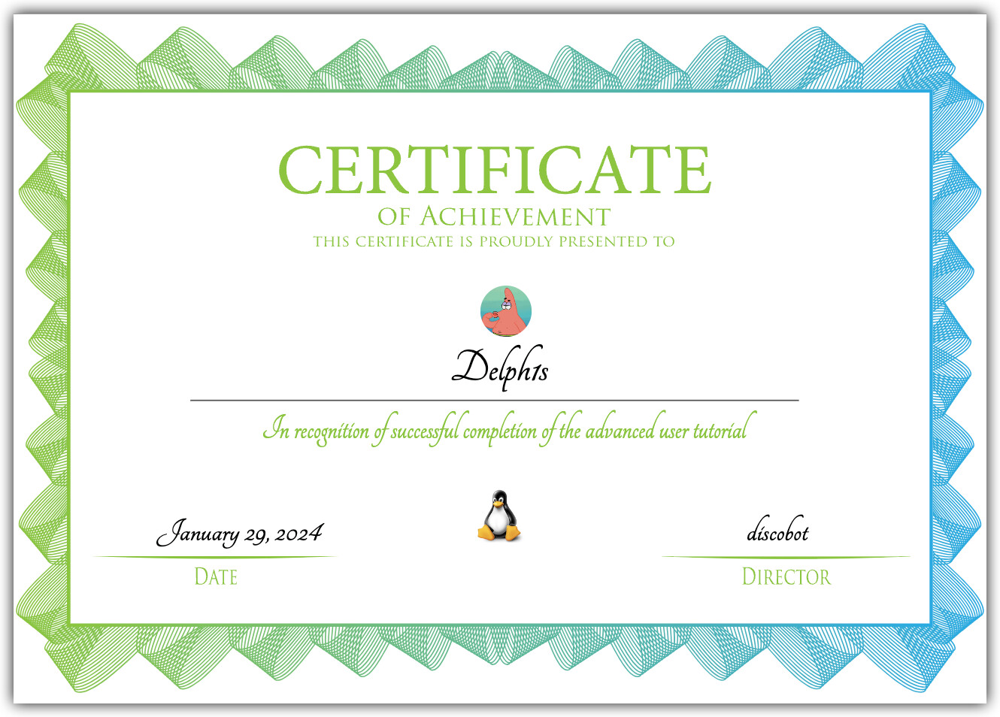
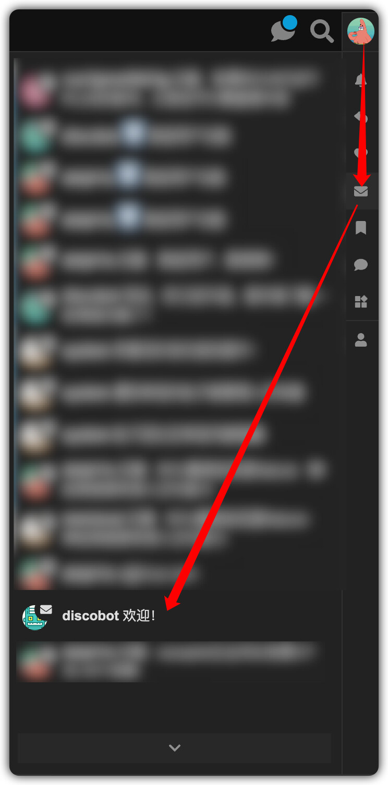
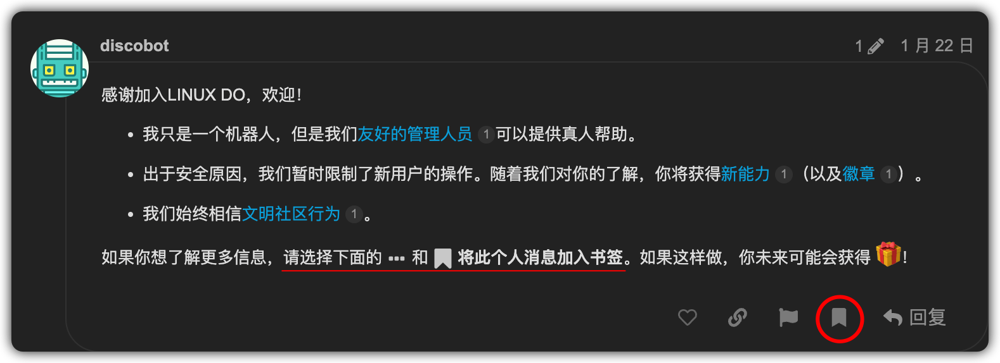
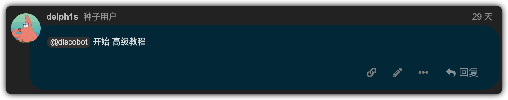
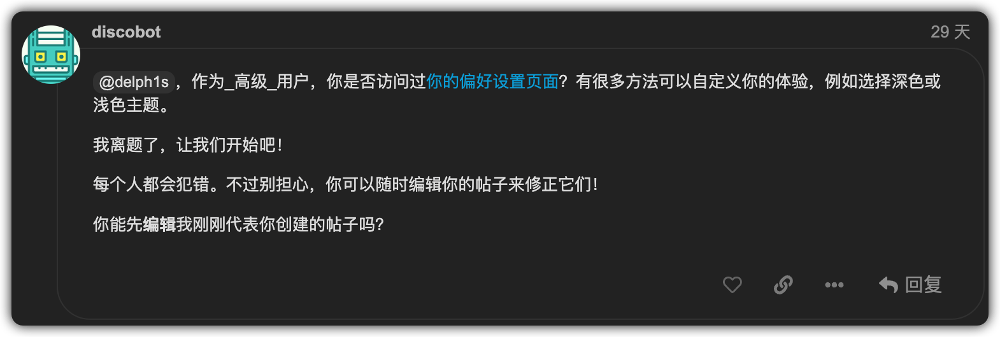

---

id: 4400

title: "【论坛功能】已认证和已授权徽章获取方法"

created_at: 2024-01-29T07:53:59.392Z

username: delph1s

display_username: "威震天"

---

# 【论坛功能】已认证和已授权徽章获取方法

# 如果你们和我一样，都是高级用户，那我觉得这件事真是，泰裤辣！

## 如何获得证书？

### 初级证书

首先你可以打开私信，里面有一封 `discobot` 发给你的 `greeting` 或 `欢迎`

初级用户第一个任务是点开 “…” 然后将 `discobot` 的第一条对话加入书签

然后仔细审题，一步步做就可以拿到证书（PS：可以回复“跳过”，从而跳过某一步，因为论坛限制不能连续回复相似内容，所以不能连续跳过，请在最难的问题那里选择跳过）。

> Q: 在私信中没有发现 `greeting` 或 `欢迎` 私信？

>

> A: 你可以在任何地方回复 `@discobot 开始 教程`（注意空格别漏了！）

### 高级证书

在任何地方回复 `@discobot 开始 高级教程` （注意空格别漏了！）

这里我们直接在原对话回复

然后开始高级用户的第一个问题

然后仔细审题，一步步做就可以拿到高级证书（PS：可以回复“跳过”，从而跳过某一步，因为论坛限制不能连续回复相似内容，所以不能连续跳过，请在最难的问题那里选择跳过）。

---

*来源: https://linux.do/t/topic/4400.json*

