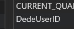
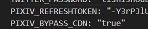

---

id: 447151

title: "rsshub 參數細節"

created_at: 2025-02-23T09:45:52.304Z

username: joegodwanggod

display_username: "善解人意屬實有點害羞"

---

# rsshub 參數細節

> 主要討論並記錄一些細項 用於補充 [配置 | RSSHub](https://docs.rsshub.app/zh/deploy/config#pixiv)

>

> 爲本文做出貢獻者，可以私信我領取 google & gork 10刀(我部屬的newapi)

前言 : 透過論壇ai 結果找到自己的文章

**joegodwanggod:**

幫我找看看有沒有關於rsshub 的帖子 呃，這個帖子內容要是去詳盡的描述，說它每個參數要怎麼設置

**gpt-4o-mini:**

我來幫您搜尋關於 RSSHub 的詳細配置相關帖子。

找到 'rsshub config setup status:public' 的 51 个[结果](/search?q=rsshub+config+setup+status%3Apublic)

让我搜尋看看關於 rsshub 設定和參數的討論。我會查看搜尋結果並從中找出最相關的內容。

在搜尋結果中,雖然有一些提到 rsshub,但大多是一般性的討論。讓我調整搜尋關鍵字再試一次:

找到 'rsshub parameter deploy status:public' 的 51 个[结果](/search?q=rsshub+parameter+deploy+status%3Apublic)

我找到了几個主題帖子提到 RSSHub 的使用：

1. 建一個 RSSHub [相關討論串](https://linux.do/t/topic/421164/1)，裡面提到一些部署后的經驗,比如訂閱上限和多帳號的解決方法。

2. 但要找更详细的安装配置说明,建议看官方文档: [RSSHub官方文档](https://docs.rsshub.app/)。主要涉及：

- 安装部署:支持 Docker、npm、手動等安装方式

- 路由參數:每個源的具體參數配置

- 通过环境变量配置:

`CACHE_TYPE`: 缓存类型，如 memory、redis 等

`PORT`: 监听端口

`PROXY_PROTOCOL`: 代理设置

`ACCESS_KEY`: 访问密钥

- 路由扩展:如何添加自定义源

- 更新日志

1. 一些实践经验:

- 建议用 Docker 部署,更简单稳定

- 根据需求设置缓存减轻服务器负担

- 考虑添加 access key 控制访问

- 需要代理时配置 proxy 参数

如果需要更具体的参数设置和配置说明,可以参考官方文档相應章節。你有什么具体的配置问题需要了解吗?

| 平台 | 状态 | 备注 |

| --- | --- | --- |

| Pixiv | ✅ | 开启R18才能爬取完整内容 |

| Instagram | ❌ | 期待大佬出手 |

| Twitter (X) | ✅ |  |

| Discord (DC) | ✅ |  |

| 哔哩哔哩 (B站) | ✅ |  |

| YouTube | ✅ |  |

| N網 | ✅ |  |

- bilibil

BILIBILI_COOKIE_{id}: “整個cookie”

下方圖片對應值替換 {id}

- dc

get dc token

[image1047×794 78.5 KB](https://cdn3.ldstatic.com/original/4X/c/7/c/c7c9e8aec0feaaf83a62efac55fcf7b7122d4b8d.png)

- pivix

开启R18才能爬取完整内容

# 其他疑難雜症

- 單獨 restart rsshub會導致 nginx 無法接觸到rsshub

- ig 帳密與cookie拚盡全力無法取勝

---

*来源: https://linux.do/t/topic/447151.json*

