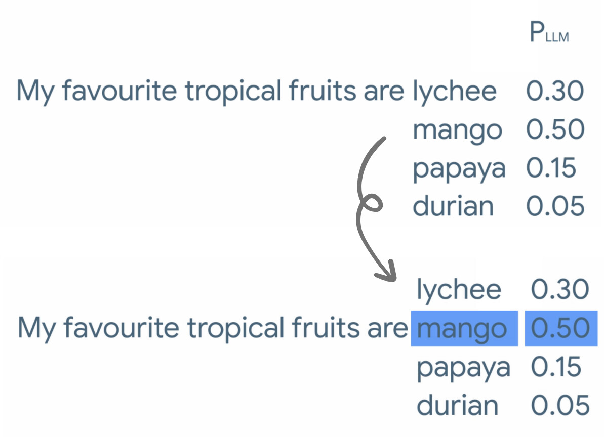
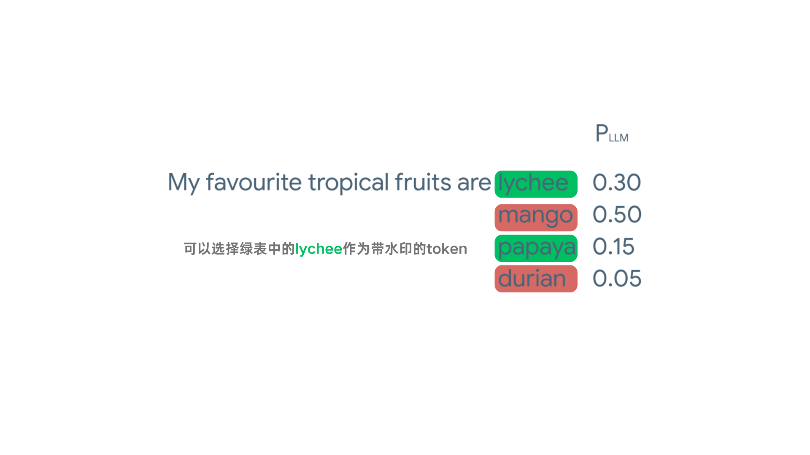
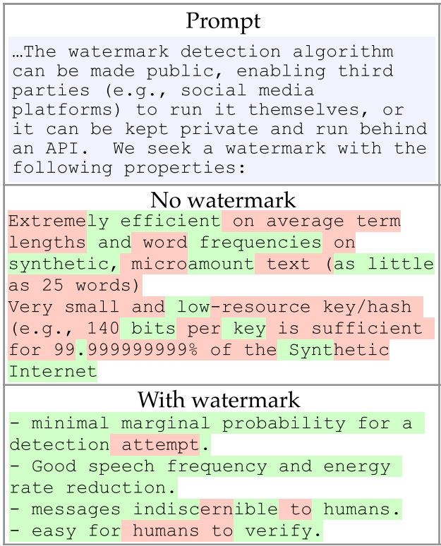
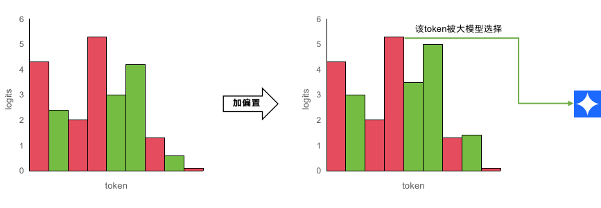

---

id: 448203

title: "【大模型生成文本水印科普】水印就是把Tokens涂成绿色？"

created_at: 2025-02-24T03:26:11.670Z

username: askylin

display_username: "askylin"

---

# 【大模型生成文本水印科普】水印就是把Tokens涂成绿色？

> 自从上次科普后竟然忙到现在才有空闲来进行新的科普（研究牲过年都在干活，55555）。话不多说，这次直接进入以论文为主体的科普，通过具体的水印方案带佬友们进一步了解大模型生成文本水印的主要思想。如果是第一次阅读到该科普的佬友，欢迎移步到[【大模型生成文本水印科普】你悄悄用大模型完成的作业真的不会被发现吗？（补充）](https://linux.do/t/topic/351929) 去简单了解大模型生成文本水印是什么。

那么在正式开始论文科普之前，为了方便佬友们回顾理解，我们还是先回顾一下大模型是如何生成文本的：

> 首先，需要补充一个很简单的前置知识：大模型在生成一段文本时，是一个token一个token的生成的，每个token都是从一个词汇表中选择的。为了便于理解，大家可以简单的把token看作一个单词（虽然这是不准确的），词汇表就是大语言模型自己的词典，它生成的所有单词都来自这个词典。那么更进一步，大模型是如何选择单词的呢？我们到大模型生成文本的过程中来，给定一个的prompt，大模型开始生成文本。假设现在生成了t-1个单词的文本，那么接下来大模型需要生成第t个单词，此时大模型根据prompt和前面的生成t-1个单词的内容，去从词汇表中选择合适的单词作为第t个单词，那么这一过程中，**大模型会为词汇表中的单词分配其对应的logits，logits可以简单的理解为大模型对单词的打分，分越高的单词说明越适合被选择作为第t个单词。如果将这些logits归一化，那就能够得到单词的概率分布，每个单词有一个自己的被选中的概率，越合适的单词，选中的概率越大。** 然后大模型再使用合适的采样方法，选择出最终的第t个单词。如此往复，大模型就生成了整个文本。下图展示了生成一个token的示例：

> 

OK，有了上述前置知识后，我们正式开始此次的论文科普。论文名称：《 A Watermark for Large Language Models》，论文全文下载：[A Watermark for Large Language Models](https://proceedings.mlr.press/v202/kirchenbauer23a/kirchenbauer23a.pdf)。这篇论文在2023年首次发布在arXiv，可以算作大模型生成文本水印的开创性的文章，迅速引起了研究者对这个新的水印思路的关注，后续水印方案或多或少都是基于这篇论文的思想去深入研究的。因此我这次就以尽可能简单的方式为佬友介绍这篇论文的思路。

经典的方案的思想总是简洁但有效的，这篇论文的思想也是如此：**在每个token生成时，将词汇表划分为红色token区域（称为红表）和绿色token区域（称为绿表），只选择绿表中的token用于生成文本。** 这样就为生成文本嵌入了水印。这里给两个具体的图例便于大家理解：

第一个图表明了**带水印的单个token的生成方式**，第二个图展示了大模型不使用和使用该思路生成的文本之间的差异：**带水印的方案生成的文本中绿token更多，而不带水印的生成文本红token和绿token的数量相近。**

现在我们掌握了该方案的总体思路，那么更进一步的，在每个token生成时，应该把当前的词汇表中的哪些token涂成绿色（划分到绿表），哪些token又该涂成红色（划分到红表）呢？如何保证token的颜色只有我自己知道，我自己能验证，而其他人无法知道呢？

论文的思路就是：在生成第t个token时，对前一个（即第t-1）已经生成的token利用自己的密钥进行哈希（可以理解为把这个token变成一个数，不同token对应不同的数），作为一个随机生成器的随机种子（可以理解为随机种子能够让随机生成器以固定的模式生成随机数，比如第一次水印时一个种子为12.232的随机生成器生成了0.1, 0.34,0.57这些随机数，在水印后续检测时，以同样的随机种子的生成器也同样会按顺序生成0.1, 0.34,0.57这些随机数，无论运行多少次，该模式都是固定的），这样随机生成器生成0-1之间的实数，根据这个数将当前的词汇表划分为相等的两部分。比如随机数生成器生成了0.57，那么找到这个词汇表中词汇表第**token数x0.57**的token，该token前面的一半数量的token可以划分为绿表，后一半（不足的就从开头的token补，把词汇表中的token顺序理解成一个闭环）token划分为红表。这样，只有持有密钥的人才能进行这个过程，因此保证了token的颜色（水印）只对持有密钥的人可见。

那么在水印检测时，给定一个句子，就使用上述同样的方法，去计算token是红的还是绿的，统计绿token的数量，**当绿token的数量很多的时候，就说明文本带有水印，可以证明文本是大模型生成的。** 具体的量化则是通过z检验测试实现的，感兴趣的佬友可以进一步看论文理解。

这个方案被称之为”硬红绿表“水印。为什么有个”硬“字呢？这是因为这种方法强行让大模型只选择绿表中的token，不去选择红表的，是一种强硬的做法。那这就会带来一些问题：**硬红表规则以一种简单的方式处理低熵（即不太能变化的，或者是固定的组合的文本）序列，它阻止了语言模型产生它们。例如，在许多文本数据集中，标记“巴拉克”后面几乎肯定跟着“奥巴马”，但“奥巴马”可能在生成过程中被划分到红表，而不被允许用于生成。** 这就会导致文本的生成质量严重下降。

这里再补充一下文本的熵的概念：**一个文本的内容的不确定程度（就比如“She is happy and wanna go out to play sports”的熵就比“L站的站长是Neo”的熵更高，因为后者更倾向于答案，答案是固定的，熵就低）**，如果对低熵文本进行上述水印，那就可能出现”L站的站长是bbb“的情况。 

为了缓解水印给低熵文本质量带来的损伤，论文进一步提出了”软红绿表“水印。该方法的思路是：设定一个绿表占比值γ（即绿表在整个词汇表中的占比），利用上述思路划分红绿表后，**对绿表中的token的logits添加正向的偏置，然后在让大模型选择（这里就不是只能从绿表中选择了）。** 这样就增大了大模型选择绿表中token的概率，使得生成的文本中绿token偏多，同时能够保证本来就有较大logit的token（基本大模型就选择这个token）不会因为划分到红表而不被选择。

水印的检测也与硬红绿表水印方案相同，验证文本中绿token出现的是否足够多来判断是否有水印。

以上就是这篇论文所提出的水印思路。主要的思想就是对词汇表进行划分，以及对logits的修改（软红绿表水印）。我们称这种水印为失真水印，因为水印会导致文本的质量产生失真。那么除了失真这个问题外，这种方案因为失真，会导致文本的困惑度上升（意味着人类更难理解），甚至还可能导致水印被有心者发现，进而破坏的可能。

那么这个方案对可能受到的攻击的抵抗能力如何呢？

首先如果人类对水印文本进行释义，那是能比较有效的破坏水印的。但如果在较长的文本片段(如文章)中，一些部分或完全没有释义的句子就足以在触发水印检测。

此外，攻击者还可能对文本中某几个词进行修改、删除、替换等操作，来影响哈希的计算，但这个影响是有限的，只要文本较长，就能检测到水印

一个强力的攻击是在prompt中让模型生成时加入特定的字符或者将某个字母替换为其他字母，然后生成结束后将特定字符去除或者将字母还原，以此来破坏水印。这是一个很严重的攻击，单靠生成水印方案很难解决。但与此同时，这类攻击这增加了文本生成的成本，因为需要生成比通常更多的令牌，并减少了有效的上下文宽度。针对这些攻击的防御是在finetuning期间包含此类提示的负面示例，训练模型以拒绝这些请求。

除了攻击外，方案在低熵文本中可能存在误报的可能。如果一个低熵token恰好分在了绿表，同时这个token在文本中出现的次数又非常多，这就会导致文本被错误的判断为水印文本。

以上就是这次科普的全部内容，可以看到这个水印思路非常简单且具有开创性但依旧存在着许多问题需要解决。但不管怎么说，这篇文章为大模型生成水印带来了全新的有效的思路，为后面水印的发展打下了基础。打字不易，还希望佬友们有所收获！（ps: 学业繁忙，写科普文的时间确实偏少，往佬友们理解）

---

*来源: https://linux.do/t/topic/448203.json*

