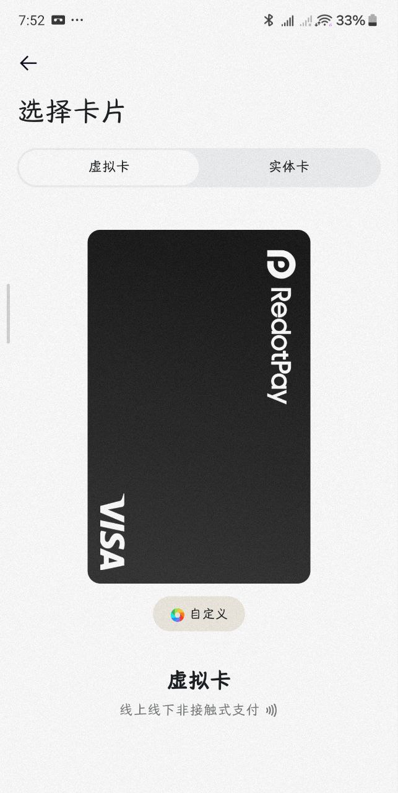
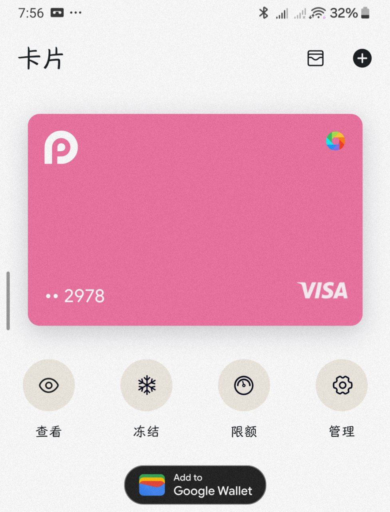

---

id: 464945

title: "关于如何使用小红卡（有借鉴）"

created_at: 2025-03-01T11:58:21.732Z

username: Alaric_Merrick

display_username: "Alaric Merrick"

---

# 关于如何使用小红卡（有借鉴）

有人问我怎么使用小红卡，我就写个教程吧

首先我先介绍一下小红卡

第一：小红卡没有充值手续费、没有月费、没有年费、不动管理费；这个是不是很正常？恰恰是其他各家都有不同明目的费用，显得小红卡不正常。

第二：小红卡不需要2次充值，什么意思呢？就是大部分U卡，把U充值到平台以后，还需要再次充值到卡里，小红卡是没有这一步的，消费直接扣币，不消费，币就是币，随时可以提现。这样对体验的影响，大家可以自行感受。尤其是二次充值还有额外费用，以及卡片的余额无法退回的时候，你会知道为什么小红卡这样做会再次显得与众不同。我个人感觉，就是其他平台可能没有太多的沉淀资金跟卡组织实时结算，所以需要用户二次充值固定成自己的资金池。而小红卡有充足的自有资金池跟卡组织结算（要知道，小红卡的单笔交易上限是10万U），所以能够做到实时的消费扣币。

第三：就是小红卡的APP体验和审美。真的不输大厂作品，除了丝滑还是丝滑。尤其是在和其他友商对比之后，优劣立现。

Web3 支付解决方案提供商 RedotPay 与 Matrixport 旗下托管业务 Cactus Custody 达成战略合作，旨在提升托管服务的合规性和安全性。此次合作确保 RedotPay 用户的数字资产将由 Cactus Custody 提供的独立钱包安全托管，并享有高达 5000 万美元的保险保障  [https://foresight-news.com/news/detail/33396](https://foresight-news.com/news/detail/33396)

![photo_2025-03-01_19-53-26|251x500]

这个怎么使用呢首先进入开卡，这个再开卡前是不能换绑的，换绑再开卡会出人脸，先开再换绑就没有事情

---

*来源: https://linux.do/t/topic/464945.json*

