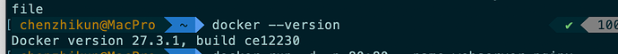

---

id: 469643

title: "写给前端,项目如何用Docker部署?"

created_at: 2025-03-04T01:45:14.113Z

username: czk

display_username: "chen"

---


# 写给前端,项目如何用Docker部署?


## 写在前面，文章为自己学习记录，如果对各位佬友能有帮助更好了

### Docker对比传统虚拟机

| 特性 | 容器 | 虚拟 |

| --- | --- | --- |

| 启动 | 秒级 | 分钟级 |

| 硬盘使用 | 一般为 `MB` | 一般为 `GB` |

| 性能 | 接近原生 | 弱于 |

| 系统支持量 | 单机支持上千个容器 | 一般几十个 |

> [Docker](https://www.docker.com/) 是个划时代的开源项目，它彻底释放了计算虚拟化的威力，极大提高了应用的维护效率，降低了云计算应用开发的成本！使用 Docker，可以让应用的部署、测试和分发都变得前所未有的高效和轻松！

>

> 无论是应用开发者、运维人员、还是其他信息技术从业人员，都有必要认识和掌握 Docker，节约有限的生命。

文章的主旨通过让开发者通过将一个vue项目进行Docker化,以达到对Docker学习作用,主要流程如下

- 打包手头的一个Vue项目，生成的`dist文件夹`,编写`Dockerfile`文件 通过docker打包生成一个`前端镜像`，然后通过这个`前端镜像`实例化启动一个`前端容器` 实现前端项目部署

- 配置后端环境,或者启动一个`node服务`，实现简单接口。也通过docker打包生成一个`node服务镜像`，运行一个`nodeserver容器`，提供后端接口 实现后端服务部署

- 通过`nginx`代理，让前端接口的请求转发到`nodeserver容器`上 实现`nginx代理转发`

## 1. Docker是什么?为什么要用?

### Docker基本概念

上面说了一堆流程,最开始者要先理解docker的三个基本概念

- **镜像（Image）：** Docker 镜像是一个只读的模板，用来创建容器,简单来说就是为`容器`运行提供需要的程序、资源、配置等, 他在构建成功后就不会变化,只用于启动容器

- **容器（Container）：** 容器是镜像的运行实例，可以被启动、停止、删除 ,一个Docker镜像可以例化出来多个容器，每个容器之间是独立的。Docker的容器是用来`运行程序的,`可以理解为Docker的容器就是一个操作系统，目的是运行我们写的程序。

- **仓库（Repository）：** 用来存储和分发 Docker 镜像的地方 [Dockerhub](https://hub.docker.com/) 有点类似于github用户可以在上面托管镜像

核心概念就是，通过**Dockerfile**生成`镜像`**或者从Dockerhub**中获取镜像 然后去创建`容器`,最后让`程序跑在容器上`。

理解了这三个概念，就理解了 **Docker** 的整个生命周期

### 为什么要使用Docker

- **环境一致性:**  避免发生在我的电脑上能运行,别人的电脑上用不了的问题，确保开发、测试和生产环境的一致性

- **版本隔离：** 在同一台服务器上运行不同版本的应用（如不同版本的Node.js），避免项目报错

- **服务迁移：** 容器化后的应用可以轻松地在不同服务器间迁移，无需担心环境差异

- **标准化交付：** 提供了一个标准的软件交付方式，减少了人为部署错误

使用Docker不仅能解决传统部署中的环境依赖问题，还能大大提高开发和部署效率。如果你管理多个项目，Docker能显著简化维护工作，你总不想因为不同的环境,不同的依赖导致问题而苦恼吧.

对于前端开发的日常来说,基本用不到容器化, 基本的部署也是打个dist包给运维(后端)让他们部署

**前端开发不懂容器化很正常，但是至少要让自己了解它。**

## 2. 环境搭建

### Docker 安装

docker 分为 `stable` `test` 和 `nightly` 三个更新频道。官方网站上有各种环境下的 [安装指南](https://docs.docker.com/get-docker/)，

根据操作系统选择安装方式：

- Linux 安装

`# Ubuntu sudo apt-get update sudo apt-get install docker-ce  # CentOS sudo yum install docker-ce `

- Windows/Mac 安装

下载并安装 [Docker Desktop](https://www.docker.com/get-started/)。

安装完成后执行`docker --version`验证是否成功




如果 `docker version`、`docker info` 都正常的话，可以尝试运行一下 [Nginx 服务器](https://hub.docker.com/_/nginx/)：

```
docker run -d -p 80:80 --name webserver nginx`
```

[image2_hmdjry_.png1188×404 104 KB](https://cdn3.ldstatic.com/original/4X/f/e/7/fe75487492153363ebc8a8373307318948903606.png)

服务运行后，可以访问 [http://localhost](http://localhost)，如果看到了 “Welcome to nginx!”，就说明基础环境都配置成功了。

[docker1_rq5jpm_.png1276×444 40.2 KB](https://cdn3.ldstatic.com/original/4X/d/9/6/d9618f220105ca90dd43eccc45ddc4bf57b40600.png)

---

可以通过命令行或者通过Docker Desktop停止 Nginx 服务器并删除执：

```
docker stop webserver
docker rm webserver
```

[image3_tennup_.png1596×732 43.8 KB](https://cdn3.ldstatic.com/original/4X/b/7/f/b7f48d463e1d4e75f3715b262c3b0eb2e718887c.png)

如果在使用过程中发现拉取 Docker 镜像十分缓慢，可以在 Docker Desktop 配置国内镜像加速。

```
"registry-mirrors":[
    "https://docker.1ms.run",
    "https://docker.1panel.dev",
]
```

[image4_zg2yvv_.png2506×1410 275 KB](https://cdn3.ldstatic.com/original/4X/6/c/b/6cb831807582ed4fa21077e62420e9f1163d5586.png)

## 3. 将项目容器化

### 3.1 构建镜像前准备

首先明确2个概念

- docker 中容器(**Container**)像一个虚拟机，容器中运行着一个完整的操作系统。可以在容器中装 Nodejs,mySql等,可以在命令行中执行相对应的操作

- 镜像(**Image**)是一个文件，它是用来创建容器的。他通过执行Dockerfile文件而来

在项目根目录下建立3个文件, 分别为

- `dockerfile` 用于配置docker构建信息

[dockerfile逻辑-2025-03-25-20561360×491 30 KB](https://cdn3.ldstatic.com/original/4X/5/6/5/565aaa1cf9a4bc4e74d2f66529ee594ae8377052.png)

```
# 使用 Node.js 16 作为基础镜像
FROM node:16.14.2

# 将当前工作目录设置为/app
WORKDIR /app

# 将 package.json 和 package-lock.json 复制到 /app 目录下
COPY package*.json ./

# 运行 npm install 安装依赖
RUN yarn install

# 将源代码复制到 /app 目录下
COPY . .

# 打包构建
RUN npm run build

# 将构建后的代码复制到 nginx 镜像中
FROM nginx:latest
COPY --from=0 /app/dist /usr/share/nginx/html

# 复制自定义的Nginx配置到镜像中，覆盖默认配置
COPY nginx/default.conf /etc/nginx/conf.d/default.conf

EXPOSE 80

# 启动 nginx 服务
CMD ["nginx", "-g", "daemon off;"]
```

只有 `RUN`, `COPY`, `ADD` 会创建层数, 其它指令不会增加镜像的体积

如果是构建过程中npm因为网络原因,安装依赖失败可以考虑使用 npm镜像地址或者使用cnpm

```
# 运行 npm install 安装cnpm 再通过cnpm安装依赖
RUN npm -g --cache=none --registry https://registry.npmmirror.com \
 && cnpm install
```

- `dockerignore` 与`.gitignore` 语法一致。使用它排除构建无关的文件及目录，如 `node_modules`

```
.DS_Store
node_modules
/dist

# local env files
.env.local
.env.*.local

# Log files
npm-debug.log*
yarn-debug.log*
yarn-error.log*
pnpm-debug.log*

# Editor directories and files
.idea
.vscode
*.suo
*.ntvs*
*.njsproj
*.sln
*.sw?
dist.zip
```

- `nginx/default.conf` 用于自定义配置ngnix配置

```
server {
    listen 80;   # 端口号是80
    server_name localhost;

    location / {
        root   /usr/share/nginx/html;  # nginx 默认会从这个路径下加载网页，这是 nginx 默认的网页根目录
        index  index.html index.htm;
    }

    error_page  404              /404.html;  # 错误404处理
    error_page  500 502 503 504  /50x.html;  # 错误5XX处理

    location = /50x.html {
        root   /usr/share/nginx/html;
    }
}
```

### 3.2 通过使用docker build命令构建前端镜像

编写完成3个文件后就可以开始构建了,执行下列命令

```
docker build -t gyljr-admin:v1 .
```

这里的`docker build -t` 后面第一个参数为我自定义的项目名,你也可以随便取一个,第二个:v1则代表构建的tag 如果通过这个来区分不同版本构建.最后的.号代表上下文路径，`docker` 会在这个路径下寻找 `dockerfile` 及其他文件，根据 `dockerfile` 配置打镜像。

[image5_s0o6qm_.png1392×432 392 KB](https://cdn3.ldstatic.com/original/4X/c/5/6/c56d368180d025c786f7b3b9125fbc95f283d912.png)

如果成功打出了镜像,可以在本地运行一下这个镜像进行验证

通过`docker run -d -p 3000:80 --name gyljr-admin-web gyljr-admin:v1` 来运行

`3000:80`代表把宿主机的 `3000` 端口转发到容器的 `80` 端口，`gyljr-admin:v1`则是我们刚才打出的镜像的名字。


可以通过`docker ps` 或者直接访问 [http://localhost:3000/](http://localhost:3000/) 此时应该可以看到 前端静态页面已经部署

这时我们发现网页的接口请求都为404,是因为我们只部署了前端的页面和静态资源还需要部署后端的接口服务

### 3.3 编写简易node后端服务

> （如果你只关注构建docker镜像，这块可以跳过）

由于我手头上没有合适的后端服务,如果有需要可以先安装docker数据库,开发环境等,因此我打算用一个简单的node服务来模拟后端服务

新建项目文件夹后执行

```
npm i koa koa-router nodemon
```

创建一个简单的 Koa 服务作为示例：

```
const Koa = require('koa');
const Router = require('koa-router');

const app = new Koa();
const router = new Router();

async function handleRequest(ctx) {
    try {
        ctx.body = {
            "code": 200,
            "status": 1,
            "message": "ok",
            "data": {
                "userRole": 1,
                "userId": "000000000000000001",
                "companyId": "1000000000000000001",
                "userName": "test",
            }
        }
    } catch(error) {
        ctx.status = 500;
        ctx.body = {
            error: 'Internal Server Error'
        };
    }
}

router.post('/Account/SignIn', async(ctx) = >{
    await handleRequest(ctx);
});

// 使用路由中间件
app.use(router.routes());
app.use(router.allowedMethods());

// 启动服务器
const port = 1000;
app.listen(port, () = >{
    console.log(`Server is running on port $ {
        port
    }`);
});
```

可以看到这个node 服务主要功能就是接受一个post请求，模拟请求,接口路径是`http://localhost:1000/Account/SignIn`

这里可以根据你项目实际情况修改,在你的前端项目的请求中,找个接口的路径名称复制上去即可, 我这里是用的登陆接口

修改该项目`pack.json`

```
{
  "type": "commonjs",
  "scripts": {
    "start": "nodemon app.js" //主要是这行
  },
  "dependencies": {
    "koa": "^2.15.2",
    "koa-router": "^12.0.1"
  },
  "devDependencies": {
    "nodemon": "^3.1.9"
  }
}
```

运行`node app.js`发现项目正常启动,且用`postman`或其他接口工具能够正常访问即可开始构建镜像

[image7_7i304k_.png1562×1244 66.4 KB](https://cdn3.ldstatic.com/original/4X/b/c/0/bc0e70006133b0a2525aa4bfcf4ccdbac162b21c.png)

### 3.3 构建node后端服务镜像

- 编写Dockerfile文件

```
# 指定镜像
FROM node:16.14.2

# 复制文件到容器中 .就是当前目录下所有的文件。 /app就是容器的路径（自定义）
ADD . /app

# 进入工作区（跟复制的文件路径一致）
WORKDIR /app

# 安装依赖
RUN npm install

# 暴露端口
EXPOSE 1000

# 启动服务
CMD ["node", "app.js"]
```

### 3.2 Docker 配置与构建

创建dockerfile 文件：这里我node服务写的比较简单只需要安装依赖即可执行,如果比较复杂的话需要修改这里配置

```
# 指定基础镜像
FROM node:16.14.2

# 设置工作目录
WORKDIR /app

# 复制项目文件
ADD . /app

# 安装依赖
RUN npm install

# 暴露端口
EXPOSE 1000

# 启动服务
CMD ["node", "app.js"]
```

之后一样的 可以通过命令来构建镜像

```
docker build -t node_server:v1 .
```

[image8_b044fa_.png1702×650 93 KB](https://cdn3.ldstatic.com/original/4X/0/7/0/070066b65856a15990e053b419527a0a8440f668.png)

[image9_pjeqvd_.jpeg1360×290 66.1 KB](https://cdn3.ldstatic.com/original/4X/3/e/7/3e706947160600583f70511d9bbfc5dc76f2f37f.png)

可以看到我们的镜像都已经构建成功,之后执行代码来运行容器

```
docker run -d --name node_server_container -p 9000:1000 node_server:v1
```

[image10_k1obe3_.png1418×330 94.2 KB](https://cdn3.ldstatic.com/original/4X/a/0/6/a06fdb3f21706907edd8d2642300e630a829404e.png)

## 4 Nginx 反向代理配置

```
 proxy: {
        '/api': {
          target: `http://xxx.xx.x.x:xxxx`, // 后端地址服务地址
          changeOrigin: true,
          secure: false,
          rewrite: (path) => path.replace(/^\/api/, ''),
        },
      }
```

我们平常开发前端的项目时,如果请求本地的后端地址,实际上是`vite`或者`webpack`都会启动一个服务用于转发我们的接口路径,从而达到解决跨域问题的效果,但是现在打包后前端项目都是静态而且位于docker容器内该如何转发呢?

接下来我们就需要将前端页面的请求通过`nginx`转发到`node_server_container这`个容器的ip和端口下

### 4.1 Docker容器ip,端口获取

可以通过`docker desktop`查看一下`node_server_container`的ip 命令行可以通过先用`docker ps` 获取容器id后 `docker inspect 容器id` 获取ip

[image11_jwzraw_.png1546×1166 151 KB](https://cdn3.ldstatic.com/original/4X/1/6/2/162c709400aa12190f2816cf6ae96435072bb896.png)

### 4.2 修改ngnix配置

知道了node服务端的ip和端口接下来只要修改nginx配置即可,这时候可以不用重新打镜像而是直接修改镜像的ngnix配置

```
server {
    listen 80;   # 端口号是80
    server_name localhost;

    location / {
        root   /usr/share/nginx/html;  # nginx 默认会从这个路径下加载网页，这是 nginx 默认的网页根目录
        index  index.html index.htm;
    }

    location /api/ {
        rewrite  /api/(.*)  /$1  break;  # 如果需要把路径/api路径替换为/像我这个后端服务中没有需要替换的路径这里其实用不到
        proxy_pass http://172.17.0.3:1000;
	}

    location /Account/ {
        proxy_pass http://172.17.0.3:1000;  # proxy_pass：就是对应代理到server容器上的地址。
    }

    error_page  404              /404.html;  # 错误404处理
    error_page  500 502 503 504  /50x.html;  # 错误5XX处理

    location = /50x.html {
        root   /usr/share/nginx/html;
    }
}
```

修改容器nginx配置可以通过以下方法

```
docker exec -it gyljr-admin-web bash
```

```
# 修改配置文件
vi /etc/nginx/conf.d/default.conf
```

用 vi 修改完成后，按`ESC` 键 跳到命令模式，然后输入退出命令 `:wq` 即可保存文件并退出 vi ,之后执行

```
# 测试配置是否正确
nginx -t

# 重载配置（不停止服务）
nginx -s reload
```

---

如果你docker内没有vi 那就先安装一个或者直接改前端项目的`nginx/default.conf`配置,之后再重新打包一个镜像即可,下面是容器内安装vi的方法

查看版本

```
cat /etc/os-release
```

[image12_2eotm4_.png876×390 98.4 KB](https://cdn3.ldstatic.com/original/4X/4/5/f/45f484d4985350f2c696ba13c351c3c8f28a207d.png)

```
# Debian/Ubuntu based

apt-get update
apt-get install vim

# Alpine based

apk add --no-cache vim
```

---

如此完成`nginx`配置的修改后再次登陆前端页面可以发现,页面已经可以正常请求

[image13_5tpz48_.jpeg2380×194 31.8 KB](https://cdn3.ldstatic.com/original/4X/2/4/5/245b40bd707587917d99b6957d31735fabf49edb.png)

### 4.3 常用 Docker 命令速查

- 构建镜像：docker build -t <镜像名> .

- 运行容器：docker run -p <本地端口>:<容器端口> -d <镜像名>

- 查看正在运行的容器：docker ps

- 停止容器：docker stop <容器ID>

- 删除容器：docker rm <容器ID>

- 查看镜像列表：docker images

- 删除镜像：docker rmi <镜像ID>

- 查看容器日志：docker logs <容器ID>

- 进入容器内部：docker exec -it <容器ID> /bin/bash

- 查看容器内部文件：docker exec -it <容器ID> ls

## 后记

在本项目中学习 docker 的使用，还学会了如何使用 docker 制作镜像、运行容器, 其实还可以做自动化CI/CD 配置，从而实现代码提交或者更新 自动化构建然后发布,这个可以留个坑后续再做分享。


---


*来源: https://linux.do/t/topic/469643.json*

