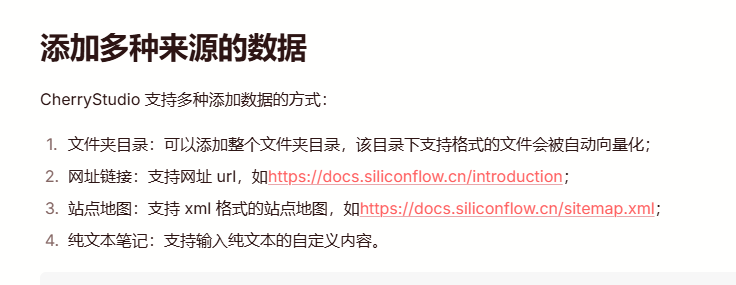
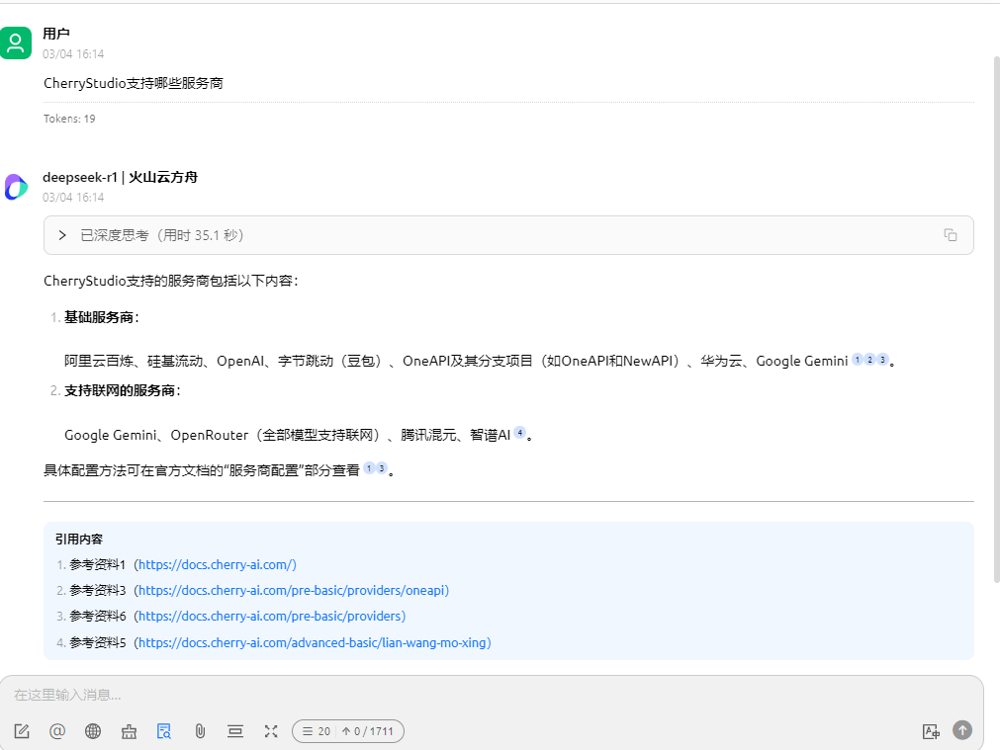
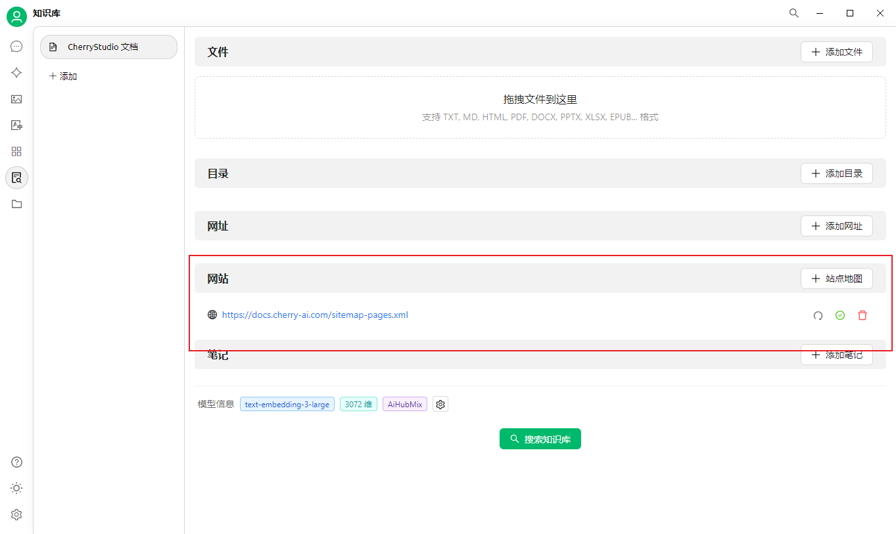

---

id: 470781

title: "CherryStudio知识库的小技巧-扩展篇"

created_at: 2025-03-04T08:23:24.953Z

username: taloslhan

display_username: "taloslhan"

---

# CherryStudio知识库的小技巧-扩展篇

本篇内容其实是 [个人使用CherryStudio的小技巧](https://linux.do/t/topic/468413)的扩展

在上面的文章中，大家都提到了一个问题，就是通过添加链接的方式，**只能索引添加链接的对应的页面本身，不会自己寻找子链接**

这个问题，其实我们可以利用 **站点地图** 来实现，其实这部分功能在官方文档中有单独说明

CherryStudio的站点地图地址：[https://docs.cherry-ai.com/sitemap-pages.xml](https://docs.cherry-ai.com/sitemap-pages.xml)

在CherryStudio中，我们可以使用站点提供的sitemap来实现文档连接的汇总，这个链接的内容也是由站点自行维护的，会实时更新，经过测试确实能索引到文档的内容

其他支持sitemap的站点类似。

---

*来源: https://linux.do/t/topic/470781.json*

