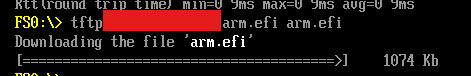

---

id: 471456

title: "基于python的甲骨文实例面板VNC救砖教程"

created_at: 2025-03-04T14:12:01.509Z

username: kali-io

display_username: "kali-io"

---


# 基于python的甲骨文实例面板VNC救砖教程


# 所需工具

一台linux主机(WSL也可以，负责控制台连接中转)

# 部署OCI X WEB Platform(已安装的请忽略，可根据当前设备系统的特性来决定安装方式)

## 方式1：windows本机部署

下载项目：[GitHub - beyond-yaobaiyang/oci_instance_web_management: 基于OCI PYTHON SDK开发的实例管理面板](https://github.com/beyond-yaobaiyang/oci_instance_web_management)


安装python3并且配置好pip（自行百度）


解压项目zip


将cmd运行目录切换到项目目录并运行以下命令

```
pip install -r requirement -i https://mirrors.aliyun.com #-i 参数是指定镜像源，如果你在国内的话
python app.py #即可启动项目，访问主机ip:5000
```

##方式2：linux部署（以debian11举例子）


用apt安装git和python3以及pip3


git项目

```
git clone https://github.com/beyond-yaobaiyang/oci_instance_web_management
```

将工作目录切换到项目文件中

```
pip install -r requirement -i https://mirrors.aliyun.com #-i 参数是指定镜像源，如果你在国内的话
python app.py #即可启动项目，访问主机ip:5000
```

## 用docker部署

命令

```
docker run -d --name oci-api -p 5000:5000 -v data:/app/data -v logs:/app/logs -v config:/app/config -e FLASK_APP=app.py -e FLASK_ENV=production --restart unless-stopped yaobaiyang/oci_python_web
```

# 添加租户配置

部署完成后默认账户密码为admin/admin123 (在公网部署的记得及时修改,并且开启面板的mfa，注意：此mfa不是甲骨文的mfa！)

## 第一步进入租户管理点击添加租户按钮


## 第二步填写租户配置信息并添加


# 进入实例管理选择需要救机的租户配置


# 进入需要救机实例的详情页面（就是哪个蔚蓝色的感叹号按钮）


# 进入详情后找到控制台连接并点击新建控制台连接


# VNC转发机生成密钥并查看公钥内容


# 将公钥内容复制上去


# 将连接命令复制到VNC转发机上面去

如果出现以下情况


这里可能会出现如果出现


Unable to negotiate with 130.61.0.255 port 443: no matching host key type found. Their offer: ssh-rsa


kex_exchange_identification: Connection closed by remote host


Connection closed by UNKNOWN port 65535


需要使用文本编辑器打开配置文件

```
sudo nano /etc/ssh/ssh_config
# 或
nano ~/.ssh/config
```

在配置文件中，您需要添加或编辑以下参数：


Host *


HostKeyAlgorithms +ssh-rsa


PubkeyAcceptedKeyTypes +ssh-rsa


连接成功后是这样的


# 接下来利用使用VNC客户端连接

VNC客户端用VNCview,tiggervnc都行


连接方法输入VNC转发主机IP:5900即可


# 进入bios

连接成功后在面板进行重启机器操作疯狂在VNC区域摁esc直到出现以下结果


# 使用netboot救砖

注意：自行寻找可tftp获取的netboot（也可以自己搭建tftp服务器并且将efi文件放入其中）


选择Bootmanager


```
fs0:
ifconfig -s eth0 dhcp
```


```
tftp tftp服务ip efi文件 efi文件
```




传输完成后输入exit按下esc回到bios主界面


选择boot maintenance manger->boot from file->选择刚才的下载下来的efi文件进入以下界面


觉得不错的话可以给项目点一个免费的star~


项目链接：

### [GitHub - beyond-yaobaiyang/oci_instance_web_management: 基于OCI PYTHON SDK开发的实例管理面板](https://github.com/beyond-yaobaiyang/oci_instance_web_management)

基于OCI PYTHON SDK开发的实例管理面板


---


*来源: https://linux.do/t/topic/471456.json*

