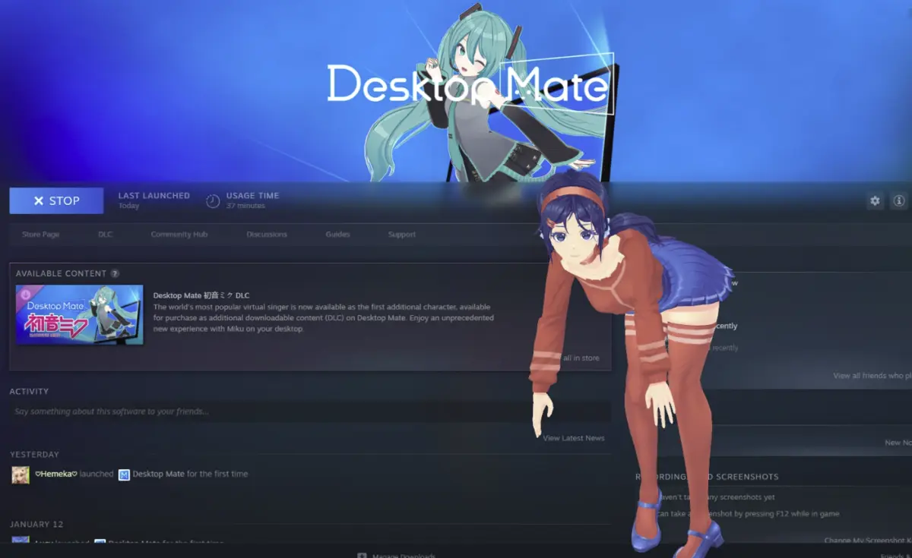
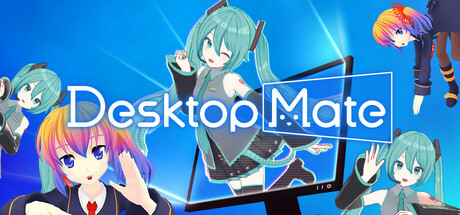

---

id: 473088

title: "使用Desktop Mate配合MOD 让你拥有一个自己的桌宠。"

created_at: 2025-03-05T07:56:26.508Z

username: Black_L

display_username: "反正可爱就对了~"

---


# 使用Desktop Mate配合MOD 让你拥有一个自己的桌宠。


[image714×363 58.2 KB](https://cdn3.ldstatic.com/original/4X/8/8/9/889dfc857272f3fc02b2c67a3b3aa3951d09cbb9.jpeg)

# Desktop Mate游戏本体下载（免费！）

```
https://store.steampowered.com/app/3301060?snr=5000_5100__
```

# 1.解除官方对MOD限制

## 第一种使用Steam下载旧版本

新版本封堵了MOD，因此需要下载老版本。


1 win+r输入steam://nav/console来打开steam的控制台


2 在控制台输入download_depot 3301060 3301061 8228098102537752112来下载以前的版本


3 下的文件在Steam/steamapps/content/app_3301060/depot 330061中


4 删除Desktop Mate游戏文件夹中的所有文件，并将下载的文件复制并粘贴到Desktop Mate游戏文件夹中


5 接下来按照正常打mod的方法即可

## 第二种使用我已经下载好的进行覆盖：

[https://drive.google.com/file/d/1f7adheVqVGKdxSQv1M8MMFTPI0plxpVO/view?usp=drive_link](https://drive.google.com/file/d/1f7adheVqVGKdxSQv1M8MMFTPI0plxpVO/view?usp=drive_link)

# 2.安装MelonLoader && CustomAvatarLoader

## 前提条件安装NET6.0

```
https://dotnet.microsoft.com/en-us/download/dotnet/thank-you/runtime-desktop-6.0.36-windows-x64-installer
```

## MelonLoader下载和安装

```
https://github.com/YusufOzmen01/desktopmate-custom-avatar-loader/releases
```

选择最新版本下载，在菜单里选择Desktop Mate ，如图

[image443×644 43.1 KB](https://cdn3.ldstatic.com/original/4X/a/a/b/aab461e4a0e4aff27f235029a3b2cffc173a0e65.jpeg)

## CustomAvatarLoader下载和安装

```
https://github.com/YusufOzmen01/desktopmate-custom-avatar-loader/releases/latest/download/CustomAvatarLoader.zip
```

将CustomAvatarLoader压缩包里面的文件夹复制到游戏目录里。

# 启动游戏

第一次启动会编译一些内容，等一会编译完成后就重启打开游戏。


点击人物再按F4就会弹窗文件选择，此时选择你下载mod即可(vrm格式)

[image661×408 20.5 KB](https://cdn3.ldstatic.com/original/4X/d/b/2/db22e226aa8d1c2af187423efe990e52cb8159fc.png)

mod下载网站

```
https://www.nexusmods.com/desktopmate?tab=popular+%28all+time%29
```

# 效果图

[image848×385 89.9 KB](https://cdn3.ldstatic.com/original/4X/4/8/3/483c4c256a74322952f3359e426d382548b1673c.jpeg)

[image651×345 54.3 KB](https://cdn3.ldstatic.com/original/4X/2/f/7/2f729a164c8e18fd0b506200272b5e4ac32b64f2.jpeg)

[image484×377 47.6 KB](https://cdn3.ldstatic.com/original/4X/d/0/9/d09f7936b5d76d00d3b4892107fa0bc70b763419.jpeg)

[image1242×644 159 KB](https://cdn3.ldstatic.com/original/4X/e/2/8/e28ba87d44c65d5560584da4a622aa0b25545acb.png)

参考文章：



### [Desktop Mate VRM Mod: Custom Avatar Loader Guide - Desktop Mate](https://www.desktop-mate.com/zh/mods/desktop-mate-vrm-mod-custom-avatar-loader-guide/)

Desktop Mate is a dynamic platform that allows users to customize their desktop mascots using interactive 3D models. With the Custom Avatar Loader Mod, you



### [Steam 社区 :: Desktop Mate](https://steamcommunity.com/app/3301060/reviews/?browsefilter=toprated&snr=1_5_100010_)

Desktop Mate - What is Desktop Mate?Customize your PC with officially licensed, super-cute characters using the next-generation desktop mascot platform Desktop Mate. Powered by the latest 3D technology, characters roam your desktop, sitting on...


---


*来源: https://linux.do/t/topic/473088.json*

