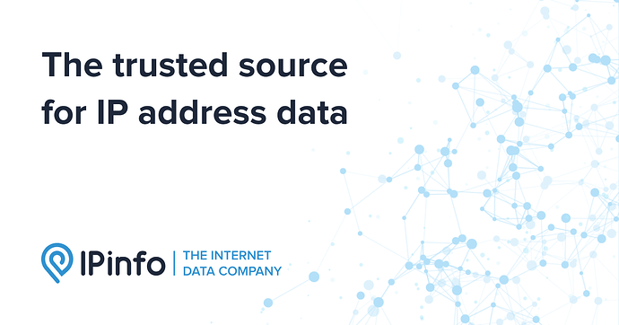

---

id: 481038

title: "IP知识库相关网站"

created_at: 2025-03-09T02:04:59.871Z

username: mcx

display_username: "mntmcx"

---

# IP知识库相关网站

> 

> [Telegram: View @chaguanjcscj](https://t.me/chaguanjcscj/216)

#查ip

### [IP Address Lookup / IPv4 / IPv6 - IP.SB](https://ip.sb)

IPv4 Address Lookup, IPv6 Address Lookup

[https://ping0.cc/](https://ping0.cc/)

### [IPIP.NET_专业精准的IP库服务商_IPIP](https://www.ipip.net/)

### [IP Geolocation API with Threat Intelligence](https://ipdata.co/)

Lookup the location of any IP Address with ipdata's IP Geolocation API. ipdata is fast, accurate and is used by 20,000+ developers.

[https://debug.skk.moe](https://debug.skk.moe)

[https://ip.skk.moe](https://ip.skk.moe)

[https://whoer.net](https://whoer.net)

### [显示查询自己的IP地址](https://ip233.cn)

从国内和国外显示查询自己的IP地址

### [IP/DNS Detect](https://ipleak.net/)

What is your IP, what is your DNS, check your torrent IP, what informations you send to websites.

#在线ping

[https://www.itdog.cn/](https://www.itdog.cn/)

#查询ip干净程度

### [IP234-专业全球IP信息查询](http://ip123.in/#fraud_check)

快速查询用户的IP和浏览器、操作系统。可以批量查询IP地址所在地，可以解析域名的多个IP地址。已完美支持IPv6查询。通过DNS检测可以快速查出不同的地区不同的网络对你的域名解析速度，及域名DNS信息。

[https://ipjiance.com/](https://ipjiance.com/)

#ip库

[http://api.bilibili.com/x/web-interface/zone](http://api.bilibili.com/x/web-interface/zone) (哔哩哔哩)

[https://ipinfo.io](https://ipinfo.io) (更新快，好用)

[https://www.maxmind.com/en/geoip-demo](https://www.maxmind.com/en/geoip-demo) (很多网站都在使用)

[https://db-ip.com/](https://db-ip.com/) (更新较慢)

[https://lite.ip2location.com/](https://lite.ip2location.com/) (比较详细)

#查dns泄露(有国内dns即泄露请求)

### [IP/DNS Detect](https://ipleak.net)

What is your IP, what is your DNS, check your torrent IP, what informations you send to websites.

### [DNS Leak Test](https://browserleaks.com/dns)

The DNS Leak Test is a tool used to determine which DNS servers your browser is using to resolve domain names. This test attempts to resolve 50 randomly generated domain names, of which 25 are IPv4-only and 25 are IPv6-only.

#查ip是否原生

### [Hurricane Electric BGP Toolkit](https://bgp.he.net)

点击“You are visiting from”的ip地址→点击上方 whois 即可查看ip详细信息

SBL 一个全网通用的列表，如果IP在里面基本上就彻底臭了

### [Spamhaus Blocklist (SBL) | IP DNSBL for effective email filtering](https://www.spamhaus.org/blocklists/spamhaus-blocklist/)

Spamhaus Blocklist contains IPs identified as sending spam, hosting malicious content, hijacking IP space, or acting like a bulletproof hosting company.

BlackListMaster 一个检测多个SPAM List库的在线测试工具

### [BlacklistMaster - Blacklist Monitor | Blacklist Check](https://www.blacklistmaster.com/)

Blacklist monitoring. IP and domain blacklist check. IP address reputation monitoring. Blacklist check API.

IPInfo 可以检测IP/ASN类型的工具

### [Trusted IP Data Provider, from IPv6 to IPv4](https://ipinfo.io)

Get accurate IP address information with IPinfo. Trusted by 400,000+ users, we handle more than 40 billion API requests monthly. Sign up for free account today.

---

*来源: https://linux.do/t/topic/481038.json*

