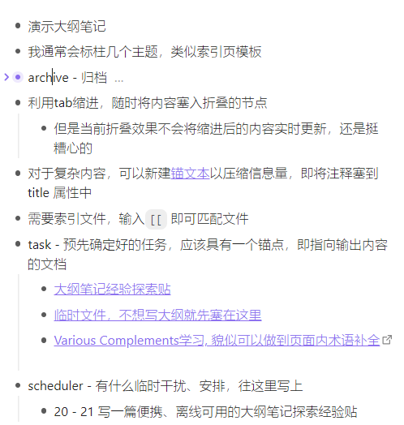
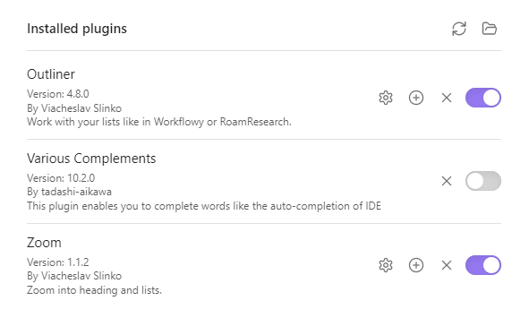
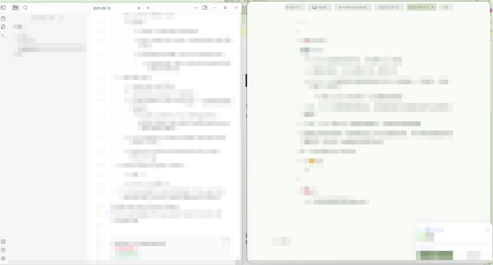
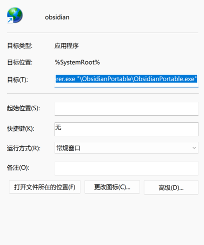

---

id: 490966

title: "折腾了一下离线可用的本地大纲笔记软件，记录一下"

created_at: 2025-03-13T13:44:45.119Z

username: xu-qing-hai

display_username: "虚青海"

---


# 折腾了一下离线可用的本地大纲笔记软件，记录一下


最后确定的是 旧版 Obsidian 便携版以及几个插件配合。

## 效果预览




## 大纲笔记 | Outline

- 个人理解，就是由无序列表组成的笔记


有层级区分

可以折叠、聚焦某个子节点树

适合速记，一时间没想好怎么组合句子的话

就直接换行，就是可读性可能比较难说

## 需求场景介绍

我希望能够断网下保持基本的编辑的体验，并能够顺利配合日常习惯使用思源笔记 + daily note 无压笔记 （按日期新建文件，用大纲节点形式记录）的习惯。而且需要在不同地方编辑，所以需要是便携版的。

举例：校园网限制登录设备数量时，不想带笔记本，也希望专注于当前项目上所以只带了U盘在实验室上课的场景。

所以大部分大纲笔记都不能满足这个需求，有的太重，有的需要联网登录或干脆就是在线版的（大部分大纲笔记软件）

## 引入主题

到最后，我的注意力转移到了 [Obsidian 便携版](https://portableapps.com/node/68172) 这个软件，考虑到之前使用 Obsidian 克制插件使用时确实还算轻，而且旧版（170 MB安装包 / 解压后683 MB) 点击直开的体验已经做的很不错了。所以就大概花了下午两节课的时间调试了一下体验。

主要操作有：

- 调整快捷键

- 隐藏不需要的功能

- 添加代码片段优化行内代码块对比度

- 设置打开后自动打开今日日志


主旨是：**屏蔽无关细节，减少记录步骤**

当前启用插件如下

- outliner

- zoom



鉴于**极简的维护很贵**，很有可能后续会引入其他辅助编写体验的插件（如latex语法补全），不建议在极简上做的太过分。



以及提供一个参考 pkmer 社区编写的css代码片段

```
/* 仅编辑模式下有效 */
.markdown-source-view span.cm-inline-code {
    padding: 4px 6px;
    border-radius: 8px;
}
.theme-dark .markdown-source-view span.cm-inline-code {
    background-color: #666666;
}
.theme-light .markdown-source-view span.cm-inline-code{
    background-color: #eeeeee;
}
```

对了，为了插入 U 盘后直接在根目录点击开启，新建了个调用系统文件浏览器打开相对文件夹下软件本体的快捷方式。

```
%SystemRoot%\explorer.exe "\ObsidianPortable\ObsidianPortable.exe"
```




---


*来源: https://linux.do/t/topic/490966.json*

