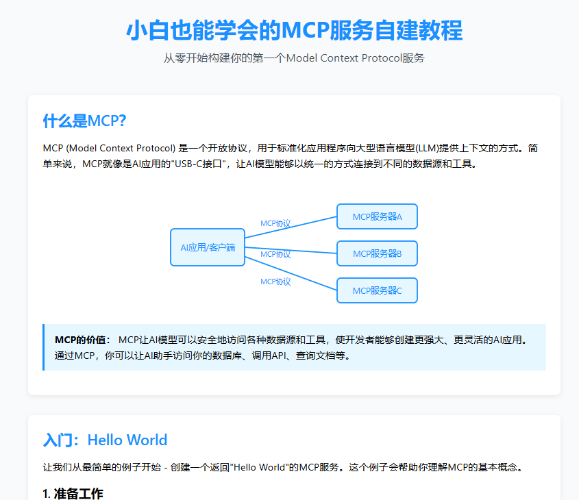
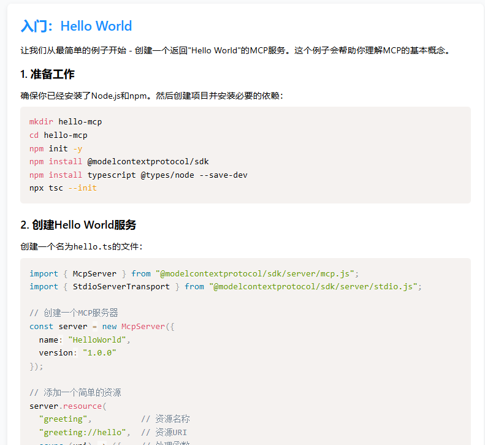
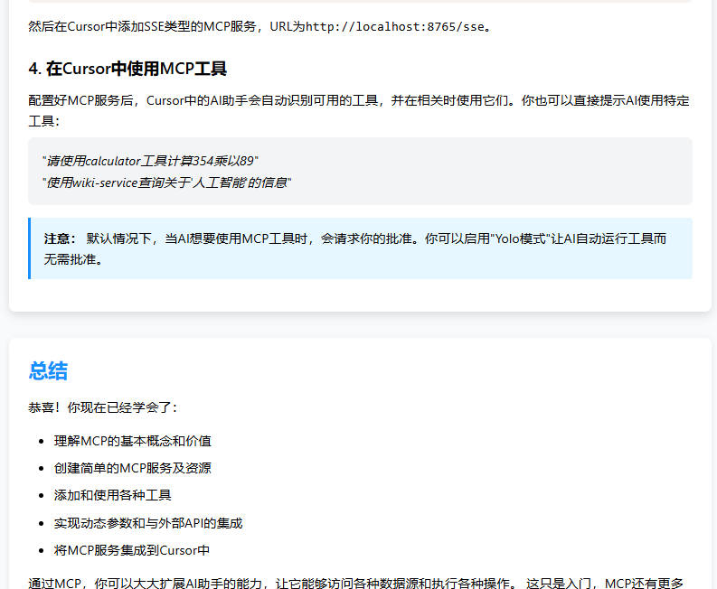

---

id: 491677

title: "用claude 3.7 做了一份MCP基础入门教程（基于typescript）"

created_at: 2025-03-14T02:46:48.171Z

username: xiongcaihu

display_username: "xiongcaihu"

---

# 用claude 3.7 做了一份MCP基础入门教程（基于typescript）

最近MCP不是很火嘛，网上有那么多好用的MCP，那么自己如何搭建MCP服务呢？于是用3.7做了一份教程给自己学习，然后也分享给各位佬

## 片段截图：

## 

完整图如下：

---

*来源: https://linux.do/t/topic/491677.json*

