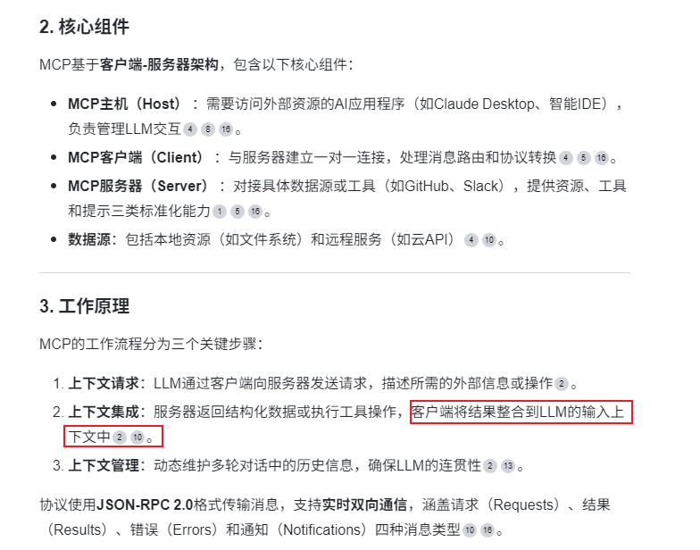
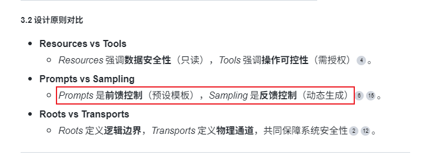

---

id: 492671

title: "一起学习【MCP 和它的核心概念】"

created_at: 2025-03-14T09:07:01.102Z

username: hahadalin

display_username: "hahadalin"

---

# 一起学习【MCP 和它的核心概念】

你可能和我一样已经知道 MCP 了，也对它能干什么有了模糊的理解。

但作为程序员，总是希望能把一个系统、协议的各个部分了解更清楚，所以有了这个帖子。

[完整文字版](https://metaso.cn/s/TQRQC7k)（帖子最底下会贴一张图）

文字版也是找 AI 总结的，不过我感觉有些值得分享的：

以上两处我认为 AI 总结得很到位。

最后，附上全图（还是建议看文字版）

---

*来源: https://linux.do/t/topic/492671.json*

