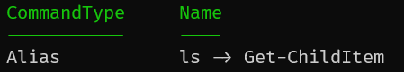
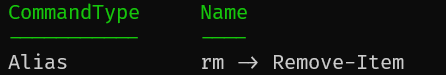
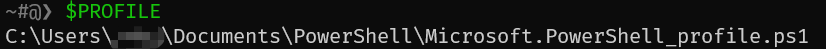

---

id: 500578

title: "分享日用软件，第二期，好看好用的Shell"

created_at: 2025-03-18T16:18:49.685Z

username: xx88136

display_username: "Guest35278"

---


# 分享日用软件，第二期，好看好用的Shell


# 分享日用软件，第二期，好看好用的Shell

### 结论：使用PowerShell +scoop包(功能) + oh_my_posh(美化)

### 需求：

习惯了Ubuntu使用Terminal(终端)操作文件的方便，希望在Windows上也能一样操作文件。

# 1. 介绍：

PowerShell 7 是 Microsoft推出的终端软件。PowerShell的指令大多为首字母大写，动宾结构，横线-连接的形式，像是Get-Command，Remove-Item。由于指令较长PowerShell内置了不少的别名







这些别名使PowerShell更为易用，同时也与Ubuntu的使用体验更为相近，但仍然有不少功能未能完全复现，因此可以按需搭配scoop包使用。

列出常用的官方指令表(别名):

| 指令 | 功能 |

| --- | --- |

| cd | 定位到路径 |

| ls | 列出当前路径下的所有文件 |

| rm | 删除文件/路径 |

| history | 终端历史指令 |

| echo | 打印到终端 |

| cat | 打印文件内容 |

| pwd | 打印当前路径 |

| ipconfig | 打印网络情况 |

| mv | 移动 |

| cp | 复制 |

常用路径表示：

| 路径 | 功能 |

| --- | --- |

| . | 当前路径 |

| .. | 父路径 |

| ~ | C:\Users\username |

| / | C: |

# 2.功能增强

### 2.1 scoop包

很多常用的指令(如grep,touch,wget,sudo)不在官方的基础指令中，可以通过scoop下载对应的包实现功能。

以创建文件的touch指令和搜索grep指令作为例子:

```
scoop install touch
```


```
scoop install grep
```


安装后，指令便写入了环境变量(隐式，通过scoop的shim机制)，在打开新的终端后，可以使用如`touch 1.md`，`ls | grep .txt`等等指令。更多的工具可以在[psutils项目](https://github.com/lukesampson/psutils)和[GNU Software](https://www.gnu.org/software/)找到。

列出常用的指令:

| 指令 | 功能 |

| --- | --- |

| grep | 一般与\|配合使用，用于查找\|前指令所输出的内容 |

| touch | 创建文件 |

| sudo | 指令使用管理员执行 |

| wget | 从链接下载文件 |

注意：


如果需要使用which指令，更推荐为原生指令Get-Comman设置别名which

### 2.2 设置指令的别名

此外，还可以给微软自带指令设置别名，例如，我希望通过which 查看当前运行程序所在的路径，对应微软的Get-Comman指令。通过hash指令获取文件的hash，对应微软的get-filehash指令。

方法: 修改powershell的配置文件，使用`$PROFILE`,查看配置文件的位置




在配置文件中写入：

- which 作为Get-Command的别名:

```
New-Alias -Name which -Value Get-Command
```

- hash作为get-filehash的别名，使用算法为sha256:

```
New-Alias -Name hash -Value get-filehash -algorithm sha256
```

---

# 3 安装oh-my-posh(美化)

### 效果：


安装和设置，可以直接参考[知乎教程](https://zhuanlan.zhihu.com/p/579513537)

教程中，介绍以下内容的安装和设置，版本要求为Powershell 7

- oh-my-posh(美化主题)

- Zlocation(定位工具)

- PSReadLine(补全工具)

---

软件下载


PowerShell7:，[Github](https://github.com/powershell/powershell/releases)，winget指令下载

```
winget install --id Microsoft.PowerShell --source winget
```

---

# 再分享几个使用PowerShell的小技巧

1. $env:Path 可以读取到环境变量中的路径变量。

2. CTRL+R 可以搜索历史指令。

3. explorer是文件管理器的指令，可以通过`explorer .`在当前路径下打开文件管理器


---


*来源: https://linux.do/t/topic/500578.json*

