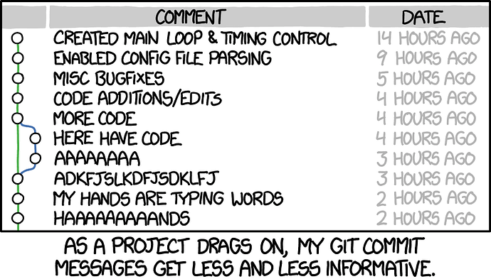
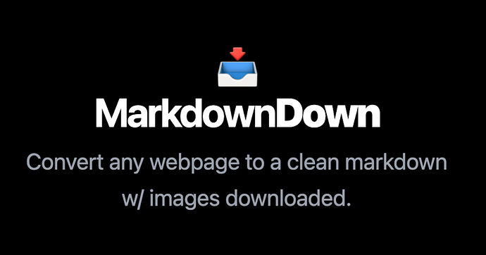

---

id: 501672

title: "How to Write a Git Commit Message | Vibe Version Control(VVC)"

created_at: 2025-03-19T07:11:02.011Z

username: tig

display_username: "正常自称"

---

# How to Write a Git Commit Message | Vibe Version Control(VVC)

标题暂时这样，分区暂时是这个，或许不该是这个分区？

分享这一篇文章：

### [How to Write a Git Commit Message](https://cbea.ms/git-commit/)

Commit messages matter. Here's how to write them well.

好久之前的书签了，搜了一下找到了。

另外还有这个：

### [约定式提交](https://www.conventionalcommits.org/zh-hans/v1.0.0/)

一种用于给提交信息增加人机可读含义的规范

另外分享：

### [Convert URL to MarkDown](https://urltomarkdown.com/)

### [MarkdownDown](https://markdowndown.vercel.app/)

Convert any webpage to a clean markdown w/ images downloaded.

可能有更好的工具，这两个目前来说感觉还行。

---

*来源: https://linux.do/t/topic/501672.json*

