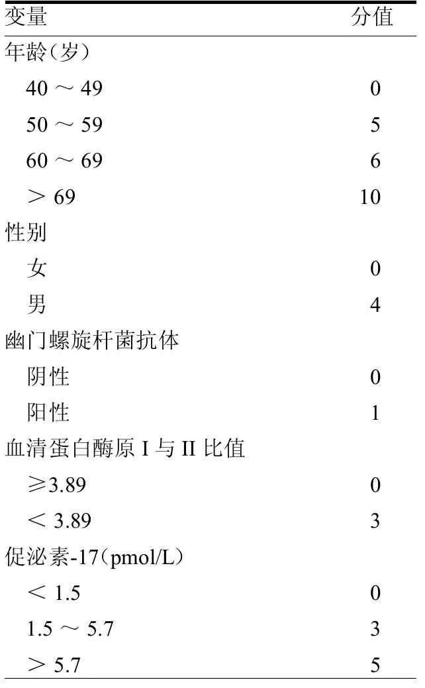
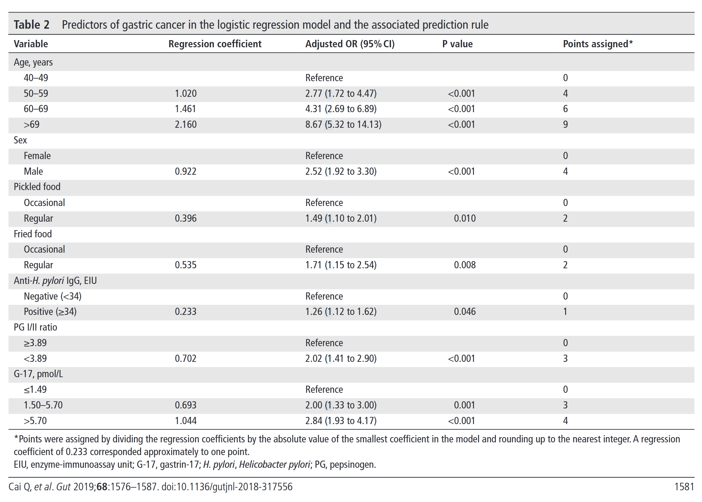
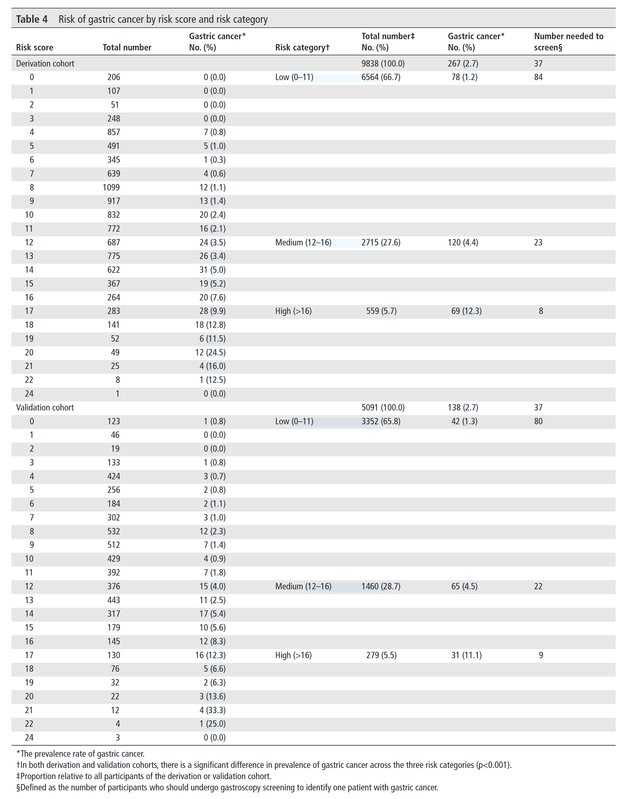

---

id: 511074

title: "胃癌的筛查策略"

created_at: 2025-03-24T10:37:11.879Z

username: DDGameOver

display_username: "Vic"

---

# 胃癌的筛查策略

大学时期上消化系统疾病相关课程的时候，印象中老师建议的胃癌筛查起始年龄很早，大概是30岁或者35岁，大约每3年一次。

最近发现这一部分的信息是错误的，可能是我记错了或者当时循证医学证据不充分的情况下，胃肠病学的老师推荐的筛查策略有些激进。所以把目前的一些临床循证推荐总结在此文内。

## 2024-CHN-胃癌筛查与早诊早治方案

### 评估高危人群

年龄≥45 岁， 且符合以下任意一项者：

（一）居住于胃癌高发地区（ 以县级行政区为单位界定，以 2000 年中国人口结构为标准的年龄标化发病率>20/10 万）。

（二）父母、 子女以及兄弟姐妹等一级亲属中有胃癌病史。

（三）尿素呼气试验（ urea breath test， UBT） 、 血清Hp 抗体、 粪便 Hp 抗原检测任一阳性。

（四）吸烟、 重度饮酒、 高盐饮食、 腌制食品等不良生活方式和饮食习惯。

（五）患有慢性萎缩性胃炎、 胃溃疡、 胃息肉、 手术后残胃、 肥厚性胃炎、 恶性贫血等疾病。

### 筛查策略

（一）筛查对象

胃癌高风险人群，无上消化道癌病史，年龄一般在**45**~74岁之间，无内镜检查禁忌证，能配合内镜检查。

（二）筛查方法

胃癌筛查推荐内镜学检查，首选普通白光内镜检查，对发现的可疑病灶采用特殊内镜技术（窄带成像技术结合放大内镜、蓝激光成像放大内镜、色素内镜、激光共聚焦显微内镜、荧光内镜等）检查并进行活检。

不能耐受常规内镜检查者可进行麻醉/镇静内镜或经鼻超细内镜检查，也可考虑使用磁控胶囊胃镜。

具体检查方法和操作流程参见国家卫生健康委最新发布的胃癌诊疗指南（以下简称诊疗指南）。不建议将血清胃蛋白酶原（pepsinogen，PG）检测、血清胃泌素-17（gastrin-17，G-17）检测或血清胃癌相关抗原MG7等检测单独用于胃癌筛查，也不推荐使用以下方法进行胃癌筛查：其他生物标志物检测、上消化道钡餐造影、PET检查等。

（三）筛查频率

胃癌高风险人群原则上每5年进行1次内镜检查，有下列病变者建议缩短筛查间隔：

1. 局限于胃窦或胃体的萎缩性胃炎或肠上皮化生患者，每3年进行1次内镜检查。萎缩累及胃底或全胃，每年进行1次内镜检查。

2. 低级别上皮内瘤变每年进行1次内镜检查。高级别上皮内瘤变每3~6个月进行1次内镜检查。

## 2022-CHN-中国胃癌筛查与早诊早治指南

### 高危人群

**年龄45岁及以上，且符合下列任一条件者为胃癌高风险人群（强推荐，证据分级：中）：**

（1）长期居住于胃癌高发区；

（2）Hp感染；

（3）既往患有慢性萎缩性胃炎、胃溃疡、胃息肉、手术后残胃、肥厚性胃炎、恶性贫血等胃癌前疾病；

（4）一级亲属有胃癌病史；

（5）存在胃癌其他高危因素（高盐、腌制饮食、吸烟、重度饮酒等）。

### 筛查策略

1. 推荐高风险人群胃癌筛查起始年龄为**45岁**，至75岁或预期寿命＜５年时终止筛查。

2. 推荐胃癌高风险人群接受胃癌筛查，不建议胃癌非高风险人群接受胃癌筛查。

根据新型胃癌筛查评分系统，进行危险分层。

| 总评分 | 风险等级 | 筛查建议 |

| --- | --- | --- |

| 0-8 | 低危 | 每5年常规胃镜复查 |

| 9-15 | 中危 | 每3年胃镜筛查，结合PG/G-17动态监测 |

| ≥16 | 高危 | 每年1次胃镜精查，必要时结合病理活检 |

其中，PG（Pepsinogen）为胃蛋白酶原，G-17（Gastrin-17）为胃泌素-17。

## 2024-CHN-中国早期胃癌预防、诊断和治疗指南

| 推荐建议 | 推荐强度 |

| --- | --- |

| 我们建议根据 Li 等人的预测模型进行内窥镜筛查，以获得医疗经济效益。 | 推荐性较弱；证据确定性极低 |

| 建议 40 岁以上幽门螺杆菌感染者和有其他胃癌危险因素（男性、吸烟、恶性贫血、直系亲属有胃癌、严重萎缩性胃炎、肠化生、腺瘤等）的患者进行胃癌筛查。建议将幽门螺杆菌检测、胃蛋白酶原 I 和胃蛋白酶原 I/II 比值作为胃癌筛查的综合指标。 | 强烈建议，证据确定性低 |

| 磁控胶囊胃镜作为传统胃镜的有益补充和最佳替代方法，可用于胃癌筛查。对于特殊人群（拒绝或不能耐受传统胃镜检查者，或胃镜检查时并发症风险较高者），在排除任何禁忌症后，建议采用磁控胶囊胃镜进行胃癌筛查。 | 强烈建议；中度证据确定性 |

### Li’s prediction model

> Cai, Q. *et al.*  Development and validation of a prediction rule for estimating gastric cancer risk in the Chinese high-risk population: A nationwide multicentre study. *Gut* **68**, 1576–1587 (2019).

#### 分值

#### 危险分层标准

#### 总结（重绘）

##### 评分标准

| 变量 | 分值 |

| --- | --- |

| 年龄（岁） |  |

| 40–49 | 0 |

| 50-59 | 4 |

| 60-69 | 6 |

| >69 | 9 |

| 性别 |  |

| 女 | 0 |

| 男 | 4 |

| 腌制食品 |  |

| 偶尔 | 0 |

| 经常 | 2 |

| 抗幽门螺杆菌 IgG，EIU |  |

| 阴性（<34） | 0 |

| 阳性（≥34） | 1 |

| 血清蛋白酶原I与II比值 |  |

| ≥3.89 | 0 |

| <3.89 | 3 |

| 胃泌素-17（pmol/L） |  |

| ≤1.49 | 0 |

| 1.50-5.70 | 3 |

| >5.70 | 4 |

##### 分级标准

| 总评分 | 风险等级 | 筛查建议 |

| --- | --- | --- |

| 0-11 | 低危 | 每5年常规胃镜复查 |

| 12-16 | 中危 | 每3年胃镜筛查，结合PG/G-17动态监测 |

| >16 | 高危 | 每年1次胃镜精查，必要时结合病理活检 |

---

*来源: https://linux.do/t/topic/511074.json*

