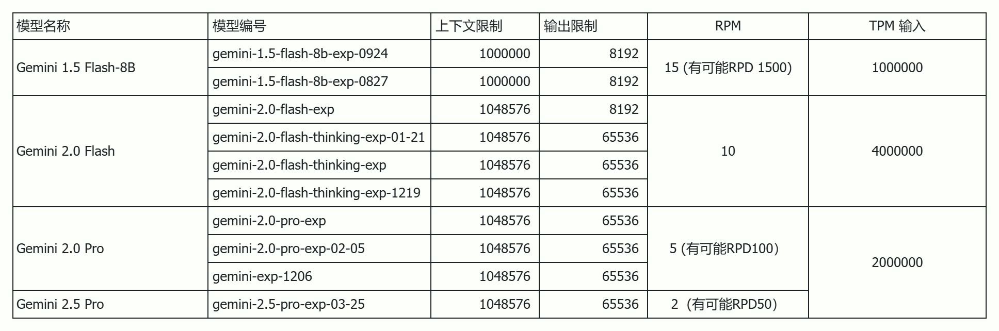

---

id: 517263

title: "Gemini （GCP绑卡号）的免费EXP模型计量"

created_at: 2025-03-27T11:36:20.364Z

username: BlueSkyXN

display_username: "BlueSkyXN"

---

# Gemini （GCP绑卡号）的免费EXP模型计量

Gemini （GCP绑卡号）的免费EXP模型计量

检查了下1.5pro/1.5flash/2.0flash-8b的exp模型都没exp了

比较离谱的是官方文档和GCP API控制台互相冲突，有很多参数不匹配

---

*来源: https://linux.do/t/topic/517263.json*

