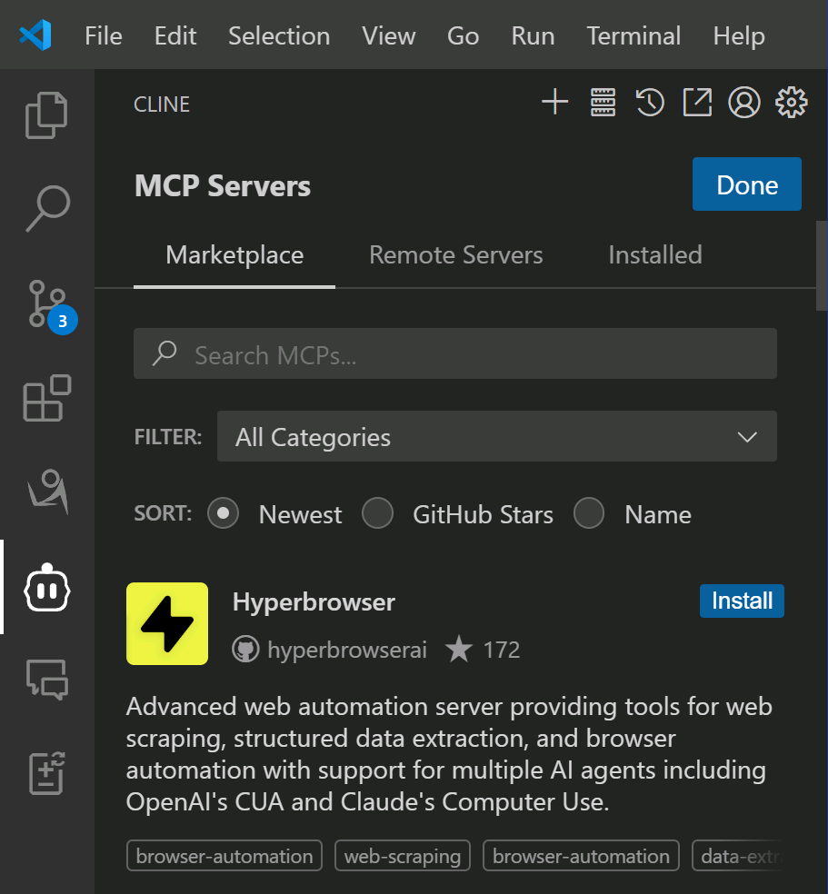

---

id: 543257

title: "一文彻底搞懂 MCP：AI 大模型的标准化工具箱"

created_at: 2025-04-09T04:41:39.923Z

username: BNTang

display_username: "程序员NEO"

---


# 一文彻底搞懂 MCP：AI 大模型的标准化工具箱


**MCP** 最近在 **AI 领域** 引发了 **广泛关注**，特别是在 **海外各大社区** 中，大家热烈讨论，热度 **相当高**。

我打开了 [Google Trends](https://trends.google.com/trends/?hl=zh-cn)，这是一个专门用于查看全球热点趋势的网站。


输入关键词后，可以查看其**热度变化**。

我搜索了 **“MCP”**，它的趋势如图所示，变化**非常明显**。

各位可以**参考一下**。


每天都有**新的 MCP 工具**被推出，**为我们带来了无限的机会**。

当我打开 **Cline 的 MCP Servers** 时，便发现了**许多新工具**等待探索。



本文，我会全面介绍 **MCP**，包括它的**基本概念**、**核心技术原理**，以及它在**实际应用中的各种场景**。

让你轻松掌握 **MCP** 的**所有要点**。

# 什么是 MCP

**MCP**（**Model Context Protocol**，即**模型上下文协议**）是由 **Anthropic**（**Claude** 的母公司）于 **2024年11月** 开源发布的一项 **全新技术**。


简单来说，**MCP** 是一个 **AI 大模型的标准化工具箱**。

大模型可以通过这些工具与 **外界互动**，**获取信息**，并 **完成具体任务**。

在日常工作和学习中，我们经常需要与 **浏览器**、**文件**、**数据库** 和 **代码仓库** 等外部工具进行交互。

在 **传统方式** 中，我们需要 **手动截图** 或 **复制文本**，再将其 **粘贴** 到 **AI 窗口** 中进行对话。


大家请注意，我的插画中的箭头都是从**右到左**，表示内容是**单向流动**的，而不是双向的。

这意味着我们是将**浏览器**、**文件系统**或**GitHub**中的信息**复制到 AI 中**，以便进行对话时的数据流向。

**MCP**通过**标准化的协议**，让我们不再需要**手动截图**、**复制文本**，然后再**粘贴**到**AI 窗口**中进行对话。

这一过程被**自动化**了，**简化了我们的操作**。


**MCP 服务**充当**AI 和外部工具之间的桥梁**，能够**自动替代人类**访问和操作这些外部工具。

在我的插图中，**箭头为双向**，表示**AI 可以直接访问 MCP 服务**。

而 **MCP 服务**则能访问**浏览器、文件系统等数据源**。

通过这种方式，**数据能够通过 MCP 服务传输到 AI 中**。

每个 **MCP 服务**（也称为 **MCP Server**）**专注于特定的任务**。

例如，有的服务**专门用于读取和写入浏览器信息**，有的**负责处理本地文件**，还有的**用于操作 Git 仓库**等。


**MCP Server** 通常是一个**在本地运行的程序**，可能是用 **Node.js** 或 **Python** 开发的。


**大模型**通过操作系统的 **标准输入输出（stdio）**，即我们常说的**输入与输出通道**，来进行**信息交流与处理**，并**调用某个 MCP Server**。


它的信息格式**是 JSON**，这是一种**常用的数据交换格式**。

```
{
    "jsonrpc": "2.0",
    "id": 129,
    "method": "tools/call",
    "params": {
        "name": "search_repositories",
        "arguments": {
            "query": "user:BNTang"
        }
    }
}
```


**MCP Server** 在接收到请求后，会通过**自身的代码**或**外部工具的 API**来执行任务。

从这里可以看出，**MCP 协议**与 **Function Calling** 非常相似。

**MCP 的最大优点**是整合了之前各大模型不同的**Function Call 标准**，形成了一个**统一的标准协议**。


而且，**不仅是 Claude**，**几乎所有市面上的大模型**都可以接入 **MCP**。


本文，我将用**免费的 DeepSeek**，来进行**实战演示**。

# 准备工作

在正式开始之前，我们需要先准备一个**支持 MCP 协议的客户端**。

目前支持 **MCP 功能** 的客户端并不多，主要有 **AI 编程工具 Cline、Cursor、WindSurf**，以及 **Claude 官方客户端（Claude App）** 等。


本文将以开源免费的 **Cline** 为例进行演示，并简要介绍如何在 **Cursor** 中完成相关配置。

首先，请访问 **VSCode 官网**，下载并安装 **Visual Studio Code**。


后续我会持续分享 **VSCode 的安装与使用教程**，欢迎大家**关注我**，以便**第一时间获取最新内容**。

安装完成后，我们打开 **VSCode 软件**：


在界面左侧的工具栏中，找到并点击 **Extensions 图标**，即可进入**插件市场**，方便我们**安装和管理各种实用插件**。


在 **Extensions 市场**中搜索 **Cline**，找到并点击 **安装插件**：


安装完成后，在左侧面板找到 **Cline**，点击进入：


接下来，需要为 **Cline 配置一个 AI 模型**。首先点击 **设置（Settings）**：


在 **模型提供商**中，选择 **OpenRouter**，它提供免费的 **DeepSeek V3 模型**：


在模型搜索框中，输入 `deepseek/deepseek-chat-free`，选择该模型：


这是免费的 **DeepSeek V3 模型**，大家可以选择它。

接下来，我们需要获取一个 **API Key**，点击 **Get OpenRouter API Key**：


需要登录（可以使用 **谷歌账号**）：


该地址在国内可以直连。


点击 **Authorize 授权**：


点击 **打开 Visual Studio Code**：


然后再点击 **Open**：


此时 **OpenRouter 的 API Key 会自动填写**：


Cline 支持两种运行模式：**Planning（规划模式）** 和 **Acting（执行模式）**，具体说明如下：

- **Planning 模式**：此模式用于生成详细的**行动计划**，非常适合在开始编写代码之前与 AI 进行沟通，**清晰地分解任务**，从而**避免盲目操作导致的返工**。您可以利用此模式**规划新功能的实现步骤**或**讨论如何优化现有代码**。

- **Acting 模式**：此模式负责根据 Planning 阶段的计划**逐步执行任务**。适用于在明确计划后，让 AI **实际执行操作**。例如，您在 Planning 模式中已确定了 API 调用的实现逻辑，然后可以切换到 Acting 模式，让 AI **帮助您编写具体代码**。

此外，如果您希望为 Planning 和 Acting 模式**分别使用不同的 AI 模型**，可以勾选 **“Use different models for Plan and Act modes”** 选项。启用该选项后，您可以为 Planning 模式指定一个**擅长分析和规划的 AI 模型**，同时为 Acting 模式配置一个**更适合执行操作的模型**。这样，两个模式可以**各司其职**，提供更**灵活和高效**的智能辅助体验。


为 **Plan 模式** 和 **Act 模式** 分别配置 **OpenRouter 的 API Key**。例如，您可以统一使用免费的 **DeepSeek 模型**，但后续可以根据自己的实际需求进行调整。在写代码时，可以为 **Act 模式** 配置 **Claude 模型**，而为 **Plan 模式** 配置 **ChatGPT 模型**。这样，您可以充分利用各个模型的优势，提高 **工作效率** 和 **智能辅助体验**。


只需配置一次 **OpenRouter 的 API Key**，即可让两个模式共享该设置。

配置完成后，请点击 **Save** 以保存设置。


接下来，返回 **Cline 的主界面**，点击 **New Task** 开始测试。


选择 **Act 模式**，并勾选 **Auto-append: Read, Browse**。这是我之前的配置，供大家参考。


发送 “你好”，查看输出效果：


此时 **Cline 的配置已完成**。

接下来，我们要安装 **Node.js**。

正如之前所述，**MCP Server 本质上是运行在电脑上的一个 Node.js 程序**，因此 **Node.js 的运行环境必不可少**。


安装 **Node.js** 可以参考 [三种方式轻松搭建 Node.js](https://mp.weixin.qq.com/s/cHbR1GpIx_MUPw9WNo7kUA)，至此所有准备工作就完成了。

接下来我们开始正式安装 MCP Server。

# 第一个 MCP

我们回到 **Cline**，点击这个 **MCP Server** 的小图标。


这是 **Cline** 新推出的 **MCP Server 应用市场**。


我们可以按照 **星标数量（GitHub Stars）** 进行排序。


在这里找到非常受欢迎的 **MCP 服务器**。我们的第一个 **MCP 服务** 以这个 **GitHub 项目** 为例。请点击 **“安装”（Install）** 按钮进行安装。


它会自动打开一个 **AI 聊天窗口**，您可以根据 **AI 的指引** 完成 **MCP Server 的安装**。

第一步是创建一个 **空文件夹**，用于安装的 **目标位置**：

```
mkdir E:\Document\Cline\MCP\github-server
```


这一步不是必需的，我将直接点击 **“继续（Run Command）”按钮**。


在 **第二步** 中，它要求我们填写一个 **GitHub Token**。请打开提供的 **链接**：


进入 **GitHub 的设置页面**，找到 **Token 生成部分**，然后点击 **“创建一个新的 Token”**。


为 **Token 命名**，我这里选择 **Cline**。


在这里，我为它授予了 **所有仓库的权限**，选择了 **所有仓库（All repositories）**。


接下来，详细讨论一下 **Repository permissions**，其中包含一些 **细致的权限控制选项**。


这里我为他提供了创建仓库的权限，请将 **Administration** 权限设置为 **Read and write**。


此外，还有 **编写代码的权限**，请将 **Codespaces 权限** 设置为 **Read and write**。


另外，还有一个查看仓库内容的权限，请将 **Contents** 权限设置为 **Read and write**。


你可以根据具体需求为其分配相应的 **权限**，设置完成后，点击 **Generate token** 按钮即可生成该 **Token**。


这样，我们的 **GitHub Token** 就创建完成了。请记得为令牌设置一个合适的 **过期时间**，否则 **GitHub** 会显示黄色警告 （这里我操作得太快，没有截取对应的图片，也就不再回退了）。接下来，我们 **复制生成的 Token** 即可。


回到 **Cline**，粘贴 **Token** 后，点击 **「发送（Send）」按钮** 即可。


**Cline** 已经为我们创建好了 **配置文件**，点击 **「Save」按钮** 即可保存。


Cline wants to use a tool on the GitHub MCP server，请点击 **「Approve」按钮**。


接下来，**Cline** 想使用 **npx 命令**，不过此步骤并非必需，我仍然点击 **「继续（Run Command）」按钮**。


如果出现 **「Proceed While Running（继续运行）」** 提示，请点击 **「Proceed While Running」按钮**。

若您使用的是 **Mac 系统**，到此 **安装步骤** 便已完成。

但若您使用的是 **Windows 系统**，则还需额外进行一些 **配置**。

请注意，以下步骤非常重要，请务必仔细操作：

1. 打开配置文件 `cline_mcp_settings.json`，首先，将原本位于 `"command"` 中的 `npx` 移动到 `"args"` 数组中：


1. 将 `"command"` 的值修改为 `cmd`


1. 在 `"args"` 数组中新增一行 `/c`


最终的 **配置文件** 参考如下：

```
{
  "mcpServers": {
    "github.com/modelcontextprotocol/servers/tree/main/src/github": {
      "command": "cmd",
      "args": [
        "/c",
        "npx",
        "-y",
        "@modelcontextprotocol/server-github"
      ],
      "env": {
        "GITHUB_PERSONAL_ACCESS_TOKEN": "脱敏处理",
      },
      "disabled": false,
      "autoApprove": []
    }
  }
}
```

保存 **配置文件** 后，回到 **MCP Server** 的 **「Installed」选项卡**，此时 **GitHub MCP Server** 已经显示为 **绿色状态**，表示安装成功。


至此，**MCP Server** 的 **配置** 已成功完成。实际上，配置 **MCP Server** 最核心的就是上述的 **配置文件**，前面的 **图形界面步骤** 并非必须，后续直接编辑 **配置文件** 也可以完成 **MCP Server** 的配置。

接下来，我们进行一次简单的 **测试**：

1. 点击界面上的 **「Done」按钮**：


1. 新建一个对话，点击 **「New Task」按钮**：


1. 向 **AI** 提问，例如：

> 我的名字是 BNTang，我在 GitHub 上有哪些仓库？

回车发送问题：


我们无需手动指定 **MCP 服务** 或 **工具**，**AI** 会自动智能地选择最合适的 **工具** 进行处理。在发送问题后，**AI** 请求调用名为 **search_repositories** 的 **MCP 工具**：


1. 点击 **「Approve」按钮**，允许 **工具** 调用：


此时，**Cline** 会调用 **MCP 工具** 并获取数据：


1. 最终，**大模型** 会将获取到的数据进行整理，并返回 **最终结果**：


如图所示，**AI** 列举了我的 **14 个公开仓库**，说明 **MCP Server** 已成功配置并正常运行。

接下来，我们打开一个 **Powershell** 界面：


我们一起来探究一下 **MCP** 的本质究竟是什么。我先粘贴三行 **命令**：

```
$json = '{"jsonrpc":"2.0","id":123,"method":"tools/call","params":{"name":"search_repositories","arguments":{"query":"user:BNTang"}}}'

$env:GITHUB_PERSONAL_ACCESS_TOKEN = "脱敏处理"

echo $json | npx -y @modelcontextprotocol/server-github
```

- **第一行**定义了一个 **JSON 字符串**，它正是客户端（**Cline**）向 **MCP Server** 传递的参数。我们看到 **JSON** 中的 **method** 字段是 “**tools/call**”，表示调用工具；**params** 中的工具名为 “**search_repositories**”，即搜索仓库；**query** 则是具体的搜索参数，这里是查询 **GitHub 用户** “**BNTang**”。

- **第二行**设置了运行时的 **环境变量**，即 **GitHub** 的 **个人访问令牌**（已脱敏）。

- **第三行**则通过 **管道符**，将刚才定义的 **JSON 参数**传递给 **MCP Server**（一个基于 **NodeJS** 的程序）执行。

现在我们 **运行** 一下上述 **命令**：


可以看到，成功获取了 **GitHub** 上用户 “**BNTang**” 的 **仓库信息**。

通过这个例子，我们发现 **MCP** 本质上并没有什么神秘之处。它的核心原理，就是客户端通过 **命令行** 调用本地（或服务器上）的 **NodeJS** 或 **Python** 程序，执行特定操作后再返回结果。

接下来，我们再 **测试** 一个新的 **任务**：创建一个名为 “**cline_test**” 的 **GitHub 仓库**。

我在 **Cline** 的 **问答输入框** 中输入：

> 请帮我创建一个 GitHub 仓库，名字叫做 cline_test


此时，**Cline** 会询问我是否允许它调用 **MCP Server**，我点击 **Approve**：


随后，**Cline** 显示 **仓库创建成功**，并返回了 **仓库地址**：


点击 **链接**，我们跳转到 **GitHub** 查看一下：


**确认** 仓库已经 **成功创建**：


我们注意到，单个 **MCP Server** **工具** 提供了多达 **26 项强大的功能**，其中包括但不限于：

- **创建或更新文件** （`create_or_update_file`）

- **搜索仓库** （`search_repositories`）

- **创建仓库** （`create_repository`）

- **获取文件内容** （`get_file_contents`）

- **推送文件** （`push_files`）

这些功能几乎涵盖了所有与 GitHub 交互的需求，一个 MCP 工具就可以轻松处理这些操作。

更重要的是，我们只需使用 **自然语言**，就能直接指挥 **AI** 完成这些工作，全程无需离开 **VSCode**，极大提升了我们的 **工作效率**。

通过以上示例，我们清晰地感受到了 **MCP** 的 **强大** 与 **便捷** 之处。

# Cursor + MCP

接下来，我们来看如何 **配置 Cursor**。需要注意的是，**低版本的 Cursor** 是可以支持 **MCP 服务** 的，我使用的版本是 **0.48.7**。在 **Cursor 的设置**中，我首先将版本切换到 **Early Access（抢先体验）版本**。


然后，通过点击 **Check for Updates** 来 **升级 Cursor 到最新版本**（**版本号**会随时间变化，因此这里不再说明具体版本号）。


**最新版本**支持全新的 **MCP 配置方式**。本文将聚焦于 **新的配置方法**。首先，在 **Cursor 设置**的左侧，找到 **MCP 配置选项**。目前的 **MCP 配置**是通过 **文件方式**实现的：


在 **项目根目录**下创建一个名为 **.cursor** 的 **文件夹**：


在 **.cursor 文件夹**中，右击选择 **New File**，创建文件 **mcp.json**：


接下来，将之前在 **Cline** 中所配置的内容完整复制到 **mcp.json** 文件中：

```
{
  "mcpServers": {
    "github.com/modelcontextprotocol/servers/tree/main/src/github": {
      "command": "cmd",
      "args": [
        "/c",
        "npx",
        "-y",
        "@modelcontextprotocol/server-github"
      ],
      "env": {
        "GITHUB_PERSONAL_ACCESS_TOKEN": "脱敏处理"
      },
      "disabled": false,
      "autoApprove": []
    }
  }
}
```


当你粘贴完成后，左下角会弹出一个 **New MCP server detected**（**检测到新的 MCP 服务器**）提示，点击 **Enable** 启用它：


之后，打开 **Cursor** 的 **MCP 选项卡**，检查 **MCP Server** 的 **状态**，确认它已经变为 **绿色**：


 **注意**：如果弹出了 **黑色窗口**，请不要关闭它，只要确认 **MCP Server** 是 **绿色** 即可。

至此，**Cursor 的配置已完成**，说明当前的 **Cursor 配置**与 **Cline 的设置**是一致的。

接下来，我将演示如何添加 **另一种 MCP Server**。我们前往 **MCP Servers GitHub 页面**，找到官方提供的 **自定义 Server**。这次我将演示 **file system（文件系统）** 这个 **Server**：


点击 **链接** 后，向下滚动页面，你会看到 **npx 的安装方式**：


我们将 **file system** 的配置添加到 **Cursor** 的 **mcp.json 文件**中。复制相应的段落配置，如下所示：


在 **mcp.json 文件**中添加一个 **逗号**，并将复制的内容粘贴到 **逗号后面**，确保逗号位于 **最后一行的末尾**：


```
{
  "mcpServers": {
    "github.com/modelcontextprotocol/servers/tree/main/src/github": {
      "command": "cmd",
      "args": [
        "/c",
        "npx",
        "-y",
        "@modelcontextprotocol/server-github"
      ],
      "env": {
        "GITHUB_PERSONAL_ACCESS_TOKEN": "脱敏处理"
      },
      "disabled": false,
      "autoApprove": []
    },
+   "filesystem": {
+     "command": "npx",
+     "args": [
+       "-y",
+       "@modelcontextprotocol/server-filesystem",
+       "/Users/username/Desktop",
+       "/path/to/other/allowed/dir"
+     ]
+   }
  }
}
```


对于 **Mac 系统**，**配置到此即可**；对于 **Windows 系统**，需要将 **npx** 移动到 **args 数组**中，同时将 **command** 修改为 **cmd**，并新增一行 **/c**。

完成以上步骤后，还需调整 **文件系统的配置**如下：


这里的配置定义了 **file system** 可操作的 **目录**。我将 **电脑桌面的目录** 添加到此列表中。**Windows 系统路径**记得使用 **双反斜杠 \**，例如：**C:\\Users\\Public\\Desktop**。


**注意**将 **不需要的配置**删除：


完成 **MCP 的添加**后，保存并返回 **Cursor 设置**，进入 **MCP 选项卡**，启用 **file system 这个 MCP Server**，当前显示为 **Disabled（禁用）**，点击 **Disable** 变为 **Enable（启用）**：


启用后，点击 **Refresh（刷新）** 按钮：


这时可以看到 **file system 的 MCP Server** 已经变为 **绿色的状态**：


如果打开了一个新的空白 **命令行窗口**，请不要关闭，不用理会，只需保证 **MCP Server** 为 **绿色** 即可。

最后，我们来测试 **file system 这个 MCP Server**。在 **Cursor 的 AI 对话框**中，务必将模式切换到 **Agent 模式**：


在此模式下，我询问：

> C:\Users\Public\Desktop 这个文件夹里面有什么？

也就是想了解桌面上都有什么文件。回车后，Cursor 将使用 MCP 工具，点击 **Run Command**：


Cursor 说输出似乎有些乱码，建议用另一种方式查看，继续点击 **Run Command**：


最终，成功列出了目录中的内容：


顺便提一句，如果希望 Cursor 自动使用 MCP 工具，而无需每次授权，可以在 Cursor 设置中进入 **Features** 选项卡，勾选 **Enable auto-run mode** 选项：


这样在使用 MCP 时就无需再次确认授权。我们同样可以将此配置文件直接复制到 Cline 中，使 Cline 也能使用 **file system** 这个 MCP Server。

全量复制 Cursor 的 `mcp.json` 内容，切换到 Cline，进入 **MCP Servers**，点击 **Installed** 选项卡，然后选择 **Configure MCP Server**：


然后直接粘贴复制的内容：


保存后，可以看到 **file system** 这个 MCP Server 也已经变为绿色状态：


这样，无论是在 Cursor 还是 Cline，**file system** 这个 MCP Server 都可以顺利使用，两个工具之间的配置是可以互通的。

总结一下，我们介绍了两种设置 MCP 的方法：第一种是让 AI 自动帮助我们生成配置文件，第二种是利用 GitHub 上的示例手动粘贴配置。这两种方法均可轻松使用，用户可以根据需要选择其一。

# Python 版

这里我们以一个特殊的 MCP Server **time** 为例，展示如何安装和配置使用 Python 编写的 MCP Server。

第一步：访问 MCP Server 的 GitHub 页面，在 MCP Server 列表中找到 **time**：


点击进入其 [GitHub 页面](https://github.com/modelcontextprotocol/servers/tree/main/src/time)：


第二步：安装 Python 环境（如已有可跳过）由于该 MCP Server 基于 Python 开发，因此需确保你的电脑已安装 Python 环境：


如果尚未安装 Python，请参考：[Python 双版本 Windows 安装攻略](https://mp.weixin.qq.com/s/aKPqbJJS-HRrzrAx8shc1w)。

第三步：安装 MCP Server（time）复制如下命令：

```
pip install mcp-server-time
```

打开 **Powershell** 粘贴并执行：


安装完成界面：


第四步：配置 MCP Server 到 Cline，在 GitHub 页面找到 **Configure for Claude.app** 部分，展开 **Using pip installation**，复制以下 JSON 配置：


```
"time": {
  "command": "python",
  "args": ["-m", "mcp_server_time"]
}
```

打开 Cline 的 MCP 配置文件 `cline_mcp_settings.json`，将上述配置添加到 `"mcpServers"` 中，注意逗号：

```
{
  "mcpServers": {
    "github.com/modelcontextprotocol/servers/tree/main/src/github": {
      "command": "cmd",
      "args": [
        "/c",
        "npx",
        "-y",
        "@modelcontextprotocol/server-github"
      ],
      "env": {
        "GITHUB_PERSONAL_ACCESS_TOKEN": "脱敏处理"
      },
      "disabled": false,
      "autoApprove": []
    },
    "filesystem": {
      "command": "cmd",
      "args": [
        "/c",
        "npx",
        "-y",
        "@modelcontextprotocol/server-filesystem",
        "C:\\Users\\Public\\Desktop"
      ]
    },
+   "time": {
+     "command": "python",
+     "args": ["-m", "mcp_server_time"]
+   }
  }
}
```


第五步：配置本地时区，接下来，在刚才的 `"args"` 后面添加时区配置（这里以上海时区为例）：


```
"--local-timezone=Asia/Shanghai"
```

配置后效果：


保存配置文件。

第六步：验证 MCP Server 是否成功加载，回到 **Cline** 的 **MCP Server** 面板，切换到 **Installed** 选项卡，确认 **time** 已变为绿色状态：


第七步：测试 MCP Server 功能，新建对话框，切换到 **Act 模式**，输入测试问题：

> When it’s 4 PM in New York, what time is it in London?

首次使用时，Cline 将请求调用 MCP 权限。若想避免每次询问，可在 **Cline 设置** 中勾选：

- **Use MCP Server**

- 对应 MCP 工具的 **Auto Approve** 选项


点击 **Approve** 后，MCP Server 成功调用，并返回结果：


最终效果：


第八步：迁移配置到 Cursor（可选），同样的配置也可直接复制到 **Cursor** 的 `.cursor/mcp.json` 文件中，保存后点击 **Refresh** 即可加载：


以上即为一个特殊 MCP Server（time）的完整安装、配置与使用过程。后续我们将继续介绍其他实用的 MCP 服务。

# Broswer Tool

我们来看一个前端开发必备的 MCP 工具，名为 **Browser Tool**。首先，在 Cline 中搜索 **Browser Tool**，点击进入其 GitHub 页面：


这个 MCP 工具可以让 AI 直接读取浏览器中的内容。要使用它，我们需要先安装一个 Chrome 插件：


插件下载地址：[https://github.com/AgentDeskAI/browser-tools-mcp/releases/download/v1.2.0/BrowserTools-1.2.0-extension.zip](https://github.com/AgentDeskAI/browser-tools-mcp/releases/download/v1.2.0/BrowserTools-1.2.0-extension.zip)

我使用的是谷歌浏览器，这一步的主要目的是在浏览器中安装这个插件。下载完成后，进入浏览器的扩展程序管理页面：


在页面右上角打开“开发者模式”：


然后，将刚刚下载的插件解压到本地，进入解压后的文件夹，将其中的 chrome-extension 文件夹拖拽到浏览器的扩展程序页面中：


这样，BrowserTools MCP 插件就成功安装了：


插件安装完成后，我们正式安装 Browser Tool 这个 MCP 工具。这里我们依旧使用 npx 安装方式。我仿照之前的配置，在 Cline 中新建一个配置项，将之前的 file system 配置复制一份，并将名称修改为 browser-tool-mcp：


接下来，我们回到 GitHub 页面，复制以 MCP 结尾的 npx 命令：


```
@agentdeskai/browser-tools-mcp@latest
```

将此命令粘贴到 args 中：


删除不需要的内容，例如 `"C:\\Users\\Public\\Desktop"`，最终配置如下：

```
"browser-tool-mcp": {
  "command": "cmd",
  "args": [
    "/c",
    "npx",
    "-y",
    "@agentdeskai/browser-tools-mcp@latest"
  ]
}
```


此时，我们查看 Cline 的 MCP Server 选项卡，发现 browser-tool-mcp 已经变成绿色，说明安装成功：


但到这里还没有完全结束，我们还需要执行另一个命令：


```
npx @agentdeskai/browser-tools-server@latest
```

在命令行中执行以 server 结尾的命令（我是在 Powershell 中执行的）：


接着，我们打开浏览器，按下 F12 打开开发者工具，此时浏览器会提示：“BrowserTools MCP 已经开始调试此浏览器”：


我们再回顾一下，使用这个 MCP Server 需要启动的三个部分：

1. 浏览器中安装的插件：


1. 命令行中执行的以 server 结尾的命令：


1. Cline 中配置的以 MCP 结尾的命令：


只有同时启动这三个部分，我们才能真正实现浏览器与 AI 的完全打通。

现在，我让 AI 分析一下浏览器的网络面板：

> 请分析一下浏览器的网络面板，并告诉我有哪些请求？中文回答我。


AI 给出的分析非常详细，大家可以看截图，我这里就不再赘述。

接下来，我返回浏览器网页，打开调试工具的 Element 选项卡，鼠标选中一个元素：


然后我再让 AI 来解释一下浏览器中我选中的部分：

> 浏览器我选中部分是什么，里面有何主要控件，请用中文回答我。


AI 同样给出了清晰详细的解释，大家可以参考截图。

通过以上操作，我们成功实现了前端开发与 AI 之间的高效沟通。相比于过去我们手动从浏览器 Element 选项卡中复制 HTML 代码再与 AI 进行问答的方式，效率得到了极大的提升。

因此，使用 Browser Tool 这个 MCP Server 工具，可以显著提高我们前端开发的效率。

# MCP 工具大全

Smithery.ai 是一个 MCP 工具的聚合网站，目前已收录超过 4,219 种 MCP Server：


我们可以根据自己的需求，在这里找到最适合自己的 MCP 服务，比如搜索引擎相关、命令执行相关、数据库相关、网络爬虫相关等等。

下面我以 Smithery.ai 中的一个名为 Sequential Thinking 的 MCP Server 为例：


Sequential Thinking 能够将普通的 AI 大模型转化为具备推理能力的模型。点击 Sequential Thinking 链接进入其详细介绍页面，接下来我们无需关注右侧的安装方式，直接进入其 GitHub 首页：


按照惯例，找到包含 npx 命令的那一行，将其复制下来：


然后回到 Cline 中，在 mcpServers 中添加一个逗号后粘贴刚才复制的内容。如果你使用的是 MacOS，直接粘贴即可；如果你使用的是 Windows，则需要稍作修改：将 npx 移动到 args 中，command 改为 cmd，并在 args 中添加 /c：

```
"sequential-thinking": {
  "command": "cmd",
  "args": [
    "/c",
    "npx",
    "-y",
    "@modelcontextprotocol/server-sequential-thinking"
  ]
}
```

这样就完成了安装。此时在 Cline 的 MCP Server 选项卡中，sequential-thinking 会变成绿色，表示安装成功：


熟练之后，安装一个 MCP 工具只需几秒钟。同样，我们也可以将上述配置文件复制到 Cursor 中，Cursor 也能使用该 MCP Server。

在 Cursor 的 MCP Server 配置中，最后一个 MCP Server 后面添加一个逗号，将配置内容粘贴进去，保存后点击 Refresh 刷新一下，sequential-thinking 同样会变成绿色：


好了，我突然意识到本文篇幅已经很长了，后续我会继续介绍更多 MCP 工具以及组合使用的方法，感兴趣的朋友可以关注我的公众号，后续会持续更新。

最后，我分享一些 MCP 聚合网站给大家：

| 名称 | 描述 | 链接 |

| --- | --- | --- |

| Smithery.ai (推荐) | Cline 插件 MCP 市场 | [https://smithery.ai/?q=is:deployed](https://smithery.ai/?q=is:deployed) |

| MCP Store | 英文版（集合全球3600+个 MCP Server，每天还在增长。） | [https://mcpstore.co/](https://mcpstore.co/) |

| MCP Market | 中文版（集合全球3600+个 MCP Server，每天还在增长。） | [https://mcpmarket.cn/](https://mcpmarket.cn/) |

| MCP Servers Directory | Official servers directory | [https://mcpservers.org/](https://mcpservers.org/) |

| MCP.run | MCP servers collection | [https://www.mcp.run/](https://www.mcp.run/) |

| MCP.so | MCP servers repository | [https://mcp.so/](https://mcp.so/) |

| PulseMCP | MCP servers collection | [MCP Server Directory: 6970+ updated daily \| PulseMCP](https://www.pulsemcp.com/servers) |

| Glama.ai | MCP servers directory | [Popular MCP Servers \| Glama](https://glama.ai/mcp/servers) |

| AIMCP.info | MCP servers directory (Chinese) | [https://www.aimcp.info/zh](https://www.aimcp.info/zh) |

| Awesome MCP Servers | Curated list of MCP servers | [GitHub - punkpeye/awesome-mcp-servers: A collection of MCP servers.](https://github.com/punkpeye/awesome-mcp-servers) |

| Awesome MCP Servers (Search) | Search functionality for MCP servers | [GitHub - punkpeye/awesome-mcp-servers: A collection of MCP servers.](https://github.com/punkpeye/awesome-mcp-servers?tab=readme-ov-file#search) |

| Model Context Protocol | Official MCP servers repository | [GitHub - modelcontextprotocol/servers: Model Context Protocol Servers](https://github.com/modelcontextprotocol/servers) |

## 值得注意的独立 MCP 服务器

| 服务器 | 描述 | 链接 |

| --- | --- | --- |

| Time MCP Server | Provides current time information | [servers/src/time at main · modelcontextprotocol/servers · GitHub](https://github.com/modelcontextprotocol/servers/tree/main/src/time) |

| Filesystem MCP Server | Provides filesystem access | [servers/src/filesystem at main · modelcontextprotocol/servers · GitHub](https://github.com/modelcontextprotocol/servers/tree/main/src/filesystem) |

| Fetch MCP Server | Enables web content fetching | [servers/src/fetch at main · modelcontextprotocol/servers · GitHub](https://github.com/modelcontextprotocol/servers/tree/main/src/fetch) |

| bioRxiv MCP Server | Specialized for bioRxiv papers | [GitHub - JackKuo666/bioRxiv-MCP-Server: 🔍 Enable AI assistants to search and access bioRxiv papers through a simple MCP interface.](https://github.com/JackKuo666/bioRxiv-MCP-Server) |

MCP 虽然功能强大，并且拥有广泛的应用前景，但在实际使用过程中，务必注意安全问题。在允许模型操作本地文件之前，建议提前对 **HOST** 可访问的目录和文件范围进行严格限制，以防止敏感信息泄露，避免产生开盒、信息泄密等安全风险。

另外，模型必须支持 **Function Calling（允许模型调用外部工具以增强自身能力）** 才能正常使用 MCP 功能。

# 常见问题解答（FAQ）

**Q：MCP 是否只能在 Claude 模型上使用？**

**A：不是。** 只要模型支持 Function Calling 功能，就可以使用 MCP。

**Q：Perplexity 的 API 是否支持 MCP？**

**A：支持。** Perplexity 的 API 本身即支持 Function Calling，因此也支持 MCP。


【MCP是啥？技术原理是什么？一个视频搞懂MCP的一切。Windows系统配置MCP，Cursor Cline使用MCP-哔哩哔哩】 [https://b23.tv/hvJAcQy](https://b23.tv/hvJAcQy)


---


*来源: https://linux.do/t/topic/543257.json*

