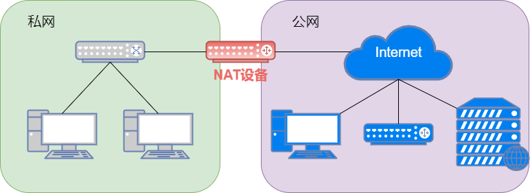
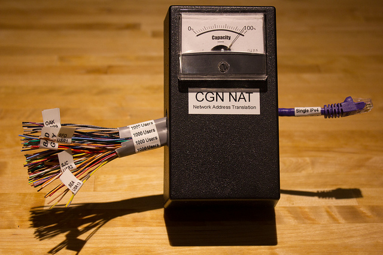
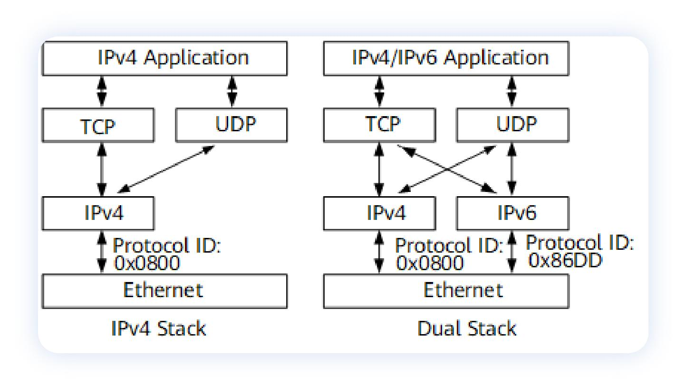
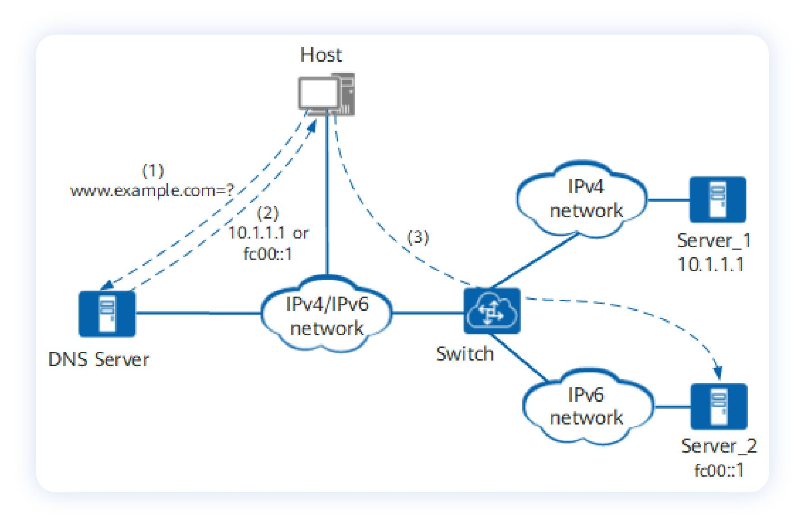
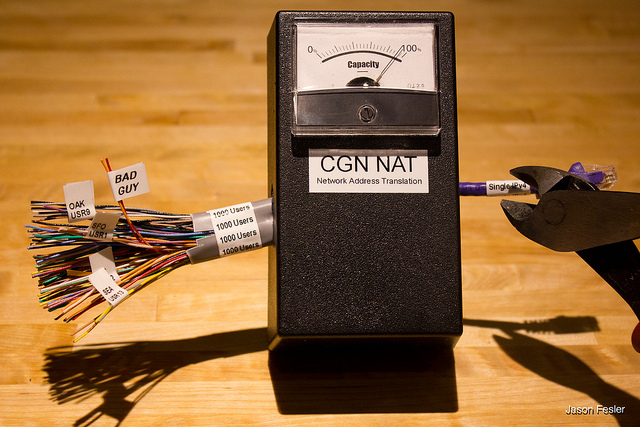

---

id: 544944

title: "简单说说：IPV4已耗尽，为什么你仍然可以访问互联网?"

created_at: 2025-04-10T00:59:44.336Z

username: lynn6

display_username: "Lynn"

---

# 简单说说：IPV4已耗尽，为什么你仍然可以访问互联网?

> **上篇文章：你的电脑是如何访问网页的？**

书接上文，在《[你的电脑是如何访问网页的？](https://linux.do/t/topic/543216)》中我们聊到了IP技术，同时我们知道了在计算机世界中，设备之间需要通过IP地址来找到彼此，才能进行数据交换和通讯。**没有IP地址，就像没有电话号码，通讯就无法实现**。

如果你没有看过上篇文章，欢迎跳转前去查看。

那么，你有想过一个问题吗，IPV4只有大约 43 亿个唯一的 IP 地址，但是全球互联网网民如此之多，每一台上网的设备都需要一个IP地址，这些IP应该早就被用尽了，**为什么我们仍然可以连接到互联网呢？**

后来的互联网设计者也为此而头疼，于是他们“开源节流”，从两个方面来处理这个问题。

## IPv6的崭露头角

为了长期解决IPv4地址不足的问题，互联网设计者推出了IPv6，这是IPv4的继任者。IPv6采用了128位地址，相对于IPv4的32位地址，它提供了几乎无限的IP地址。**简单来说，IPv6可以为地球上的每粒沙子提供一个唯一的IP地址**，这足以支持未来数代的互联网增长。[[1]](#footnote-5032929-1)

尽管IPv6的出现时间早于今天，但它的普及工作仍然在进行中。现在，越来越多的互联网服务提供商、网络运营商和网站已经支持IPv6，并向用户提供IPv6地址。在全球范围内，IPv6的采用逐渐增加，为互联网的可持续性和未来扩展性奠定了基础。

## 半路杀出程咬金：NAT技术

互联网设计者采用了地址重用的方法，其中的一项重要技术就是**网络地址转换（NAT）**。NAT技术允许多个内部设备共享同一个公共IPv4地址，**就像一个大家庭使用同一个电话号码接电话一样**。在NAT的帮助下，你家里的多台设备可以使用同一个公共IP地址访问互联网，而外部互联网上的服务器只会看到你的NAT路由器的IP地址。

这样做的好处是显而易见的，首先，它节省了IP地址的使用，因为多个设备可以共享一个地址，可以让IPV4“苟延残喘”一段时间。其次，NAT还提供了一定的安全性，因为外部网络无法直接访问你内部网络中的设备，这种隔离减少了一些潜在的网络威胁。

但是，NAT也有一些缺点。它可能导致一些特定的网络应用程序和服务出现问题，因为外部服务器无法直接与内部设备通信。此外，NAT会增加网络管理的复杂性，尤其是在大型企业网络中。

NAT会增加网络管理的复杂性。在大型企业网络中，可能会有多个内部设备和多个外部服务器需要相互通信。如果每个设备都使用不同的内部和外部IP地址，那么管理员需要记住和管理这些地址，以便正确地配置网络设置和防火墙规则。此外，由于NAT的使用，可能会出现多个虚拟私有网络（VPN），这可能会导致混淆和错误的配置。因此，管理和维护NAT设备可能需要更多的工作量和技术知识。

### 人人都在使用NAT

你知道吗，其实我们每天使用的互联网都在利用NAT技术！

没错，NAT技术已经深深融入了我们日常互联网的使用中，即使我们可能并不经常意识到它的存在。这项技术在我们的路由器、家庭网络和企业网络中都扮演着关键的角色。

NAT技术实际上是一种在IPv4网络中解决地址短缺问题的巧妙方法。它允许多台设备共享一个公共IPv4地址，就像**一栋大楼里的多户人家共享同一个门牌号一样**。

当你通过家庭网络连接到互联网时，你的路由器通常会分配到一个公共IPv4地址。然后，你的路由器使用NAT技术，为所有连接到它的设备（例如手机、电脑、智能家居设备）分配一个本地IP地址，这些地址通常是在私有的范围内，如192.168.x.x或10.x.x.x等。当这些设备与互联网上的服务器通信时，路由器会将它们的请求“翻译”成公共IPv4地址上的请求，以便与外部服务器通信。

在实际应用中，NAT技术的使用比比皆是，特别是在互联网服务提供商的网络中，它们使用NAT来分配IPv4地址，以便为更多用户提供服务。但是，随着互联网的不断发展和IPv4地址的枯竭，我们也需要更好的解决方案来支持未来互联网的增长。

这就是为什么IPv6的出现如此重要，它提供了巨大的地址空间，为互联网的可持续增长提供了坚实的基础。虽然NAT技术在一定程度上延长了IPv4的寿命，但解决地址短缺问题的根本之道仍然是IPv6。

## 平稳过渡：双栈支持

我们可以这么想，IPv4是一条狭窄的公路，而IPv6是一条宽敞的高速公路。

IPv4地址空间有限，就像一条狭窄的公路上只能容纳**有限数量**的车辆。随着互联网的发展，IPv4地址资源变得稀缺，这就像**公路上车辆拥挤**。而IPv6拥有**更多可用的IP地址**，就像建造了一条**宽敞的高速公路**，可以**容纳更多的车辆**。而在过渡期间，有些地方同时存在狭窄的公路（IPv4）和宽敞的高速公路（IPv6），以便让交通顺畅过渡到新的高速公路。

在互联网过渡期间，绝大多数网络和设备仍然使用IPv4。双栈技术的关键在于，它使设备能够同时支持IPv4和IPv6协议，这就像是新能源汽车（IPV6）和传统汽车（IPV4）一样。在完全转换之前，有着油电混用的汽车。这种并存允许设备在IPv4和IPv6网络之间切换，确保网络的平稳过渡。

### 扩展阅读

> 双协议栈技术简称双栈技术，是IPv4网络向IPv6网络过渡的一种有效的技术。网络中的设备既支持IPv4协议栈又支持IPv6协议栈，源设备根据目的设备的不同选用不同的协议栈，而源设备和目的设备之间的网络设备根据报文的协议类型选择不同的协议栈进行处理和转发。双栈可以在一个单一的设备上实现，也可以是一个双栈网络。对于双栈网络，其中的所有设备必须同时支持IPv4/IPv6协议栈，连接双栈网络的接口必须同时配置IPv4地址和IPv6地址。单协议栈和双协议栈结构示例如图3所示。

> ——华为云[[2]](#footnote-5032929-2)

> 如图4所示，首先主机Host向DNS服务器发送DNS请求报文，请求域名www.example.com对应的IP地址。

> 其次DNS服务器查找该域名对应的IP地址，并将查找到的结果返回给主机Host。域名www.example.com对应的IP地址可以是10.1.1.1或fc00::1。主机发送DNS请求报文的查询类型可以是A类查询或AAAA查询。当主机是IPv4主机时，主机发送的是A类查询，向DNS服务器请求的是域名对应的IPv4地址；当主机是IPv6主机时，主机发送的是AAAA查询，向DNS服务器请求的是域名对应的IPv6地址。DNS服务器根据收到DNS请求报文的查询类型回复域名对应的IP地址。

> 最后主机根据DNS服务器返回的查询结果，[访问域名www.example.com](http://xn--www-q33er8otu8go5o.example.com)。图中Switch支持双协议栈功能。如果主机访问IPv4地址为10.1.1.1的网络服务器，则可以通过Switch的IPv4协议栈访问目标节点。如果主机访问IPv6地址为fc00::1的网络服务器，则可以通过Switch的IPv6协议栈访问目标节点。

> ——华为云[[2:1]](#footnote-5032929-2)

## 有了NAT技术，为什么我们仍然需要IPV6？

实际上NAT已经可以正常保证我们的互联网正常使用，但是为什么我们仍然需要IPV6呢？不妨读一读下面的文章。

> 使用互联网的过程中，你的计算机与你要使用的服务之间需要建立连接。要想建立连接，你必须先知道对方的 IP（网际协议）地址，并且连接建立时，对方也能得知你的 IP 地址，这样他们才能把信息回复给你和你运行的程序。

> 20 世纪末 21 世纪初以来我们一直使用的网络协议的地址已经耗尽。通过多台机器共用地址的方式，我们仍可以继续使用这种协议，但是会受到一些限制。家庭或工作网络就经常采用这种方式。

> 问题在于，互联网服务提供商不得不面临一个事实：这种地址共享的规模将越来越大。你可能已经听过这些术语：NAT、CGN、运营商级 NAT、LSN、大规模 NAT。他们差不多都长这样：

>

> Photo by Jason Fesler - [Flickr Login](http://flic.kr/p/bhDoxg)

> 问题在于：一个公网地址会有**很多**人同时使用。

> 如果谁家有个无聊的黑客，或者（更有可能）有台脆弱的电脑，不更新，也不装杀毒软件，结果会怎样？要是那台电脑开始攻击你的网银或者常用的网站呢？

> 被攻击的网站终归要靠屏蔽流量来维持正常运行。不幸的是，他们只能看到这个无数人共用的地址，也就只能这样屏蔽：

> 

> Photo by Jason Fesler - [Flickr Login](http://flic.kr/p/bhDomR)

> 这可不是什么好事。而最有效的解决办法就是确保你的 IPv6 运行正常，并且是首选的协议。

> 大多数操作系统和浏览器本身都强烈倾向于使用 IPv6，而非（可能正和别人共用地址的）IPv4。如果你的浏览器并非如此，而你想改变现状，不妨向浏览器厂商反馈。你也可以换一个正常的浏览器作为权宜之计。

> ——《你的浏览器倾向于使用 IPv4 而非 IPv6》

实际上IPV6普及的好处有很多，与朋友MC联机的时候不再需要内网穿透等工具、可以利用BT快速下载资源文件、更快的访问互联网…

## 小结一下

1. **IP地址的重要性**：IP地址类似于电话号码，它是设备之间进行数据交换和通信的关键。**没有IP地址，设备无法连接到互联网**。

2. **IPv4地址枯竭**：IPv4只有约43亿个唯一IP地址，然而全球互联网用户数量巨大，这意味着IP地址早就应该被用尽。这引发了如何继续连接到互联网的问题。

3. **IPv6的崭露头角**：为了解决IPv4地址不足的问题，互联网设计者推出了IPv6，它采用了128位地址，提供了**几乎无限的IP地址**，确保了互联网的可持续增长。

4. **NAT技术的应用**：NAT技术允**许多个内部设备共享一个公共IPv4地址**，以延长IPv4地址的使用寿命。尽管NAT解决了一部分问题，但它也引入了一些限制和复杂性。

5. **为什么仍然需要IPv6**：尽管NAT技术在一定程度上帮助解决了IPv4地址枯竭问题，但IPv6仍然至关重要。IPv6提供了更大的地址空间、全球可互通性、更简化的网络管理和更强的网络安全性，有助于满足未来互联网的需求。

6. **双栈支持的平稳过渡**：双栈技术允许设备同时支持IPv4和IPv6，确保了网络的平稳过渡，使设备可以逐渐过渡到IPv6，同时与IPv4设备通信，无需中断连接。

## 后记

实际上，中国早已开始推进IPV6的建设，你可以经常在软件开屏处看到“本软件已支持IPV6网络”的字样。

同时根据《中国IPv6产业发展报告（2023版）》的说明，截至2023年5月，我国IPv6活跃用户数达到7.63亿，用户占比达到71.51%，用户规模位居世界前列。[[3]](#footnote-5032929-3)

---

1. [IPv6 - 维基百科，自由的百科全书](https://zh.wikipedia.org/wiki/IPv6)	“维基百科：IPV6” [↩︎](#footnote-ref-5032929-1)

2. [https://support.huawei.com/enterprise/zh/doc/EDOC1100138280/e0e5c6c7/ipv4-ipv6-dual-stack](https://support.huawei.com/enterprise/zh/doc/EDOC1100138280/e0e5c6c7/ipv4-ipv6-dual-stack)	华为云：双协议栈 [↩︎](#footnote-ref-5032929-2) [↩︎](#footnote-ref-5032929-2)

3. [我国IPv6活跃用户数达7.63亿-新华网](http://www.news.cn/fortune/2023-07/04/c_1129732232.htm)  新华网：我国IPv6活跃用户数达7.63亿 [↩︎](#footnote-ref-5032929-3)

---

*来源: https://linux.do/t/topic/544944.json*

