---

id: 545241

title: "类postman的API测试工具"

created_at: 2025-04-10T02:31:30.001Z

username: runbrick

display_username: "砖头"

---

# 类postman的API测试工具

不分排名，不推荐。

本次文章辅助工具：

- PixPin 长截图功能

- Chrome

- grok API 查找 SoapUI 价格

- 沉浸翻译+deepseek v3

## postman

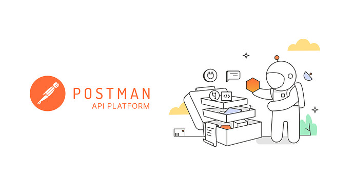

### [Postman: The World's Leading API Platform | Sign Up for Free](https://www.postman.com/)

Accelerate API development with Postman's all-in-one platform. Streamline collaboration and simplify the API lifecycle for faster, better results. Learn more.

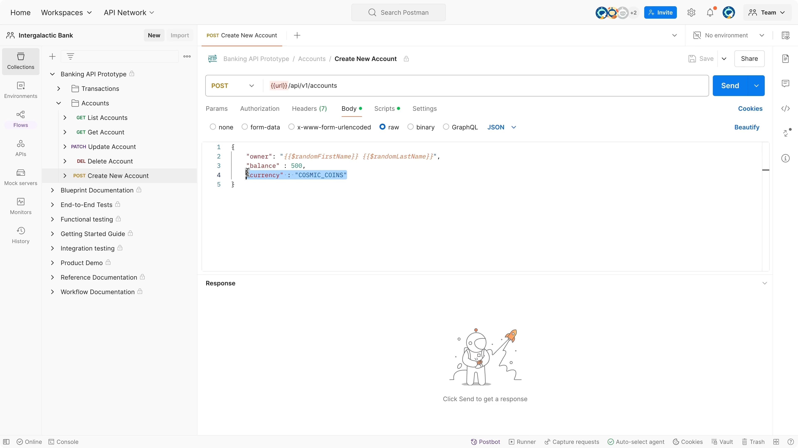

## Insomnia

### [The Collaborative API Development Platform](https://insomnia.rest/)

Leading Open Source API Development Platform for HTTP, REST, GraphQL, gRPC, SOAP, and WebSockets

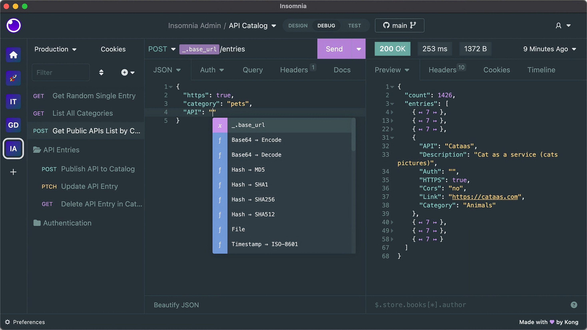

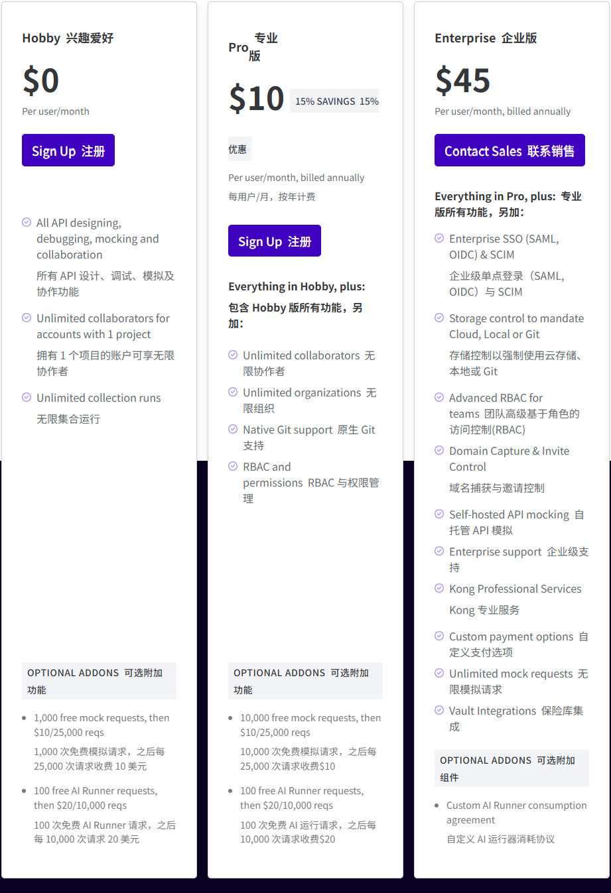

## SoapUI （非专业不推荐，太贵）

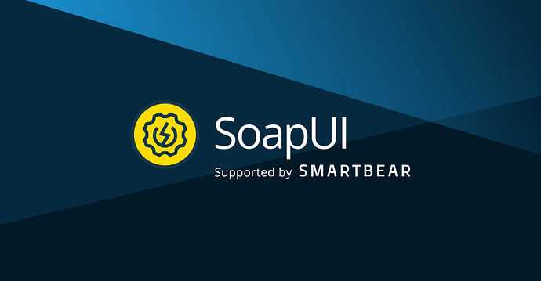

### [The World’s Most Popular API Testing Tool | SoapUI](https://www.soapui.org/)

SoapUI is the world’s most widely-used automated testing tool for SOAP and REST APIs. Write, run, integrate, and automate advanced API Tests with ease. See why millions of users trust SoapUI for testing their APIs today!

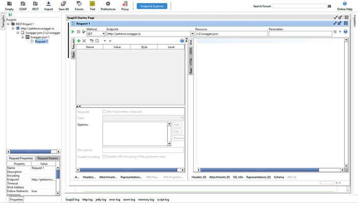

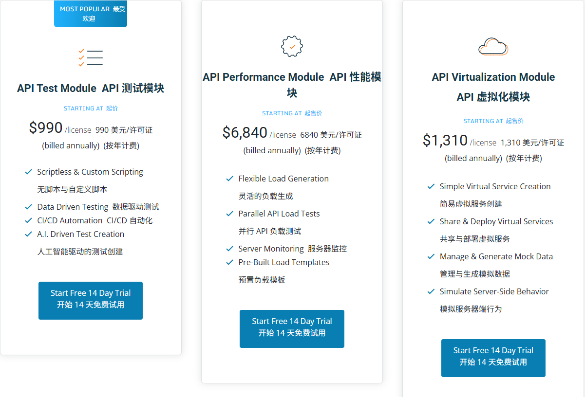

## Apifox

### [Apifox - API 文档、调试、Mock、测试一体化协作平台。拥有接口文档管理、接口调试、Mock、自动化测试等功能，接口开发、测试、联调效率，提升...](https://apifox.com/)

Apifox = Postman + Swagger + Mock + JMeter。集接口文档工具、接口Mock工具、接口自动化测试工具、接口调试工具于一体，提升 10 倍研发效率。是最好用的API文档工具，API自动化测试工具，API Mock工具，接口文档管理工具，接口文档生成工具。

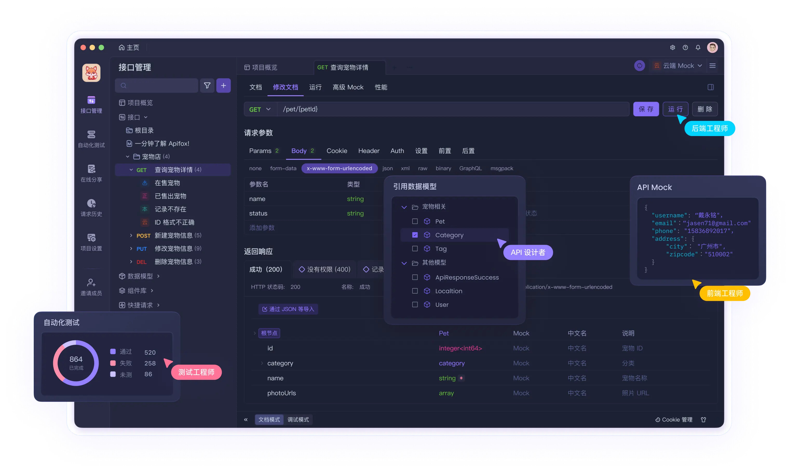

## Hoppscotch (免费)

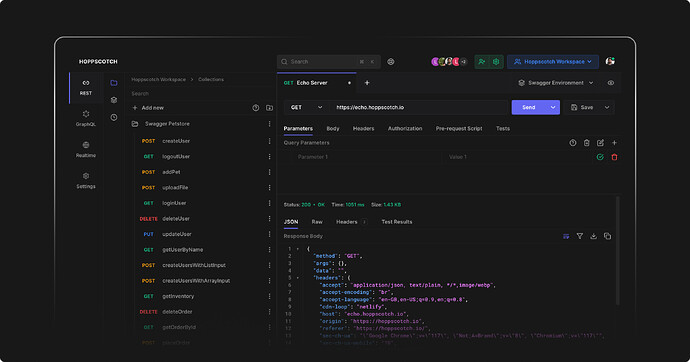

### [Hoppscotch • Open source API development ecosystem](https://hoppscotch.io/)

Helps you create requests faster, saving precious time on development.

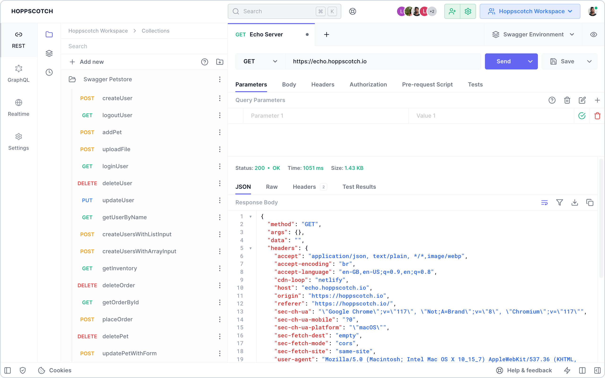

## apipost （免费版本+企业版本联系客服）

### [Apipost-API 文档、设计、调试、自动化测试一体化协作平台](https://www.apipost.cn/)

Apipost是集API设计、API调试、API文档、自动化测试为一体的API研发协同平台,支持grpc,http,websocket,socketio,socketjs类型接口调试,支持私有化部署。

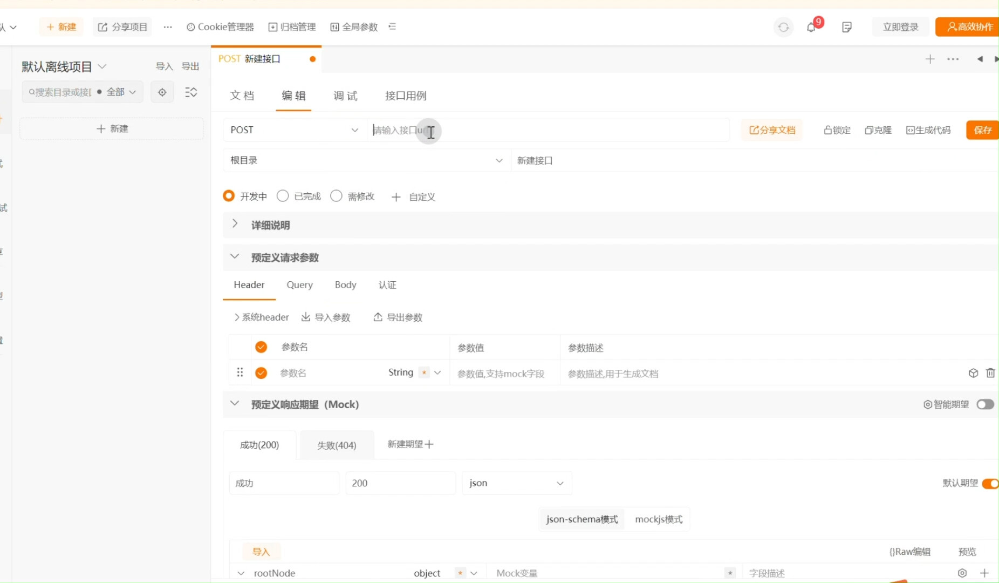

## reqable

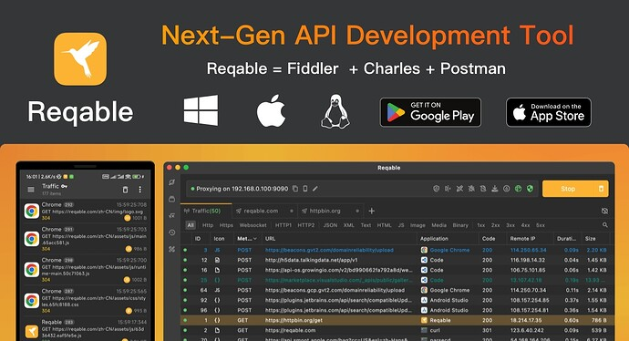

### [Reqable · API抓包调试 + API测试一站式工具](https://reqable.com/zh-CN/)

Reqable = Fiddler + Charles + Postman，新一代网络抓包和API测试一站化解决方案，让API更快更简单。

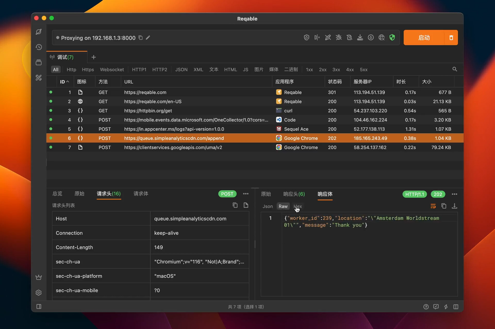

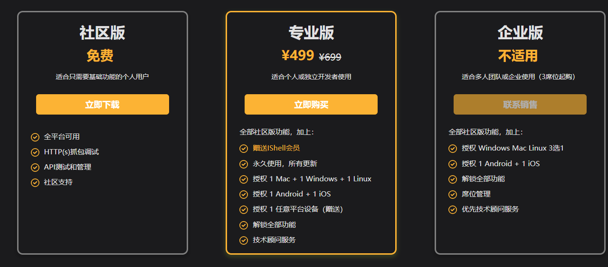

## yaak

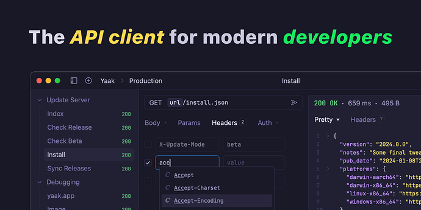

### [Yaak – The API client for modern developers](https://yaak.app/)

A fast, secure, and offline API client that works with Git.

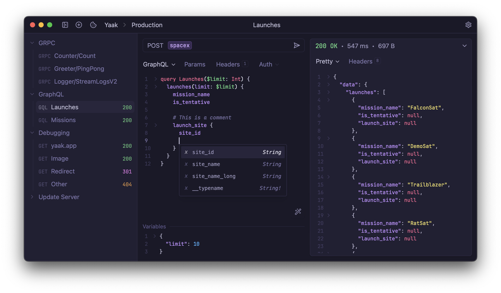

## usebruno

[https://www.usebruno.com/](https://www.usebruno.com/)

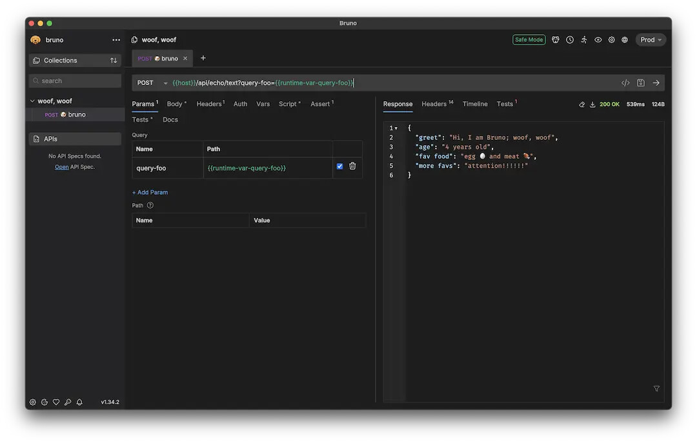

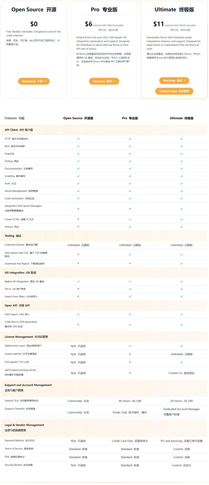

## apidog

[https://apidog.com/](https://apidog.com/)

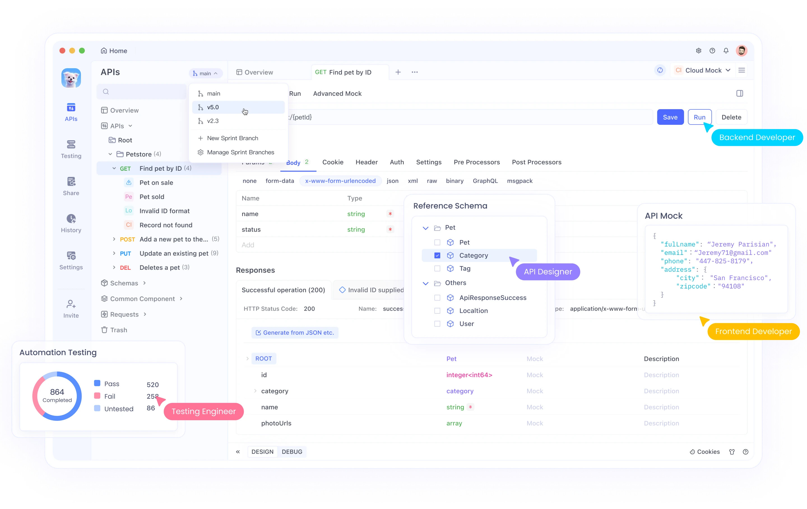

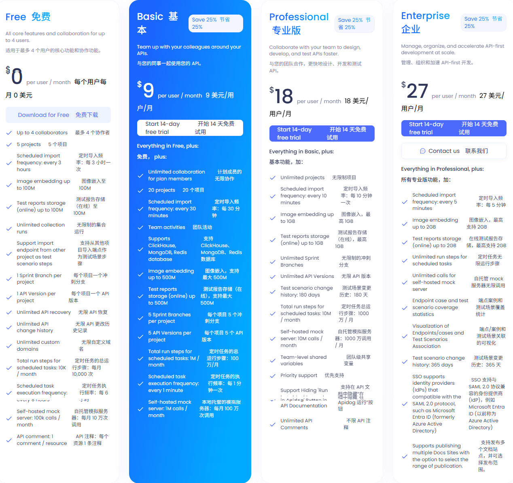

---

*来源: https://linux.do/t/topic/545241.json*

