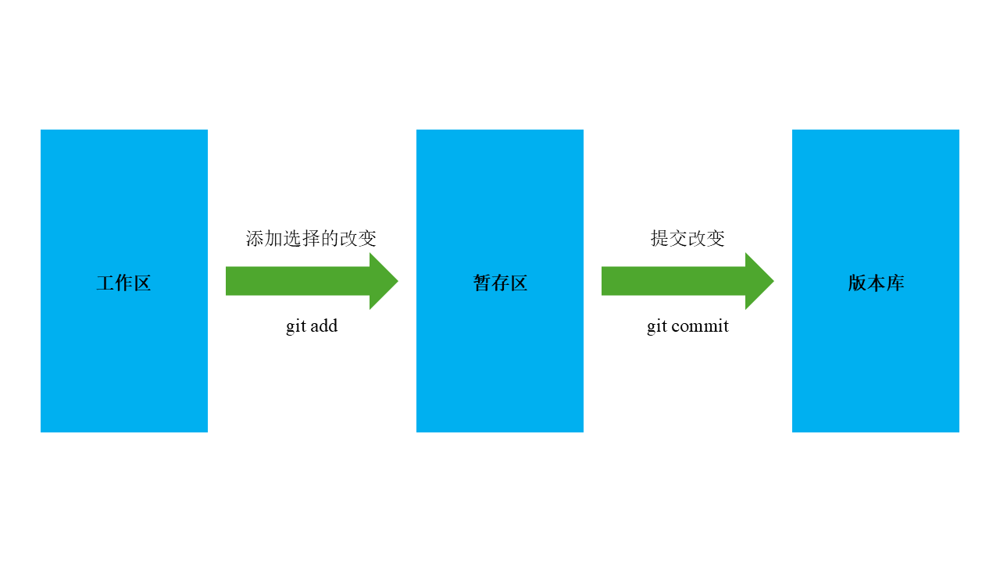

---

id: 547501

title: "带你了解Git以及一些基本的命令"

created_at: 2025-04-11T01:49:01.060Z

username: Lorelei

display_username: "Lorelei"

---


# 带你了解Git以及一些基本的命令


# 一、Git概述

## 1. Git安装及使用

- 官网：[Git官网](https://git-scm.com/)

- 安装：安装适合自己的版本，默认安装即可

- 使用：选择一个文件夹，右键，当出现：`Git Bash`后说明安装成功，后续使用都是基于`Git Bash`

## 2. Git简介

- Git是一个**分布式**版本控制工具

- Git仓库


**本地仓库**：自己电脑的`Git`仓库

**远程仓库**：远程服务器上的`Gi`t仓库

- **commit**：提交，将本地文件和版本信息保存到本地仓库

- **push**：推送，将本地仓库文件和版本信息上传到远程仓库

- **pull**：拉取，将远程仓库文件和版本信息下载到本地仓库

# 二、Git常用命令

此处最最重要的是**本地仓库操作**和**远程仓库操作**

## 1. Git全局设置

设置用户信息

```
git config --global user.name "用户名"
git config --global user.email "邮箱"
```

查看配置信息

```
git config --list
git config --global --list
```

## 2. 获取Git仓库

获取Git仓库有两种方式：

- 在本地初始化一个`Git`仓库

- 从远程仓库克隆

### 2.1 在本地初始化Git仓库

执行步骤如下：

1. 在任意目录下创建一个空目录作为我们的本地Git仓库

2. 进入这个目录，点击右键打开`Git bash`窗口

3. 执行命令`git init`

4. 在当前目录中看到`.git`文件夹（隐藏文件夹）说明`Git`仓库创建成功

### 2.2 从远程仓库克隆

- 命令：`git clone [远程Git仓库地址]`

## 3. 工作区、暂存区和版本库的概念

了解这三个概念有助于理解`Git`的工作流程

- **版本库**：`.git`隐藏文件夹就是版本库，包含配置信息等

- **工作区**：包含`.git`文件夹的目录就是工作区，存放开发的代码

- **暂存区**：`.git`文件夹中有很多文件，其中有一个`index`文件就是暂存区，临时保存修改文件的地方




## 4. Git工作区中文件的状态

`Git`工作区中的文件存在两种状态：

- `untracked` 未跟踪（未被纳入版本控制）

- `tracked` 已跟踪（被纳入版本控制），其中有细分为如下三种状态：


`Unmodified` 未修改状态

`Modified` 已修改状态

`Staged`  已暂存状态

**注意**：这些文件的状态随着执行`Git`的命令发生变化

## 5. 本地仓库操作

| 命令 | 解释 |

| --- | --- |

| git status | 查看文件状态 |

| git add | 将文件的修改加入暂存区 |

| git reset | 将暂存区的文件取消暂存或者是切换到指定版本 |

| git commit | 将暂存区的文件修改提交到版本库 |

| git log | 查看日志 |

### 5.1 加入暂存区

- 命令后面的 `.` 指定是添加所有文件

```
git add .
```

- 只添加 `a.txt`

```
git add a.txt
```

### 5.2 提交

- 要使用 `-m` 来添加提交信息

```
git commit -m "提交信息"
```

### 5.3 查看日志信息

- 查看详细的日志信息

```
git log
```

- 查看简略的日志信息

```
git reflog
```

- 若日志信息太多，按`q`或`ctrl+c`退出

### 5.4 回退到指定版本

- 使用`git reflog`查看版本，最前面的是版本`id`，假设版本id为`b210086`

- 再使用如下命令回退到该版本即可

```
git reset b210086
```

## 6. 远程仓库操作

| 命令 | 解释 |

| --- | --- |

| git remote | 查看远程仓库 |

| git remote add | 添加远程仓库 |

| git clone | 从远程仓库克隆 |

| git pull | 从远程仓库拉取 |

| git push | 推送到远程仓库 |

### 6.1 查看远程仓库

- 使用`-v`查看详细信息

```
git remote -v
```

### 6.2 添加远程仓库

- 运行 `git remote add <shortname> <url>` 添加一个新的远程Git仓库，同时指定一个可以引用的简写

```
git remote add origin https://gitee.com/perry/repo.git
```

- 注意：在远程仓库中创建了一个仓库后，远程仓库==不要做初始化操作==，不然无法从本地`push`上去。这是因为要使用`git push`之前，本地仓库一定要包含远程仓库的文件，不然会`git push`失败

### 6.3 推送至远程仓库

- 命令：`git push [remote-name] [branch-name]`

```
git push origin master
```

- 注意：在使用`git push`命令将本地文件推送至码云远程仓库时，需要进行身份认证，认证通过才可以推送

- 若已经登录过一次，下次还需要认证，执行以下命令：

```
git config --global credential.helper.store
```

### 6.4 从远程仓库拉取

- 从远程仓库获取最新版本并合并到本地仓库，命令：`git pull [short-name] [branch-name]`

```
git pull origin master
```

- 注意：如果当前仓库不是从远程仓库克隆，而是本地创建的仓库，并且仓库中存在文件，此时再从远程仓库拉取文件的时候会报错（`fatal:refusing to merge unrelated histories`）。解决此问题可以在`git pull`命令后加入参数`--allow-unrelated-histories`

```
git pull  --allow-unrelated-histories origin master
```

- 会进入`vim`模式，直接保存并退出即可：`:wq`

## 7. 分支操作

- 使用分支意味着把你的工作从开发主线上分离开来，以免影响开发主线。同一个仓库可以有多个分支，各个分支相互独立，互不干扰

- 通过`git init`命令创建本地仓库时会默认创建一个`master`分支

| 命令 | 解释 |

| --- | --- |

| git branch | 查看分支 |

| git branch [name] | 创建分支 |

| git checkout [name] | 切换分支 |

| git push [shortName] [name] | 推送至远程仓库分支 |

| git merge [name] | 合并分支 |

### 7.1 查看分支

- 列出所有本地分支

```
git branch
```

- 列出所有远程分支

```
git branch -r
```

- 列出所有本地分支和远程分支

```
git branch -a
```

### 7.2 创建分支

- 创建分支，基于哪个分支创建的，则新分支会包含原分支的所有信息

### 7.3 新分支推送至远程仓库

- 使用新分支推送到远程仓库后会发现不同分支的内容不同，即在远程仓库中`master`和新分支内容不同

### 7.4 合并分支

- 将新分支（b1）的内容合并到master，先切换到**master分支**，再使用`git merge b1`，此时`b1`分支就会合并到`master`分支，再使用`git push origin master`，则在远程仓库中`master`分支就合并了新分支的内容

## 8. 标签

- Git中的标签，指的是某个分支某个特定时间点的状态。通过标签可以很方便的切换到标记时的状态。

- 比如用这个功能标记发布结点（v1.0、v1.2）

| 命令 | 解释 |

| --- | --- |

| git tag | 列出已有的标签 |

| git tag [name] | 创建标签 |

| git push [shortName] [name] | 将标签推送至远程仓库 |

| git checkout -b [branch] [name] | 检出标签 |

### 8.1 创建标签

- 比如在完成一个阶段的代码开发，则在提交并推送代码后，可以创建标签并推送，远程仓库中的标签有着此时的所有代码

- 示例：

```
git tag v1.0
```

### 8.2 将标签推送至远程仓库

- 示例：

```
git push origin v1.0
```

### 8.3 检出标签

- 使用场景：比如此时有`v1.0`和`v2.0`两个标签，且`v2.0`比`v1.0`更新，但是我们需要基于`v1.0`的代码进行修改，这个时候体现出标签的好处，因为我们在`v1.0`的时候打上了一个标签

- 以下代码的功能是检出`v1.0`标签并基于`v1.0`代码创建一个新的分支`b1.0`并切换到该新分支

```
git checkout -b b1.0 v1.0
```

## 9. 使用时注意事项

- 在写代码前先`pull`一下

- 写完代码先`commit`，再进行`pull`或`push`操作

---

> 根据 [Yuhiri](https://linux.do/u/talentestors) 佬友的提示，再补充一些内容

## 10. Stash 操作

| 命令 | 解释 |

| --- | --- |

| git stash | 保存当前工作区的状态而不进行提交 |

| git stash list | 查看所有已保存的stash条目 |

| git stash apply | 应用某个stash而不删除它 |

| git stash pop | 应用并删除最近一次的stash |

| git stash drop | 删除一个已存储的stash |

| git stash clear | 清空所有stash记录 |

### 10.1 保存当前工作

- 当你正在进行一些工作但还未完成时，可以使用 `git stash` 来临时保存你的更改。这会将你当前工作目录和暂存区的所有更改保存起来，并将它们从工作区中移除。

```
git stash
```

- 如果你想为这个stash添加描述信息，可以使用 `-m` 参数：

```
git stash save -m "描述信息"
```

### 10.2 查看stash列表

- 要查看所有的stash条目，可以使用：

```
git stash list
```

这将列出所有的stash，每个都有一个唯一的引用名如 `stash@{0}` 、`stash@{1}` 等等。

### 10.3 应用stash

- 要重新应用之前保存的stash到当前工作区，可以使用 `git stash apply` 或者 `git stash pop` 。前者会保留stash内容，而后者会在应用后自动删除该stash。

```
git stash apply stash@{0}
# 或者直接使用 git stash pop 应用最近一次的stash
git stash pop
```

### 10.4 删除stash

- 如果确定不再需要某个stash，可以通过以下命令删除：

```
git stash drop stash@{0}
```

- 清空所有stash记录：

```
git stash clear
```


---


*来源: https://linux.do/t/topic/547501.json*

