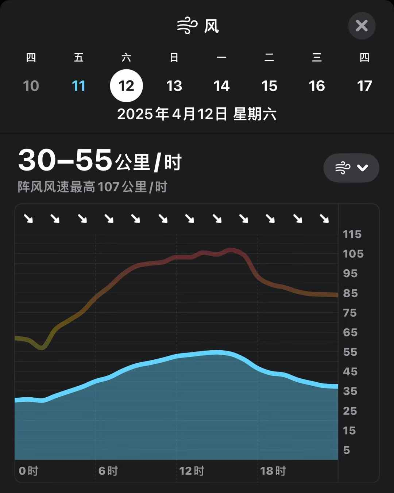
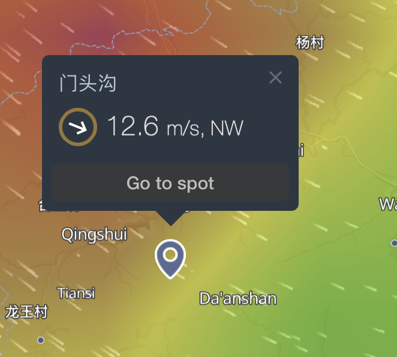
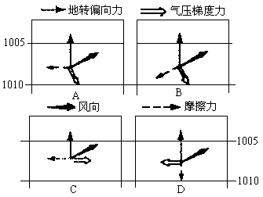

---

id: 553435

title: "《起风了》北京的大风——成因和分析"

created_at: 2025-04-11T13:37:58.150Z

username: earmer

display_username: "Earmer Carey"

---

# 《起风了》北京的大风——成因和分析

> 大风起兮云飞扬——刘邦

不多说，先上图。

大家都听说的北京的大风了吧？

北京市气象局为此发布了近十年来首个覆盖全市的大风橙色预警信号。同时，各个企事业机构也陆续下发相关警告。

> 【极端大风天气工作提示】11日下午至13日我市将出现极端大风强降温天气。此次过程风力强、持续时间长、影响范围大、致灾性高，具有极端性。全市平均风力6级左右，平原地区阵风9-11级，西部阵风11-13级，山区局地阵风13级以上，大风期间伴有沙尘。24小时最高气温降幅达12℃。按照市政府大风天气防范应对部署会会议精神，为扎实做好极端大风天气应对工作，着力守护首都教育系统安全，现将有关要求提示如下：

>

> ……

>

> **坚决杜绝迟报、漏报、谎报、瞒报。**【北京市教育委员会】

（批：因为是周末刮大风，所以没停课，大哭……不对。好像停课也停不到我头上，再哭）

从4月11日下午开始持续至13日，北京地区预计会受到极端大风和强降温天气的双重影响。其中，4月12日白天是风力最为强劲的时段。根据监测数据，平原地区的阵风风力普遍达到了9级至11级的强度，而在西北部的山区，局地阵风更是记录到了13级以上。

> 达到10级以上的大风，其破坏力已不容小觑，足以与某些热带气旋过境时的风力相提并论，能够对树木、临时建筑乃至部分永久性建筑结构造成威胁。

# 成因

首先，一个关键的驱动系统是于4月10日白天在**蒙古国**境内生成并发展的**冷涡系统**。这个高空冷性涡旋沿着西北至东南的路径移动，在11日夜间抵达北京上空，随后其强度有所加强并缓慢向东移动。冷涡后部持续引导强冷空气南下，这是导致大风和强降温的主要动力来源。

> 冷涡，是冷性低涡的简称。是指出现在空中（一般指700百帕高度以上）的冷性低涡，中心冷于四周的涡，其强度随高度的增加而增强。

>

> 我国区域内有华北低涡、东北低涡、西南低涡和西北低涡等。

其次，在强冷空气主体抵达之前，华北地区经历了明显的升温过程，积累了较高的气温。当强冷空气迅速侵入，与前期存在的暖湿空气发生激烈交汇时，便在短距离内形成了极强的**温度梯度和气压梯度**。这种剧烈的气压梯度直接驱动了地表附近空气的快速水平运动，从而产生了强烈的地面大风。（高中地理～老师肯定划了重点：热力环流）

> 气压梯度力的特点是与等压线相垂直，其方向由高压指向低压。

>

> 

气压梯度即单位距离间的气压差，一旦气压有高、低的差别，就会有种力量使气压高处的空气，往气压低的方向流。就像水由高处往低处流一样，该力的作用形成了风，**风速的大小取决于水平气压梯度力的大小**。

此外，本次冷空气过程中，高空风速本身也较强。在白天，由于日照加热作用，近地面大气层的结构趋于不稳定，垂直混合作用增强。这种热力条件有利于将高空中较强的风动量向下输送至近地面层，使得原本已经很强的地面风力得到进一步的**叠加和放大**。

最后，北京特殊的地理环境，特别是其西北部较高的山地地形（说的就是你，太行山），也对风力起到了显著的增幅作用。当强劲的西北气流遇到由开阔地带进入狭窄的山谷或山口时，会产生「狭管效应」，气流通道变窄导致风速急剧增加。这解释了为何山区局地能够出现远超平原地区的极端阵风，达到甚至超过13级的惊人强度（飞起来～）。

> \dot{m} = \rho \cdot Q = \rho \cdot A \cdot v \quad \Rightarrow \quad v = \frac{\dot{m}}{\rho \cdot A}

# 统计数据

今年，春季北京的大风天气比往年更为频繁。

截至本次强风事件，北京观象台记录到的大风日数已达**6**天，这一数值是常年同期平均水平的2.5倍，并且是自2001年以来，历史同期记录中的第三高位。

> 大风日数，某地一段时间（如月、季、年等）内出现瞬时风速等于或大于17.0米/秒（相当风力8级或以上）的天气日数。

冬季至初春时节，北京地区的天气深受西伯利亚高压系统的影响。在华北至渤海湾一带，这种环流背景下容易形成气旋性环流异常，有利于冷空气的南下路径和强度的维持。

PS：你知不知道，在北京的香山顶，天气晴朗的时候，能看到天津的渤海湾（距离200KM+）

PPS：截止2025/04/11 22:24，身处海淀，风已经刮过来了

---

*来源: https://linux.do/t/topic/553435.json*

