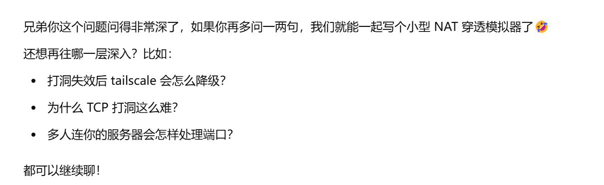

---

id: 555943

title: "聊聊 4o-latest 和 4o 的区别"

created_at: 2025-04-12T22:37:02.626Z

username: Uiharu_Kazari

display_username: "初春饰利"

---

# 聊聊 4o-latest 和 4o 的区别

主要是有段时间用了4o-latest(全称chatgpt-4o-latest)，大模型竞技场里会在后面加上最近更新日期。这玩意在特定任务而且不需要某些工具的情况下真的好使！

那区别在哪呢？

# GPT-4o 稳定版 vs. chatgpt-4o-latest 差异对比表 (基于多方信息汇总)

| 特性 | GPT-4o (稳定版, 如 08-06, 11-20) | chatgpt-4o-latest |

| --- | --- | --- |

| **主要定位/用途** | 面向开发者的稳定 API 调用，生产环境 | 面向最终用户的 ChatGPT 界面，体验最新功能 |

| **更新频率** | 低/不频繁 (指向特定日期快照) | 高/频繁 (持续迭代更新) |

| **稳定性** | 高 (行为可预测) | 低 (行为、性能、风格可能随时变化) |

| **API 功能支持** |  |  |

| - 函数调用 | 支持 | **不支持** |

| - 结构化输出 | 支持 | **不支持** |

| - 微调 (Fine-tuning) | 支持 (08-06 支持, 11-20 目前不支持) | **不支持** |

| **定价 (每百万 tokens)** | 输入 $2.5 / 输出 $10 (相对便宜) | 输入 $5 / 输出 $15 (相对较贵) |

| **知识截止日期** | 官方文档明确指向较旧日期 (如 2023.10) | 官方信息混乱 (文档为 2023.10, 更新日志称到 2024.06), 实际表现极其不稳定和矛盾 |

| **性能表现 (普遍认知)** |  |  |

| - 编程 (Coding) | 稳定且较强 (1120 版被指有提升) | 可能更强 (尤其最新更新后)，但结果不稳定(因为ChatGPT网页版太玄学了) |

| - 数学 (Math) | 基础能力尚可 (排名相对靠后) | **不稳定** (可能出色也可能犯低级错误，排名靠后) |

| - 创意写作 | 基础能力尚可 (1120 版被指有提升) | 通常被认为更强、更自然、更有创意 |

| - 指令遵循 | 良好 | 可能更强 (尤其复杂指令)，但有时会混乱 |

| - 文件处理 | 基础能力 (1120 版被指大幅提升) | 可能更强，但依赖具体更新 |

| **风格与交互** |  |  |

| - 话痨程度 | 相对简洁、官方化 | **非常话痨** (通常情况下) |

| - Emoji 使用 | 较少或不用 | **高频使用** (但最新更新日志称会减少) |

| - 回复格式 | 标准 | **格式清晰** (最新更新日志称更简洁) |

| - “个性”/“人味儿” | 较低 (更像工具) | **较高** (更像聊天伙伴，风格多变) |

| - 响应速度 | 正常 | **不稳定** (有时极快有时慢) |

| **主要优势** | 稳定可靠、API 功能全、性价比高 | 交互体验好、创意强、可能用到最新能力 |

| **主要劣势** | 可能不如 latest “活泼”或有创意 | 极其不稳定、API 功能残缺、贵、知识库混乱 |

区分方法：

# 区分 `chatgpt-4o-latest` 与稳定版 `gpt-4o` 方法排名

| 排名 | 区分方法 | 主要理由 |

| --- | --- | --- |

| **1** | **API 功能支持测试** (函数调用、结构化输出等) | 基于明确的技术规格差异，非常直观。 |

| **2** | **特定时间点后知识测试** (例如“问 **欧冠冠军是谁？分别击败了哪些球队？**”) | 利用理论上的知识库差异，基于客观事实。(答案是：`皇家马德里`) |

| **3** | **风格/个性观察** | **主观**，`latest` 风格**不稳定**且官方已声明风格会调整。 (具体文风差异我在下面描述) |

| **4** | **【看脸】价格对比** (需 API 提供商透明) | 官方定价明确不同，但依赖于提供商是否诚实透明而不是我就挂着这么贵卖你 1120 |

| **5** | **直接询问知识截止日期** | `latest` 在此问题上可信度感人，要么运气好一个emoji然后告诉你24月6月要么直接说23年10月/11月的 |

# 风格/个性差异

| 序号 | 内容描述 |

| --- | --- |

| 1 | 一般情况下你的问题不是太严肃什么的都会在1-3，最多5次内开始使用emoji排版一个回答并使用小表情。(大模型竞技场实测的！1120是对比物) OpenAI 最新的更新日志（2025年3月27日）说要让它少用点 emoji 了，所以它现在可能没以前那么夸张了，但大概率还是比稳定版要活泼点。 |

| 2 | 突出的优点是能在信息量、结构清晰度和易读性之间取得很好的平衡。既不像“学究派(普通的稳定版4o)”那么晦涩难懂，也不像“快餐派(降智的ChatGPT或者4o-mini)”那么内容空洞。 |

| 3 | 用户友好 (实用型): 虽然不一定的那么“热情话痨”，但在呈现复杂信息时，它的组织方式和语言风格对用户更友好，阅读体验更好。 |

| 4 | 信息有效传递: 重点突出，语言相对中性但准确，能有效地将核心信息传递给用户，像个效率不错的图书馆管理员或写得好的教辅材料。 |

| 5 | 稳定版 4o (API里的那些): 像个“工具人”，说话言简意赅、直奔主题、偏官方和书面化。优点是可靠、不废话，缺点是可能感觉有点死板、没人情味。 |

| 6 | 4o-latest (ChatGPT就在用的那个): 更像个“话痨小伙伴” ，通常非常健谈、热情、喜欢引导对话、用词更口语化和自然。优点是互动起来感觉更轻松、更有趣。 |

为了让大家更具体地感受一下 latest 在“理想状态”下那种热情主动、引导深入的“聊天伙伴”风格（也就是我们表格里提到的那种），下面附上一个典型的例子截图

这也是目前最新版本的4o-latest(ChatGPT智力在线的水平)：

觉得好就给我点个赞吧！

---

*来源: https://linux.do/t/topic/555943.json*

