---

id: 558799

title: "【API Pricing】各厂API价格汇总"

created_at: 2025-04-14T07:24:15.839Z

username: obrook

display_username: "思危"

---

# 【API Pricing】各厂API价格汇总

更新时间：2025-04-13T16:00:00Z

因为要找实惠点的API，汇总比较下各厂API价格，佬们也可增删改查此帖

# 网页版

### [https://artificialanalysis.ai/](https://artificialanalysis.ai/)

贡献者 [@Shreno](/u/shreno)

我也分享一個，這家還有token速度和可靠性能比較

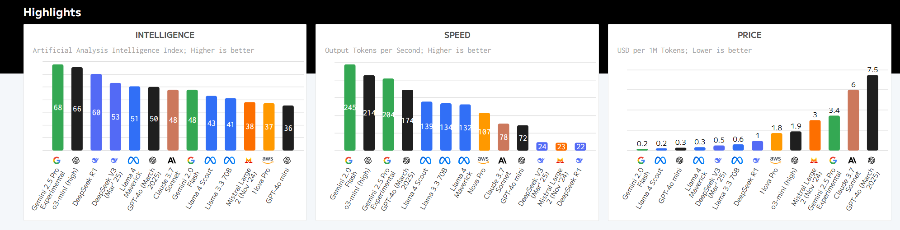

---

### [AI API Price Comparison](https://ohswklctdl.app.yourware.so/)

贡献者 [@rick_w](/u/rick_w)

让ai根据各位佬的数据搓了一个网页，可以参考下

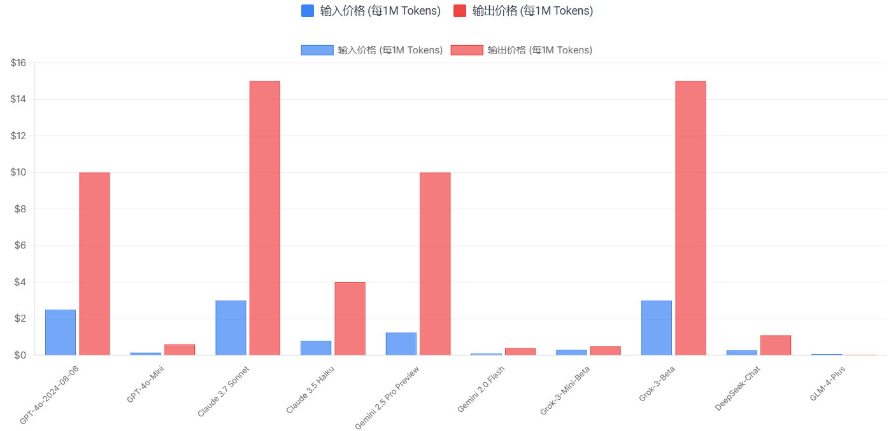

# 表格版

贡献者 [@Viss](/u/viss)

用Grok3整理了一版 

| 供应商 | 模型名称 | 上下文长度 | 输入价格 (每 1M Tokens) | 输出价格 (每 1M Tokens) | 其他价格信息 (如缓存输入等) | 备注 |

| --- | --- | --- | --- | --- | --- | --- |

| **OpenAI** | GPT-4.5-Preview-2025-02-27 | - | $75.00 | $150.00 | 缓存输入: $37.50 | - |

|  | GPT-4o-2024-08-06 | - | $2.50 | $10.00 | 缓存输入: $1.25 | - |

|  | GPT-4o-Audio-Preview-2024-12-17 | - | $2.50 | $10.00 | - | - |

|  | GPT-4o-RealTime-Preview-2024-12-17 | - | $5.00 | $20.00 | 缓存输入: $2.50 | - |

|  | GPT-4o-Mini | - | $0.15 | $0.60 | 缓存输入: $0.075 | - |

|  | GPT-4o-Mini-Audio-Preview-2024-12-17 | - | $0.15 | $0.60 | - | - |

|  | GPT-4o-Mini-RealTime-Preview-2024-12-17 | - | $0.60 | $2.40 | 缓存输入: $0.30 | - |

|  | o1-2024-12-17 | - | $15.00 | $60.00 | 缓存输入: $7.50 | - |

|  | o1-Pro-2025-03-19 | - | $150.00 | $600.00 | - | - |

|  | o3-Mini-2025-01-31 | - | $1.10 | $4.40 | 缓存输入: $0.55 | - |

|  | o1-Mini-2024-09-12 | - | $1.10 | $4.40 | 缓存输入: $0.55 | - |

|  | GPT-4o-Mini-Search-Preview-2025-03-11 | - | $0.15 | $0.60 | - | - |

|  | GPT-4o-Search-Preview-2025-03-11 | - | $2.50 | $10.00 | - | - |

|  | Computer-Use-Preview-2025-03-11 | - | $3.00 | $12.00 | - | - |

| **Anthropic Claude** | Claude 3.7 Sonnet | 200K | $3.00 | $15.00 | - | - |

|  | Claude 3.5 Sonnet | 200K | $3.00 | $15.00 | - | - |

|  | Claude 3.5 Haiku | 200K | $0.80 | $4.00 | - | - |

|  | Claude 3 Opus | 200K | $15.00 | $75.00 | - | - |

|  | Claude 3 Haiku | 200K | $0.25 | $1.25 | - | - |

| **Google Gemini** | Gemini 2.5 Pro Preview | 200K | $1.25 (<=200K tokens) | $10.00 (<=200K tokens) | - | 2.50(输入)/2.50(输入)/15.00 (输出) if >200K tokens |

|  | Gemini 2.0 Flash | 1M | $0.10 (text/image/video) | $0.40 | 缓存输入: $0.025 (text/image/video) | 缓存输入 (audio): $0.175 / 1M tokens |

|  | Gemini 2.0 Flash-Lite | - | $0.08 | $0.30 | - | - |

| **XAI Grok** | Grok-3-Mini-Fast-Beta | 131,072 | $0.60 | $4.00 | - | - |

|  | Grok-3-Mini-Beta | 131,072 | $0.30 | $0.50 | - | - |

|  | Grok-3-Fast-Beta | 131,072 | $5.00 | $25.00 | - | - |

|  | Grok-3-Beta | 131,072 | $3.00 | $15.00 | - | - |

|  | Grok-2-Vision-1212 | 32,768 | 2.00(text)/2.00(text)/2.00 (image) | $10.00 | - | - |

|  | Grok-Vision-Beta | 8,192 | 5.00(text)/5.00(text)/5.00 (image) | $15.00 | - | - |

|  | Grok-2-1212 | 131,072 | $2.00 | $10.00 | - | - |

|  | Grok-Beta | 131,072 | $5.00 | $15.00 | - | - |

| **DeepSeek** | DeepSeek-Chat | 64K | 0.07(缓存命中)/0.07(缓存命中)/0.27 (缓存未命中) | $1.10 | 折扣价: 0.035(缓存命中)/0.035(缓存命中)/0.135 (缓存未命中) | 折扣价输出: $0.550 |

|  | DeepSeek-Reasoner | 64K | 0.14(缓存命中)/0.14(缓存命中)/0.55 (缓存未命中) | $2.19 | 折扣价: 0.035(缓存命中)/0.035(缓存命中)/0.135 (缓存未命中) | 折扣价输出: $0.550 |

| **智谱** | GLM-4-Plus | 128K | $0.05 | $0.03 | - | - |

|  | GLM-4-Air | 128K | $0.00 | $0.00 | - | - |

|  | GLM-4-Long | 1M | $0.00 | $0.00 | - | - |

|  | GLM-4-Zero-Preview | 16K | $0.01 | 不支持 | - | - |

|  | GLM-4-AirX | 8K | $0.01 | 不支持 | - | - |

|  | GLM-4-FlashX | 128K | $0.00 | 不支持 | - | - |

| **Azure OpenAI** | GPT-4o-2024-1120 Global | 128K | $2.50 | $10.00 | 缓存输入: $1.25 | - |

|  | GPT-4o-2024-1120 US/EU | 128K | $2.75 | $11.00 | 缓存输入: $1.375 | - |

|  | GPT-4o-2024-1120 Regional | 128K | $2.75 | $11.00 | 缓存输入: $1.375 | - |

|  | GPT-4o-2024-08-06 Global | 128K | $2.50 | $10.00 | 缓存输入: $1.25 | - |

|  | GPT-4o-2024-08-06 US/EU | 128K | $2.75 | $11.00 | 缓存输入: $1.375 | - |

|  | GPT-4o-2024-08-06 Regional | 128K | $2.75 | $11.00 | 缓存输入: $1.375 | - |

|  | GPT-4o-2024-05-13 Global | 128K | $5.00 | $15.00 | - | - |

|  | GPT-4o-2024-05-13 US/EU | 128K | $5.00 | $15.00 | - | - |

|  | GPT-4o-2024-05-13 Regional | 128K | $5.00 | $15.00 | - | - |

| **Azure DeepSeek** | DeepSeek-V3 Global | - | $1.14 | $4.56 |  |  |

|  | DeepSeek-V3 Regional | - | $1.25 | $5.00 |  |  |

# 详细版

贡献者 [@obrook](/u/obrook)

## OpenAI

[https://platform.openai.com/docs/pricing](https://platform.openai.com/docs/pricing)

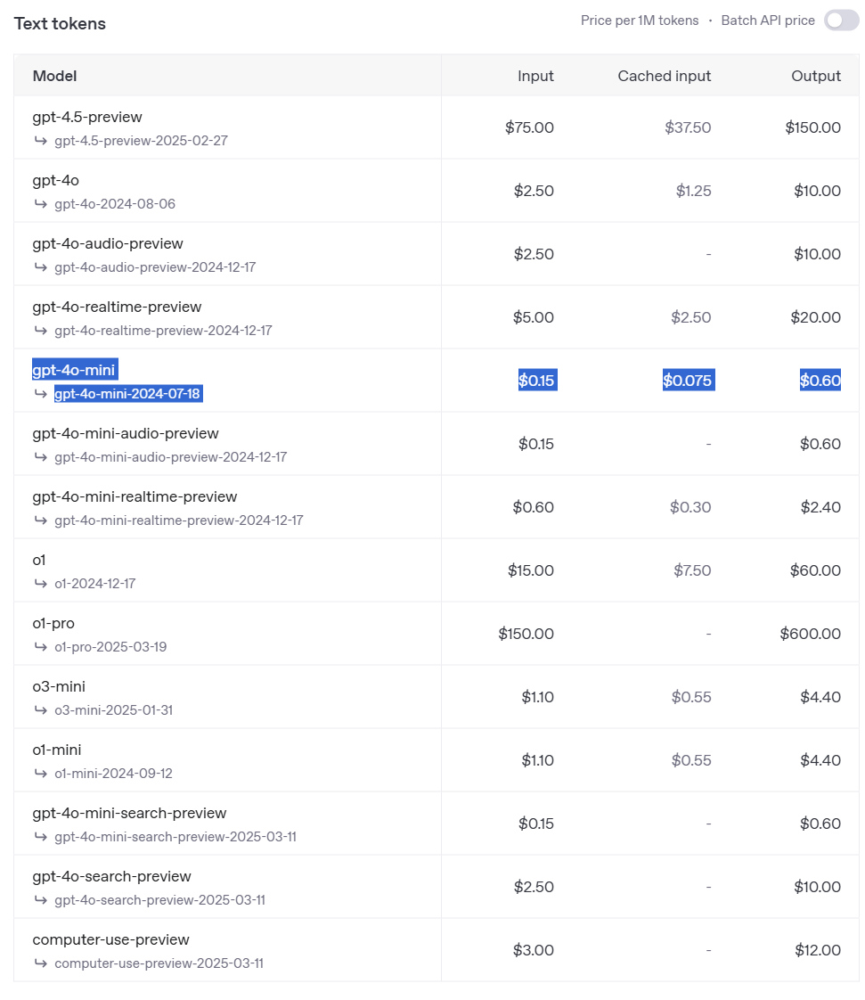

## Anthropic Claude

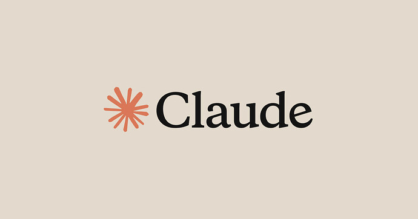

### [Pricing | Claude](https://claude.com/pricing)

Explore Claude pricing plans and API costs. Choose from Free, Pro, Max, Team, or Enterprise options to get started with Claude.

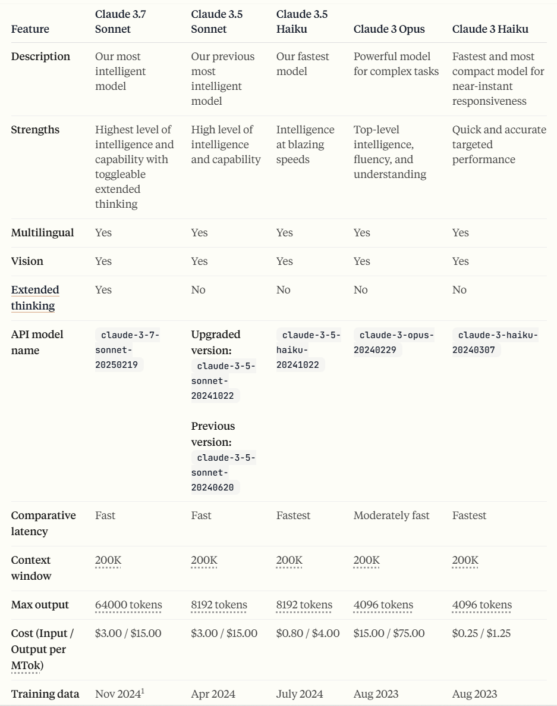

## Google Gemini

[https://ai.google.dev/gemini-api/docs/pricing?hl=zh-cn](https://ai.google.dev/gemini-api/docs/pricing?hl=zh-cn)

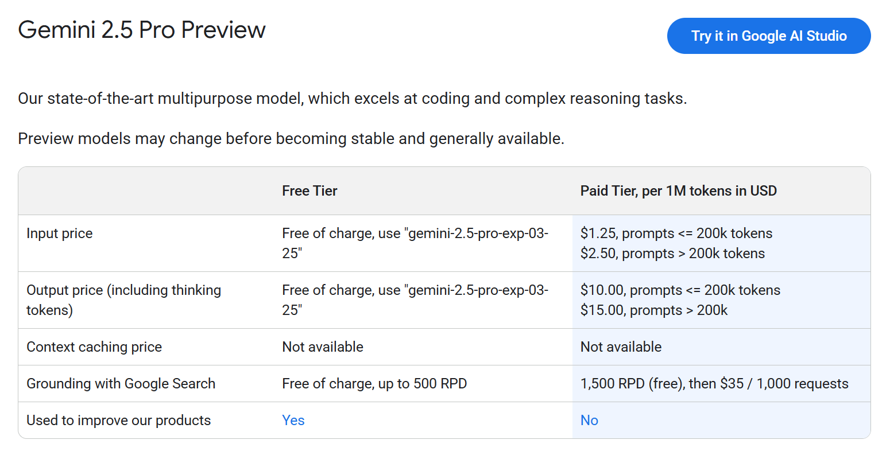

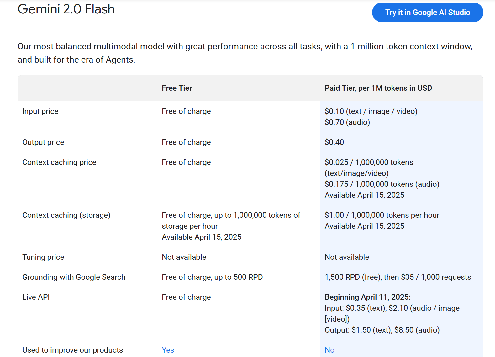

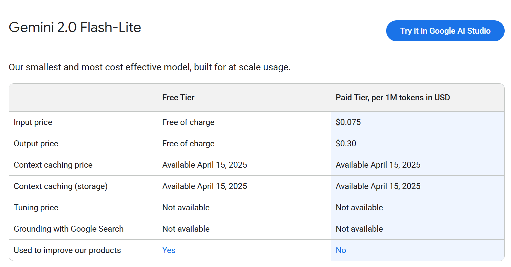

## XAI Grok

[https://console.x.ai/team/default/models](https://console.x.ai/team/default/models)

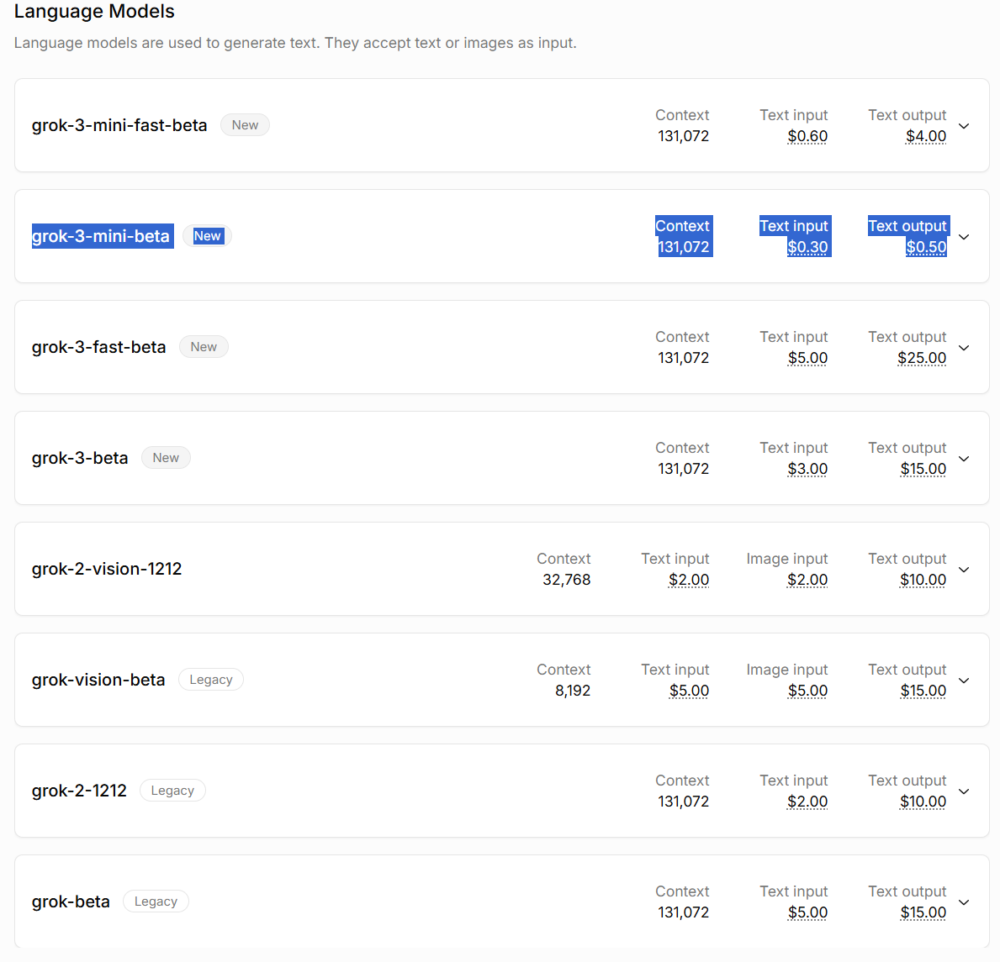

## DeepSeek

[https://api-docs.deepseek.com/zh-cn/quick_start/pricing](https://api-docs.deepseek.com/zh-cn/quick_start/pricing)

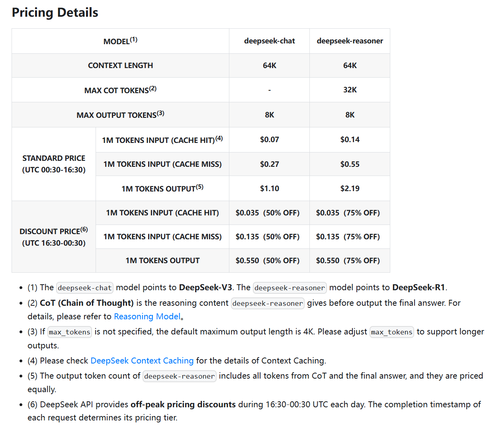

## 智谱

[https://open.bigmodel.cn/pricing](https://open.bigmodel.cn/pricing)

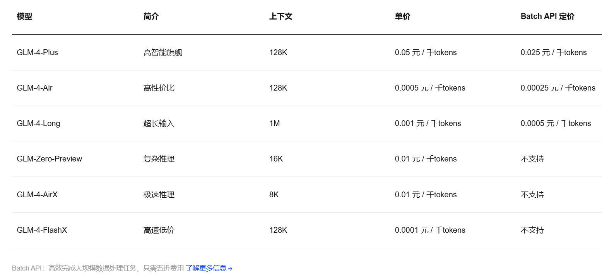

## Azure OpenAI

[https://azure.microsoft.com/en-us/pricing/details/cognitive-services/openai-service/](https://azure.microsoft.com/en-us/pricing/details/cognitive-services/openai-service/)

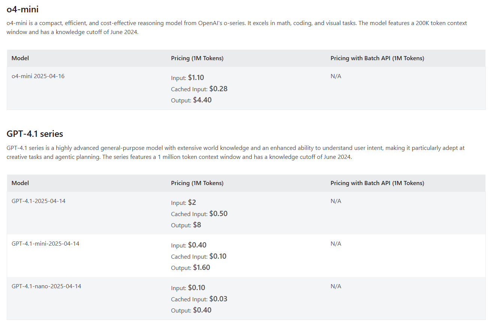

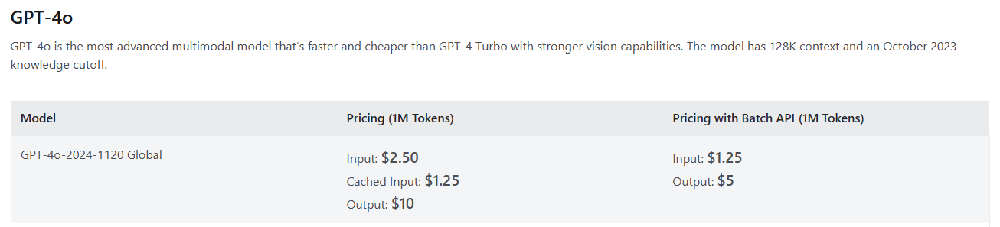

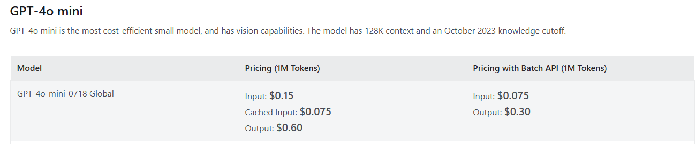

## Azure DeepSeek

[https://techcommunity.microsoft.com/blog/machinelearningblog/announcing-deepseek-v3-on-azure-ai-foundry-and-github/4390438](https://techcommunity.microsoft.com/blog/machinelearningblog/announcing-deepseek-v3-on-azure-ai-foundry-and-github/4390438)

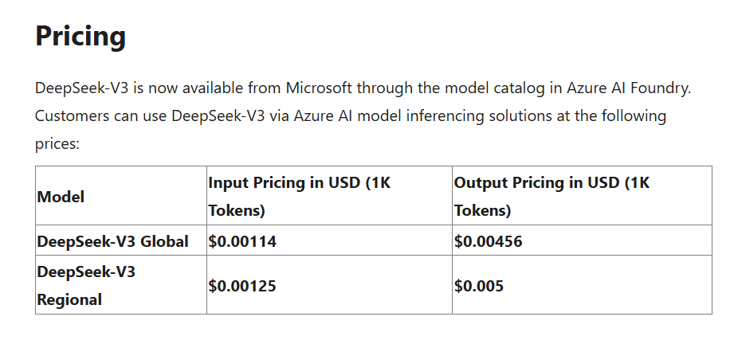

## Azure Grok

[https://devblogs.microsoft.com/foundry/announcing-grok-3-and-grok-3-mini-on-azure-ai-foundry/](https://devblogs.microsoft.com/foundry/announcing-grok-3-and-grok-3-mini-on-azure-ai-foundry/)

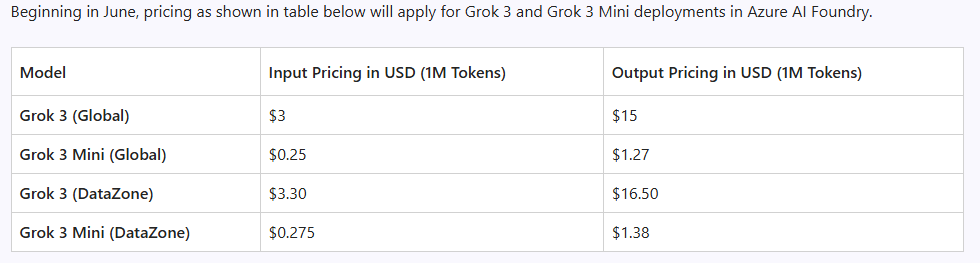

---

*来源: https://linux.do/t/topic/558799.json*

