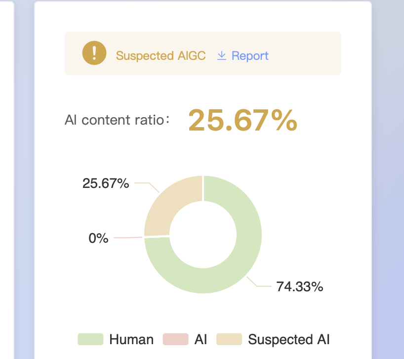
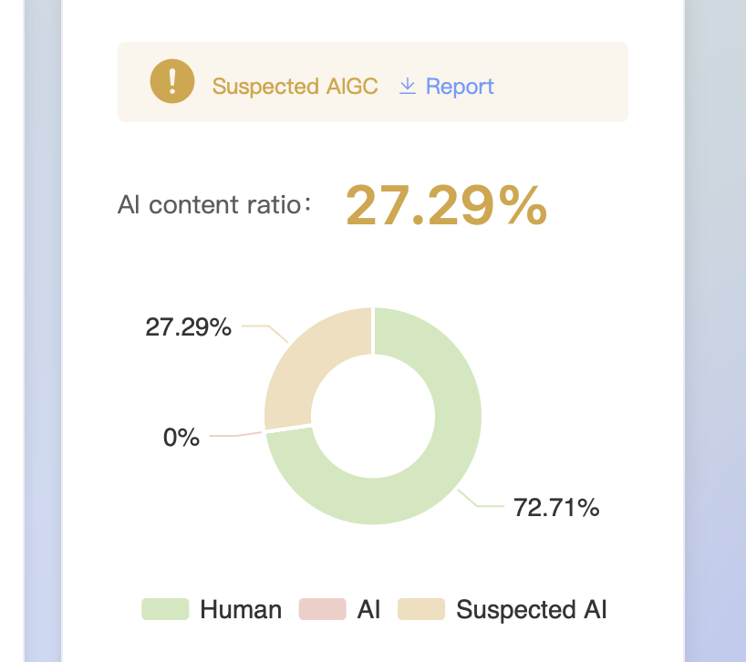
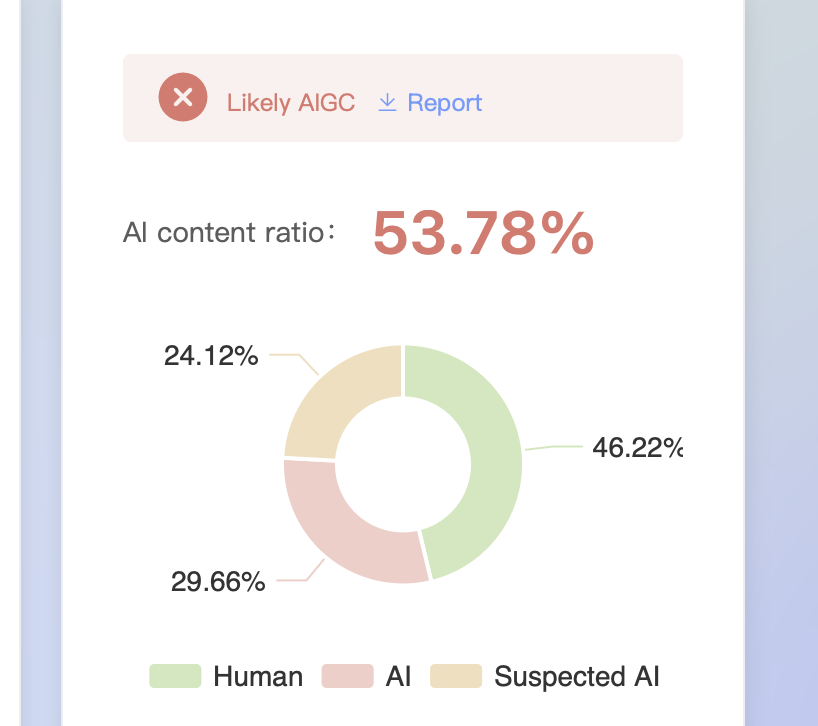
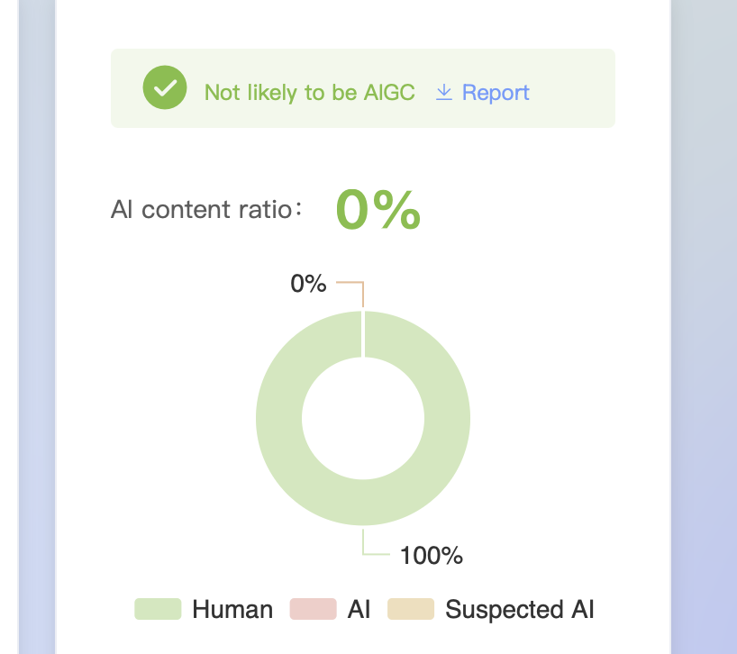
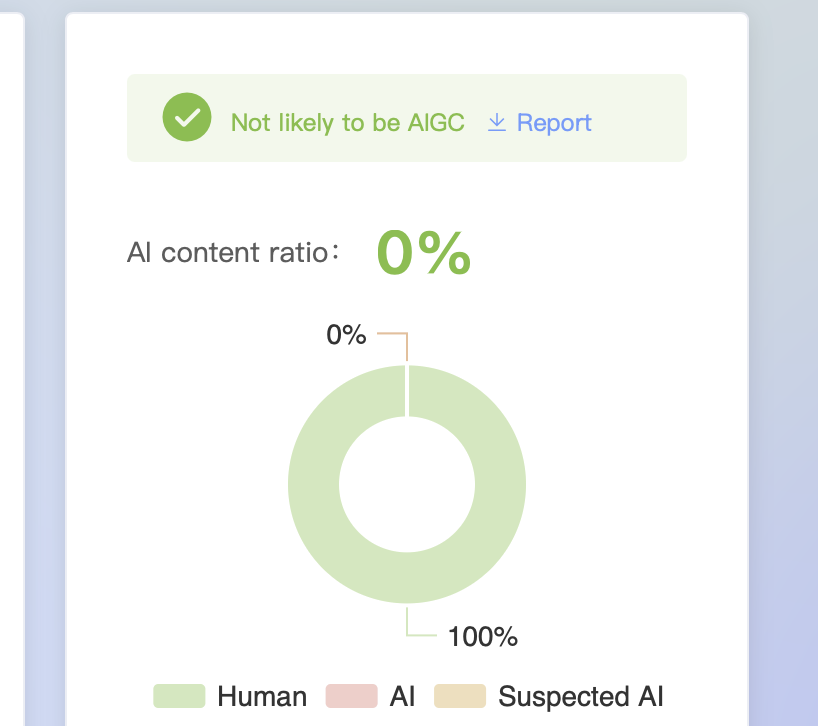
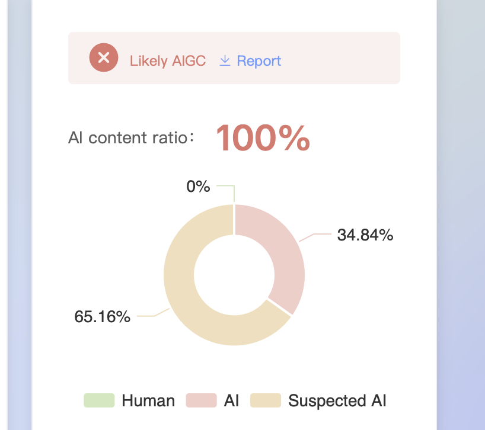
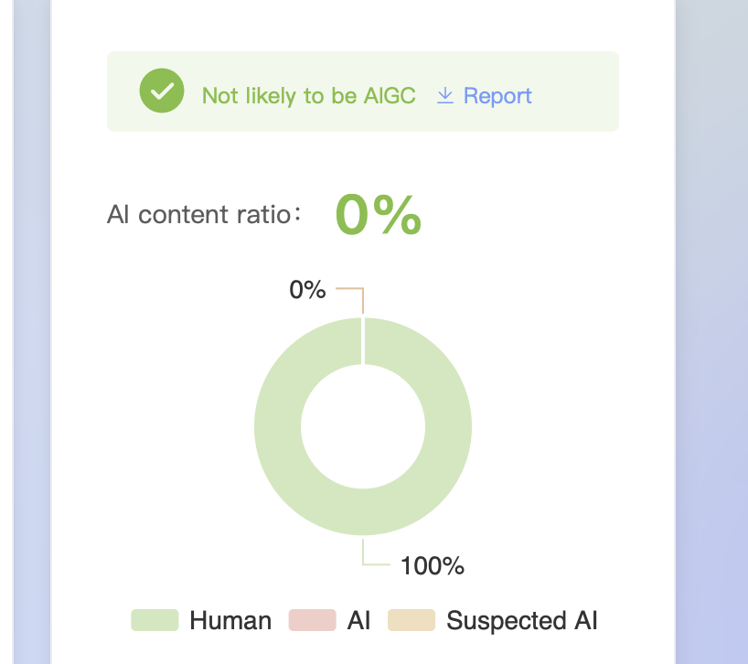
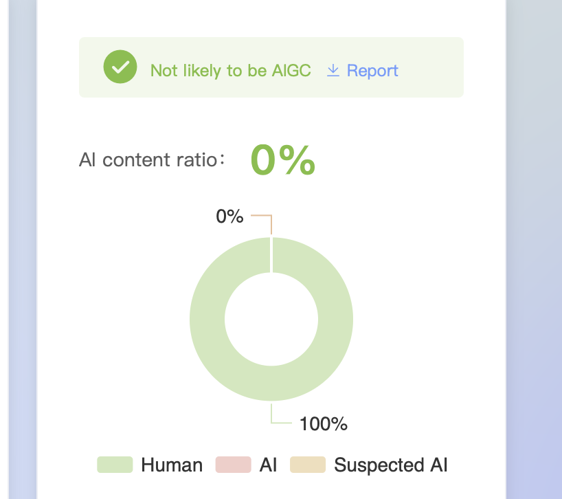

---

id: 592745

title: "怒评AIGC检测"

created_at: 2025-04-24T12:15:22.698Z

username: earmer

display_username: "Earmer Carey"

---

# 怒评AIGC检测

以上是我手写的两篇长文章的电子版的AI检测结果。

---

以上是让AI模仿文章风格和内容的AI检测结果。

---

以上是有给定的样本材料，让AI模仿风格进行全新创作的结果。

---

有意思的是——

---

---

## 假如，我是说假如……

假如我的写作风格就是和ChatGPT、Gemini、LLaMa、Mistral的风格相似呢？毕竟，毕竟，他们的很大一部分微调数据也要追溯到「上古」时期的阿三数据工人手动输入的。

我问你，我问你，什么是对一个辛辛苦苦的创作者造成的伤害最大的？

是自己的作品被人拿去训练AI吗？

是被「AI小鬼」拿着结果跳脸的吗？

是被人评论「不如AI」吗？

**不对，不对！**

是：腾讯控股有限公司，以及很多很多相似的公司。

它做了什么？好问题，我告诉你，最让一个创作者心寒的是——

完完全全的一笔一画的创作结果被一个**无法辩驳**的**官方公认**的**没有人性**的判断系统，

**判断为AI创作。**

并且，它还将我看到的「一眼AI」的内容判定为人类写作。

带来什么后果？

论坛上已经有佬友说过了，自己写的论文被维普判定为AI写作，然后被迫掏钱付费「去AI」。

**何其荒谬和反智。**

这和当年天主教教会售卖赎罪券有什么区别？

---

## 不，还是有区别的……？

继续，我们看到了一幅怪象。一个网站，左侧写着「AI写论文」，中间写着「AI论文检测」，右侧写着「去AI痕迹」。这是什么？

是垄断和强奸。

何为垄断？垄断就是只有我说了算什么是「人类」，什么是「AI」。——你算老几，人类创作凭什么被你打上好坏之分？比R18G还暴力的内容都有人为其付费，你的检测就算数？

但它的屁话还真算数，算数还能收钱。

何为强奸？你把论文给他「去AI痕迹」，是在干嘛？还不是在用AI写作！你想想它的原理就知道了：检测模型标准，那么我只需要建立一套体系，这个标点改一改，那个用词改一改，只要过了检测就行。

——然后你会发现，你重新发明了GAN——对抗式生成。

好嘛，你本来可能就是一个AI洁癖的人，见不得任何AI地东西污染你的文章。现在可好，你是个良家妇女的时候，村里的长老说你卖淫，等你晚上去了他家的青楼营业了几天后，这个这长老又在全村人面前宣布你是一个贞洁妇女了，要给你立牌坊，上书五个大字——

「无人工智能」

---

## AI，AI，何时成了低质量的代名词？

不是我说，咱们绝大多数人根本写不出AI那样的高质量有逻辑的话语。于是你看，那些所谓的「过AI检测Prompt」中或多或少都会有一条「假如逻辑瑕疵和略微跑题」的要求。

所以如果你要过AI检测，你就得把你的智商降低，抛开逻辑地写作。

这本质上是一种反智主义。

还有，凭什么定义AI是低质量？你的AI检测器也本来是一个AI模型，你凭什么认为一个AI能够有资格评判人类写作的高低？就像人工智能庭审员一样，这是同样的法律担忧。

一场不公正的庭审很破坏十年的法治结果，AIGC检测也如此，它否定了人类文本的多样性——一种严谨、客观、整洁的文本的存在的合法性。

但AIGC检测和AIGC庭审又有一点不同：

一个利益熏心的庭审员一次庭审只能实际影响一个人，但一个公开发布的、权威但不准确的AIGC检测能一本万利祸害千万人。

工业化的力量，小子。

---

*来源: https://linux.do/t/topic/592745.json*

